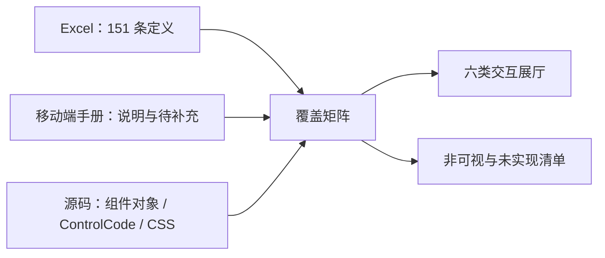

# 151 条定义不等于 151 个界面：`demo-app-ui` 移动端组件覆盖与交互方案

Type: Deep-Dive / Component Inventory
Scope: 对齐 `控件定义一览表.xlsx`、`配置中心移动端组件手册1.0.md` 与 `demo-app-ui` 当前源码；效果图使用静态夹具数据，不代表后端联调结果。
Prerequisite Knowledge: 配置中心的控件代码、容器引用关系、移动端页面模式
Reading Time: 20 min
Central Argument: Excel 中的 151 条定义只有在区分可视组件、配置节点、别名渲染器和组合字段后，才能得到可信的移动端覆盖率与演示范围。

## Writing Brief

- `ARGUMENT`：151 条定义不能直接等同于 151 个独立界面组件；覆盖结论必须由源表、手册和源码三方证据共同约束。
- `ANCHORS`：151 个唯一代码；138 个 `Uc*`；13 个非 `Uc*`；55 个内容控件；96 个非内容控件；源码存在配置代码与渲染器名称不一致的别名。
- `READER BELIEF`：读者可能认为源码文件名就是实现清单；本文通过 `ControlCode` 分支和别名映射修正这一判断。
- `BOUNDARY`：不验证后端接口、鉴权、移动端原生桥接和真实业务配置，不把静态重建图当作联调截图。
- `VOICE`：Mechanism Autopsy；以证据和渲染链路解释覆盖状态。

## Annotated Outline

- **结论与口径**：先说明为什么定义数量、源码文件数量和可演示数量不同。
- **覆盖结果**：给出可复核统计和证据状态分布。
- **分类交互方案**：将可见能力收敛为六类可操作样例。
- **全量矩阵**：逐条保留 151 条定义及其来源、映射和限制。
- **风险与边界**：说明静态重建无法证明的运行时行为。

## 结论与统计口径

把 151 条记录全部制作成界面会产生错误结果：动作、参数、引用和隐藏字段没有独立视觉；表单字段往往由统一渲染器分派；部分配置代码又使用不同的源码符号。正确做法是保留 151 条主矩阵，同时只对有视觉意义且有手册或源码依据的组件制作演示。

> 最容易忽略的是“组合渲染”：例如 `UcTextBox` 没有同名组件文件，但在 `EditComponent` 和 `UcDynamicComponent` 中存在明确的 `ControlCode` 分支，因此不能判为未实现。

| 指标         | 数量  | 验收结论         |
| ---------- | ---: | ------------ |
| Excel 主清单  | 151 | 与源表一致        |
| 唯一控件代码     | 151 | 无重复          |
| `Uc*` 定义   | 138 | 与计划基线一致      |
| 非 `Uc*` 定义 | 13  | 与计划基线一致      |
| 内容控件（`-1`） | 55  | 与计划基线一致      |
| 非内容控件（`0`） | 96  | 与计划基线一致      |
| 源码附加组件     | 11  | 单列附录，不计入 151 |

### 源码覆盖分布

| 覆盖方式  | 数量  | 判断依据                        |
| ----- | ---: | --------------------------- |
| 直接实现  | 32  | 存在同名组件对象文件                  |
| 别名渲染  | 26  | 配置代码映射到不同名的实际渲染器            |
| 组合渲染  | 27  | 统一渲染器中存在明确 `ControlCode` 分支 |
| 未发现实现 | 46  | 组件源码范围内未找到可验证证据             |
| 非可视定义 | 20  | 动作、参数、引用、数据或隐藏节点            |

### 手册引用与加载清单审计

- 手册中识别出 36 个控件/引用代码；35 个与 Excel 精确一致，1 个为大小写差异或明确差异项。
- 两份 `install.js` 去除 mixins 并合并重复项后包含 58 个可视加载项；1 个加载项缺少期望文件。

| 审计对象               | 映射/期望文件                                                                         | 状态    |
| ------------------ | ------------------------------------------------------------------------------- | ----- |
| 手册 `UcWorkFlow`    | `UcWorkflow`                                                                    | 大小写差异 |
| 加载项 `UcKindEditor` | `demo-app-ui/APP/components/common/baseComponents/UcKindEditor/UcKindEditor.js` | 缺少文件  |

## 分类交互方案与效果图

[打开独立交互展厅](component-showcase/index.html)；展厅默认使用 390px 设备框，并提供蓝色/绿色主题、分类切换和组件目录过滤。

### 展厅总览

### 页面骨架与导航

### 数据展示与列表

### 表单与字段编辑

### 操作、权限与反馈

### 工作流、文件与媒体

### 图表、轮播与地图

## 分类决策表

| 分类        | 重点能力         | 实施方案                  | 判定               |
| --------- | ------------ | --------------------- | ---------------- |
| 页面骨架与导航   | 标题、页签、菜单、底栏  | 复用源码主题变量和布局关系，静态夹具驱动  | **源码复原优先**       |
| 数据展示与列表   | 卡片、筛选、详情、树   | 复原卡片流和状态标签，补足空/加载状态   | **源码复原 + 状态建议**  |
| 表单与字段编辑   | 查看/编辑、多行、选择器 | 按统一字段渲染器呈现，不伪造独立组件文件  | **组合渲染复原**       |
| 操作、权限与反馈  | 按钮权限、确认、反馈   | 用页面模式和权限夹具演示显隐、禁用与加载  | **交互建议需业务校验**    |
| 工作流、文件与媒体 | 流程、上传、预览     | 复原前端状态；原生桥接和服务端上传只做说明 | **界面可信，链路未联调**   |
| 图表、轮播与地图  | 图形、钻取、定位     | 使用静态数据复原外观和点击状态       | **效果示意，不代表真实数据** |

## 151 条组件覆盖矩阵

内容控件标记沿用源表：`-1` 表示内容/容器类，`0` 表示非内容/叶子类。源码证据链接精确到首次用于判定的行。

| 组件分类       | Excel 定义                                                 | 内容控件标记 | 内部控件              | 手册覆盖 | 源码覆盖方式 | 实现文件与行号                                                                                                                                                                                                                                                                                                                                                           | 展示等级   | 预期样式                          | 建议交互                      | 限制说明                     |
| ---------- | -------------------------------------------------------- | ------: | ----------------- | ---- | ------ | ----------------------------------------------------------------------------------------------------------------------------------------------------------------------------------------------------------------------------------------------------------------------------------------------------------------------------------------------------------------- | ------ | ----------------------------- | ------------------------- | ------------------------ |
| 数据、动作与内部定义 | `ApiAction` Api接口容器                                      | -1     | —                 | 未提及  | 非可视定义  | —                                                                                                                                                                                                                                                                                                                                                                 | 不生成效果图 | 配置或数据链路定义，没有独立可见界面。           | 作为数据源、参数、引用或校验节点参与组合。     | 非独立可视组件                  |
| 数据、动作与内部定义 | `ApiInParameter` ApiInParameter                          | 0      | —                 | 未提及  | 非可视定义  | —                                                                                                                                                                                                                                                                                                                                                                 | 不生成效果图 | 配置或数据链路定义，没有独立可见界面。           | 作为数据源、参数、引用或校验节点参与组合。     | 非独立可视组件                  |
| 数据、动作与内部定义 | `ApiOutParameter` ApiOutParameter                        | 0      | —                 | 未提及  | 非可视定义  | —                                                                                                                                                                                                                                                                                                                                                                 | 不生成效果图 | 配置或数据链路定义，没有独立可见界面。           | 作为数据源、参数、引用或校验节点参与组合。     | 非独立可视组件                  |
| 数据、动作与内部定义 | `ClientSideParameter` ClientSideParameter                | 0      | —                 | 未提及  | 非可视定义  | —                                                                                                                                                                                                                                                                                                                                                                 | 不生成效果图 | 配置或数据链路定义，没有独立可见界面。           | 作为数据源、参数、引用或校验节点参与组合。     | 非独立可视组件                  |
| 数据、动作与内部定义 | `CommentAction` CommentAction                            | 0      | —                 | 未提及  | 非可视定义  | —                                                                                                                                                                                                                                                                                                                                                                 | 不生成效果图 | 配置或数据链路定义，没有独立可见界面。           | 作为数据源、参数、引用或校验节点参与组合。     | 非独立可视组件                  |
| 数据、动作与内部定义 | `InParameter` InParameter                                | 0      | —                 | 未提及  | 非可视定义  | —                                                                                                                                                                                                                                                                                                                                                                 | 不生成效果图 | 配置或数据链路定义，没有独立可见界面。           | 作为数据源、参数、引用或校验节点参与组合。     | 非独立可视组件                  |
| 数据、动作与内部定义 | `OutParameter` OutParameter                              | 0      | —                 | 正文提及 | 非可视定义  | —                                                                                                                                                                                                                                                                                                                                                                 | 不生成效果图 | 配置或数据链路定义，没有独立可见界面。           | 作为数据源、参数、引用或校验节点参与组合。     | 非独立可视组件                  |
| 数据、动作与内部定义 | `RedisAction` 执行redis                                    | -1     | —                 | 未提及  | 非可视定义  | —                                                                                                                                                                                                                                                                                                                                                                 | 不生成效果图 | 配置或数据链路定义，没有独立可见界面。           | 作为数据源、参数、引用或校验节点参与组合。     | 非独立可视组件                  |
| 数据、动作与内部定义 | `RefContainer` 引用容器                                      | 0      | —                 | 正文提及 | 非可视定义  | [demo-app-ui/APP/components/common/container/TabGroupContainer/TabGroupContainer.js:88](demo-app-ui/APP/components/common/container/TabGroupContainer/TabGroupContainer.js#L88)                                                                                                                                                                                   | 不生成效果图 | 配置或数据链路定义，没有独立可见界面。           | 作为数据源、参数、引用或校验节点参与组合。     | 非独立可视组件                  |
| 数据、动作与内部定义 | `RefJs` 引用JS                                             | 0      | —                 | 未提及  | 非可视定义  | —                                                                                                                                                                                                                                                                                                                                                                 | 不生成效果图 | 配置或数据链路定义，没有独立可见界面。           | 作为数据源、参数、引用或校验节点参与组合。     | 非独立可视组件                  |
| 页面骨架与导航    | `SideMenuContainer` 平板侧边栏控件                              | 0      | —                 | 未提及  | 直接实现   | [demo-app-ui/APP/components/common/container/SideMenuContainer/SideMenuContainer.js:1](demo-app-ui/APP/components/common/container/SideMenuContainer/SideMenuContainer.js#L1)                                                                                                                                                                                     | 分类示意   | 蓝/绿主题标题栏、页签、菜单与底部导航组成移动端页面骨架。 | 返回、搜索层、页签与角标切换、底部导航激活。    | 非独立可视组件；源码符号与配置代码不同      |
| 数据、动作与内部定义 | `SqlDBAction` 执行Sql                                      | -1     | —                 | 未提及  | 非可视定义  | —                                                                                                                                                                                                                                                                                                                                                                 | 不生成效果图 | 配置或数据链路定义，没有独立可见界面。           | 作为数据源、参数、引用或校验节点参与组合。     | 非独立可视组件                  |
| 数据、动作与内部定义 | `StoredProcDBAction` 执行存储过程                              | -1     | —                 | 正文提及 | 非可视定义  | —                                                                                                                                                                                                                                                                                                                                                                 | 不生成效果图 | 配置或数据链路定义，没有独立可见界面。           | 作为数据源、参数、引用或校验节点参与组合。     | 非独立可视组件                  |
| 表单与字段编辑    | `UcAmount` 金额控件                                          | 0      | —                 | 未提及  | 组合渲染   | [demo-app-ui/APP/components/common/baseComponents/EditComponent/EditComponent.js:516](demo-app-ui/APP/components/common/baseComponents/EditComponent/EditComponent.js#L516)                                                                                                                                                                                       | 分类示意   | Vant 风格字段、分隔线、选择弹层及多行编辑表格。    | 查看/编辑切换、校验、增删行、回填、显隐和评分。  | 需结合业务配置和接口数据验证           |
| 页面骨架与导航    | `UcAnchor` 锚点                                            | 0      | —                 | 未提及  | 未发现实现  | —                                                                                                                                                                                                                                                                                                                                                                 | 交互建议   | 蓝/绿主题标题栏、页签、菜单与底部导航组成移动端页面骨架。 | 返回、搜索层、页签与角标切换、底部导航激活。    | 当前源码未找到可验证渲染证据           |
| 页面骨架与导航    | `UcAnchorGroup` 锚点组                                      | -1     | —                 | 未提及  | 未发现实现  | —                                                                                                                                                                                                                                                                                                                                                                 | 交互建议   | 蓝/绿主题标题栏、页签、菜单与底部导航组成移动端页面骨架。 | 返回、搜索层、页签与角标切换、底部导航激活。    | 当前源码未找到可验证渲染证据           |
| 操作、权限与反馈   | `UcAnswerField` 答案控件                                     | 0      | —                 | 未提及  | 直接实现   | [demo-app-ui/APP/components/common/baseComponents/UcAnswerField/UcAnswerField.js:1](demo-app-ui/APP/components/common/baseComponents/UcAnswerField/UcAnswerField.js#L1)                                                                                                                                                                                           | 分类示意   | 主题色主按钮、白底描边次按钮、进度与反馈状态。       | 权限控制、禁用/加载、二次确认、提示和点赞。    | 需结合业务配置和接口数据验证           |
| 图表、轮播与地图   | `UcASCX` 自定义组件                                           | -1     | —                 | 未提及  | 别名渲染   | [demo-app-ui/APP/components/common/container/UcAscx/UcAscx.js:2](demo-app-ui/APP/components/common/container/UcAscx/UcAscx.js#L2)                                                                                                                                                                                                                                 | 分类示意   | 轮播、ECharts 风格图形和地图标记以主题色统一视觉。 | 轮播切换、图例选择、图表钻取、定位与模板展开。   | 源码符号与配置代码不同              |
| 图表、轮播与地图   | `UcBannerContainer` 轮播图                                  | -1     | —                 | 详细说明 | 直接实现   | [demo-app-ui/APP/components/common/container/UcBannerContainer/UcBannerContainer.js:1](demo-app-ui/APP/components/common/container/UcBannerContainer/UcBannerContainer.js#L1)                                                                                                                                                                                     | 重点交互演示 | 轮播、ECharts 风格图形和地图标记以主题色统一视觉。 | 轮播切换、图例选择、图表钻取、定位与模板展开。   | 需结合业务配置和接口数据验证           |
| 页面骨架与导航    | `UcBottomBar` 底部导航栏                                      | -1     | —                 | 未提及  | 直接实现   | [demo-app-ui/APP/components/common/container/UcBottomBar/UcBottomBar.js:1](demo-app-ui/APP/components/common/container/UcBottomBar/UcBottomBar.js#L1)                                                                                                                                                                                                             | 重点交互演示 | 蓝/绿主题标题栏、页签、菜单与底部导航组成移动端页面骨架。 | 返回、搜索层、页签与角标切换、底部导航激活。    | 需结合业务配置和接口数据验证           |
| 数据展示与列表    | `UcBoundField` 数据绑定显示                                    | 0      | —                 | 正文提及 | 组合渲染   | [demo-app-ui/APP/components/common/baseComponents/EditComponent/EditComponent.js:56](demo-app-ui/APP/components/common/baseComponents/EditComponent/EditComponent.js#L56)                                                                                                                                                                                         | 重点交互演示 | 卡片、状态标签、列表和树形区域按移动端纵向信息流排列。   | 搜索、筛选、卡片详情、列表/树切换以及空数据状态。 | 需结合业务配置和接口数据验证           |
| 操作、权限与反馈   | `UcButton` 按钮                                            | 0      | —                 | 详细说明 | 组合渲染   | [demo-app-ui/APP/components/common/baseComponents/EditComponent/EditComponent.js:349](demo-app-ui/APP/components/common/baseComponents/EditComponent/EditComponent.js#L349)                                                                                                                                                                                       | 重点交互演示 | 主题色主按钮、白底描边次按钮、进度与反馈状态。       | 权限控制、禁用/加载、二次确认、提示和点赞。    | 需结合业务配置和接口数据验证           |
| 操作、权限与反馈   | `UcButtonContainer` 按钮组                                  | -1     | —                 | 详细说明 | 直接实现   | [demo-app-ui/APP/components/common/container/UcButtonContainer/UcButtonContainer.js:1](demo-app-ui/APP/components/common/container/UcButtonContainer/UcButtonContainer.js#L1)                                                                                                                                                                                     | 重点交互演示 | 主题色主按钮、白底描边次按钮、进度与反馈状态。       | 权限控制、禁用/加载、二次确认、提示和点赞。    | 需结合业务配置和接口数据验证           |
| 表单与字段编辑    | `UcCalenderContainer` 日历容器                               | -1     | —                 | 未提及  | 未发现实现  | —                                                                                                                                                                                                                                                                                                                                                                 | 交互建议   | Vant 风格字段、分隔线、选择弹层及多行编辑表格。    | 查看/编辑切换、校验、增删行、回填、显隐和评分。  | 当前源码未找到可验证渲染证据           |
| 工作流、文件与媒体  | `UcCameraOperate` 相机操作器                                  | 0      | —                 | 未提及  | 别名渲染   | [demo-app-ui/APP/components/common/baseComponents/CameraOperate/CameraOperate.js:1](demo-app-ui/APP/components/common/baseComponents/CameraOperate/CameraOperate.js#L1)                                                                                                                                                                                           | 分类示意   | 步骤流、文件卡片、缩略图和媒体入口组成业务详情区。     | 提交/撤回、来源选择、预览、列表/缩略图切换。   | 源码符号与配置代码不同              |
| 工作流、文件与媒体  | `UcCameraOperater` 相机操作器                                 | 0      | —                 | 未提及  | 别名渲染   | [demo-app-ui/APP/components/common/baseComponents/CameraOperate/CameraOperate.js:1](demo-app-ui/APP/components/common/baseComponents/CameraOperate/CameraOperate.js#L1)                                                                                                                                                                                           | 分类示意   | 步骤流、文件卡片、缩略图和媒体入口组成业务详情区。     | 提交/撤回、来源选择、预览、列表/缩略图切换。   | 源码符号与配置代码不同              |
| 数据展示与列表    | `UcCardContainer` 卡片容器                                   | -1     | —                 | 详细说明 | 直接实现   | [demo-app-ui/APP/components/common/container/UcCardContainer/UcCardContainer.js:2](demo-app-ui/APP/components/common/container/UcCardContainer/UcCardContainer.js#L2)                                                                                                                                                                                             | 重点交互演示 | 卡片、状态标签、列表和树形区域按移动端纵向信息流排列。   | 搜索、筛选、卡片详情、列表/树切换以及空数据状态。 | 需结合业务配置和接口数据验证           |
| 工作流、文件与媒体  | `UcCardFileContainer` 卡片文件容器                             | -1     | —                 | 未提及  | 直接实现   | [demo-app-ui/APP/components/common/container/UcCardFileContainer/UcCardFileContainer.js:2](demo-app-ui/APP/components/common/container/UcCardFileContainer/UcCardFileContainer.js#L2)                                                                                                                                                                             | 分类示意   | 步骤流、文件卡片、缩略图和媒体入口组成业务详情区。     | 提交/撤回、来源选择、预览、列表/缩略图切换。   | 需结合业务配置和接口数据验证           |
| 图表、轮播与地图   | `UcChartContainer` 图表                                    | -1     | —                 | 详细说明 | 直接实现   | [demo-app-ui/APP/components/common/container/UcChartContainer/UcChartContainer.js:1121](demo-app-ui/APP/components/common/container/UcChartContainer/UcChartContainer.js#L1121)                                                                                                                                                                                   | 重点交互演示 | 轮播、ECharts 风格图形和地图标记以主题色统一视觉。 | 轮播切换、图例选择、图表钻取、定位与模板展开。   | 需结合业务配置和接口数据验证           |
| 表单与字段编辑    | `UcCheckBox` 复选框（UcCheckBox)                             | 0      | —                 | 未提及  | 组合渲染   | [demo-app-ui/APP/components/common/baseComponents/EditComponent/EditComponent.js:307](demo-app-ui/APP/components/common/baseComponents/EditComponent/EditComponent.js#L307)                                                                                                                                                                                       | 分类示意   | Vant 风格字段、分隔线、选择弹层及多行编辑表格。    | 查看/编辑切换、校验、增删行、回填、显隐和评分。  | 需结合业务配置和接口数据验证           |
| 表单与字段编辑    | `UcCheckBoxField` 选择框(UcCheckBoxField)                   | 0      | `UcCheckBox`      | 未提及  | 组合渲染   | [demo-app-ui/APP/components/common/container/UcGridContainer/UcGridContainer.js:222](demo-app-ui/APP/components/common/container/UcGridContainer/UcGridContainer.js#L222)                                                                                                                                                                                         | 分类示意   | Vant 风格字段、分隔线、选择弹层及多行编辑表格。    | 查看/编辑切换、校验、增删行、回填、显隐和评分。  | 需结合业务配置和接口数据验证           |
| 表单与字段编辑    | `UcCheckBoxList` 复选框列表                                   | 0      | —                 | 未提及  | 别名渲染   | [demo-app-ui/APP/components/common/baseComponents/CheckboxList/CheckboxList.js:1](demo-app-ui/APP/components/common/baseComponents/CheckboxList/CheckboxList.js#L1)                                                                                                                                                                                               | 分类示意   | Vant 风格字段、分隔线、选择弹层及多行编辑表格。    | 查看/编辑切换、校验、增删行、回填、显隐和评分。  | 源码符号与配置代码不同              |
| 表单与字段编辑    | `UcCheckBoxListField` 复选框列表                              | 0      | `UcCheckBoxList`  | 正文提及 | 别名渲染   | [demo-app-ui/APP/components/common/baseComponents/CheckboxList/CheckboxList.js:1](demo-app-ui/APP/components/common/baseComponents/CheckboxList/CheckboxList.js#L1)                                                                                                                                                                                               | 重点交互演示 | Vant 风格字段、分隔线、选择弹层及多行编辑表格。    | 查看/编辑切换、校验、增删行、回填、显隐和评分。  | 源码符号与配置代码不同              |
| 页面骨架与导航    | `UcCol` 列组件                                              | -1     | —                 | 未提及  | 未发现实现  | —                                                                                                                                                                                                                                                                                                                                                                 | 交互建议   | 蓝/绿主题标题栏、页签、菜单与底部导航组成移动端页面骨架。 | 返回、搜索层、页签与角标切换、底部导航激活。    | 当前源码未找到可验证渲染证据           |
| 表单与字段编辑    | `UcColorPick` 颜色选择器                                      | 0      | —                 | 未提及  | 未发现实现  | —                                                                                                                                                                                                                                                                                                                                                                 | 交互建议   | Vant 风格字段、分隔线、选择弹层及多行编辑表格。    | 查看/编辑切换、校验、增删行、回填、显隐和评分。  | 当前源码未找到可验证渲染证据           |
| 表单与字段编辑    | `UcComboTree` 级联选择器                                      | 0      | —                 | 正文提及 | 别名渲染   | [demo-app-ui/APP/components/common/baseComponents/FormCasCader/FormCasCader.js:1](demo-app-ui/APP/components/common/baseComponents/FormCasCader/FormCasCader.js#L1) [demo-app-ui/APP/components/common/baseComponents/SelectCascader/SelectCascader.js:1](demo-app-ui/APP/components/common/baseComponents/SelectCascader/SelectCascader.js#L1)                   | 重点交互演示 | Vant 风格字段、分隔线、选择弹层及多行编辑表格。    | 查看/编辑切换、校验、增删行、回填、显隐和评分。  | 源码符号与配置代码不同              |
| 表单与字段编辑    | `UcComboTreeField` UcComboTreeField                      | 0      | `UcComboTree`     | 未提及  | 别名渲染   | [demo-app-ui/APP/components/common/baseComponents/FormCasCader/FormCasCader.js:1](demo-app-ui/APP/components/common/baseComponents/FormCasCader/FormCasCader.js#L1) [demo-app-ui/APP/components/common/baseComponents/SelectCascader/SelectCascader.js:1](demo-app-ui/APP/components/common/baseComponents/SelectCascader/SelectCascader.js#L1)                   | 分类示意   | Vant 风格字段、分隔线、选择弹层及多行编辑表格。    | 查看/编辑切换、校验、增删行、回填、显隐和评分。  | 源码符号与配置代码不同              |
| 页面骨架与导航    | `UcContainer` 主容器                                        | -1     | —                 | 详细说明 | 直接实现   | [demo-app-ui/APP/components/common/container/UcContainer/UcContainer.js:2](demo-app-ui/APP/components/common/container/UcContainer/UcContainer.js#L2)                                                                                                                                                                                                             | 重点交互演示 | 蓝/绿主题标题栏、页签、菜单与底部导航组成移动端页面骨架。 | 返回、搜索层、页签与角标切换、底部导航激活。    | 需结合业务配置和接口数据验证           |
| 数据、动作与内部定义 | `UcData` UcData                                          | 0      | —                 | 未提及  | 非可视定义  | [demo-app-ui/APP/components/common/container/PageListContentContainer/PageListContentContainer.js:395](demo-app-ui/APP/components/common/container/PageListContentContainer/PageListContentContainer.js#L395)                                                                                                                                                     | 不生成效果图 | 配置或数据链路定义，没有独立可见界面。           | 作为数据源、参数、引用或校验节点参与组合。     | 非独立可视组件                  |
| 数据展示与列表    | `UcDataChangeContainer` 信息变更记录                           | -1     | —                 | 未提及  | 未发现实现  | —                                                                                                                                                                                                                                                                                                                                                                 | 交互建议   | 卡片、状态标签、列表和树形区域按移动端纵向信息流排列。   | 搜索、筛选、卡片详情、列表/树切换以及空数据状态。 | 当前源码未找到可验证渲染证据           |
| 数据展示与列表    | `UcDataListContainer` 翻页容器                               | -1     | —                 | 未提及  | 直接实现   | [demo-app-ui/APP/components/common/container/UcDataListContainer/UcDataListContainer.js:1](demo-app-ui/APP/components/common/container/UcDataListContainer/UcDataListContainer.js#L1)                                                                                                                                                                             | 重点交互演示 | 卡片、状态标签、列表和树形区域按移动端纵向信息流排列。   | 搜索、筛选、卡片详情、列表/树切换以及空数据状态。 | 需结合业务配置和接口数据验证           |
| 数据、动作与内部定义 | `UcDataStorage` UcDataStorage                            | -1     | —                 | 未提及  | 非可视定义  | —                                                                                                                                                                                                                                                                                                                                                                 | 不生成效果图 | 配置或数据链路定义，没有独立可见界面。           | 作为数据源、参数、引用或校验节点参与组合。     | 非独立可视组件                  |
| 表单与字段编辑    | `UcDatePicker` 日期选择器（UcDatePicker）                       | 0      | —                 | 正文提及 | 别名渲染   | [demo-app-ui/APP/components/common/baseComponents/FormDate/FormDate.js:1](demo-app-ui/APP/components/common/baseComponents/FormDate/FormDate.js#L1)                                                                                                                                                                                                               | 重点交互演示 | Vant 风格字段、分隔线、选择弹层及多行编辑表格。    | 查看/编辑切换、校验、增删行、回填、显隐和评分。  | 源码符号与配置代码不同              |
| 表单与字段编辑    | `UcDatePickerField` 日期选择器（UcDatePickerField）             | 0      | `UcDatePicker`    | 未提及  | 别名渲染   | [demo-app-ui/APP/components/common/baseComponents/FormDate/FormDate.js:1](demo-app-ui/APP/components/common/baseComponents/FormDate/FormDate.js#L1)                                                                                                                                                                                                               | 分类示意   | Vant 风格字段、分隔线、选择弹层及多行编辑表格。    | 查看/编辑切换、校验、增删行、回填、显隐和评分。  | 源码符号与配置代码不同              |
| 表单与字段编辑    | `UcDateTimePicker` 日期时间选择器（UcDateTimePicker）             | 0      | —                 | 未提及  | 未发现实现  | —                                                                                                                                                                                                                                                                                                                                                                 | 交互建议   | Vant 风格字段、分隔线、选择弹层及多行编辑表格。    | 查看/编辑切换、校验、增删行、回填、显隐和评分。  | 当前源码未找到可验证渲染证据           |
| 表单与字段编辑    | `UcDdlWFStepList` UcDdlWFStepList                        | 0      | —                 | 未提及  | 组合渲染   | [demo-app-ui/APP/components/common/baseComponents/EditComponent/EditComponent.js:259](demo-app-ui/APP/components/common/baseComponents/EditComponent/EditComponent.js#L259)                                                                                                                                                                                       | 分类示意   | Vant 风格字段、分隔线、选择弹层及多行编辑表格。    | 查看/编辑切换、校验、增删行、回填、显隐和评分。  | 需结合业务配置和接口数据验证           |
| 表单与字段编辑    | `UcDropDownList` 下拉列表                                    | 0      | —                 | 正文提及 | 别名渲染   | [demo-app-ui/APP/components/common/baseComponents/FormSelect/FormSelect.js:1](demo-app-ui/APP/components/common/baseComponents/FormSelect/FormSelect.js#L1) [demo-app-ui/APP/components/common/baseComponents/FormMultipleSelect/FormMultipleSelect.js:1](demo-app-ui/APP/components/common/baseComponents/FormMultipleSelect/FormMultipleSelect.js#L1)           | 重点交互演示 | Vant 风格字段、分隔线、选择弹层及多行编辑表格。    | 查看/编辑切换、校验、增删行、回填、显隐和评分。  | 源码符号与配置代码不同              |
| 表单与字段编辑    | `UcDropDownListField` 下拉列表                               | 0      | `UcDropDownList`  | 未提及  | 别名渲染   | [demo-app-ui/APP/components/common/baseComponents/FormSelect/FormSelect.js:1](demo-app-ui/APP/components/common/baseComponents/FormSelect/FormSelect.js#L1) [demo-app-ui/APP/components/common/baseComponents/FormMultipleSelect/FormMultipleSelect.js:1](demo-app-ui/APP/components/common/baseComponents/FormMultipleSelect/FormMultipleSelect.js#L1)           | 分类示意   | Vant 风格字段、分隔线、选择弹层及多行编辑表格。    | 查看/编辑切换、校验、增删行、回填、显隐和评分。  | 源码符号与配置代码不同              |
| 数据、动作与内部定义 | `UcDSContainer` 数据容器                                     | -1     | —                 | 未提及  | 非可视定义  | —                                                                                                                                                                                                                                                                                                                                                                 | 不生成效果图 | 配置或数据链路定义，没有独立可见界面。           | 作为数据源、参数、引用或校验节点参与组合。     | 非独立可视组件                  |
| 表单与字段编辑    | `UcDynamicComponent` 动态组件                                | -1     | —                 | 未提及  | 直接实现   | [demo-app-ui/APP/components/common/baseComponents/UcDynamicComponent/UcDynamicComponent.js:1](demo-app-ui/APP/components/common/baseComponents/UcDynamicComponent/UcDynamicComponent.js#L1)                                                                                                                                                                       | 分类示意   | Vant 风格字段、分隔线、选择弹层及多行编辑表格。    | 查看/编辑切换、校验、增删行、回填、显隐和评分。  | 需结合业务配置和接口数据验证           |
| 数据展示与列表    | `UcDynamicFieldGroup` 动态列表                               | -1     | —                 | 未提及  | 未发现实现  | —                                                                                                                                                                                                                                                                                                                                                                 | 交互建议   | 卡片、状态标签、列表和树形区域按移动端纵向信息流排列。   | 搜索、筛选、卡片详情、列表/树切换以及空数据状态。 | 当前源码未找到可验证渲染证据           |
| 表单与字段编辑    | `UcDynamicScopeContainer` 动态查找容器                         | -1     | —                 | 未提及  | 未发现实现  | —                                                                                                                                                                                                                                                                                                                                                                 | 交互建议   | Vant 风格字段、分隔线、选择弹层及多行编辑表格。    | 查看/编辑切换、校验、增删行、回填、显隐和评分。  | 当前源码未找到可验证渲染证据           |
| 表单与字段编辑    | `UcEditGrid` UcEditGrid                                  | 0      | —                 | 未提及  | 未发现实现  | —                                                                                                                                                                                                                                                                                                                                                                 | 交互建议   | Vant 风格字段、分隔线、选择弹层及多行编辑表格。    | 查看/编辑切换、校验、增删行、回填、显隐和评分。  | 当前源码未找到可验证渲染证据           |
| 操作、权限与反馈   | `UcEvaluation` 点赞组件                                      | -1     | —                 | 未提及  | 直接实现   | [demo-app-ui/APP/components/common/baseComponents/UcEvaluation/UcEvaluation.js:1](demo-app-ui/APP/components/common/baseComponents/UcEvaluation/UcEvaluation.js#L1)                                                                                                                                                                                               | 重点交互演示 | 主题色主按钮、白底描边次按钮、进度与反馈状态。       | 权限控制、禁用/加载、二次确认、提示和点赞。    | 需结合业务配置和接口数据验证           |
| 工作流、文件与媒体  | `UcFileContainer` 文件容器                                   | -1     | —                 | 详细说明 | 直接实现   | [demo-app-ui/APP/components/common/container/UcFileContainer/UcFileContainer.js:1](demo-app-ui/APP/components/common/container/UcFileContainer/UcFileContainer.js#L1)                                                                                                                                                                                             | 重点交互演示 | 步骤流、文件卡片、缩略图和媒体入口组成业务详情区。     | 提交/撤回、来源选择、预览、列表/缩略图切换。   | iOS 不显示手册所述上传按钮          |
| 工作流、文件与媒体  | `UcFileUpload` 文件上传控件                                    | 0      | —                 | 详细说明 | 别名渲染   | [demo-app-ui/APP/components/common/baseComponents/fileUpload/fileUpload.js:1](demo-app-ui/APP/components/common/baseComponents/fileUpload/fileUpload.js#L1)                                                                                                                                                                                                       | 重点交互演示 | 步骤流、文件卡片、缩略图和媒体入口组成业务详情区。     | 提交/撤回、来源选择、预览、列表/缩略图切换。   | 源码符号与配置代码不同              |
| 工作流、文件与媒体  | `UcFileViewContainer` 文件预览容器                             | -1     | —                 | 未提及  | 别名渲染   | [demo-app-ui/APP/components/common/container/FilePreviewContainer/FilePreviewContainer.js:1](demo-app-ui/APP/components/common/container/FilePreviewContainer/FilePreviewContainer.js#L1) [demo-app-ui/APP/components/common/container/UcViewContainer/UcViewContainer.js:11](demo-app-ui/APP/components/common/container/UcViewContainer/UcViewContainer.js#L11) | 分类示意   | 步骤流、文件卡片、缩略图和媒体入口组成业务详情区。     | 提交/撤回、来源选择、预览、列表/缩略图切换。   | 源码符号与配置代码不同              |
| 数据、动作与内部定义 | `UcFnRSValue` UcFnRSValue                                | 0      | —                 | 未提及  | 非可视定义  | —                                                                                                                                                                                                                                                                                                                                                                 | 不生成效果图 | 配置或数据链路定义，没有独立可见界面。           | 作为数据源、参数、引用或校验节点参与组合。     | 非独立可视组件                  |
| 表单与字段编辑    | `UcFormDetailView` 表单                                    | -1     | —                 | 详细说明 | 别名渲染   | [demo-app-ui/APP/components/common/container/UcFormContainer/UcFormContainer.js:2](demo-app-ui/APP/components/common/container/UcFormContainer/UcFormContainer.js#L2)                                                                                                                                                                                             | 重点交互演示 | Vant 风格字段、分隔线、选择弹层及多行编辑表格。    | 查看/编辑切换、校验、增删行、回填、显隐和评分。  | 源码符号与配置代码不同              |
| 表单与字段编辑    | `UcFormTree` form表单中的树                                   | 0      | —                 | 未提及  | 别名渲染   | [demo-app-ui/APP/components/common/baseComponents/FormTree/FormTree.js:1](demo-app-ui/APP/components/common/baseComponents/FormTree/FormTree.js#L1)                                                                                                                                                                                                               | 分类示意   | Vant 风格字段、分隔线、选择弹层及多行编辑表格。    | 查看/编辑切换、校验、增删行、回填、显隐和评分。  | 源码符号与配置代码不同              |
| 图表、轮播与地图   | `UcGpsRangeList` 坐标距离列表                                  | 0      | —                 | 未提及  | 直接实现   | [demo-app-ui/APP/components/common/baseComponents/UcGpsRangeList/UcGpsRangeList.js:1](demo-app-ui/APP/components/common/baseComponents/UcGpsRangeList/UcGpsRangeList.js#L1)                                                                                                                                                                                       | 分类示意   | 轮播、ECharts 风格图形和地图标记以主题色统一视觉。 | 轮播切换、图例选择、图表钻取、定位与模板展开。   | 需结合业务配置和接口数据验证           |
| 数据展示与列表    | `UcGridView` 数据绑定控件                                      | 0      | —                 | 未提及  | 未发现实现  | —                                                                                                                                                                                                                                                                                                                                                                 | 交互建议   | 卡片、状态标签、列表和树形区域按移动端纵向信息流排列。   | 搜索、筛选、卡片详情、列表/树切换以及空数据状态。 | 当前源码未找到可验证渲染证据           |
| 数据展示与列表    | `UcGridviewContainer` 单行编辑列表容器                           | -1     | —                 | 待补充  | 别名渲染   | [demo-app-ui/APP/components/common/container/UcGridContainer/UcGridContainer.js:1](demo-app-ui/APP/components/common/container/UcGridContainer/UcGridContainer.js#L1)                                                                                                                                                                                             | 重点交互演示 | 卡片、状态标签、列表和树形区域按移动端纵向信息流排列。   | 搜索、筛选、卡片详情、列表/树切换以及空数据状态。 | 手册未给出完整属性或行为；源码符号与配置代码不同 |
| 页面骨架与导航    | `UcGroup` 分组控件                                           | -1     | —                 | 未提及  | 未发现实现  | —                                                                                                                                                                                                                                                                                                                                                                 | 交互建议   | 蓝/绿主题标题栏、页签、菜单与底部导航组成移动端页面骨架。 | 返回、搜索层、页签与角标切换、底部导航激活。    | 当前源码未找到可验证渲染证据           |
| 数据展示与列表    | `UcHeadParentControl` 父表头(UcHeadParentControl)           | 0      | —                 | 未提及  | 未发现实现  | —                                                                                                                                                                                                                                                                                                                                                                 | 交互建议   | 卡片、状态标签、列表和树形区域按移动端纵向信息流排列。   | 搜索、筛选、卡片详情、列表/树切换以及空数据状态。 | 当前源码未找到可验证渲染证据           |
| 数据展示与列表    | `UcHeadRadioList` UcHeadRadioList                        | 0      | `UcHeadRadioList` | 未提及  | 组合渲染   | [demo-app-ui/APP/components/common/container/PageListContentContainer/PageListContentContainer.js:34](demo-app-ui/APP/components/common/container/PageListContentContainer/PageListContentContainer.js#L34)                                                                                                                                                       | 分类示意   | 卡片、状态标签、列表和树形区域按移动端纵向信息流排列。   | 搜索、筛选、卡片详情、列表/树切换以及空数据状态。 | 需结合业务配置和接口数据验证           |
| 数据展示与列表    | `UcHeadSearch` UcHeadSearch                              | 0      | —                 | 未提及  | 未发现实现  | —                                                                                                                                                                                                                                                                                                                                                                 | 交互建议   | 卡片、状态标签、列表和树形区域按移动端纵向信息流排列。   | 搜索、筛选、卡片详情、列表/树切换以及空数据状态。 | 当前源码未找到可验证渲染证据           |
| 数据展示与列表    | `UcHeadSelect` UcHeadSelect                              | 0      | —                 | 未提及  | 组合渲染   | [demo-app-ui/APP/components/common/container/PageListContentContainer/PageListContentContainer.js:815](demo-app-ui/APP/components/common/container/PageListContentContainer/PageListContentContainer.js#L815)                                                                                                                                                     | 分类示意   | 卡片、状态标签、列表和树形区域按移动端纵向信息流排列。   | 搜索、筛选、卡片详情、列表/树切换以及空数据状态。 | 需结合业务配置和接口数据验证           |
| 数据展示与列表    | `UcHeadTabList` UcHeadTabList                            | 0      | —                 | 未提及  | 组合渲染   | [demo-app-ui/APP/components/common/container/PageListContentContainer/PageListContentContainer.js:30](demo-app-ui/APP/components/common/container/PageListContentContainer/PageListContentContainer.js#L30)                                                                                                                                                       | 分类示意   | 卡片、状态标签、列表和树形区域按移动端纵向信息流排列。   | 搜索、筛选、卡片详情、列表/树切换以及空数据状态。 | 需结合业务配置和接口数据验证           |
| 数据、动作与内部定义 | `UcHiddenField` UcHiddenField(隐藏控件)                      | 0      | —                 | 未提及  | 非可视定义  | [demo-app-ui/APP/components/common/container/PageListContentContainer/PageListContentContainer.js:395](demo-app-ui/APP/components/common/container/PageListContentContainer/PageListContentContainer.js#L395)                                                                                                                                                     | 不生成效果图 | 配置或数据链路定义，没有独立可见界面。           | 作为数据源、参数、引用或校验节点参与组合。     | 非独立可视组件                  |
| 数据展示与列表    | `UcHighLightBlock` 高亮块                                   | -1     | —                 | 未提及  | 未发现实现  | —                                                                                                                                                                                                                                                                                                                                                                 | 交互建议   | 卡片、状态标签、列表和树形区域按移动端纵向信息流排列。   | 搜索、筛选、卡片详情、列表/树切换以及空数据状态。 | 当前源码未找到可验证渲染证据           |
| 图表、轮播与地图   | `UcHTMLTemplate` 前端模板                                    | -1     | —                 | 未提及  | 别名渲染   | [demo-app-ui/APP/components/common/container/UcHtmlTemplateContainer/UcHtmlTemplateContainer.js:1](demo-app-ui/APP/components/common/container/UcHtmlTemplateContainer/UcHtmlTemplateContainer.js#L1)                                                                                                                                                             | 重点交互演示 | 轮播、ECharts 风格图形和地图标记以主题色统一视觉。 | 轮播切换、图例选择、图表钻取、定位与模板展开。   | 源码符号与配置代码不同              |
| 操作、权限与反馈   | `UcHyperLink` 超链接                                        | 0      | —                 | 未提及  | 组合渲染   | [demo-app-ui/APP/components/common/baseComponents/EditComponent/EditComponent.js:407](demo-app-ui/APP/components/common/baseComponents/EditComponent/EditComponent.js#L407)                                                                                                                                                                                       | 分类示意   | 主题色主按钮、白底描边次按钮、进度与反馈状态。       | 权限控制、禁用/加载、二次确认、提示和点赞。    | 需结合业务配置和接口数据验证           |
| 操作、权限与反馈   | `UcHyperLinkField` 超链接                                   | 0      | —                 | 未提及  | 组合渲染   | [demo-app-ui/APP/components/common/baseComponents/EditComponent/EditComponent.js:396](demo-app-ui/APP/components/common/baseComponents/EditComponent/EditComponent.js#L396)                                                                                                                                                                                       | 分类示意   | 主题色主按钮、白底描边次按钮、进度与反馈状态。       | 权限控制、禁用/加载、二次确认、提示和点赞。    | 需结合业务配置和接口数据验证           |
| 数据展示与列表    | `UcImage` 图片（仅展示）                                        | 0      | —                 | 正文提及 | 组合渲染   | [demo-app-ui/APP/components/common/baseComponents/EditComponent/EditComponent.js:29](demo-app-ui/APP/components/common/baseComponents/EditComponent/EditComponent.js#L29)                                                                                                                                                                                         | 重点交互演示 | 卡片、状态标签、列表和树形区域按移动端纵向信息流排列。   | 搜索、筛选、卡片详情、列表/树切换以及空数据状态。 | 需结合业务配置和接口数据验证           |
| 操作、权限与反馈   | `UcImageButton` 图片按钮                                     | 0      | —                 | 未提及  | 未发现实现  | —                                                                                                                                                                                                                                                                                                                                                                 | 交互建议   | 主题色主按钮、白底描边次按钮、进度与反馈状态。       | 权限控制、禁用/加载、二次确认、提示和点赞。    | 当前源码未找到可验证渲染证据           |
| 数据展示与列表    | `UcImageField` UcImageField                              | 0      | —                 | 正文提及 | 组合渲染   | [demo-app-ui/APP/components/common/baseComponents/EditComponent/EditComponent.js:31](demo-app-ui/APP/components/common/baseComponents/EditComponent/EditComponent.js#L31)                                                                                                                                                                                         | 分类示意   | 卡片、状态标签、列表和树形区域按移动端纵向信息流排列。   | 搜索、筛选、卡片详情、列表/树切换以及空数据状态。 | 需结合业务配置和接口数据验证           |
| 数据展示与列表    | `UcInfoList` UcInfoList                                  | -1     | `UcInfoList`      | 未提及  | 未发现实现  | —                                                                                                                                                                                                                                                                                                                                                                 | 交互建议   | 卡片、状态标签、列表和树形区域按移动端纵向信息流排列。   | 搜索、筛选、卡片详情、列表/树切换以及空数据状态。 | 当前源码未找到可验证渲染证据           |
| 表单与字段编辑    | `UcInput` 输入框(UcInput)                                   | 0      | —                 | 未提及  | 未发现实现  | —                                                                                                                                                                                                                                                                                                                                                                 | 交互建议   | Vant 风格字段、分隔线、选择弹层及多行编辑表格。    | 查看/编辑切换、校验、增删行、回填、显隐和评分。  | 当前源码未找到可验证渲染证据           |
| 表单与字段编辑    | `UcJsGridCheckBoxField` 选择框(UcJsGridCheckBoxField)       | 0      | —                 | 未提及  | 组合渲染   | [demo-app-ui/APP/components/common/container/UcJsGridContainer/UcJsGridContainer.js:330](demo-app-ui/APP/components/common/container/UcJsGridContainer/UcJsGridContainer.js#L330)                                                                                                                                                                                 | 分类示意   | Vant 风格字段、分隔线、选择弹层及多行编辑表格。    | 查看/编辑切换、校验、增删行、回填、显隐和评分。  | 需结合业务配置和接口数据验证           |
| 表单与字段编辑    | `UcJsGridComboTreeField` UcJsGridComboTreeField          | 0      | `UcComboTree`     | 未提及  | 组合渲染   | [demo-app-ui/APP/components/common/container/UcJsGridContainer/UcJsGridContainer.js:248](demo-app-ui/APP/components/common/container/UcJsGridContainer/UcJsGridContainer.js#L248)                                                                                                                                                                                 | 分类示意   | Vant 风格字段、分隔线、选择弹层及多行编辑表格。    | 查看/编辑切换、校验、增删行、回填、显隐和评分。  | 需结合业务配置和接口数据验证           |
| 表单与字段编辑    | `UcJsGridContainer` 多行编辑列表                               | -1     | —                 | 详细说明 | 直接实现   | [demo-app-ui/APP/components/common/container/UcJsGridContainer/UcJsGridContainer.js:1](demo-app-ui/APP/components/common/container/UcJsGridContainer/UcJsGridContainer.js#L1)                                                                                                                                                                                     | 重点交互演示 | Vant 风格字段、分隔线、选择弹层及多行编辑表格。    | 查看/编辑切换、校验、增删行、回填、显隐和评分。  | 需结合业务配置和接口数据验证           |
| 表单与字段编辑    | `UcJsGridDateField` 日期控件（批量编辑）                           | 0      | —                 | 未提及  | 组合渲染   | [demo-app-ui/APP/components/common/container/UcJsGridContainer/UcJsGridContainer.js:96](demo-app-ui/APP/components/common/container/UcJsGridContainer/UcJsGridContainer.js#L96)                                                                                                                                                                                   | 分类示意   | Vant 风格字段、分隔线、选择弹层及多行编辑表格。    | 查看/编辑切换、校验、增删行、回填、显隐和评分。  | 需结合业务配置和接口数据验证           |
| 表单与字段编辑    | `UcJsGridDropDownListField` 下拉列表                         | 0      | `UcDropDownList`  | 未提及  | 组合渲染   | [demo-app-ui/APP/components/common/container/UcJsGridContainer/UcJsGridContainer.js:271](demo-app-ui/APP/components/common/container/UcJsGridContainer/UcJsGridContainer.js#L271)                                                                                                                                                                                 | 分类示意   | Vant 风格字段、分隔线、选择弹层及多行编辑表格。    | 查看/编辑切换、校验、增删行、回填、显隐和评分。  | 需结合业务配置和接口数据验证           |
| 表单与字段编辑    | `UcJsGridField` UcJsGridField                            | 0      | —                 | 未提及  | 组合渲染   | [demo-app-ui/APP/components/common/container/UcJsGridContainer/UcJsGridContainer.js:119](demo-app-ui/APP/components/common/container/UcJsGridContainer/UcJsGridContainer.js#L119)                                                                                                                                                                                 | 分类示意   | Vant 风格字段、分隔线、选择弹层及多行编辑表格。    | 查看/编辑切换、校验、增删行、回填、显隐和评分。  | 需结合业务配置和接口数据验证           |
| 数据、动作与内部定义 | `UcJsGridHiddenField` 隐藏域（批量编辑）                          | 0      | —                 | 未提及  | 非可视定义  | [demo-app-ui/APP/components/common/container/UcContainer/UcContainer.js:306](demo-app-ui/APP/components/common/container/UcContainer/UcContainer.js#L306)                                                                                                                                                                                                         | 不生成效果图 | 配置或数据链路定义，没有独立可见界面。           | 作为数据源、参数、引用或校验节点参与组合。     | 非独立可视组件                  |
| 表单与字段编辑    | `UcJsGridNumericField` UcJsGridNumericField              | 0      | —                 | 未提及  | 组合渲染   | [demo-app-ui/APP/components/common/container/UcJsGridContainer/UcJsGridContainer.js:212](demo-app-ui/APP/components/common/container/UcJsGridContainer/UcJsGridContainer.js#L212)                                                                                                                                                                                 | 分类示意   | Vant 风格字段、分隔线、选择弹层及多行编辑表格。    | 查看/编辑切换、校验、增删行、回填、显隐和评分。  | 需结合业务配置和接口数据验证           |
| 表单与字段编辑    | `UcJsGridTextBoxField` 文本框（UcJsGridTextBoxField）         | 0      | —                 | 未提及  | 组合渲染   | [demo-app-ui/APP/components/common/container/UcJsGridContainer/UcJsGridContainer.js:152](demo-app-ui/APP/components/common/container/UcJsGridContainer/UcJsGridContainer.js#L152)                                                                                                                                                                                 | 分类示意   | Vant 风格字段、分隔线、选择弹层及多行编辑表格。    | 查看/编辑切换、校验、增删行、回填、显隐和评分。  | 需结合业务配置和接口数据验证           |
| 表单与字段编辑    | `UcJsGridWebComboField` UcJsGridWebComboField            | 0      | `UcWebCombo`      | 未提及  | 未发现实现  | —                                                                                                                                                                                                                                                                                                                                                                 | 交互建议   | Vant 风格字段、分隔线、选择弹层及多行编辑表格。    | 查看/编辑切换、校验、增删行、回填、显隐和评分。  | 当前源码未找到可验证渲染证据           |
| 表单与字段编辑    | `UcJsGridWebComboUserField` UcJsGridWebComboUserField    | 0      | `UcWebComboUser`  | 未提及  | 未发现实现  | —                                                                                                                                                                                                                                                                                                                                                                 | 交互建议   | Vant 风格字段、分隔线、选择弹层及多行编辑表格。    | 查看/编辑切换、校验、增删行、回填、显隐和评分。  | 当前源码未找到可验证渲染证据           |
| 表单与字段编辑    | `UcKindEditor` 富文本编辑                                     | 0      | —                 | 未提及  | 组合渲染   | [demo-app-ui/APP/components/common/baseComponents/EditComponent/EditComponent.js:200](demo-app-ui/APP/components/common/baseComponents/EditComponent/EditComponent.js#L200)                                                                                                                                                                                       | 分类示意   | Vant 风格字段、分隔线、选择弹层及多行编辑表格。    | 查看/编辑切换、校验、增删行、回填、显隐和评分。  | 需结合业务配置和接口数据验证           |
| 数据展示与列表    | `UcLabel` label标签(纯文本)                                   | 0      | —                 | 正文提及 | 组合渲染   | [demo-app-ui/APP/components/common/baseComponents/EditComponent/EditComponent.js:33](demo-app-ui/APP/components/common/baseComponents/EditComponent/EditComponent.js#L33)                                                                                                                                                                                         | 重点交互演示 | 卡片、状态标签、列表和树形区域按移动端纵向信息流排列。   | 搜索、筛选、卡片详情、列表/树切换以及空数据状态。 | 需结合业务配置和接口数据验证           |
| 页面骨架与导航    | `UcLayout` 布局容器                                          | -1     | —                 | 未提及  | 未发现实现  | —                                                                                                                                                                                                                                                                                                                                                                 | 交互建议   | 蓝/绿主题标题栏、页签、菜单与底部导航组成移动端页面骨架。 | 返回、搜索层、页签与角标切换、底部导航激活。    | 当前源码未找到可验证渲染证据           |
| 操作、权限与反馈   | `UcLinkButton` 超链接按钮                                     | 0      | —                 | 未提及  | 未发现实现  | —                                                                                                                                                                                                                                                                                                                                                                 | 交互建议   | 主题色主按钮、白底描边次按钮、进度与反馈状态。       | 权限控制、禁用/加载、二次确认、提示和点赞。    | 当前源码未找到可验证渲染证据           |
| 表单与字段编辑    | `UcListBox` 列表框                                          | 0      | —                 | 未提及  | 未发现实现  | —                                                                                                                                                                                                                                                                                                                                                                 | 交互建议   | Vant 风格字段、分隔线、选择弹层及多行编辑表格。    | 查看/编辑切换、校验、增删行、回填、显隐和评分。  | 当前源码未找到可验证渲染证据           |
| 工作流、文件与媒体  | `UcLiveStreamVideo` 视频流                                  | 0      | —                 | 未提及  | 别名渲染   | [demo-app-ui/APP/components/common/baseComponents/LiveStreamVideo/LiveStreamVideo.js:1](demo-app-ui/APP/components/common/baseComponents/LiveStreamVideo/LiveStreamVideo.js#L1)                                                                                                                                                                                   | 重点交互演示 | 步骤流、文件卡片、缩略图和媒体入口组成业务详情区。     | 提交/撤回、来源选择、预览、列表/缩略图切换。   | 源码符号与配置代码不同              |
| 图表、轮播与地图   | `UcMapContainer` 地图控件                                    | -1     | —                 | 未提及  | 直接实现   | [demo-app-ui/APP/components/common/container/UcMapContainer/UcMapContainer.js:1](demo-app-ui/APP/components/common/container/UcMapContainer/UcMapContainer.js#L1)                                                                                                                                                                                                 | 重点交互演示 | 轮播、ECharts 风格图形和地图标记以主题色统一视觉。 | 轮播切换、图例选择、图表钻取、定位与模板展开。   | 需结合业务配置和接口数据验证           |
| 页面骨架与导航    | `UcMenu` 菜单控件                                            | 0      | —                 | 未提及  | 未发现实现  | —                                                                                                                                                                                                                                                                                                                                                                 | 交互建议   | 蓝/绿主题标题栏、页签、菜单与底部导航组成移动端页面骨架。 | 返回、搜索层、页签与角标切换、底部导航激活。    | 当前源码未找到可验证渲染证据           |
| 页面骨架与导航    | `UcMenuContainer` 菜单                                     | -1     | —                 | 未提及  | 直接实现   | [demo-app-ui/APP/components/common/container/UcMenuContainer/UcMenuContainer.js:1](demo-app-ui/APP/components/common/container/UcMenuContainer/UcMenuContainer.js#L1)                                                                                                                                                                                             | 重点交互演示 | 蓝/绿主题标题栏、页签、菜单与底部导航组成移动端页面骨架。 | 返回、搜索层、页签与角标切换、底部导航激活。    | 需结合业务配置和接口数据验证           |
| 操作、权限与反馈   | `UcMsgContainer` 消息容器                                    | -1     | —                 | 未提及  | 直接实现   | [demo-app-ui/APP/components/common/container/UcMsgContainer/UcMsgContainer.js:1](demo-app-ui/APP/components/common/container/UcMsgContainer/UcMsgContainer.js#L1)                                                                                                                                                                                                 | 分类示意   | 主题色主按钮、白底描边次按钮、进度与反馈状态。       | 权限控制、禁用/加载、二次确认、提示和点赞。    | 需结合业务配置和接口数据验证           |
| 页面骨架与导航    | `UcNavigateContainer` 导航控件                               | -1     | —                 | 未提及  | 未发现实现  | —                                                                                                                                                                                                                                                                                                                                                                 | 交互建议   | 蓝/绿主题标题栏、页签、菜单与底部导航组成移动端页面骨架。 | 返回、搜索层、页签与角标切换、底部导航激活。    | 当前源码未找到可验证渲染证据           |
| 页面骨架与导航    | `UcNavigateItemContainer` UcNavigateItemContainer（导航项组件） | 0      | —                 | 未提及  | 未发现实现  | —                                                                                                                                                                                                                                                                                                                                                                 | 交互建议   | 蓝/绿主题标题栏、页签、菜单与底部导航组成移动端页面骨架。 | 返回、搜索层、页签与角标切换、底部导航激活。    | 当前源码未找到可验证渲染证据           |
| 表单与字段编辑    | `UcNumericField` UcNumericField                          | 0      | —                 | 未提及  | 未发现实现  | —                                                                                                                                                                                                                                                                                                                                                                 | 交互建议   | Vant 风格字段、分隔线、选择弹层及多行编辑表格。    | 查看/编辑切换、校验、增删行、回填、显隐和评分。  | 当前源码未找到可验证渲染证据           |
| 数据展示与列表    | `UcPageListContainer` 移动端列表容器                            | -1     | —                 | 详细说明 | 别名渲染   | [demo-app-ui/APP/components/common/container/PageListContentContainer/PageListContentContainer.js:1](demo-app-ui/APP/components/common/container/PageListContentContainer/PageListContentContainer.js#L1)                                                                                                                                                         | 重点交互演示 | 卡片、状态标签、列表和树形区域按移动端纵向信息流排列。   | 搜索、筛选、卡片详情、列表/树切换以及空数据状态。 | 源码符号与配置代码不同              |
| 页面骨架与导航    | `UcPageNavigate` 页面导航组件                                  | 0      | —                 | 未提及  | 未发现实现  | —                                                                                                                                                                                                                                                                                                                                                                 | 交互建议   | 蓝/绿主题标题栏、页签、菜单与底部导航组成移动端页面骨架。 | 返回、搜索层、页签与角标切换、底部导航激活。    | 当前源码未找到可验证渲染证据           |
| 页面骨架与导航    | `UcPageTitleContainer` 页面标题                              | -1     | —                 | 详细说明 | 别名渲染   | [demo-app-ui/APP/components/common/container/PageTitleContainer/PageTitleContainer.js:1](demo-app-ui/APP/components/common/container/PageTitleContainer/PageTitleContainer.js#L1)                                                                                                                                                                                 | 重点交互演示 | 蓝/绿主题标题栏、页签、菜单与底部导航组成移动端页面骨架。 | 返回、搜索层、页签与角标切换、底部导航激活。    | 源码符号与配置代码不同              |
| 工作流、文件与媒体  | `UcPhoto` 图片上传控件                                         | 0      | —                 | 未提及  | 直接实现   | [demo-app-ui/APP/components/common/baseComponents/UcPhoto/UcPhoto.js:11](demo-app-ui/APP/components/common/baseComponents/UcPhoto/UcPhoto.js#L11)                                                                                                                                                                                                                 | 重点交互演示 | 步骤流、文件卡片、缩略图和媒体入口组成业务详情区。     | 提交/撤回、来源选择、预览、列表/缩略图切换。   | 需结合业务配置和接口数据验证           |
| 数据、动作与内部定义 | `UcPostContainer` UcPostContainer                        | -1     | —                 | 正文提及 | 非可视定义  | —                                                                                                                                                                                                                                                                                                                                                                 | 不生成效果图 | 配置或数据链路定义，没有独立可见界面。           | 作为数据源、参数、引用或校验节点参与组合。     | 非独立可视组件                  |
| 操作、权限与反馈   | `UcProgress` UcProgress                                  | 0      | —                 | 未提及  | 别名渲染   | [demo-app-ui/APP/components/common/baseComponents/ProgressBar/ProgressBar.js:1](demo-app-ui/APP/components/common/baseComponents/ProgressBar/ProgressBar.js#L1)                                                                                                                                                                                                   | 分类示意   | 主题色主按钮、白底描边次按钮、进度与反馈状态。       | 权限控制、禁用/加载、二次确认、提示和点赞。    | 源码符号与配置代码不同              |
| 操作、权限与反馈   | `UcProgressBar` 进度条                                      | 0      | —                 | 未提及  | 别名渲染   | [demo-app-ui/APP/components/common/baseComponents/ProgressBar/ProgressBar.js:1](demo-app-ui/APP/components/common/baseComponents/ProgressBar/ProgressBar.js#L1)                                                                                                                                                                                                   | 重点交互演示 | 主题色主按钮、白底描边次按钮、进度与反馈状态。       | 权限控制、禁用/加载、二次确认、提示和点赞。    | 源码符号与配置代码不同              |
| 表单与字段编辑    | `UcRadioButton` 单选按钮                                     | 0      | —                 | 未提及  | 未发现实现  | —                                                                                                                                                                                                                                                                                                                                                                 | 交互建议   | Vant 风格字段、分隔线、选择弹层及多行编辑表格。    | 查看/编辑切换、校验、增删行、回填、显隐和评分。  | 当前源码未找到可验证渲染证据           |
| 表单与字段编辑    | `UcRadioButtonList` 单选列表                                 | 0      | —                 | 正文提及 | 别名渲染   | [demo-app-ui/APP/components/common/baseComponents/RadioButtonList/RadioButtonList.js:1](demo-app-ui/APP/components/common/baseComponents/RadioButtonList/RadioButtonList.js#L1)                                                                                                                                                                                   | 重点交互演示 | Vant 风格字段、分隔线、选择弹层及多行编辑表格。    | 查看/编辑切换、校验、增删行、回填、显隐和评分。  | 源码符号与配置代码不同              |
| 表单与字段编辑    | `UcRateField` 打星评分组件                                     | 0      | —                 | 未提及  | 别名渲染   | [demo-app-ui/APP/components/common/baseComponents/FormRate/FormRate.js:1](demo-app-ui/APP/components/common/baseComponents/FormRate/FormRate.js#L1)                                                                                                                                                                                                               | 分类示意   | Vant 风格字段、分隔线、选择弹层及多行编辑表格。    | 查看/编辑切换、校验、增删行、回填、显隐和评分。  | 源码符号与配置代码不同              |
| 表单与字段编辑    | `UcRateListField` 打星评分组控件                                | 0      | —                 | 正文提及 | 直接实现   | [demo-app-ui/APP/components/common/baseComponents/UcRateListField/UcRateListField.js:1](demo-app-ui/APP/components/common/baseComponents/UcRateListField/UcRateListField.js#L1)                                                                                                                                                                                   | 重点交互演示 | Vant 风格字段、分隔线、选择弹层及多行编辑表格。    | 查看/编辑切换、校验、增删行、回填、显隐和评分。  | 需结合业务配置和接口数据验证           |
| 页面骨架与导航    | `UcRow` 行组件                                              | -1     | —                 | 未提及  | 未发现实现  | —                                                                                                                                                                                                                                                                                                                                                                 | 交互建议   | 蓝/绿主题标题栏、页签、菜单与底部导航组成移动端页面骨架。 | 返回、搜索层、页签与角标切换、底部导航激活。    | 当前源码未找到可验证渲染证据           |
| 工作流、文件与媒体  | `UcScheduleContainer` 日程组件                               | -1     | —                 | 未提及  | 未发现实现  | —                                                                                                                                                                                                                                                                                                                                                                 | 交互建议   | 步骤流、文件卡片、缩略图和媒体入口组成业务详情区。     | 提交/撤回、来源选择、预览、列表/缩略图切换。   | 当前源码未找到可验证渲染证据           |
| 操作、权限与反馈   | `UcScopeContainer` 查找容器                                  | -1     | —                 | 正文提及 | 直接实现   | [demo-app-ui/APP/components/common/container/UcScopeContainer/UcScopeContainer.js:1](demo-app-ui/APP/components/common/container/UcScopeContainer/UcScopeContainer.js#L1)                                                                                                                                                                                         | 重点交互演示 | 主题色主按钮、白底描边次按钮、进度与反馈状态。       | 权限控制、禁用/加载、二次确认、提示和点赞。    | 需结合业务配置和接口数据验证           |
| 操作、权限与反馈   | `UcSearchButton` 查找按钮                                    | 0      | —                 | 未提及  | 未发现实现  | —                                                                                                                                                                                                                                                                                                                                                                 | 交互建议   | 主题色主按钮、白底描边次按钮、进度与反馈状态。       | 权限控制、禁用/加载、二次确认、提示和点赞。    | 当前源码未找到可验证渲染证据           |
| 表单与字段编辑    | `UcSelect` 数据项类组件（UcSelect）                              | 0      | —                 | 未提及  | 直接实现   | [demo-app-ui/APP/components/common/baseComponents/UcSelect/UcSelect.js:1](demo-app-ui/APP/components/common/baseComponents/UcSelect/UcSelect.js#L1)                                                                                                                                                                                                               | 分类示意   | Vant 风格字段、分隔线、选择弹层及多行编辑表格。    | 查看/编辑切换、校验、增删行、回填、显隐和评分。  | 需结合业务配置和接口数据验证           |
| 表单与字段编辑    | `UcSensitiveField` 敏感信息                                  | 0      | —                 | 正文提及 | 组合渲染   | [demo-app-ui/APP/components/common/baseComponents/EditComponent/EditComponent.js:416](demo-app-ui/APP/components/common/baseComponents/EditComponent/EditComponent.js#L416)                                                                                                                                                                                       | 重点交互演示 | Vant 风格字段、分隔线、选择弹层及多行编辑表格。    | 查看/编辑切换、校验、增删行、回填、显隐和评分。  | 需结合业务配置和接口数据验证           |
| 操作、权限与反馈   | `UcStepList` 步骤条                                         | 0      | —                 | 正文提及 | 直接实现   | [demo-app-ui/APP/components/common/baseComponents/UcStepList/UcStepList.js:1](demo-app-ui/APP/components/common/baseComponents/UcStepList/UcStepList.js#L1)                                                                                                                                                                                                       | 分类示意   | 主题色主按钮、白底描边次按钮、进度与反馈状态。       | 权限控制、禁用/加载、二次确认、提示和点赞。    | 需结合业务配置和接口数据验证           |
| 操作、权限与反馈   | `UcStepListContainer` 步骤条                                | -1     | —                 | 未提及  | 未发现实现  | —                                                                                                                                                                                                                                                                                                                                                                 | 交互建议   | 主题色主按钮、白底描边次按钮、进度与反馈状态。       | 权限控制、禁用/加载、二次确认、提示和点赞。    | 当前源码未找到可验证渲染证据           |
| 表单与字段编辑    | `UcStepperField` 步进器                                     | 0      | —                 | 正文提及 | 直接实现   | [demo-app-ui/APP/components/common/baseComponents/UcStepperField/UcStepperField.js:1](demo-app-ui/APP/components/common/baseComponents/UcStepperField/UcStepperField.js#L1)                                                                                                                                                                                       | 重点交互演示 | Vant 风格字段、分隔线、选择弹层及多行编辑表格。    | 查看/编辑切换、校验、增删行、回填、显隐和评分。  | 需结合业务配置和接口数据验证           |
| 表单与字段编辑    | `UcSwitchField` 开关                                       | 0      | `UcSwitchField`   | 未提及  | 直接实现   | [demo-app-ui/APP/components/common/baseComponents/UcSwitchField/UcSwitchField.js:1](demo-app-ui/APP/components/common/baseComponents/UcSwitchField/UcSwitchField.js#L1)                                                                                                                                                                                           | 重点交互演示 | Vant 风格字段、分隔线、选择弹层及多行编辑表格。    | 查看/编辑切换、校验、增删行、回填、显隐和评分。  | 需结合业务配置和接口数据验证           |
| 页面骨架与导航    | `UcTab` Tab标签                                            | -1     | `UcHyperLink`     | 正文提及 | 别名渲染   | [demo-app-ui/APP/components/common/container/TabGroupContainer/TabGroupContainer.js:241](demo-app-ui/APP/components/common/container/TabGroupContainer/TabGroupContainer.js#L241)                                                                                                                                                                                 | 重点交互演示 | 蓝/绿主题标题栏、页签、菜单与底部导航组成移动端页面骨架。 | 返回、搜索层、页签与角标切换、底部导航激活。    | 源码符号与配置代码不同              |
| 页面骨架与导航    | `UcTabGroup` Tab标签组                                      | -1     | —                 | 详细说明 | 别名渲染   | [demo-app-ui/APP/components/common/container/TabGroupContainer/TabGroupContainer.js:241](demo-app-ui/APP/components/common/container/TabGroupContainer/TabGroupContainer.js#L241)                                                                                                                                                                                 | 重点交互演示 | 蓝/绿主题标题栏、页签、菜单与底部导航组成移动端页面骨架。 | 返回、搜索层、页签与角标切换、底部导航激活。    | 角标属性和数据格式待补充；源码符号与配置代码不同 |
| 数据展示与列表    | `UcTableContainer` (已弃用)表格布局容器                           | -1     | —                 | 未提及  | 直接实现   | [demo-app-ui/APP/components/common/container/UcTableContainer/UcTableContainer.js:1](demo-app-ui/APP/components/common/container/UcTableContainer/UcTableContainer.js#L1)                                                                                                                                                                                         | 分类示意   | 卡片、状态标签、列表和树形区域按移动端纵向信息流排列。   | 搜索、筛选、卡片详情、列表/树切换以及空数据状态。 | 需结合业务配置和接口数据验证           |
| 数据展示与列表    | `UcTableTest` UcTableTest                                | -1     | —                 | 未提及  | 未发现实现  | —                                                                                                                                                                                                                                                                                                                                                                 | 交互建议   | 卡片、状态标签、列表和树形区域按移动端纵向信息流排列。   | 搜索、筛选、卡片详情、列表/树切换以及空数据状态。 | 当前源码未找到可验证渲染证据           |
| 表单与字段编辑    | `UcTagFilter` 标签过滤器                                      | 0      | —                 | 未提及  | 直接实现   | [demo-app-ui/APP/components/common/baseComponents/UcTagFilter/UcTagFilter.js:1](demo-app-ui/APP/components/common/baseComponents/UcTagFilter/UcTagFilter.js#L1)                                                                                                                                                                                                   | 分类示意   | Vant 风格字段、分隔线、选择弹层及多行编辑表格。    | 查看/编辑切换、校验、增删行、回填、显隐和评分。  | 需结合业务配置和接口数据验证           |
| 数据展示与列表    | `UcTagGroup` tag标签组                                      | -1     | —                 | 待补充  | 组合渲染   | [demo-app-ui/APP/components/common/baseComponents/EditComponent/EditComponent.js:496](demo-app-ui/APP/components/common/baseComponents/EditComponent/EditComponent.js#L496)                                                                                                                                                                                       | 分类示意   | 卡片、状态标签、列表和树形区域按移动端纵向信息流排列。   | 搜索、筛选、卡片详情、列表/树切换以及空数据状态。 | 手册未给出完整属性或行为             |
| 数据展示与列表    | `UcTagGroupV2` 标签组                                       | -1     | —                 | 未提及  | 未发现实现  | —                                                                                                                                                                                                                                                                                                                                                                 | 交互建议   | 卡片、状态标签、列表和树形区域按移动端纵向信息流排列。   | 搜索、筛选、卡片详情、列表/树切换以及空数据状态。 | 当前源码未找到可验证渲染证据           |
| 工作流、文件与媒体  | `UcTalkContainer` 瀑布式评论容器                                | -1     | —                 | 未提及  | 未发现实现  | —                                                                                                                                                                                                                                                                                                                                                                 | 交互建议   | 步骤流、文件卡片、缩略图和媒体入口组成业务详情区。     | 提交/撤回、来源选择、预览、列表/缩略图切换。   | 当前源码未找到可验证渲染证据           |
| 数据展示与列表    | `UcTemplateField` UcTemplateField                        | 0      | —                 | 未提及  | 未发现实现  | —                                                                                                                                                                                                                                                                                                                                                                 | 交互建议   | 卡片、状态标签、列表和树形区域按移动端纵向信息流排列。   | 搜索、筛选、卡片详情、列表/树切换以及空数据状态。 | 当前源码未找到可验证渲染证据           |
| 表单与字段编辑    | `UcTextBox` 文本框（UcTextBox）                               | 0      | —                 | 正文提及 | 组合渲染   | [demo-app-ui/APP/components/common/baseComponents/EditComponent/EditComponent.js:161](demo-app-ui/APP/components/common/baseComponents/EditComponent/EditComponent.js#L161)                                                                                                                                                                                       | 重点交互演示 | Vant 风格字段、分隔线、选择弹层及多行编辑表格。    | 查看/编辑切换、校验、增删行、回填、显隐和评分。  | 需结合业务配置和接口数据验证           |
| 表单与字段编辑    | `UcTextBoxField` 文本框（UcTextBoxField）                     | 0      | `UcTextBox`       | 未提及  | 组合渲染   | [demo-app-ui/APP/components/common/container/UcGridContainer/UcGridContainer.js:108](demo-app-ui/APP/components/common/container/UcGridContainer/UcGridContainer.js#L108)                                                                                                                                                                                         | 分类示意   | Vant 风格字段、分隔线、选择弹层及多行编辑表格。    | 查看/编辑切换、校验、增删行、回填、显隐和评分。  | 需结合业务配置和接口数据验证           |
| 表单与字段编辑    | `UcTimePicker` 时间选择器                                     | 0      | —                 | 未提及  | 未发现实现  | —                                                                                                                                                                                                                                                                                                                                                                 | 交互建议   | Vant 风格字段、分隔线、选择弹层及多行编辑表格。    | 查看/编辑切换、校验、增删行、回填、显隐和评分。  | 当前源码未找到可验证渲染证据           |
| 工作流、文件与媒体  | `UcTimer` UcTimer                                        | 0      | —                 | 未提及  | 直接实现   | [demo-app-ui/APP/components/common/baseComponents/UcTimer/UcTimer.js:1](demo-app-ui/APP/components/common/baseComponents/UcTimer/UcTimer.js#L1)                                                                                                                                                                                                                   | 分类示意   | 步骤流、文件卡片、缩略图和媒体入口组成业务详情区。     | 提交/撤回、来源选择、预览、列表/缩略图切换。   | 需结合业务配置和接口数据验证           |
| 操作、权限与反馈   | `UcTodo` 通知待办                                            | 0      | —                 | 未提及  | 未发现实现  | —                                                                                                                                                                                                                                                                                                                                                                 | 交互建议   | 主题色主按钮、白底描边次按钮、进度与反馈状态。       | 权限控制、禁用/加载、二次确认、提示和点赞。    | 当前源码未找到可验证渲染证据           |
| 数据展示与列表    | `UcTreeNodeContainer` 树节点                                | -1     | —                 | 未提及  | 直接实现   | [demo-app-ui/APP/components/common/container/UcTreeNodeContainer/UcTreeNodeContainer.js:2](demo-app-ui/APP/components/common/container/UcTreeNodeContainer/UcTreeNodeContainer.js#L2)                                                                                                                                                                             | 重点交互演示 | 卡片、状态标签、列表和树形区域按移动端纵向信息流排列。   | 搜索、筛选、卡片详情、列表/树切换以及空数据状态。 | 需结合业务配置和接口数据验证           |
| 工作流、文件与媒体  | `UcUpload` 上传控件                                          | 0      | —                 | 未提及  | 未发现实现  | —                                                                                                                                                                                                                                                                                                                                                                 | 交互建议   | 步骤流、文件卡片、缩略图和媒体入口组成业务详情区。     | 提交/撤回、来源选择、预览、列表/缩略图切换。   | 当前源码未找到可验证渲染证据           |
| 数据、动作与内部定义 | `UcValidateNum` UcValidateNum(验证控件)                      | 0      | —                 | 未提及  | 非可视定义  | —                                                                                                                                                                                                                                                                                                                                                                 | 不生成效果图 | 配置或数据链路定义，没有独立可见界面。           | 作为数据源、参数、引用或校验节点参与组合。     | 非独立可视组件                  |
| 表单与字段编辑    | `UcValueSet` 数据集合下拉列表                                    | 0      | —                 | 未提及  | 组合渲染   | [demo-app-ui/APP/components/common/baseComponents/EditComponent/EditComponent.js:740](demo-app-ui/APP/components/common/baseComponents/EditComponent/EditComponent.js#L740)                                                                                                                                                                                       | 分类示意   | Vant 风格字段、分隔线、选择弹层及多行编辑表格。    | 查看/编辑切换、校验、增删行、回填、显隐和评分。  | 需结合业务配置和接口数据验证           |
| 表单与字段编辑    | `UcValueSetField` UcValueSetField                        | 0      | `UcValueSet`      | 未提及  | 未发现实现  | —                                                                                                                                                                                                                                                                                                                                                                 | 交互建议   | Vant 风格字段、分隔线、选择弹层及多行编辑表格。    | 查看/编辑切换、校验、增删行、回填、显隐和评分。  | 当前源码未找到可验证渲染证据           |
| 工作流、文件与媒体  | `UcViewContainer` 文件预览容器                                 | -1     | —                 | 未提及  | 直接实现   | [demo-app-ui/APP/components/common/container/UcViewContainer/UcViewContainer.js:11](demo-app-ui/APP/components/common/container/UcViewContainer/UcViewContainer.js#L11)                                                                                                                                                                                           | 重点交互演示 | 步骤流、文件卡片、缩略图和媒体入口组成业务详情区。     | 提交/撤回、来源选择、预览、列表/缩略图切换。   | 源码符号与配置代码不同              |
| 图表、轮播与地图   | `UcWeatherContainer` 天气                                  | -1     | —                 | 未提及  | 未发现实现  | —                                                                                                                                                                                                                                                                                                                                                                 | 交互建议   | 轮播、ECharts 风格图形和地图标记以主题色统一视觉。 | 轮播切换、图例选择、图表钻取、定位与模板展开。   | 当前源码未找到可验证渲染证据           |
| 表单与字段编辑    | `UcWebCombo` UcWebCombo(组合框)                             | 0      | —                 | 未提及  | 未发现实现  | —                                                                                                                                                                                                                                                                                                                                                                 | 交互建议   | Vant 风格字段、分隔线、选择弹层及多行编辑表格。    | 查看/编辑切换、校验、增删行、回填、显隐和评分。  | 当前源码未找到可验证渲染证据           |
| 表单与字段编辑    | `UcWebComboField` UcWebComboField                        | 0      | `UcWebCombo`      | 未提及  | 未发现实现  | —                                                                                                                                                                                                                                                                                                                                                                 | 交互建议   | Vant 风格字段、分隔线、选择弹层及多行编辑表格。    | 查看/编辑切换、校验、增删行、回填、显隐和评分。  | 当前源码未找到可验证渲染证据           |
| 表单与字段编辑    | `UcWebComboUser` 员工下拉列表                                  | 0      | —                 | 未提及  | 未发现实现  | —                                                                                                                                                                                                                                                                                                                                                                 | 交互建议   | Vant 风格字段、分隔线、选择弹层及多行编辑表格。    | 查看/编辑切换、校验、增删行、回填、显隐和评分。  | 当前源码未找到可验证渲染证据           |
| 表单与字段编辑    | `UcWebComboUserField` 员工下拉列表                             | 0      | `UcWebComboUser`  | 未提及  | 未发现实现  | —                                                                                                                                                                                                                                                                                                                                                                 | 交互建议   | Vant 风格字段、分隔线、选择弹层及多行编辑表格。    | 查看/编辑切换、校验、增删行、回填、显隐和评分。  | 当前源码未找到可验证渲染证据           |
| 工作流、文件与媒体  | `UcWeekCalendar` 周日历                                     | 0      | —                 | 未提及  | 直接实现   | [demo-app-ui/APP/components/common/baseComponents/UcWeekCalendar/UcWeekCalendar.js:1](demo-app-ui/APP/components/common/baseComponents/UcWeekCalendar/UcWeekCalendar.js#L1)                                                                                                                                                                                       | 分类示意   | 步骤流、文件卡片、缩略图和媒体入口组成业务详情区。     | 提交/撤回、来源选择、预览、列表/缩略图切换。   | 需结合业务配置和接口数据验证           |
| 工作流、文件与媒体  | `UcWorkflow` 工作流                                         | -1     | —                 | 详细说明 | 直接实现   | [demo-app-ui/APP/components/common/container/UcWorkflow/UcWorkflow.js:1](demo-app-ui/APP/components/common/container/UcWorkflow/UcWorkflow.js#L1)                                                                                                                                                                                                                 | 重点交互演示 | 步骤流、文件卡片、缩略图和媒体入口组成业务详情区。     | 提交/撤回、来源选择、预览、列表/缩略图切换。   | 需结合业务配置和接口数据验证           |

## 源码附加组件

这些符号存在于源码，但不作为 Excel 151 条主清单的新增记录；其中多数是配置控件的渲染器或内部模板。

| 源码符号                        | 类型     | 文件                                                                                                                                                                                                                     |
| --------------------------- | ------ | ---------------------------------------------------------------------------------------------------------------------------------------------------------------------------------------------------------------------- |
| `AudioPlayer`               | 基础辅助组件 | [demo-app-ui/APP/components/common/baseComponents/AudioPlayer/AudioPlayer.js](demo-app-ui/APP/components/common/baseComponents/AudioPlayer/AudioPlayer.js)                                                             |
| `EditComponent`             | 基础辅助组件 | [demo-app-ui/APP/components/common/baseComponents/EditComponent/EditComponent.js](demo-app-ui/APP/components/common/baseComponents/EditComponent/EditComponent.js)                                                     |
| `IgwCapsule`                | 基础辅助组件 | [demo-app-ui/APP/components/common/baseComponents/IgwCapsule/IgwCapsule.js](demo-app-ui/APP/components/common/baseComponents/IgwCapsule/IgwCapsule.js)                                                                 |
| `ViewComment`               | 基础辅助组件 | [demo-app-ui/APP/components/common/baseComponents/ViewComment/ViewComment.js](demo-app-ui/APP/components/common/baseComponents/ViewComment/ViewComment.js)                                                             |
| `Selector`                  | 模板组件   | [demo-app-ui/APP/components/common/baseHtmlTemplate/Selector/Selector.js](demo-app-ui/APP/components/common/baseHtmlTemplate/Selector/Selector.js)                                                                     |
| `templateFacialRecognition` | 模板组件   | [demo-app-ui/APP/components/common/baseHtmlTemplate/templateFacialRecognition/templateFacialRecognition.js](demo-app-ui/APP/components/common/baseHtmlTemplate/templateFacialRecognition/templateFacialRecognition.js) |
| `TemplateFileSync`          | 模板组件   | [demo-app-ui/APP/components/common/baseHtmlTemplate/TemplateFileSync/TemplateFileSync.js](demo-app-ui/APP/components/common/baseHtmlTemplate/TemplateFileSync/TemplateFileSync.js)                                     |
| `TemplateFlowDiagram`       | 模板组件   | [demo-app-ui/APP/components/common/baseHtmlTemplate/TemplateFlowDiagram/TemplateFlowDiagram.js](demo-app-ui/APP/components/common/baseHtmlTemplate/TemplateFlowDiagram/TemplateFlowDiagram.js)                         |
| `TemplateTimeLine`          | 模板组件   | [demo-app-ui/APP/components/common/baseHtmlTemplate/TemplateTimeLine/TemplateTimeLine.js](demo-app-ui/APP/components/common/baseHtmlTemplate/TemplateTimeLine/TemplateTimeLine.js)                                     |
| `UcContainerNoGroup`        | 内部渲染器  | [demo-app-ui/APP/components/common/container/UcContainerNoGroup/UcContainerNoGroup.js](demo-app-ui/APP/components/common/container/UcContainerNoGroup/UcContainerNoGroup.js)                                           |
| `UcLayerContainer`          | 内部渲染器  | [demo-app-ui/APP/components/common/container/UcLayerContainer/UcLayerContainer.js](demo-app-ui/APP/components/common/container/UcLayerContainer/UcLayerContainer.js)                                                   |

## Failure Modes / Production Risks

- **把安装字符串当成已实现组件**：`install.js` 可能引用当前目录不存在的文件；判断必须落到组件文件或渲染分支，否则会高估覆盖率。
- **把静态效果图当成接口联调结果**：展厅不访问后端，分页总数、权限、流程状态、文件上传和图表数据格式仍需在真实环境验证。
- **忽略平台分支**：文件容器依赖 iOS/Android 行为和原生桥接；桌面浏览器只能验证可见状态，不能验证拍照、第三方预览和定位。
- **别名漂移**：配置代码与源码符号不一致时，重命名渲染器可能使静态映射失效；更新组件后应重新运行 `generate_catalog.py`。

## Known Limitations / When This Doesn't Apply

- 本报告不覆盖配置中心后端、数据库动作的正确性、鉴权策略和业务操作码分配。
- `madora-asset://` 手册图片没有稳定的本地文件入口，因此 PNG 根据当前源码 CSS 和已有图片资源重建。
- 未发现实现不等同于服务端完全不支持，只表示在当前 `demo-app-ui/APP/components/common` 范围内没有可验证前端证据。
- 真实数据可能触发当前夹具未覆盖的超长文本、大文件、弱网、复杂树和异常接口分支。

## 验收记录

- [x] 151 条唯一代码进入主矩阵。
- [x] 138/13、55/96 四项基线统计一致。
- [x] 已实现结论附带组件文件、别名渲染器或 `ControlCode` 分支证据。
- [x] 机器可读目录位于 `component-showcase/data/component-catalog.json`。
- [x] 展厅提供六类交互、蓝/绿主题和组件矩阵过滤。
- [x] 7 张 PNG 已从实际展厅页面导出。

## What to Read Next

- **移动端配置 Schema**：将 `ControlProperty`、数据源和事件字段整理成可校验 Schema，能在发布前发现别名和缺失属性。
- **真实配置回放夹具**：从脱敏后的生产配置生成展厅数据，可验证当前静态示例未覆盖的组合关系。
- **跨端行为矩阵**：分别在 Android、iOS 和平板记录文件、定位、视频和弹层行为，补齐浏览器无法验证的原生能力。

## 综合结论

三方证据表明，`demo-app-ui` 的移动端能力是一套“配置代码 + 统一渲染器 + 业务容器”的组合系统，而不是 151 个彼此独立的组件。全量矩阵保留了定义资产，六类展厅则只展示有视觉意义的能力；这种拆分既避免夸大实现覆盖，也给后续联调和补文档提供了精确入口。
