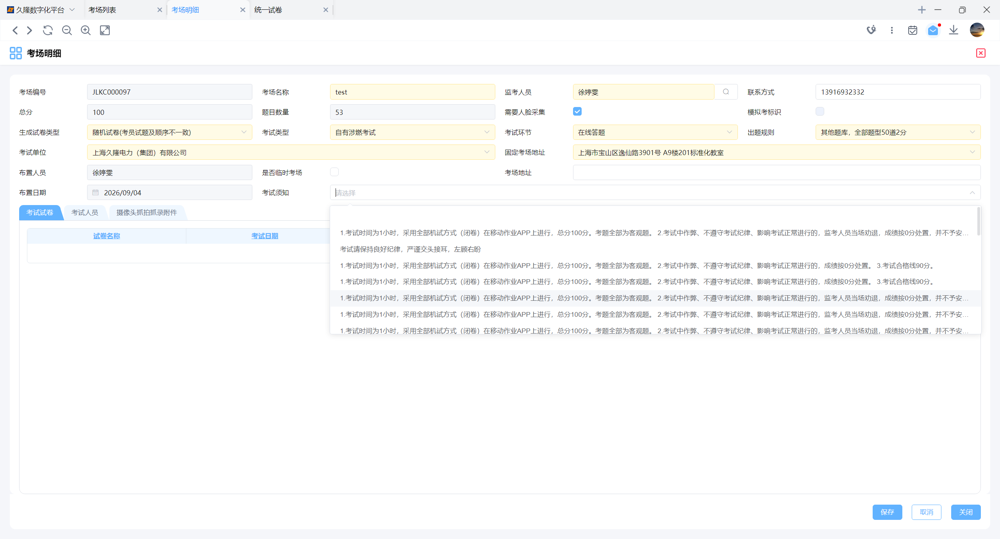
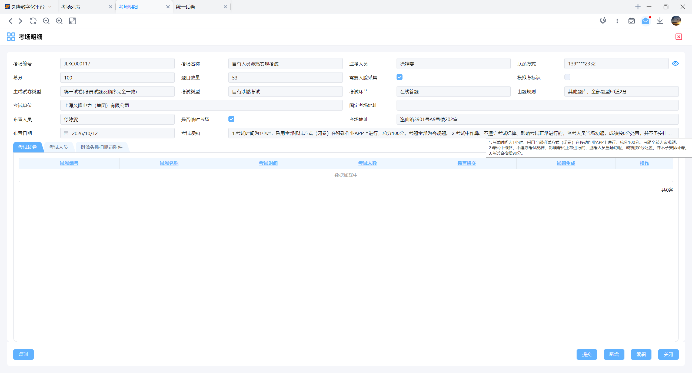
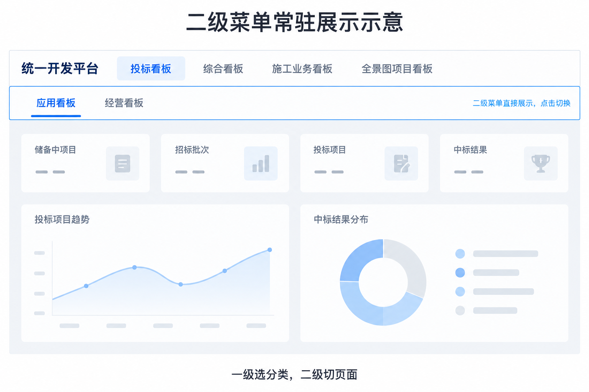
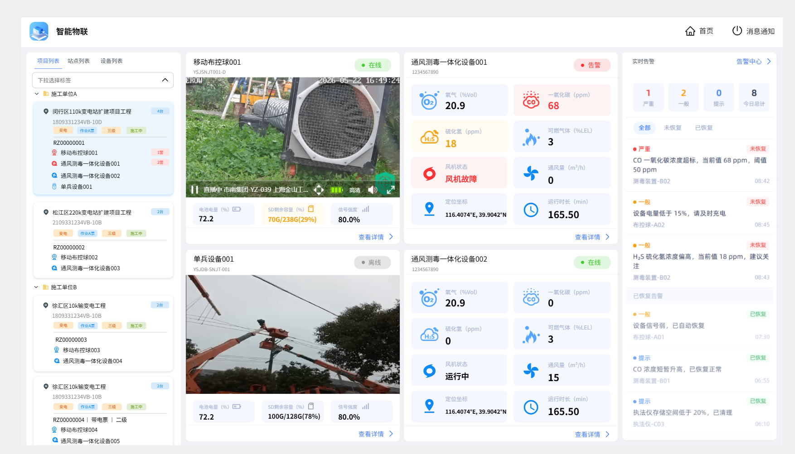

智汇看板图标调整，bar的右侧去除

收集到的逸集控需要优化的内容：

1.死机优化，内存占用减少

2.登陆过期提示优化 - 肖寰辉 ，调整为 支持可以暂不登陆的操作 

前端优化

- [ ] 生产作业移动端界面添加字段调整 - 滕磊

- [ ] 数据稽核产品前端迁移 - 滕磊

- [ ] 项目跟进助手看板联调 - 滕磊

- [ ] 下拉框优化，支持下拉选项悬浮时可以换行 - 滕磊

  

  

- [ ] 统一看板样式调整 - 滕磊

  

- [ ] 通风测爆看板 - 董世付

  

- [ ] 餐饮个别线上问题 - 董世付

- [ ] 文件容器新增一个属性用于控制是否开启复制文件的功能 -  桂佳囿

- [ ] 任务协同的下周调整- 桂佳囿

- [ ] 修复ZNSP看板充电桩看板跳转出现问题 - 桂佳囿

重点任务：

**迁移重前端代码库至统一代码库中**

前置要求：

产品化的项目中

1.后端接入了前端参数化的内容,nginx必须暴露 对应的setting.json的接口内容

2.原先的产品化的代码库内本地代码全部提交

3.在 Erow-Fronted仓库内迁移出自己产品的分支，仅允许在  demo-ui/src/product/XXX产品code 下进行编辑

其余人员工作安排：

**陈涛**

1.新平台开发相关工作

2.陈珍的那里的表结构调整

3.天气界面的配置

**张海洋**

1.安卓端11月月度发布功能整合、自测和发布

2.iOS端11月月度发布功能整合、自测和发布

3.公用js文件，双端共用文件路径映射开发。

**晏强**

1.物联历年订单数据导入

2.消息待办专用Token技术设计与功能开发

3.移动端文件下载技术交底

**许崇品**

1.鸿蒙逸集控上架1.2.7版本；

2.逸集控电脑端打开多个客户端实例获取的设备id不一致的问题优化  ；-

3.逸集控电脑端复制大文本内容（大约200kb以上）到标签页系统输入框中客户端会卡住一会问题优化；

4.逸集控电脑端提供复制图片功能；

5.持续跟踪、排查逸集控电脑端ctrl+c、v快捷键偶尔失效的问题；

6.逸集控零信任网关功能增强，实现对XSS请求拦截

7.逸集控零信任网关脚本配置动态跟新及日志收集功能规划及验证；

8.逸集控弱口令排查

**王博**

1.新平台：准备持久化字段映射和数据库回退脚本，完成补库、保存接口接入，实现小逸成果持久化保存。

统一token服务

2.文档平台：优化错误归因显示，增加多文件输入输出兼容。（？）

3.工器具：跟进接入并处理问题。

**童明捷**

1.将1万份原文件转为高质量训练集并启动训练。

2.AIRuntime场景管理、智能体、工作流模型管理增加导入导出和批量导入导出功能。

3.重构CAD电缆显示排布算法，避免交叉显示，不再通过孔位和偏移算法确定排布。

**叶荣帧**

1.岗位职责认定按会议沟通进行调整：添加长期有效标识、跨服务认证、微服务新增接口。

开发完安排功能介绍

2.通用首页改造

3.产品数据支持按行业分割推送（下周）

4.ai模块相关开发

**姜晓东**

1.基类aisdk逸投标反馈的问题修复

2.基类文件上传增加按功能点限制文件大小功能（原先是全局控制）

3.排查分析智慧监理微服务启动阻塞的问题，可能和基类有关，多个配置类Bean抢占锁的问题

4.新平台正式网关gateway开发，后端接口微服务开发（获取用户菜单数据接口，加载界面配置接口）

**肖寰辉**

1.POC验证

新平台内容

1.新平台统一token服务开发

- 安全内容
- 优化内容

数据库： POC 和 开发环境，测试环境（数据库和web服务器）

2.

