# 移动端页面案例库功能说明

## 1. 文档说明

本手册面向方案设计、原型讨论和方案评审人员，用于说明当前移动端页面案例库已经提供的页面类型、交互能力、操作方式和能力边界。

案例库以 `390 × 844` 为移动端设计基准，提供 8 类可交互页面案例。页面中的名称、编号、人员、地点、时间、文件和统计值均为虚构演示数据，不连接正式环境。


## 2. 访问方式

直接打开同目录下的 `index.html` 即可使用。部署到服务器后，可通过以下地址进入：

```text
https://example.com/index.html
```

通过 `pattern` 参数可直接进入指定案例：


| 案例      | 地址参数                  |
| ------- | --------------------- |
| 导航与入口   | `?pattern=navigation` |
| 数据看板    | `?pattern=dashboard`  |
| 查找条件    | `?pattern=filter`     |
| 检索列表    | `?pattern=list`       |
| 信息详情    | `?pattern=detail`     |
| 规则与风险说明 | `?pattern=guidance`   |
| 地图与点位   | `?pattern=map`        |
| 文件上传    | `?pattern=upload`     |


未知或旧版案例 ID 会自动回退到 `navigation`。评审截图布局可追加 `&capture=1`。

## 3. 当前版本概览

- 案例数量：8 类。
- 设计基准：390 × 844。
- 技术形态：单文件 HTML，CSS、JavaScript、SVG 和文件图标均已内嵌。
- 运行方式：可通过本地文件或 Nginx 静态服务访问。
- 交互性质：全部为浏览器端模拟反馈。
- 数据边界：仅使用虚构通用数据，不包含正式组织、人员、地址、坐标、账号或生产编号。


## 4. 完整功能清单

### 4.1 案例库公共能力

- 左侧页面案例导航与当前案例高亮。
- “详情页类型”父级分组展开、收起及子案例高亮。
- 底部快速比较卡片切换案例。
- `?pattern=<id>` 直接访问与未知值回退。
- 页面内 Toast 操作反馈。
- 全屏层、底部层、操作层的打开、取消和确认。
- 固定底部主操作，不覆盖正文内容。
- 手机预览内部允许滚动但不显示滚动条。
- 支持键盘焦点样式和 `prefers-reduced-motion`。
- 在详情案例之间保留当前会话内的分类、签名和人员选择结果。

### 4.2 八类案例能力


| 案例      | 已有功能                                     |
| ------- | ---------------------------------------- |
| 导航与入口   | 成员信息、演示横幅、业务分组入口、入口点击反馈、账户菜单。            |
| 数据看板    | 指标卡、异常指标、环形占比、统计维度切换、时间范围切换、柱状项选中值。      |
| 查找条件    | 文本输入、单选、多选、全部勾选、开始/结束日期、月份切换、清空和查找反馈。    |
| 检索列表    | 状态 Tab、结果数量、摘要卡片、空态、查找入口、两类详情分流。         |
| 信息详情    | 键值信息、脱敏字段、复制反馈、固定操作、FormTree、签字、人员单选/多选。 |
| 规则与风险说明 | 等级标签、基础属性、重点提示、长文本分区、FormTree、签字、人员选择。   |
| 地图与点位   | 虚构地图、图例切换、点位选中、模拟定位、点位详细信息层。             |
| 文件上传    | 文件类型、上传来源、模拟上传中、附件列表、缩略图、列数配置、移除和空态。     |


## 5. 页面案例说明

### 5.1 导航与入口（`navigation`）

适用于功能模块较多、需要按业务主题组织入口的移动首页。

主要内容：成员信息、账户操作、演示横幅、知识中心、项目管理和现场管理等分组入口。

可交互功能：

- 点击分组入口显示入口反馈。
- 点击右上角账户按钮打开或关闭菜单。
- 菜单项提供模拟操作反馈。

建议覆盖状态：默认门户、账户菜单、入口按压、入口跳转反馈。

操作方式：打开 `?pattern=navigation`，点击任一入口或右上角账户按钮。


### 5.2 数据看板（`dashboard`）

适用于运营概览、项目进度和服务监控等需要快速识别变化的页面。

主要内容：4 个核心指标、结构占比、趋势变化和异常指标提示。

可交互功能：

- 在“类型 / 区域”之间切换统计维度。
- 切换本周、本月等时间范围。
- 点击柱状项查看对应日期和准确值。
- 点击更多按钮查看演示数据口径反馈。

建议覆盖状态：时间切换、维度切换、图表选中、异常指标。

操作方式：打开 `?pattern=dashboard`，切换分段按钮并点击柱状图。

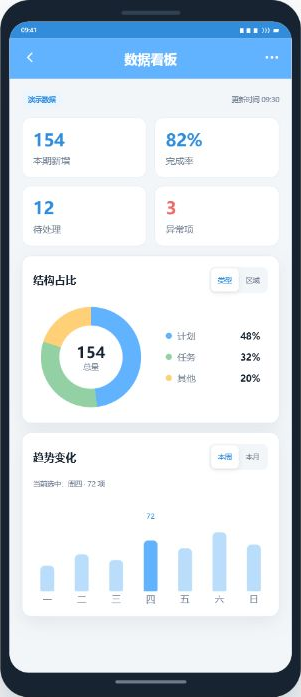

### 5.3 查找条件（`filter`）

适用于项目、单据和其他业务对象需要组合多个字段进行精确查找的页面。

主要内容：文本字段、单选字段、多选字段、开始/结束日期以及固定清空和查找操作。

可交互功能：

- 输入项目账号、名称和单据编号等文本条件。
- 单选项目类型和状态。
- 多选专业类别，支持全部勾选。
- 选择开始和结束日期，支持月份前后切换。
- 清空全部条件或执行查找并显示已用条件数量。

建议覆盖状态：默认条件、条件填写、单选、多选、日期选择、清空和查找。

操作方式：打开 `?pattern=filter`，点击项目类型、专业或日期字段。

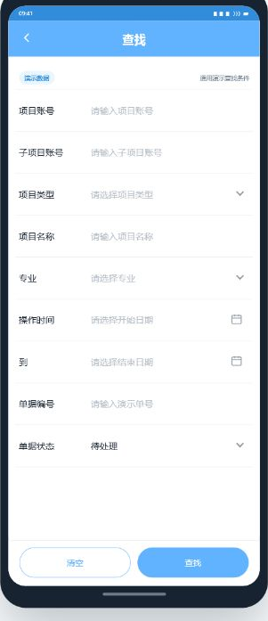

单选下拉：

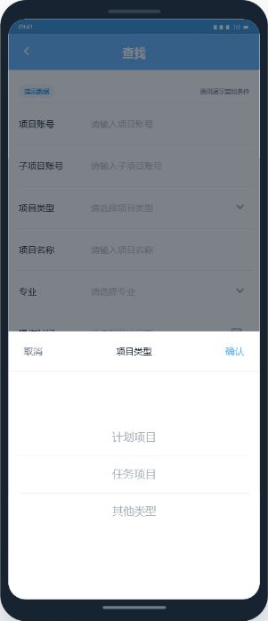

多选下拉：

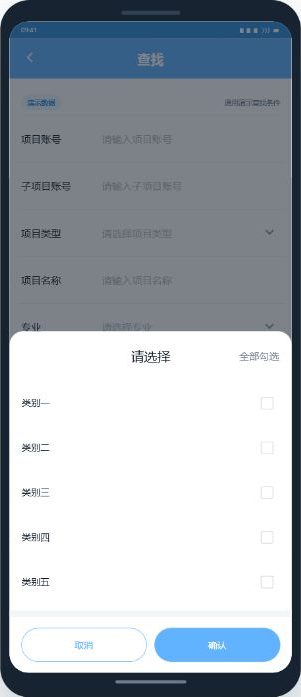

日期选择：


### 5.4 检索列表（`list`）

适用于项目、任务和单据等先按状态浏览，再进入详情或查找页面的工作流。

主要内容：状态 Tab、结果数量、摘要卡片、状态标签和空结果提示。

可交互功能：

- 切换全部、处理中和已完成等状态 Tab。
- 状态没有匹配内容时显示空态及“查看全部”操作。
- 右上角查找入口跳转到查找条件案例。
- 普通卡片进入业务处理型信息详情。
- 规则说明卡片进入规则阅读型详情。
- 从详情返回时恢复检索列表。

建议覆盖状态：全部列表、状态筛选、空结果、普通详情分流、规则详情分流。

操作方式：打开 `?pattern=list`，切换状态 Tab 或点击不同类型卡片。

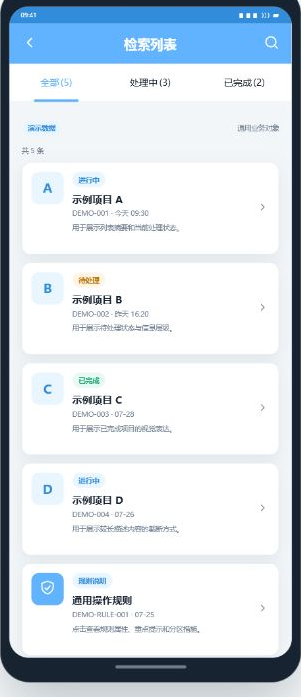

### 5.5 信息详情（`detail`）

适用于业务对象查看、信息复制、分类选择、签字和人员确认等处理型详情页。

主要内容：状态摘要、键值信息、脱敏字段、资料分类、签字、人员选择、补充信息和固定操作。

可交互功能：

- 复制演示编号并显示反馈。
- 展开或收起补充信息。
- 打开 FormTree，搜索、展开、批量选择、清空和确认分类。
- 打开签字操作层并进入手写画布，支持清除、取消和确认。
- 选择单个责任人员或多个协同人员。
- 固定底部主次操作提供演示反馈。

建议覆盖状态：默认详情、分类展开、多选分类、签字画布、已签字、人员单选和多选回填。

操作方式：打开 `?pattern=detail`，在手机正文中向下滚动并点击对应字段。


FormTree 层级选择：

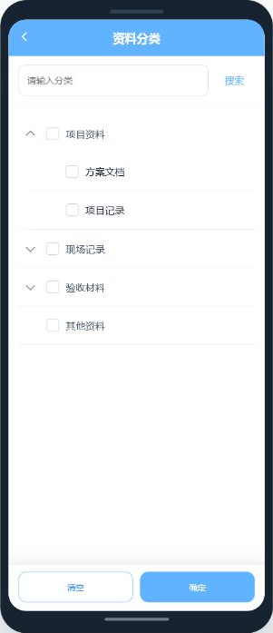

签字画布：


人员单选：

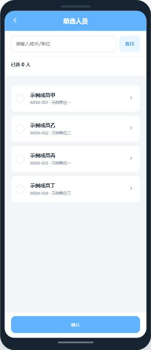

人员多选：


### 5.6 规则与风险说明（`guidance`）

适用于操作规范、风险提示、检查要点和其他需要完整阅读的结构化详情。

主要内容：规则标签、重要等级、基础属性、重点提示和分区长文本。

可交互功能：

- 与信息详情共用资料分类 FormTree。
- 与信息详情共用签字画布。
- 与信息详情共用人员单选和多选。
- 从检索列表规则卡片进入，并支持返回列表。

建议覆盖状态：默认规则详情、等级提示、分类回填、签字确认和人员回填。

操作方式：打开 `?pattern=guidance`，向下滚动查看规则分区和交互字段。


### 5.7 地图与点位（`map`）

适用于设备、门店、项目或任务的区域分布与就近查看。

主要内容：纯 CSS/SVG 虚构地图、区域名称、图例、点位和底部详情层。

可交互功能：

- 切换全部、正常和关注图例。
- 点击点位打开详细信息层。
- 详情按左侧标签、右侧数据展示编号、区域、类型、时间和示例位置。
- 使用定位按钮切换模拟定位状态。
- 关闭详情或触发查看详情反馈。

建议覆盖状态：图例切换、正常点位、关注点位、模拟定位和点位详情。

操作方式：打开 `?pattern=map`，点击地图中的任一点位。

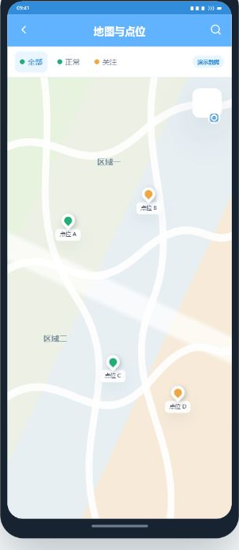

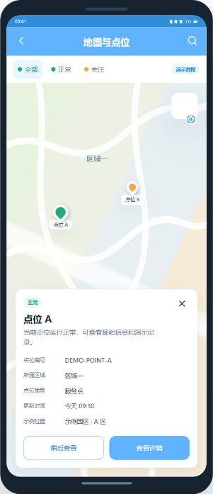

### 5.8 文件上传（`upload`）

适用于业务附件、证明材料、图片、音频和视频的移动端补充场景。

主要内容：附件类别、格式说明、上传入口、附件信息、文件类型图标和状态演示。

可交互功能：

- 选择文件通知、图片资料或音视频资料等类型。
- 选择拍照、图库、录音、视频等模拟上传来源。
- 显示模拟上传中的文件名和进度。
- 已有附件支持列表与缩略图两种方式。
- 缩略图支持每行 2 个或 3 个配置。
- 支持移除演示附件和切换暂无文件空态。

建议覆盖状态：已有附件、文件类型选择、来源选择、上传中、列表、缩略图和空态。

操作方式：打开 `?pattern=upload`，点击“资料附件”或“上传附件”。


文件类型选择：


上传来源选择：

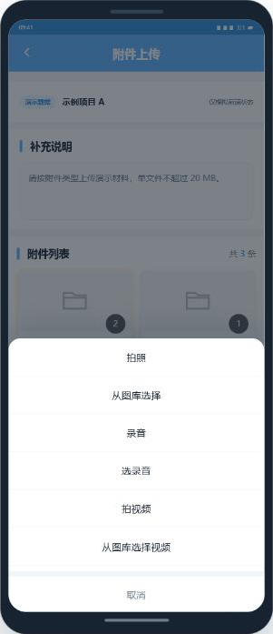

上传过程：

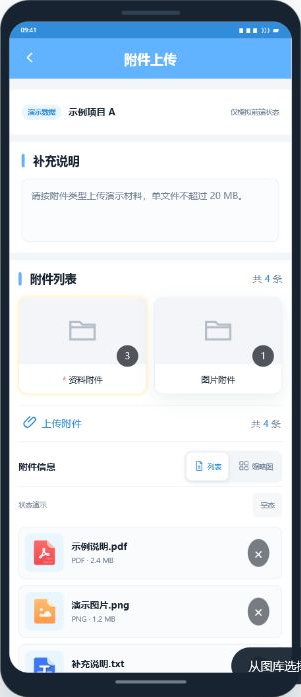

缩略图列数配置：


## 6. 关键交互约定

- 单选、多选、FormTree、人员选择和日期选择均使用临时选择状态，点击确认后才回填。
- 关闭、返回或取消弹层时不提交当前临时修改。
- 签字画布必须存在绘制内容后才能确认；清除只清空当前画布。
- 列表卡片根据类型分别进入信息详情或规则与风险说明。
- 地图详情层和上传层都可关闭，不影响其他案例数据。
- 页面中的复制、定位、上传、签字和提交结果均通过 Toast 或状态回填模拟。

## 7. 部署与交付

最终交付入口为 `index.html`，可以单独复制到服务器目录。该文件已经内嵌页面运行所需资源，Nginx 只需允许访问 `/` 和 `/index.html`。

部署配置和重新构建方式参见 [README.md](README.md)。

## 8. 演示能力限制与脱敏边界

- 不连接后端接口或正式环境。
- 不调用真实文件选择、文件上传或设备原生能力。
- 不调用真实定位、地图瓦片或地图厂商服务。
- 不连接真实人员目录、组织权限或账号系统。
- 签字只保留当前页面会话中的演示状态，不生成签名文件。
- 复制、提交、处理、详情跳转等操作仅用于演示交互方式。
- 所有人员、单位、区域、编号、位置和文件均为虚构数据。
