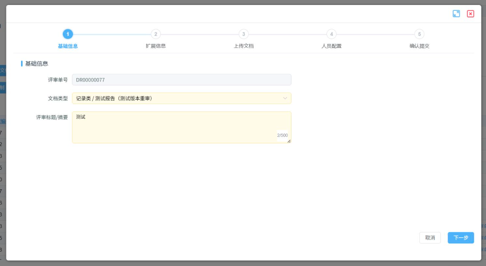
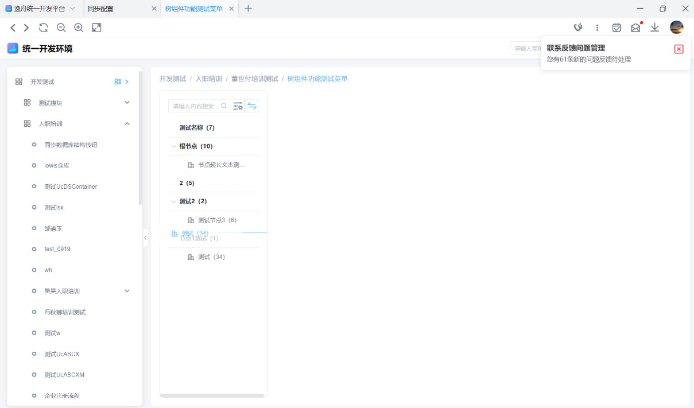
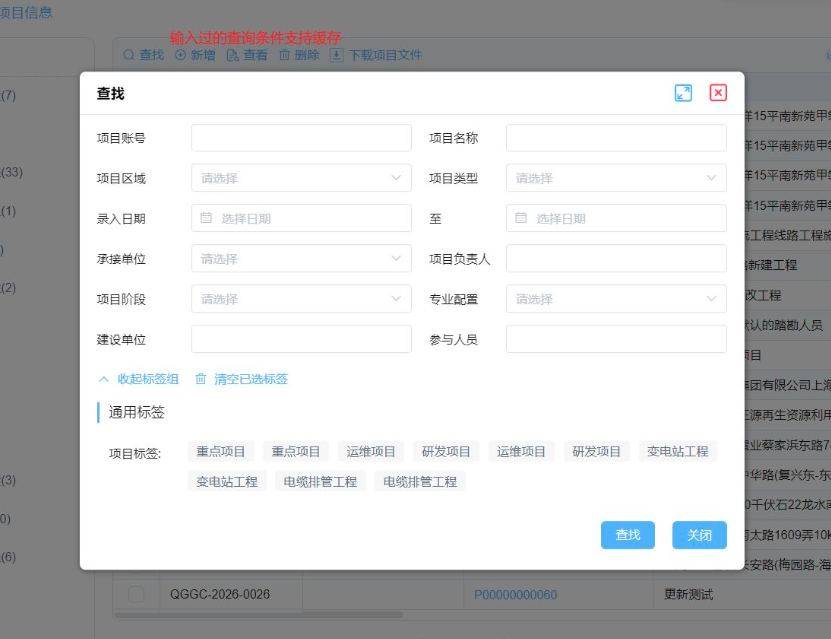
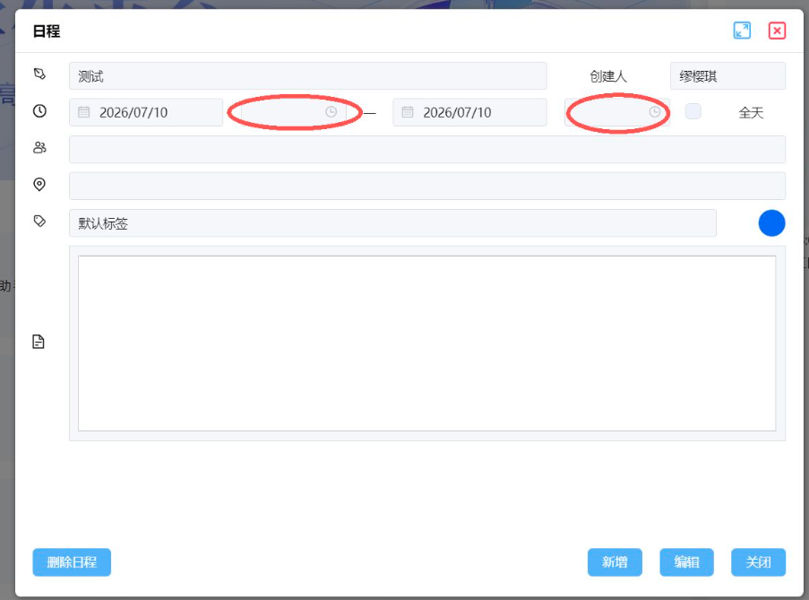
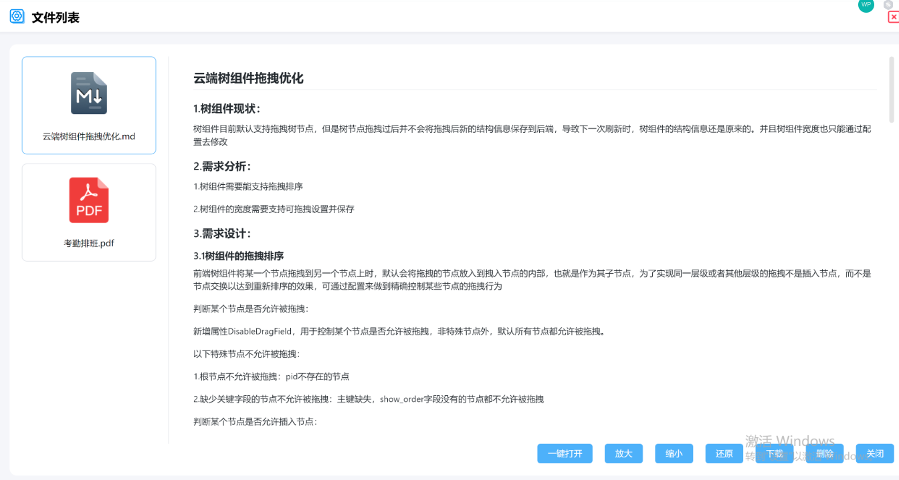
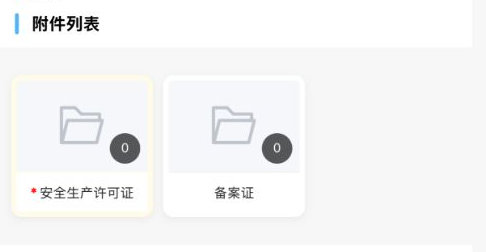

# 低代码平台月度更新发布通知-20260811

| 前端版本     | 20260810_112000     |
| :----------- | :------------------ |
| **后端版本** | **20260807_165101** |
| **发布时间** | **2026年8月11日**   |
| **发布人**   | **低代码平台**      |

## 一、影响范围

| 序号 | 终端类型 | 组件/功能        | 变更类型     | 功能点                                         | 可能影响                                                   |
| :--- | :------- | :--------------- | :----------- | :--------------------------------------------- | :--------------------------------------------------------- |
| 1    | 云端     | 安全加固         | 后端功能新增 | 系统健康检查（内网）                           | **需主动开启配置**                                         |
| 2    | 云端     | YiHtmlTemplate   | 后端功能新增 | 前端模板配置中心                               | **需执行数据库脚本，需同步配置功能点**                     |
| 3    | 云端     | 菜单栏           | 前端功能新增 | 菜单栏支持跳转不同前端                         | 无                                                         |
| 4    | 云端     | 模板组件         | 前端功能新增 | 模板组件支持配置远程模板                       | 无                                                         |
| 5    | 云端     | 树组件           | 前端功能新增 | 树组件支持拖拽功能                             | 无                                                         |
| 6    | 云端     | 树组件           | 前端功能新增 | 树组件支持缓存右侧查询条件功能                 | 无                                                         |
| 7    | 云端     | 树组件           | 前端功能新增 | 树组件查询/节点显示/收起优化                   | 无                                                         |
| 8    | 云端     | 模板组件         | 前端功能新增 | 新增发起文档评审通用模板组件                   | **需接入前配置参数化**                                     |
| 9    | 云端     | 标签组           | 前端功能新增 | 标签组折叠联动                                 | 无                                                         |
| 10   | 云端     | 看板设计器       | 前端功能新增 | 画布滚动/单页布局                              | 无                                                         |
| 11   | 云端     | 主容器           | 前端功能新增 | 获取配置后回调                                 | 无                                                         |
| 12   | 云端     | 标签组           | 前端功能新增 | 查看态独立编辑                                 | 无                                                         |
| 13   | 云端     | 一览表           | 前端功能新增 | 一览表优化（树结构高度自适应、带出默认值）     | 无                                                         |
| 14   | 云端     | 地图容器         | 前端功能新增 | 思极地图支持                                   | 无                                                         |
| 15   | 云端     | UcASCX           | 前端功能新增 | UcASCX支持自定义AfterClose                     | 无                                                         |
| 16   | 云端     | 安全加固         | 后端功能优化 | 接口签名超时时长可配置                         | 无                                                         |
| 17   | 云端     | 文件上传         | 后端功能优化 | 文件上传性能优化                               | 无                                                         |
| 18   | 云端     | 统一消息提醒     | 后端功能优化 | 统一消息补充接口签名鉴权/Es业务拓展优化        | 无                                                         |
| 19   | 云端     | AI智能体         | 后端功能优化 | 优化ai会话恢复/重试                            | 无                                                         |
| 20   | 云端     | 查找容器         | 前端功能优化 | 搜索框收藏按钮位置调整                         | 无                                                         |
| 21   | 云端     | 详情页           | 前端功能优化 | 详情页支持配置自定义取消按钮事件               | 无                                                         |
| 22   | 云端     | 一览表           | 前端功能优化 | 一览表勾选导出优化（不超过阙值时不弹确认弹窗） | 无                                                         |
| 23   | 云端     | 数据看板         | 前端功能优化 | 数据看板跳转和渲染逻辑优化                     | 无                                                         |
| 24   | 云端     | 链接             | 前端功能优化 | 链接显示状态优化                               | 无                                                         |
| 25   | 云端     | 按钮             | 前端功能优化 | 上一页、下一页文件优化                         | 无                                                         |
| 26   | 云端     | 文件上传         | 前端功能优化 | 文件上传支持压缩包的文件编辑文件类型           | 无                                                         |
| 27   | 云端     | 系统跳转         | 前端功能优化 | 浏览器环境下跨域跳转支持共享cookie             | 无                                                         |
| 28   | 云端     | 一览表           | 前端功能优化 | 一览表样式改版                                 | 无                                                         |
| 29   | 云端     | 前端性能优化     | 前端功能优化 | 优化项目的打包体积，检查首屏等待时间           | 无                                                         |
| 30   | 云端     | 地图组件         | 前端功能优化 | 地图组件思极地图改造                           | 无                                                         |
| 31   | 云端     | 选择器           | 前端功能优化 | 表单中选择器支持外部删除                       | 无                                                         |
| 32   | 云端     | YiHtmlTemplate   | 前端功能优化 | 新闻列表菜单配置键补全                         | 无                                                         |
| 33   | 云端     | 看板可视化       | 前端功能优化 | 菜单图标与加载体验                             | 无                                                         |
| 34   | 云端     | 看板可视化       | 前端功能优化 | 看板导航滚动与默认选中                         | 无                                                         |
| 35   | 云端     | 看板设计器       | 前端功能优化 | 看板移动端预览与动态配置                       | 无                                                         |
| 36   | 云端     | 单行编辑         | 前端功能优化 | 一览表填充剩余高度                             | 无                                                         |
| 37   | 云端     | 富文本编辑器     | 前端功能优化 | 富文本媒体与附件持久化                         | 无                                                         |
| 38   | 云端     | 富文本编辑器     | 前端功能优化 | 富文本展开查看与媒体样式                       | 无                                                         |
| 39   | 云端     | 表单容器         | 前端功能优化 | 查询条件分组                                   | 无                                                         |
| 40   | 云端     | InitPage         | 前端功能优化 | 消息与跨系统跳转匹配                           | 无                                                         |
| 41   | 云端     | 页面列表         | 前端功能优化 | 页面列表支持联动刷新                           | 无                                                         |
| 42   | 云端     | 数据绑定         | 前端功能优化 | 数据绑定支持配置tooltip提示                    | 无                                                         |
| 43   | 云端     | 图表容器         | 前端功能优化 | 图表容器侧边栏展开自适应优化                   | 无                                                         |
| 44   | 云端     | 模板页           | 前端功能优化 | 视屏监控模板页优化                             | 无                                                         |
| 45   | 云端     | 文件上传         | 后端BUG修复  | 修复上传失败残留垃圾文件                       | 无                                                         |
| 46   | 云端     | 菜单列表         | 后端BUG修复  | 修复首页加载报错                               | 无                                                         |
| 47   | 云端     | 功能定义         | 后端BUG修复  | 修复云端资源配置获取失败                       | 无                                                         |
| 48   | 云端     | 动态组件         | 前端BUG修复  | 多样编辑新增时候动态组件下拉框无数据问题修复   | 无                                                         |
| 49   | 云端     | 多行编辑         | 前端BUG修复  | 修复多行编辑删除行定位不准                     | 无                                                         |
| 50   | 云端     | 时间选择器       | 前端BUG修复  | 修复时间选择器鼠标点击外部导致已选日期清空     | 无                                                         |
| 51   | 云端     | 列表容器         | 前端BUG修复  | 修复云端pageList使用mockData不生效             | 无                                                         |
| 52   | 云端     | 一览表           | 前端BUG修复  | 一览表自定义组件配置width不生效修复            | 无                                                         |
| 53   | 云端     | 一览表           | 前端BUG修复  | jsGrid/UcGrid配置form时自定义控件不显示修复    | 无                                                         |
| 54   | 云端     | excel导入        | 前端BUG修复  | excel导入失败问题修复                          | 无                                                         |
| 55   | 云端     | 详情页表单提交   | 前端BUG修复  | 修复详情页表单提交数据校验错误问题             | 无                                                         |
| 56   | 云端     | 富文本编辑器     | 前端BUG修复  | 含图片富文本提交修复                           | 无                                                         |
| 57   | 云端     | 单行编辑         | 前端BUG修复  | UcBoundField动态样式类                         | 无                                                         |
| 58   | 云端     | 图片上传         | 前端BUG修复  | 新增表单图片自动上传                           | 无                                                         |
| 59   | 云端     | 工作流           | 前端BUG修复  | 工作流刷新、渲染与XSS防护                      | 无                                                         |
| 60   | 云端     | 数据绑定         | 前端BUG修复  | 多链接换行与跳转配置复用                       | 无                                                         |
| 61   | 云端     | 文件下载         | 前端BUG修复  | 表格容器文件导出（zip类型文件名异常修复）      | 无                                                         |
| 62   | 云端     | 表单容器         | 前端BUG修复  | 限制表单下拉框宽度                             | 无                                                         |
| 63   | 云端     | 富文本编辑器     | 前端BUG修复  | 提升富文本图片预览层级                         | 无                                                         |
| 64   | 云端     | 标签组           | 前端BUG修复  | 数据保存时读取隐藏form配置                     | 无                                                         |
| 65   | 云端     | 单行编辑         | 前端BUG修复  | 批量审核按钮图标                               | 无                                                         |
| 66   | 云端     | 附件预览BigImage | 前端功能优化 | 附件预览支持md文档                             | 无                                                         |
| 67   | 移动端   | 安全加固         | 后端功能新增 | 系统健康检查（内网）                           | **需主动开启配置**                                         |
| 68   | 移动端   | YiHtmlTemplate   | 后端功能新增 | 前端模板配置中心                               | **需执行数据库脚本，需同步配置功能点**                     |
| 69   | 移动端   | 模板组件         | 前端功能新增 | 模板组件支持配置远程模板                       | 无                                                         |
| 70   | 移动端   | 卡片文件         | 前端功能新增 | 移动端新增UcCardFileContainer组件              | **未接入数字化/统一开发/统一测试的需要更新前端APP目录**    |
| 71   | 移动端   | 文件容器         | 前端功能新增 | 文件容器新增ai文档扫描选项                     | **未接入数字化/统一开发/统一测试的需要更新前端APP目录**    |
| 72   | 移动端   | 拍照             | 前端功能新增 | 拍照/相册可跳过GPS                             | 无                                                         |
| 73   | 移动端   | 选择类组件       | 前端功能新增 | 多值选择文本自动换行                           | 无                                                         |
| 74   | 移动端   | 翻页容器         | 前端功能新增 | 翻页容器支持配置树容器                         | 无                                                         |
| 75   | 移动端   | 按钮容器         | 前端功能新增 | 按钮容器支持保存取消自动排序                   | 无                                                         |
| 76   | 移动端   | UcTab容器        | 前端功能新增 | UcTab增加动态scope关联                         | 无                                                         |
| 77   | 移动端   | 卡片容器         | 前端功能新增 | 卡片容器支持长按操作                           | 无                                                         |
| 78   | 移动端   | 安全加固         | 后端功能优化 | 接口签名超时时长可配置                         | 无                                                         |
| 79   | 移动端   | 文件上传         | 后端功能优化 | 文件上传性能优化                               | 无                                                         |
| 80   | 移动端   | 统一消息提醒     | 后端功能优化 | 统一消息补充接口签名鉴权/Es业务拓展优化        | 无                                                         |
| 81   | 移动端   | 统一下载         | 后端功能优化 | 移动端统一下载迁移                             | **旧版移动端前端资源下载将不可用，需迁移新版统一下载服务** |
| 82   | 移动端   | 安全改造         | 前端功能优化 | 移动端安全整改                                 | 无                                                         |
| 83   | 移动端   | 页面列表         | 前端功能优化 | 列表触底自动分页                               | 无                                                         |
| 84   | 移动端   | 文件容器         | 前端功能优化 | 数据驱动必填、标题及禁用状态                   | 无                                                         |
| 85   | 移动端   | 文件上传         | 后端BUG修复  | 修复上传失败残留垃圾文件                       | 无                                                         |
| 86   | 移动端   | 菜单列表         | 后端BUG修复  | 修复首页加载报错                               | 无                                                         |
| 87   | 移动端   | 功能定义         | 后端BUG修复  | 修复云端资源配置获取失败                       | 无                                                         |
| 88   | 移动端   | 多行编辑         | 前端BUG修复  | JsGrid删除权限来源统一                         | 无                                                         |
| 89   | 移动端   | 富文本编辑器     | 前端BUG修复  | 移动富文本文件元信息兼容                       | 无                                                         |

## 核心更新功能

### 模板组件支持配置远程模板

本次更新将“模板组件支持配置远程模板”列为核心更新功能，云端和移动端均可使用。模板组件可从远程模板配置中心加载模板，在不更新业务代码的情况下更新模板内容。

| 属性               | 值                                               |
| :----------------- | :----------------------------------------------- |
| **变更类型**       | 前端功能新增                                     |
| **更新人**         | 肖寰辉                                           |
| **适用终端**       | 云端、移动端                                     |
| **前端版本**       | ≥20260810                                        |
| **后端版本**       | ≥20260807_165101                                 |
| **配套后端能力**   | YiHtmlTemplate 前端模板配置中心                  |
| **变更内容**       | 模板组件支持远程模板，可不更新代码情况下更新模板 |
| **更新内容及风险** | 需更新最新前端common包                           |
| **配置说明**       | 无需配置                                         |

## 二、云端

### 1. 安全加固

#### (1) 【新增】系统健康检查（内网）

| 属性               | 值                                                           |
| :----------------- | :----------------------------------------------------------- |
| **变更类型**       | 后端功能新增                                                 |
| **变更内容**       | 新增系统健康检查接口（/health）和网关健康检查能力，用于监控服务是否正常运行，目前主要供内网环境使用，可通过配置开关启用。 |
| **适配版本范围**   | 后端≥20260807_165101                                         |
| **更新内容及风险** | 默认关闭，内网需要主动开启                                   |
| **配置说明**       | 内网配置biz.enableHealth: true                               |

#### (2) 【优化】接口签名超时时长可配置

| 属性               | 值                                                           |
| :----------------- | :----------------------------------------------------------- |
| **变更类型**       | 后端功能优化                                                 |
| **变更内容**       | 新增接口签名超时时间配置（biz.apiSignExpire）。内部接口签名认证依赖时间戳，服务器间时钟存在偏差时可能认证失败，可根据实际环境灵活调整超时时间，默认5分钟。 |
| **适配版本范围**   | 后端≥20260807_165101                                         |
| **更新内容及风险** | 默认5分钟                                                    |
| **配置说明**       | 可按实际情况调整，不建议过长降低安全性，示例：biz.apiSignExpire: 10 |

### 2. YiHtmlTemplate（前端模板配置中心）

#### (3) 【新增】前端模板配置中心

| 属性               | 值                                                           |
| :----------------- | :----------------------------------------------------------- |
| **变更类型**       | 后端功能新增                                                 |
| **变更内容**       | 新增前端YiHtmlTemplate模板配置中心，支持模板草稿管理、版本管理、发布/恢复版本及资源接口等功能，便于统一管理和维护前端页面模板。 |
| **适配版本范围**   | 后端≥20260807_165101；前端≥20260810_112000                   |
| **更新内容及风险** | 1.需要更新新版本云端和移动端前端  2.需要执行Erow-Demo库dbmanager脚本  3.统一管理需要同步cfg_template,cfg_template_version,fs_resource,cfg_tempate_resource功能点配置 |
| **配置说明**       | 无                                                           |

#### (4) 【优化】新闻列表菜单配置键补全

| 属性               | 值                                                           |
| :----------------- | :----------------------------------------------------------- |
| **变更类型**       | 前端功能优化                                                 |
| **更新人**         | 袁吉栋                                                       |
| **变更内容**       | 新闻页签和详情数据请求补传menuConfigKey，修复缺少菜单上下文时报错 |
| **适配版本范围**   | 前端版本：≥20260701-1357                                     |
| **更新内容及风险** | 需更新最新前端common包                                       |
| **配置说明**       | 无需配置                                                     |

### 3. 菜单栏

#### (5) 【新增】菜单栏支持跳转不同前端

| 属性               | 值                                                           |
| :----------------- | :----------------------------------------------------------- |
| **变更类型**       | 前端功能新增                                                 |
| **更新人**         | 冯秋娜                                                       |
| **变更内容**       | 点击菜单想要跳转到其他的前端                                 |
| **适配版本范围**   | 前端版本：≥20260805                                          |
| **更新内容及风险** | 需更新最新前端common包                                       |
| **配置说明**       | 要跳转其他前端的菜单配置菜单参数systemRootUrl，示例：\oam-ui\index |

### 4. 模板组件

#### (6) 【新增】模板组件支持配置远程模板

| 属性               | 值                                               |
| :----------------- | :----------------------------------------------- |
| **变更类型**       | 前端功能新增                                     |
| **更新人**         | 肖寰辉                                           |
| **变更内容**       | 模板组件支持远程模板，可不更新代码情况下更新模板 |
| **适配版本范围**   | 前端版本：≥20260810；后端版本：≥20260807_165101 |
| **更新内容及风险** | 需更新最新前端common包                           |
| **配置说明**       | 无需配置                                         |

#### (7) 【新增】新增发起文档评审通用模板组件

| 属性               | 值                                                           |
| :----------------- | :----------------------------------------------------------- |
| **变更类型**       | 前端功能新增                                                 |
| **更新人**         | 董世付                                                       |
| **变更内容**       | 新增CreateReviewWizardDialog模板，支持配置模板方式打开和配置通用js方法打开模板 |
| **适配版本范围**   | 前端版本：≥20260710                                          |
| **更新内容及风险** | 需更新最新前端common包                                       |
| **配置说明**       | 按需配置，接入前需要文档评审管理员在文档评审系统配置外部系统接入记录，确保前端参数化中返回了drmBackendUrl（需接入前端参数化） |

### 5. 树组件

#### (8) 【新增】树组件支持拖拽功能

| 属性               | 值                                                           |
| :----------------- | :----------------------------------------------------------- |
| **变更类型**       | 前端功能新增                                                 |
| **更新人**         | 董世付                                                       |
| **变更内容**       | 树组件支持拖拽节点进行排序，支持拖拽设置树组件的宽度         |
| **适配版本范围**   | 前端版本：≥20260714                                          |
| **更新内容及风险** | 需更新最新前端common包                                       |
| **配置说明**       | 按需配置，配置IsDragSort属性为true开启拖拽排序，配置IsCanResize为true开启拖拽设置树组件宽度 |

#### (9) 【新增】树组件支持缓存右侧查询条件功能

| 属性               | 值                                                           |
| :----------------- | :----------------------------------------------------------- |
| **变更类型**       | 前端功能新增                                                 |
| **更新人**         | 董世付                                                       |
| **变更内容**       | 树组件右侧关联容器有查询表单时，支持缓存查询条件，切换节点后能回填同一个表单的查询条件 |
| **适配版本范围**   | 前端版本：≥202060708                                         |
| **更新内容及风险** | 需更新最新前端common包                                       |
| **配置说明**       | 按需配置，需要缓存查询条件的表单配置IsCacheSearchPrams属性为true开启，树组件配置DialogSearchParamsField属性开启，格式为fnCode.fnParameter.ctrnUID或者field，配置field时可缓存多个查询表单数据 |

#### (10) 【新增】树组件查询/节点显示/收起优化

| 属性               | 值                                                           |
| :----------------- | :----------------------------------------------------------- |
| **变更类型**       | 前端功能新增                                                 |
| **更新人**         | 董世付                                                       |
| **变更内容**       | 树组件默认的查询树节点信息与配置的scope可支持切换，当前节点的路径支持可配置显示，树组件支持默认收起所有节点 |
| **适配版本范围**   | 前端版本：≥202060708                                         |
| **更新内容及风险** | 需更新最新前端common包                                       |
| **配置说明**       | 按需配置，配置IsShowNodePath为true开启展示当前节点路径，配置IsShowSwitchSearchModeBtn为true开启查询树组件模式的切换，配置IsDefaultCollapseAll为true开启默认收起树组件功能 |

### 6. 标签组

#### (11) 【新增】标签组折叠联动

| 属性               | 值                                                           |
| :----------------- | :----------------------------------------------------------- |
| **变更类型**       | 前端功能新增                                                 |
| **更新人**         | 袁吉栋                                                       |
| **变更内容**       | 全局、分区、行三级折叠均可执行ClientActions.toggle；增加重新计算弹窗内一览表高度的通用函数 |
| **适配版本范围**   | 前端版本：≥20260703-1122                                     |
| **更新内容及风险** | 需更新最新前端common包                                       |
| **配置说明**       | IsRenderOpenOrCloseIcon='true'；示例：ClientActions={"toggle":"refreshPerformanceInfoHeight"} |

#### (12) 【新增】查看态独立编辑

| 属性               | 值                                                           |
| :----------------- | :----------------------------------------------------------- |
| **变更类型**       | 前端功能新增                                                 |
| **更新人**         | 袁吉栋                                                       |
| **变更内容**       | 标签组在父表单查看态下可单独进入编辑、保存或取消；同时校验EDIT权限并恢复快照 |
| **适配版本范围**   | 前端版本：≥20260721_130700                                   |
| **更新内容及风险** | 需更新最新前端common包                                       |
| **配置说明**       | IsCanEditWhenView='true'才显示编辑按钮，并要求权限列表包含EDIT |

#### (13) 【修复】数据保存时读取隐藏form配置

| 属性               | 值                                                 |
| :----------------- | :------------------------------------------------- |
| **变更类型**       | 前端BUG修复                                        |
| **变更内容**       | 当标签组配置有隐藏form时，数据保存读取form配置信息 |
| **适配版本范围**   | 前端版本：≥20260807_153000                         |
| **更新内容及风险** | 需更新最新前端common包                             |
| **配置说明**       | UcTagGroupV2使用ReferToConfig配置隐藏form          |

### 7. 看板设计器

#### (14) 【新增】画布滚动/单页布局

| 属性               | 值                                                           |
| :----------------- | :----------------------------------------------------------- |
| **变更类型**       | 前端功能新增                                                 |
| **更新人**         | 袁吉栋                                                       |
| **变更内容**       | 工具栏开放"画布设置"，可选择纵向滚动或一页内显示；历史看板默认继续纵向滚动 |
| **适配版本范围**   | 前端版本：≥20260715_161500                                   |
| **更新内容及风险** | 需更新最新前端common包                                       |
| **配置说明**       | layoutMode='scroll'为默认；layoutMode='fit'为一页内显示      |

#### (15) 【优化】看板移动端预览与动态配置

| 属性               | 值                                                           |
| :----------------- | :----------------------------------------------------------- |
| **变更类型**       | 前端功能优化                                                 |
| **更新人**         | 袁吉栋                                                       |
| **变更内容**       | 设计器支持PC/移动预览切换、390×844默认视口、自适应缩放和单列布局；修复设计器输入框无法输入；预览改为从当前业务上下文加载配置 |
| **适配版本范围**   | 前端版本：≥20260722                                          |
| **更新内容及风险** | 需更新最新前端common包                                       |
| **配置说明**       | 无需配置                                                     |

### 8. 一览表

#### (16) 【新增】一览表优化（树结构高度自适应、带出默认值）

| 属性               | 值                                                       |
| :----------------- | :------------------------------------------------------- |
| **变更类型**       | 前端功能新增                                             |
| **更新人**         | 肖寰辉                                                   |
| **变更内容**       | （1）树结构右侧一览表高度自适应（2）一览表新增带出默认值 |
| **适配版本范围**   | 前端版本：≥20260810                                      |
| **更新内容及风险** | 需更新最新前端common包                                   |
| **配置说明**       | 需配置带出的默认字段                                     |

#### (17) 【优化】一览表勾选导出优化

| 属性               | 值                                                           |
| :----------------- | :----------------------------------------------------------- |
| **变更类型**       | 前端功能优化                                                 |
| **更新人**         | 冯秋娜                                                       |
| **变更内容**       | 一览表存在勾选数据且未超MaxExportRows时直接导出，不再弹确认弹窗 |
| **适配版本范围**   | 前端版本：≥20260805                                          |
| **更新内容及风险** | 需更新最新前端common包                                       |
| **配置说明**       | 一览表勾选导出的数量不超过阈值时不弹出选择导出页数弹窗       |

#### (18) 【优化】一览表样式改版

| 属性               | 值                                                   |
| :----------------- | :--------------------------------------------------- |
| **变更类型**       | 前端功能优化                                         |
| **更新人**         | 肖寰辉                                               |
| **变更内容**       | 一览表按钮改版，详情页和树右侧的按钮显示成工具栏形式 |
| **适配版本范围**   | 前端版本：≥20260810                                  |
| **更新内容及风险** | 需更新最新前端common包                               |
| **配置说明**       | 无需配置                                             |

#### (19) 【修复】一览表自定义组件配置width不生效修复

| 属性               | 值                                     |
| :----------------- | :------------------------------------- |
| **变更类型**       | 前端BUG修复                            |
| **变更内容**       | 一览表配置自定义容器设置宽度不生效修复 |
| **适配版本范围**   | 前端版本：≥20260716                    |
| **更新内容及风险** | 需更新最新前端common包                 |
| **配置说明**       | 一览表里面UcAxcs配置width              |

#### (20) 【修复】jsGrid/UcGrid配置form时自定义控件不显示修复

| 属性               | 值                                                       |
| :----------------- | :------------------------------------------------------- |
| **变更类型**       | 前端BUG修复                                              |
| **变更内容**       | 一览表里面配置了form，form里面配置了自定义容器不显示修复 |
| **适配版本范围**   | 前端版本：≥20260716                                      |
| **更新内容及风险** | 需更新最新前端common包                                   |
| **配置说明**       | 一览表里面配置form表单，form表单里面配置自定义容器       |

### 9. 主容器

#### (21) 【新增】获取配置后回调

| 属性               | 值                                                           |
| :----------------- | :----------------------------------------------------------- |
| **变更类型**       | 前端功能新增                                                 |
| **更新人**         | 袁吉栋                                                       |
| **变更内容**       | 容器支持从容器本身或ControlProperty读取AfterGetContainerConfig，并统一执行回调 |
| **适配版本范围**   | 前端版本：≥20260717_085405                                   |
| **更新内容及风险** | 需更新最新前端common包                                       |
| **配置说明**       | AfterGetContainerConfig配置为已注册在公共特殊函数对象中的函数名 |

### 10. 地图容器

#### (22) 【新增】思极地图支持

| 属性               | 值                                   |
| :----------------- | :----------------------------------- |
| **变更类型**       | 前端功能新增                         |
| **更新人**         | 滕磊                                 |
| **变更内容**       | 云端地图容器支持通过配置切换思极地图 |
| **适配版本范围**   | 前端版本：20260805_142451            |
| **更新内容及风险** | 需更新最新前端common包               |
| **配置说明**       | UseISGMap配置即可                    |

### 11. UcASCX

#### (23) 【新增】UcASCX支持自定义AfterClose

| 属性               | 值                             |
| :----------------- | :----------------------------- |
| **变更类型**       | 前端功能新增                   |
| **更新人**         | 滕磊                           |
| **变更内容**       | UcASCX支持自定义AfterClose函数 |
| **适配版本范围**   | 前端版本：20260805_142451      |
| **更新内容及风险** | 需更新最新前端common包         |
| **配置说明**       | afterClose属性配置             |

### 12. 文件上传

#### (24) 【优化】文件上传性能优化

| 属性               | 值                                                           |
| :----------------- | :----------------------------------------------------------- |
| **变更类型**       | 后端功能优化                                                 |
| **变更内容**       | 重构文件上传接口的处理流程：将缩略图、截帧、转码、转PDF、压缩等耗时较重的处理步骤从事务内移到事务前执行，事务内仅做纯数据库写入，大幅降低数据库连接池占用和事务锁等待时间，提升上传性能与并发能力。 |
| **适配版本范围**   | 后端≥20260807_165101                                         |
| **更新内容及风险** | 无                                                           |
| **配置说明**       | 无                                                           |

#### (25) 【优化】文件上传支持压缩包的文件编辑文件类型

| 属性               | 值                                   |
| :----------------- | :----------------------------------- |
| **变更类型**       | 前端功能优化                         |
| **更新人**         | 肖寰辉                               |
| **变更内容**       | 文件上传支持压缩包的文件编辑文件类型 |
| **适配版本范围**   | 前端版本：≥20260810                  |
| **更新内容及风险** | 需更新最新前端common包               |
| **配置说明**       | 无需配置                             |

#### (26) 【修复】修复上传失败残留垃圾文件

| 属性               | 值                                                           |
| :----------------- | :----------------------------------------------------------- |
| **变更类型**       | 后端BUG修复                                                  |
| **变更内容**       | 修复文件上传的一个缺陷：当文件内容已写入存储、但数据库记录保存失败时，会产生残留的临时垃圾文件占用空间。本次修复后此类残留文件会被及时清理。 |
| **适配版本范围**   | 后端≥20260807_165101                                         |
| **更新内容及风险** | 无                                                           |
| **配置说明**       | 无需配置                                                     |

### 13. 统一消息提醒

#### (27) 【优化】统一消息补充接口签名鉴权/Es业务拓展优化

| 属性               | 值                                                           |
| :----------------- | :----------------------------------------------------------- |
| **变更类型**       | 后端功能优化                                                 |
| **变更内容**       | 1.统一消息补充接口签名鉴权 [2.Es](https://2.es/)业务拓展优化 |
| **适配版本范围**   | 后端≥20260807_165101                                         |
| **更新内容及风险** | 无                                                           |
| **配置说明**       | 无                                                           |

### 14. AI智能体

#### (28) 【优化】优化ai会话恢复/重试

| 属性               | 值                   |
| :----------------- | :------------------- |
| **变更类型**       | 后端功能优化         |
| **变更内容**       | 优化ai会话恢复/重试  |
| **适配版本范围**   | 后端≥20260807_165101 |
| **更新内容及风险** | 无                   |
| **配置说明**       | 无                   |

### 15. 查找容器

#### (29) 【优化】搜索框收藏按钮位置调整

| 属性               | 值                                             |
| :----------------- | :--------------------------------------------- |
| **变更类型**       | 前端功能优化                                   |
| **更新人**         | 冯秋娜                                         |
| **变更内容**       | 云端UcFormScopeContainer搜索框收藏按钮位置调整 |
| **适配版本范围**   | 前端版本：≥20260713                            |
| **更新内容及风险** | 需更新最新前端common包                         |
| **配置说明**       | 无需配置                                       |

### 16. 详情页

#### (30) 【优化】详情页支持配置自定义取消按钮事件

| 属性               | 值                                                |
| :----------------- | :------------------------------------------------ |
| **变更类型**       | 前端功能优化                                      |
| **更新人**         | 冯秋娜                                            |
| **变更内容**       | 详情页主容器取消想要执行自定义事件                |
| **适配版本范围**   | 前端版本：≥20260723                               |
| **更新内容及风险** | 需更新最新前端common包                            |
| **配置说明**       | 详情页主容器ClientAction配置了RESET对应的js方法名 |

### 17. 数据看板

#### (31) 【优化】数据看板跳转和渲染逻辑优化

| 属性               | 值                                                           |
| :----------------- | :----------------------------------------------------------- |
| **变更类型**       | 前端功能优化                                                 |
| **更新人**         | 肖寰辉                                                       |
| **变更内容**       | 解决智慧看板跳转后页面加载缓慢和切换报频繁操作的问题，优化交互体验 |
| **适配版本范围**   | 前端版本：≥20260810                                          |
| **更新内容及风险** | 需更新最新前端common包                                       |
| **配置说明**       | 无需配置                                                     |

### 18. 链接

#### (32) 【优化】链接显示状态优化

| 属性               | 值                                                           |
| :----------------- | :----------------------------------------------------------- |
| **变更类型**       | 前端功能优化                                                 |
| **更新人**         | 肖寰辉                                                       |
| **变更内容**       | 表单的链接是动态返回时且没有可跳转的容器，此时显示成不可链接状态 |
| **适配版本范围**   | 前端版本：≥20260810                                          |
| **更新内容及风险** | 需更新最新前端common包                                       |
| **配置说明**       | 无需配置                                                     |

### 19. 按钮

#### (33) 【优化】上一页、下一页文件优化

| 属性               | 值                                 |
| :----------------- | :--------------------------------- |
| **变更类型**       | 前端功能优化                       |
| **更新人**         | 肖寰辉                             |
| **变更内容**       | 同页不请求数据和配置，减少等待时间 |
| **适配版本范围**   | 前端版本：≥20260810                |
| **更新内容及风险** | 需更新最新前端common包             |
| **配置说明**       | 无需配置                           |

### 20. 系统跳转

#### (34) 【优化】浏览器环境下跨域跳转支持共享cookie

| 属性               | 值                                                           |
| :----------------- | :----------------------------------------------------------- |
| **变更类型**       | 前端功能优化                                                 |
| **更新人**         | 肖寰辉                                                       |
| **变更内容**       | 浏览器环境下跨域跳转支持共享cookie，方便内网环境下跨域跨系统跳转 |
| **适配版本范围**   | 前端版本：≥20260810                                          |
| **更新内容及风险** | 需更新最新前端common包                                       |
| **配置说明**       | 无需配置                                                     |

### 21. 前端性能优化

#### (35) 【优化】优化项目的打包体积，检查首屏等待时间

| 属性               | 值                                   |
| :----------------- | :----------------------------------- |
| **变更类型**       | 前端功能优化                         |
| **更新人**         | 肖寰辉                               |
| **变更内容**       | 优化项目的打包体积，检查首屏等待时间 |
| **适配版本范围**   | 前端版本：≥20260810                  |
| **更新内容及风险** | 需更新最新前端common包               |
| **配置说明**       | 无需配置                             |

### 22. 地图组件

#### (36) 【优化】地图组件思极地图改造

| 属性               | 值                             |
| :----------------- | :----------------------------- |
| **变更类型**       | 前端功能优化                   |
| **更新人**         | 肖寰辉                         |
| **变更内容**       | 增加自定义热力图和地址远程配置 |
| **适配版本范围**   | 前端版本：≥20260810            |
| **更新内容及风险** | 需更新最新前端common包         |
| **配置说明**       | 无需配置                       |

### 23. 选择器

#### (37) 【优化】表单中选择器支持外部删除

| 属性               | 值                       |
| :----------------- | :----------------------- |
| **变更类型**       | 前端功能优化             |
| **更新人**         | 肖寰辉                   |
| **变更内容**       | 表单中选择器支持外部删除 |
| **适配版本范围**   | 前端版本：≥20260810      |
| **更新内容及风险** | 需更新最新前端common包   |
| **配置说明**       | 无需配置                 |

### 24. 看板可视化

#### (38) 【优化】菜单图标与加载体验

| 属性               | 值                                                           |
| :----------------- | :----------------------------------------------------------- |
| **变更类型**       | 前端功能优化                                                 |
| **更新人**         | 袁吉栋                                                       |
| **变更内容**       | 顶部菜单支持普通/悬停图标；通过接口下载并使用IndexedDB缓存；增加默认图回退；隐藏嵌入页导航和面包屑 |
| **适配版本范围**   | 前端版本：≥20260703-1125                                     |
| **更新内容及风险** | 需更新最新前端common包                                       |
| **配置说明**       | 菜单提供icon_guid/icon_hash；悬停图使用icon_hover_guid/icon_hover_hash |

#### (39) 【优化】看板导航滚动与默认选中

| 属性               | 值                                                           |
| :----------------- | :----------------------------------------------------------- |
| **变更类型**       | 前端功能优化                                                 |
| **更新人**         | 袁吉栋                                                       |
| **变更内容**       | 长菜单支持左右按钮、鼠标滚轮和自动溢出检测；无已打开iframe时默认打开首个菜单；修复宿主导航、嵌入页留白和文字颜色 |
| **适配版本范围**   | 前端版本：≥20260728_142100                                   |
| **更新内容及风险** | 需更新最新前端common包                                       |
| **配置说明**       | 统一看板跳转自动追加from_uniform_board=1、IsHideBreadcrumb=true |

### 25. 单行编辑

#### (40) 【优化】一览表填充剩余高度

| 属性               | 值                                                           |
| :----------------- | :----------------------------------------------------------- |
| **变更类型**       | 前端功能优化                                                 |
| **更新人**         | 袁吉栋                                                       |
| **变更内容**       | 一览表可占满父容器剩余空间；数据较少按内容高展示，超出后表体滚动；配置或数据变化时重算 |
| **适配版本范围**   | 前端版本：≥20260715_161900                                   |
| **更新内容及风险** | 需更新最新前端common包                                       |
| **配置说明**       | 特定调用方需设置实例forceFillHeightLayout=true；未开启时沿用原Height |

#### (41) 【修复】UcBoundField动态样式类

| 属性               | 值                                                           |
| :----------------- | :----------------------------------------------------------- |
| **变更类型**       | 前端BUG修复                                                  |
| **变更内容**       | 普通绑定字段支持从行数据动态读取CSS类；早期错误地给额外DOM包装类的方案已撤回，最终逻辑集中到getColClass |
| **适配版本范围**   | 前端版本：≥20260708_164300                                   |
| **更新内容及风险** | 需更新最新前端common包                                       |
| **配置说明**       | 无需配置                                                     |

#### (42) 【修复】批量审核按钮图标

| 属性               | 值                         |
| :----------------- | :------------------------- |
| **变更类型**       | 前端BUG修复                |
| **变更内容**       | 新增批量审核按钮图标       |
| **适配版本范围**   | 前端版本：≥20260807_153000 |
| **更新内容及风险** | 需更新最新前端common包     |
| **配置说明**       | 无需配置                   |

### 26. 富文本编辑器

#### (43) 【优化】富文本媒体与附件持久化

| 属性               | 值                                                           |
| :----------------- | :----------------------------------------------------------- |
| **变更类型**       | 前端功能优化                                                 |
| **更新人**         | 袁吉栋                                                       |
| **变更内容**       | 图片、视频、附件统一保存稳定文件元信息；运行时生成下载地址；兼容旧data-file_guid/data-file-guid；修复视频切换编辑态卡死和重复附件 |
| **适配版本范围**   | 前端版本：≥20260707_132042                                   |
| **更新内容及风险** | 需更新最新前端common包                                       |
| **配置说明**       | 无需配置                                                     |

#### (44) 【优化】富文本展开查看与媒体样式

| 属性               | 值                                                           |
| :----------------- | :----------------------------------------------------------- |
| **变更类型**       | 前端功能优化                                                 |
| **更新人**         | 袁吉栋                                                       |
| **变更内容**       | 统一图片、视频和附件样式；编辑态和查看态支持展开/收起；展开后保留当前Quill实例、选区和未保存内容 |
| **适配版本范围**   | 前端版本：≥20260717_135900                                   |
| **更新内容及风险** | 需更新最新前端common包                                       |
| **配置说明**       | 无需配置                                                     |

#### (45) 【修复】含图片富文本提交修复

| 属性               | 值                                               |
| :----------------- | :----------------------------------------------- |
| **变更类型**       | 前端BUG修复                                      |
| **变更内容**       | 修复表单提交时富文本包含图片导致序列化或上传失败 |
| **适配版本范围**   | 前端版本：≥20260720_085400                       |
| **更新内容及风险** | 需更新最新前端common包                           |
| **配置说明**       | 无需配置                                         |

#### (46) 【修复】提升富文本图片预览层级

| 属性               | 值                                       |
| :----------------- | :--------------------------------------- |
| **变更类型**       | 前端BUG修复                              |
| **变更内容**       | 修复富文本图片预览时，预览关闭按钮被遮挡 |
| **适配版本范围**   | 前端版本：≥20260731_173301               |
| **更新内容及风险** | 需更新最新前端common包                   |
| **配置说明**       | 无需配置                                 |

### 27. 表单容器

#### (47) 【优化】查询条件分组

| 属性               | 值                                                           |
| :----------------- | :----------------------------------------------------------- |
| **变更类型**       | 前端功能优化                                                 |
| **更新人**         | 袁吉栋                                                       |
| **变更内容**       | 支持按DataField对查询条件分组、排序、折叠；依据TotalCols/Colspan排版；折叠动画完成后重算父列表高度 |
| **适配版本范围**   | 前端版本：≥20260731_113155                                   |
| **更新内容及风险** | 需更新最新前端common包                                       |
| **配置说明**       | SearchConditionGroupConfig为JSON数组，例如[{"title":"项目信息","items":["project_code","project_name"]}] |

#### (48) 【修复】限制表单下拉框宽度

| 属性               | 值                             |
| :----------------- | :----------------------------- |
| **变更类型**       | 前端BUG修复                    |
| **变更内容**       | 表单下拉框宽度限制为输入框宽度 |
| **适配版本范围**   | 前端版本：≥20260731_173300     |
| **更新内容及风险** | 需更新最新前端common包         |
| **配置说明**       | 无需配置                       |

### 28. InitPage

#### (49) 【优化】消息与跨系统跳转匹配

| 属性               | 值                                                           |
| :----------------- | :----------------------------------------------------------- |
| **变更类型**       | 前端功能优化                                                 |
| **更新人**         | 袁吉栋                                                       |
| **变更内容**       | 消息跳转按menuRowGuid、menuId、系统、精确功能点、根菜单、唯一功能点逐级匹配；统一解析目标应用地址并增加诊断日志 |
| **适配版本范围**   | 前端版本：≥20260731_113155                                   |
| **更新内容及风险** | 需更新最新前端common包                                       |
| **配置说明**       | 无需配置                                                     |

### 29. 页面列表

#### (50) 【优化】页面列表支持联动刷新

| 属性               | 值                                     |
| :----------------- | :------------------------------------- |
| **变更类型**       | 前端功能优化                           |
| **更新人**         | 桂佳囿                                 |
| **变更内容**       | 其他容器数据刷新时，可同步刷新页面列表 |
| **适配版本范围**   | 前端版本：≥20260731_173302             |
| **更新内容及风险** | 需更新最新前端common包                 |
| **配置说明**       | 无需配置                               |

### 30. 数据绑定

#### (51) 【优化】数据绑定支持配置tooltip提示

| 属性               | 值                                                           |
| :----------------- | :----------------------------------------------------------- |
| **变更类型**       | 前端功能优化                                                 |
| **更新人**         | 桂佳囿                                                       |
| **变更内容**       | 数据绑定支持配置tooltip提示，仅当文本溢出时，鼠标悬浮才显示提示 |
| **适配版本范围**   | 前端版本：≥20260731_173302                                   |
| **更新内容及风险** | 需更新最新前端common包                                       |
| **配置说明**       | UcBoundField配置TipContent或TipContentField                  |

#### (52) 【修复】多链接换行与跳转配置复用

| 属性               | 值                                                           |
| :----------------- | :----------------------------------------------------------- |
| **变更类型**       | 前端BUG修复                                                  |
| **变更内容**       | 将 移到el-link外渲染，修复多链接横向错位；容器、功能点等单值配置可复用于全部链接，多值配置按索引取值 |
| **适配版本范围**   | 前端版本：≥20260805_112018                                   |
| **更新内容及风险** | 需更新最新前端common包                                       |
| **配置说明**       | 显示文本按Separator分隔；多组跳转参数使用英文逗号对齐；单个容器、功能点、参数值可复用 |

### 31. 图表容器

#### (53) 【优化】图表容器侧边栏展开自适应优化

| 属性               | 值                                     |
| :----------------- | :------------------------------------- |
| **变更类型**       | 前端功能优化                           |
| **更新人**         | 滕磊                                   |
| **变更内容**       | 侧边栏展开收缩时图表容器子使用相关优化 |
| **适配版本范围**   | 前端版本：20260805_142451              |
| **更新内容及风险** | 需更新最新前端common包                 |
| **配置说明**       | 无需额外配置                           |

### 32. 模板页

#### (54) 【优化】视屏监控模板页优化

| 属性               | 值                                       |
| :----------------- | :--------------------------------------- |
| **变更类型**       | 前端功能优化                             |
| **更新人**         | 滕磊                                     |
| **变更内容**       | 视屏监控模板页轮询优化以及视频流操作调整 |
| **适配版本范围**   | 前端版本：20260805_142451                |
| **更新内容及风险** | 需更新最新前端common包                   |
| **配置说明**       | 配置模板页数据源以及LoopTime轮询时间     |

### 33. 菜单列表

#### (55) 【修复】修复首页加载报错

| 属性               | 值                                                           |
| :----------------- | :----------------------------------------------------------- |
| **变更类型**       | 后端BUG修复                                                  |
| **变更内容**       | 修复Redis存储空列表（空List）时引发的Bug，此前会因没有任何权限导致进入数字化首页时页面报错，本次修复后首页可正常加载。 |
| **适配版本范围**   | 后端≥20260807_165101                                         |
| **更新内容及风险** | 无                                                           |
| **配置说明**       | 无需配置                                                     |

### 34. 功能定义

#### (56) 【修复】修复云端资源配置获取失败

| 属性               | 值                                                           |
| :----------------- | :----------------------------------------------------------- |
| **变更类型**       | 后端BUG修复                                                  |
| **变更内容**       | 修复云端获取配置时的问题：资源代码（rsCode）跨产品模块引用时无法正确获取。本次修复后跨模块引用可正常解析。 |
| **适配版本范围**   | 后端≥20260807_165101                                         |
| **更新内容及风险** | 无                                                           |
| **配置说明**       | 无需配置                                                     |

### 35. 动态组件

#### (57) 【修复】多样编辑新增时候动态组件下拉框无数据问题修复

| 属性               | 值                                                 |
| :----------------- | :------------------------------------------------- |
| **变更类型**       | 前端BUG修复                                        |
| **变更内容**       | 多行编辑下拉框无数据功能修复，仅一条数据时默认选中 |
| **适配版本范围**   | 前端版本：≥20260805                                |
| **更新内容及风险** | 需更新最新前端common包                             |
| **配置说明**       | 无需配置                                           |

### 36. 多行编辑

#### (58) 【修复】修复多行编辑删除行定位不准

| 属性               | 值                     |
| :----------------- | :--------------------- |
| **变更类型**       | 前端BUG修复            |
| **变更内容**       | 多行编辑删除逻辑       |
| **适配版本范围**   | 前端版本：≥20260805    |
| **更新内容及风险** | 需更新最新前端common包 |
| **配置说明**       | 无需配置               |

### 37. 时间选择器

#### (59) 【修复】修复时间选择器鼠标点击外部导致已选日期清空

| 属性               | 值                     |
| :----------------- | :--------------------- |
| **变更类型**       | 前端BUG修复            |
| **变更内容**       | 时间选择器交互变更     |
| **适配版本范围**   | 前端版本：≥20260713    |
| **更新内容及风险** | 需更新最新前端common包 |
| **配置说明**       | 无需配置               |

### 38. 列表容器

#### (60) 【修复】修复云端pageList使用mockData不生效

| 属性               | 值                                                |
| :----------------- | :------------------------------------------------ |
| **变更类型**       | 前端BUG修复                                       |
| **变更内容**       | 云端UcPageListContainer里面使用mockData不生效修复 |
| **适配版本范围**   | 前端版本：≥20260713                               |
| **更新内容及风险** | 需更新最新前端common包                            |
| **配置说明**       | 无需配置                                          |

### 39. excel导入

#### (61) 【修复】excel导入失败问题修复

| 属性               | 值                                                          |
| :----------------- | :---------------------------------------------------------- |
| **变更类型**       | 前端BUG修复                                                 |
| **变更内容**       | 修复因后端基类统一调整接口返回数据结构后，excel导入失败问题 |
| **适配版本范围**   | 前端版本：≥20260716                                         |
| **更新内容及风险** | 需更新最新前端common包                                      |
| **配置说明**       | 无需配置                                                    |

### 40. 详情页表单提交

#### (62) 【修复】修复详情页表单提交数据校验错误问题

| 属性               | 值                                                       |
| :----------------- | :------------------------------------------------------- |
| **变更类型**       | 前端BUG修复                                              |
| **变更内容**       | 修复详情页表单提交时，因前端漏传必要参数导致错误校验问题 |
| **适配版本范围**   | 前端版本：≥20260804                                      |
| **更新内容及风险** | 需更新最新前端common包                                   |
| **配置说明**       | 无需配置                                                 |

### 41. 图片上传

#### (63) 【修复】新增表单图片自动上传

| 属性               | 值                                                           |
| :----------------- | :----------------------------------------------------------- |
| **变更类型**       | 前端BUG修复                                                  |
| **变更内容**       | 新增页默认立即上传；显式关闭自动上传时保存后上传；支持new_row_guid关联新增数据，避免重复上传 |
| **适配版本范围**   | 前端版本：≥20260803_104400                                   |
| **更新内容及风险** | 需更新最新前端common包                                       |
| **配置说明**       | 无需配置                                                     |

### 42. 工作流

#### (64) 【修复】工作流刷新、渲染与XSS防护

| 属性               | 值                                                           |
| :----------------- | :----------------------------------------------------------- |
| **变更类型**       | 前端BUG修复                                                  |
| **变更内容**       | 修复页签刷新引用未定义变量；步骤工作流统一使用V2；审批意见增加DOMPurify；空流程按ControlGUID精确隐藏；销毁时移除resize监听 |
| **适配版本范围**   | 前端版本：≥20260804_104051                                   |
| **更新内容及风险** | 需更新最新前端common包                                       |
| **配置说明**       | 无需配置                                                     |

### 43. 文件下载

#### (65) 【修复】表格容器文件导出

| 属性               | 值                                |
| :----------------- | :-------------------------------- |
| **变更类型**       | 前端BUG修复                       |
| **变更内容**       | zip类型文件下载文件名异常问题修复 |
| **适配版本范围**   | 前端版本：20260805_142451         |
| **更新内容及风险** | 需更新最新前端common包            |
| **配置说明**       | 无需额外配置                      |

### 44. 附件预览BigImage

#### (66) 【优化】附件预览支持md文档

| 属性               | 值                         |
| :----------------- | :------------------------- |
| **变更类型**       | 前端功能优化               |
| **更新人**         | 桂佳囿                   |
| **变更内容**       | 附件预览支持md文档         |
| **适配版本范围**   | 前端版本：≥20260807_153000 |
| **更新内容及风险** | 需更新最新前端common包     |
| **配置说明**       | 无需额外配置               |

## 三、移动端

### 1. 安全加固

#### (67) 【新增】系统健康检查（内网）

| 属性               | 值                                                           |
| :----------------- | :----------------------------------------------------------- |
| **变更类型**       | 后端功能新增                                                 |
| **变更内容**       | 新增系统健康检查接口（/health）和网关健康检查能力，用于监控服务是否正常运行，目前主要供内网环境使用，可通过配置开关启用。 |
| **适配版本范围**   | 后端≥20260807_165101                                         |
| **更新内容及风险** | 默认关闭，内网需要主动开启                                   |
| **配置说明**       | 内网配置biz.enableHealth: true                               |

#### (68) 【优化】接口签名超时时长可配置

| 属性               | 值                                                           |
| :----------------- | :----------------------------------------------------------- |
| **变更类型**       | 后端功能优化                                                 |
| **变更内容**       | 新增接口签名超时时间配置（biz.apiSignExpire）。内部接口签名认证依赖时间戳，服务器间时钟存在偏差时可能认证失败，可根据实际环境灵活调整超时时间，默认5分钟。 |
| **适配版本范围**   | 后端≥20260807_165101                                         |
| **更新内容及风险** | 默认5分钟                                                    |
| **配置说明**       | 可按实际情况调整，不建议过长降低安全性，示例：biz.apiSignExpire: 10 |

#### (69) 【修复】修复上传失败残留垃圾文件

| 属性               | 值                                                           |
| :----------------- | :----------------------------------------------------------- |
| **变更类型**       | 后端BUG修复                                                  |
| **变更内容**       | 修复文件上传的一个缺陷：当文件内容已写入存储、但数据库记录保存失败时，会产生残留的临时垃圾文件占用空间。本次修复后此类残留文件会被及时清理。 |
| **适配版本范围**   | 后端≥20260807_165101                                         |
| **更新内容及风险** | 无                                                           |
| **配置说明**       | 无需配置                                                     |

### 2. YiHtmlTemplate（前端模板配置中心）

#### (70) 【新增】前端模板配置中心

| 属性               | 值                                                           |
| :----------------- | :----------------------------------------------------------- |
| **变更类型**       | 后端功能新增                                                 |
| **变更内容**       | 新增前端YiHtmlTemplate模板配置中心，支持模板草稿管理、版本管理、发布/恢复版本及资源接口等功能，便于统一管理和维护前端页面模板。 |
| **适配版本范围**   | 后端≥20260807_165101；前端≥20260810_112000                   |
| **更新内容及风险** | 1.需要更新新版本云端和移动端前端 2.需要执行Erow-Demo库dbmanager脚本 3.统一管理需要同步cfg_template,cfg_template_version,fs_resource,cfg_tempate_resource功能点配置 |
| **配置说明**       | 无                                                           |

### 3. 模板组件

#### (71) 【新增】模板组件支持配置远程模板

| 属性               | 值                                               |
| :----------------- | :----------------------------------------------- |
| **变更类型**       | 前端功能新增                                     |
| **更新人**         | 肖寰辉                                           |
| **变更内容**       | 模板组件支持远程模板，可不更新代码情况下更新模板 |
| **适配版本范围**   | 前端版本：≥20260810；后端版本：≥20260807_165101 |
| **更新内容及风险** | 需更新最新前端common包                           |
| **配置说明**       | 无需配置                                         |

### 4. 卡片文件

#### (72) 【新增】移动端新增UcCardFileContainer组件

| 属性               | 值                                                         |
| :----------------- | :--------------------------------------------------------- |
| **变更类型**       | 前端功能新增                                               |
| **更新人**         | 董世付                                                     |
| **变更内容**       | 移动端新增UcCardFileContainer组件，支持在UcContainer中配置 |
| **适配版本范围**   | 前端版本：≥20260728，基类版本：20260722_163814             |
| **更新内容及风险** | 未接入数字化/统一开发/统一测试的需要更新前端APP目录        |
| **配置说明**       | 按需配置                                                   |

### 5. 文件容器

#### (73) 【新增】文件容器新增ai文档扫描选项

| 属性               | 值                                                          |
| :----------------- | :---------------------------------------------------------- |
| **变更类型**       | 前端功能新增                                                |
| **更新人**         | 董世付                                                      |
| **变更内容**       | 移动端文件容器支持调用原生ai文档扫描接口获取文件并上传      |
| **适配版本范围**   | 前端版本：≥20260810                                         |
| **更新内容及风险** | 未接入数字化/统一开发/统一测试的需要更新前端APP目录         |
| **配置说明**       | 按需配置，文件容器配置PickFileTypeList属性包含scan-file行为 |

#### (74) 【优化】数据驱动必填、标题及禁用状态

| 属性               | 值                                                           |
| :----------------- | :----------------------------------------------------------- |
| **变更类型**       | 前端功能优化                                                 |
| **更新人**         | 袁吉栋                                                       |
| **变更内容**       | 支持后端通过${DataField}_required动态控制必填；标题优先读取TitleByDataField；文件容器增加DisableField数据字段控制 |
| **适配版本范围**   | 前端版本：≥20260703_1131_yjd                                 |
| **更新内容及风险** | 需更新最新前端common包                                       |
| **配置说明**       | 必填字段使用xxx_required=true；TitleByDataField指向标题数据字段；DisableField指向返回true/-1等禁用值的字段 |

### 6. 拍照

#### (75) 【新增】拍照/相册可跳过GPS

| 属性               | 值                                                           |
| :----------------- | :----------------------------------------------------------- |
| **变更类型**       | 前端功能新增                                                 |
| **更新人**         | 袁吉栋                                                       |
| **变更内容**       | UcPhoto新增IsNeedGPS；关闭后直接拍照或选相册，开启时显示定位加载提示并在定位接口失败时终止 |
| **适配版本范围**   | 前端版本：≥20260806_1429                                     |
| **更新内容及风险** | 需更新最新前端common包                                       |
| **配置说明**       | ControlProperty.IsNeedGPS='false'跳过定位；未配置或其他值保持定位流程 |

### 7. 选择类组件

#### (76) 【新增】多值选择文本自动换行

| 属性               | 值                                                           |
| :----------------- | :----------------------------------------------------------- |
| **变更类型**       | 前端功能新增                                                 |
| **更新人**         | 袁吉栋                                                       |
| **变更内容**       | 当选中值包含英文逗号且控件带指定样式类时，将单行输入框切为自适应只读文本域 |
| **适配版本范围**   | 前端版本：≥20260807_0916                                     |
| **更新内容及风险** | 需更新最新前端common包                                       |
| **配置说明**       | 给控件动态类配置增加form-select-auto-wrap，显示值需使用英文逗号分隔 |

### 8. 翻页容器

#### (77) 【新增】翻页容器支持配置树容器

| 属性               | 值                      |
| :----------------- | :---------------------- |
| **变更类型**       | 前端功能新增            |
| **更新人**         | 滕磊                    |
| **变更内容**       | 翻页容器支持配置树容器  |
| **适配版本范围**   | 前端版本：20260706_1631 |
| **更新内容及风险** | 需更新最新前端common包  |
| **配置说明**       | 无需额外配置            |

### 9. 按钮容器

#### (78) 【新增】按钮容器支持保存取消自动排序

| 属性               | 值                           |
| :----------------- | :--------------------------- |
| **变更类型**       | 前端功能新增                 |
| **更新人**         | 滕磊                         |
| **变更内容**       | 按钮容器支持保存取消自动排序 |
| **适配版本范围**   | 前端版本：20260720_1325      |
| **更新内容及风险** | 需更新最新前端common包       |
| **配置说明**       | 无需额外配置                 |

### 10. UcTab容器

#### (79) 【新增】UcTab增加动态scope关联

| 属性               | 值                      |
| :----------------- | :---------------------- |
| **变更类型**       | 前端功能新增            |
| **更新人**         | 滕磊                    |
| **变更内容**       | UcTab增加动态scope关联  |
| **适配版本范围**   | 前端版本：20260720_1325 |
| **更新内容及风险** | 需更新最新前端common包  |
| **配置说明**       | UcTab配置ScopeCtnr      |

### 11. 卡片容器

#### (80) 【新增】卡片容器支持长按操作

| 属性               | 值                                        |
| :----------------- | :---------------------------------------- |
| **变更类型**       | 前端功能新增                              |
| **更新人**         | 滕磊                                      |
| **变更内容**       | 卡片容器支持长按操作比如删除              |
| **适配版本范围**   | 前端版本：20260728_0918                   |
| **更新内容及风险** | 需更新最新前端common包                    |
| **配置说明**       | pagelist或者jsGird设置isHideDelete为false |

### 12. 文件上传

#### (81) 【优化】文件上传性能优化

| 属性               | 值                                                           |
| :----------------- | :----------------------------------------------------------- |
| **变更类型**       | 后端功能优化                                                 |
| **变更内容**       | 重构文件上传接口的处理流程：将缩略图、截帧、转码、转PDF、压缩等耗时较重的处理步骤从事务内移到事务前执行，事务内仅做纯数据库写入，大幅降低数据库连接池占用和事务锁等待时间，提升上传性能与并发能力。 |
| **适配版本范围**   | 后端≥20260807_165101                                         |
| **更新内容及风险** | 无                                                           |
| **配置说明**       | 无                                                           |

### 13. 统一消息提醒

#### (82) 【优化】统一消息补充接口签名鉴权/Es业务拓展优化

| 属性               | 值                                                           |
| :----------------- | :----------------------------------------------------------- |
| **变更类型**       | 后端功能优化                                                 |
| **变更内容**       | 1.统一消息补充接口签名鉴权 [2.Es](https://2.es/)业务拓展优化 |
| **适配版本范围**   | 后端≥20260807_165101                                         |
| **更新内容及风险** | 无                                                           |
| **配置说明**       | 无                                                           |

### 14. 统一下载

#### (83) 【优化】移动端统一下载迁移

| 属性               | 值                                                           |
| :----------------- | :----------------------------------------------------------- |
| **变更类型**       | 后端功能优化                                                 |
| **变更内容**       | 移除旧版移动端文件下载接口（getPdaFileList、getPdaFile等），统一使用新版前端下载功能。 |
| **适配版本范围**   | 后端≥20260807_165101                                         |
| **更新内容及风险** | 旧版本移动端前端资源下载不能使用，需迁移新版本统一下载服务   |
| **配置说明**       | 无                                                           |

### 15. 安全改造

#### (84) 【优化】移动端安全整改

| 属性               | 值                     |
| :----------------- | :--------------------- |
| **变更类型**       | 前端功能优化           |
| **更新人**         | 肖寰辉                 |
| **变更内容**       | 移动端安全整改         |
| **适配版本范围**   | 前端版本：≥20260810    |
| **更新内容及风险** | 需更新最新前端common包 |
| **配置说明**       | 无需配置               |

### 16. 页面列表

#### (85) 【优化】列表触底自动分页

| 属性               | 值                                                           |
| :----------------- | :----------------------------------------------------------- |
| **变更类型**       | 前端功能优化                                                 |
| **更新人**         | 袁吉栋                                                       |
| **变更内容**       | 修复下滑误触刷新并回到顶部；距底部约100px时自动请求下一页；增加"加载中/到底了"提示并恢复滚动位置 |
| **适配版本范围**   | 前端版本：≥20260703_1131_yjd                                 |
| **更新内容及风险** | 需更新最新前端common包                                       |
| **配置说明**       | 沿用rows、MaxPage；配置categoryFiled时不触发普通列表自动翻页 |

### 17. 菜单列表

#### (86) 【修复】修复首页加载报错

| 属性               | 值                                                           |
| :----------------- | :----------------------------------------------------------- |
| **变更类型**       | 后端BUG修复                                                  |
| **变更内容**       | 修复Redis存储空列表（空List）时引发的Bug，此前会因没有任何权限导致进入数字化首页时页面报错，本次修复后首页可正常加载。 |
| **适配版本范围**   | 后端≥20260807_165101                                         |
| **更新内容及风险** | 无                                                           |
| **配置说明**       | 无需配置                                                     |

### 18. 功能定义

#### (87) 【修复】修复云端资源配置获取失败

| 属性               | 值                                                           |
| :----------------- | :----------------------------------------------------------- |
| **变更类型**       | 后端BUG修复                                                  |
| **变更内容**       | 修复云端获取配置时的问题：资源代码（rsCode）跨产品模块引用时无法正确获取。本次修复后跨模块引用可正常解析。 |
| **适配版本范围**   | 后端≥20260807_165101                                         |
| **更新内容及风险** | 无                                                           |
| **配置说明**       | 无需配置                                                     |

### 19. 多行编辑

#### (88) 【修复】JsGrid删除权限来源统一

| 属性               | 值                                                           |
| :----------------- | :----------------------------------------------------------- |
| **变更类型**       | 前端BUG修复                                                  |
| **变更内容**       | 长按删除、编辑和新增权限优先采用sysLoadDBData返回的RowRights/PageRights，无数据权限时才回退操作权限接口 |
| **适配版本范围**   | 前端版本：≥20260703_1131_yjd                                 |
| **更新内容及风险** | 需更新最新前端common包                                       |
| **配置说明**       | 后端可在容器或行数据中返回RowRights、PageRights，值支持数组或逗号分隔字符串 |

### 20. 富文本编辑器

#### (89) 【修复】移动富文本文件元信息兼容

| 属性               | 值                                                           |
| :----------------- | :----------------------------------------------------------- |
| **变更类型**       | 前端BUG修复                                                  |
| **变更内容**       | 统一图片、视频、附件的file-guid元信息；运行时重建下载地址；查看态也复用禁用的UcKindEditor；清理残留debugger |
| **适配版本范围**   | 前端版本：≥20260717_160600                                   |
| **更新内容及风险** | 需更新最新前端common包                                       |
| **配置说明**       | 无需配置                                                     |

