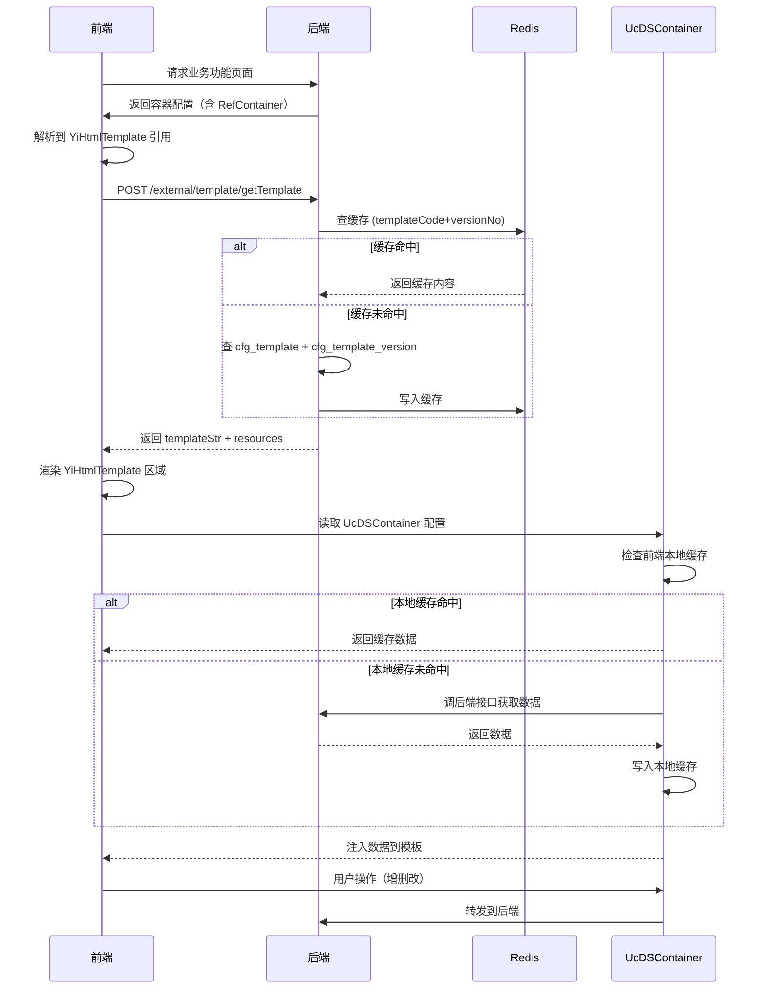
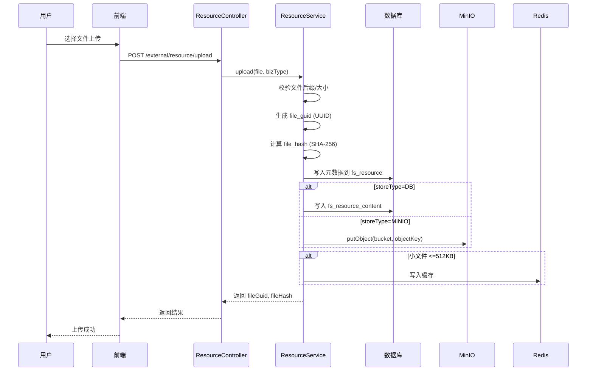
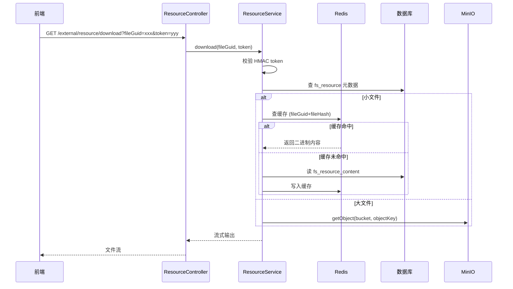
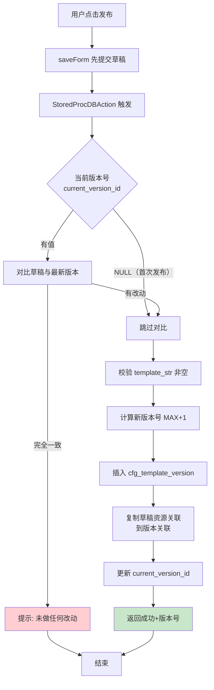
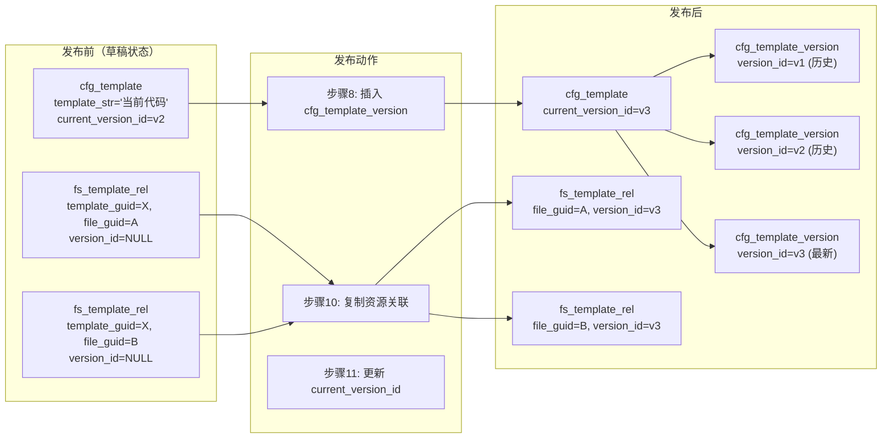
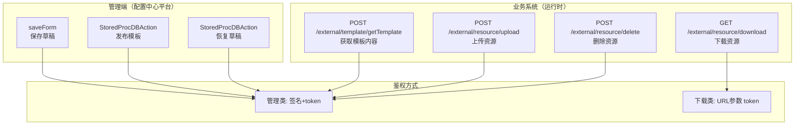

# 详细设计文档 - YiHtmlTemplate 模板配置中心

> 版本: v1.0 | 最后更新: 2026-07-31 | 负责人: 姜晓东

---

## 变更记录


| 日期         | 版本   | 变更内容 | 作者  |
| ---------- | ---- | ---- | --- |
| 2026-07-31 | v1.0 | 初版定稿 | 姜晓东 |


---

## 1. 功能概述

### 1.1 背景与目标

低代码配置中心目前支持表单、表格、列表等标准组件的配置，但对于复杂页面布局和自定义交互场景，标准配置组件无法覆盖。现有 `UcHtmlTemplate` 机制仅存储 `TemplateCode` 字符串，实际组件代码在 `baseHtmlTemplate/` 目录下，不是真正的"代码存数据库"。

**目标**：设计 `YiHtmlTemplate` 模板配置中心，将前端 HTML/JS 代码字符串存储在数据库中，通过后端 API 返回给前端动态渲染，同时提供版本管理、资源管理、静态文件管理能力。

### 1.2 功能范围

**包含：**

- 模板配置管理（创建、编辑、保存草稿）
- 模板版本管理（发布快照、版本历史、回切）
- 模板资源管理（图片、CSS、JS 文件上传/下载/替换/删除）
- 模板运行时 API（通过 templateCode 获取模板内容）
- 通用资源管理模块（可被其他业务复用）

**不包含（本次）：**

- 模板统一推送到业务系统
- 历史版本自动清理归档
- 前端模板渲染引擎（前端已实现）

### 1.3 核心概念


| 概念                 | 说明                                                                         |
| ------------------ | -------------------------------------------------------------------------- |
| **YiHtmlTemplate** | 新控件名，替代旧 UcHtmlTemplate                                                    |
| **模板（Template）**   | 前端 HTML/JS 代码字符串，存储在 `cfg_template` 表                                      |
| **版本（Version）**    | 发布时生成快照，**template\_str（代码）不可修改**；引用的资源始终取最新（见 §3.6），故版本回切仅还原代码、不还原资源当时的内容 |
| **资源（Resource）**   | 模板引用的图片、CSS、JS 等静态文件，存储在 `fs_resource` 表                                   |
| **草稿（Draft）**      | 编辑中的模板内容，保存在 `cfg_template` 表，可反复覆盖                                        |
| **发布（Publish）**    | 将草稿内容复制到 `cfg_template_version` 生成版本快照                                     |


---

## 2. 总体架构

### 2.1 模块划分

```
Java-Base/
├── base-resource/                   # [新增] 通用资源管理模块
│   ├── resource-client/
│   │   ├── entity/
│   │   │   ├── ResourceFile.java          # 资源元数据实体
│   │   │   └── ResourceContent.java       # 资源内容实体
│   │   └── enums/
│   │       └── ResourceStoreType.java     # DB=1 / MINIO=2
│   ├── resource-service/
│   │   ├── service/
│   │   │   ├── ResourceService.java       # 接口
│   │   │   └── ResourceServiceImpl.java   # 核心实现
│   │   └── config/
│   │       └── ResourceConfig.java        # @ConfigurationProperties
│   └── resource-controller/
│       └── ResourceController.java        # 上传/下载/删除
│
├── base-template/                   # [新增] 模板管理模块
│   ├── template-client/
│   │   └── entity/
│   │       ├── Template.java              # cfg_template 实体
│   │       └── TemplateVersion.java       # cfg_template_version 实体
│   ├── template-service/
│   │   └── service/
│   │       ├── TemplateService.java       # 模板查询接口
│   │       └── TemplateServiceImpl.java   # 核心实现
│   └── template-controller/
│       └── TemplateController.java        # 运行时 API
│
├── biz-frontend/                    # [现有] 管理端入口
│   └── controller/
│       ├── ConfigController.java          # saveForm 入口（现有）
│       └── ...                            # DataSevice 现有
│
├── core/config/                     # [现有]
│   └── action/
│       └── StoredProcDBAction.java        # 发布用存储过程容器（现有）
│
└── core/constant/
    └── ConfigConstants.java               # [现有] 新增常量
```

### 2.2 架构分层

```
┌──────────────────────────────────────────────────────┐
│                   配置中心平台（管理端）                  │
│                                                        │
│  模板管理页面 (配置驱动 UcGridviewContainer + UcFormDetail) │
│  资源管理页面 (配置驱动 UcGridviewContainer)              │
│                                                        │
│  保存草稿 → saveForm (ConfigController)                  │
│  发布     → StoredProcDBAction (存储过程)                │
│  上传资源 → ResourceController                          │
└──────────┬───────────────────────────────────────────┘
           │
           ▼
┌──────────────────────────────────────────────────────┐
│                   业务系统（运行时）                      │
│                                                        │
│  TemplateController                                    │
│  ├─ getTemplate("erow.YiReplyList.v3")                 │
│  │   → 返回 templateStr + 资源列表 [{fileGuid,fileHash}] │
│  └─ Redis 缓存 (key: yi:template:{productCode}:{templateCode}:{versionNo}，转小写)          │
│                                                        │
│  ResourceController                                    │
│  ├─ download(fileGuid) → 流式返回文件                   │
│  └─ 小文件走 Redis 缓存 / 大文件流式直读                  │
└──────────────────────────────────────────────────────┘
```

---

## 3. 数据库设计

### 3.1 表总览


| 表名                     | 数据库       | 说明                                   | 新增/现有 |
| ---------------------- | --------- | ------------------------------------ | ----- |
| `cfg_template`         | erow\_biz | 模板主表（草稿）                             | 新增    |
| `cfg_template_version` | erow\_biz | 模板版本历史                               | 新增    |
| `fs_resource`          | erow\_biz | 通用资源元数据表（instance\_guid+fn\_code 关联） | 新增    |
| `fs_resource_content`  | erow\_biz | 资源内容表（DB存储模式）                        | 新增    |
| `fs_template_rel`      | erow\_biz | 模板-资源关联表                             | 新增    |
| `fs_file`              | erow\_biz | 模板效果图（现有，instance\_guid 关联）          | 现有    |


### 3.2 cfg\_template（模板主表）

```sql
CREATE TABLE `cfg_template` (
  `row_guid`              varchar(32)  NOT NULL COMMENT 'UUID 主键',
  `template_code`         varchar(100) NOT NULL COMMENT '模板代码，与 product_code 联合唯一',
  `template_name`         varchar(200) NOT NULL COMMENT '模板名称',
  `description`           text         NOT NULL COMMENT '业务场景描述（必填）',
  `product_code`          varchar(50)  NOT NULL COMMENT '产品代码，FK→scr_product.product_code，与 template_code 联合唯一',
  `template_data_schema`  longtext     NULL     COMMENT '数据源格式描述（JSON Schema）',
  `template_str`          longtext     NULL     COMMENT 'HTML/JS 代码字符串（草稿内容）',
  `current_version_id`    int          NULL     COMMENT '当前发布版本ID，FK→cfg_template_version.version_id',
  `create_by`             bigint       NOT NULL,
  `create_date`           datetime     NOT NULL,
  `last_update_by`        bigint       NOT NULL,
  `last_update_date`      datetime     NOT NULL,
  `delete_flag`           int          DEFAULT 0 COMMENT '0=正常, -1=已删除',
  PRIMARY KEY (`row_guid`),
  UNIQUE KEY `uk_template_product` (`product_code`, `template_code`),
  KEY `idx_product_code` (`product_code`)
) ENGINE=InnoDB DEFAULT CHARSET=utf8mb4 COMMENT='YiHtmlTemplate 模板主表（草稿）';
```

**说明：**

- `cfg_template` 始终存储当前草稿内容，可反复覆盖
- 未发布时 `current_version_id` 为 NULL
- 效果图通过 `fs_file` 关联：`fs_file.instance_guid = cfg_template.row_guid` 且 `fs_file.fn_code = 'cfg_template'`
- `template_code` 创建后不可修改，通过配置中心表单配置为只读（`IsAllowUpdate=false`），saveForm 提交时自动忽略此字段
- `(product_code, template_code)` 联合唯一，不同产品下可用相同 template\_code
- 软删除时 `template_code` 追加 `_delete_<row_guid>` 后缀，释放原始唯一键，允许同名模板重建：
  ```sql
  UPDATE cfg_template SET template_code = CONCAT(template_code, '_delete_', row_guid), delete_flag = -1
  WHERE row_guid = :guid AND template_code NOT LIKE '%_delete_%';
  ```

### 3.3 cfg\_template\_version（版本历史表）

```sql
CREATE TABLE `cfg_template_version` (
  `version_id`         int          AUTO_INCREMENT COMMENT '版本ID，自增主键',
  `template_guid`      varchar(32)  NOT NULL COMMENT '关联模板 GUID',
  `version_no`         varchar(20)  NOT NULL COMMENT '版本号，自增 v1/v2/v3...',
  `template_str`       longtext     NOT NULL COMMENT '发布时的代码快照',
  `template_data_schema` longtext   NULL     COMMENT '发布时的数据格式快照',
  `change_reason`      varchar(500) NULL     COMMENT '变更说明',
  `create_by`          bigint       NOT NULL,
  `create_date`        datetime     NOT NULL,
  `delete_flag`        int          DEFAULT 0,
  PRIMARY KEY (`version_id`),
  KEY `idx_template_guid` (`template_guid`),
  UNIQUE KEY `uk_version_no` (`template_guid`, `version_no`)
) ENGINE=InnoDB DEFAULT CHARSET=utf8mb4 COMMENT='YiHtmlTemplate 模板版本历史';
```

**版本号生成规则：**

- 首个版本为 `v1`，后续每次发布 `version_no` 自增
- 由存储过程生成，使用 `CONCAT('v', COALESCE(MAX(CAST(SUBSTRING(version_no,2) AS SIGNED)), 0) + 1)` 逻辑

### 3.4 fs\_resource（资源元数据表）

```sql
CREATE TABLE `fs_resource` (
  `row_guid`         varchar(32)  NOT NULL COMMENT 'UUID 主键',
  `file_guid`        varchar(32)  NOT NULL COMMENT '资源唯一标识',
  `file_name`        varchar(200) NOT NULL COMMENT '原始文件名',
  `content_type`     varchar(100) NULL     COMMENT 'MIME 类型',
  `file_type`        varchar(20)  NULL     COMMENT 'IMAGE / CSS / JS / OTHER',
  `store_type`       int          DEFAULT 1 COMMENT '存储类型: 1=DB, 2=MINIO',
  `object_key`       varchar(255) NULL     COMMENT 'MinIO 对象键，仅 MINIO 模式使用',
  `content_size`     int          NULL     COMMENT '文件大小（字节）',
  `file_hash`        varchar(100) NULL     COMMENT 'SHA-256, 用于前端缓存版本比较',
  `instance_guid`    varchar(32)  NULL     COMMENT '关联业务实例 GUID（如 template_guid），与 fn_code 配合使用',
  `fn_code`          varchar(60)  NULL     COMMENT '功能点代码，如 cfg_template，与 instance_guid 配合使用',
  `create_by`        bigint       NOT NULL,
  `create_date`      datetime     NOT NULL,
  `last_update_by`   bigint       NOT NULL,
  `last_update_date` datetime     NOT NULL,
  `delete_flag`      int          DEFAULT 0,
  PRIMARY KEY (`row_guid`),
  UNIQUE KEY `uk_file_guid` (`file_guid`),
  KEY `idx_file_hash` (`file_hash`),
  KEY `idx_instance` (`instance_guid`, `fn_code`)
) ENGINE=InnoDB DEFAULT CHARSET=utf8mb4 COMMENT='通用资源元数据表，bizType 由 API 参数传入，不入表';
```

**说明：**

- 通用资源表，`instance_guid` + `fn_code` 关联业务实体，与 `fs_file` 模式一致
- 资源与模板的关联通过 `fs_template_rel` 关联表实现，支持多对多
- 前端通过 `file_hash` 判断缓存是否过期

### 3.5 fs\_resource\_content（资源内容表）

```sql
CREATE TABLE `fs_resource_content` (
  `file_guid`  varchar(32) NOT NULL COMMENT '关联 fs_resource.file_guid',
  `content`    longblob    NULL     COMMENT '文件二进制内容',
  PRIMARY KEY (`file_guid`)
) ENGINE=InnoDB DEFAULT CHARSET=utf8mb4 COMMENT='YiHtmlTemplate 资源内容（DB存储模式）';
```

### 3.6 fs\_template\_rel（资源关联表）

```sql
CREATE TABLE `fs_template_rel` (
  `row_guid`       varchar(32) NOT NULL COMMENT 'UUID 主键',
  `file_guid`      varchar(32) NOT NULL COMMENT '关联 fs_resource.file_guid',
  `template_guid`  varchar(32) NULL     COMMENT '草稿关联，FK→cfg_template.row_guid',
  `version_id`     int         NULL     COMMENT '版本关联，FK→cfg_template_version.version_id',
  `file_hash`      varchar(100) NULL    COMMENT '发布时的文件 hash，用于缓存版本比较',
  `create_date`    datetime    NOT NULL,
  PRIMARY KEY (`row_guid`),
  KEY `idx_file_guid` (`file_guid`),
  KEY `idx_template_guid` (`template_guid`),
  KEY `idx_version_id` (`version_id`),
  UNIQUE KEY `uk_draft` (`file_guid`, `template_guid`),
  UNIQUE KEY `uk_version` (`file_guid`, `version_id`)
) ENGINE=InnoDB DEFAULT CHARSET=utf8mb4 COMMENT='资源关联表：草稿关联(template_guid) + 版本关联(version_id)';
```

**说明：**

- 一张表支撑两个维度：草稿关联（`template_guid`）和版本关联（`version_id`）
- 草稿阶段：`template_guid=XX, version_id=NULL, file_hash=NULL`
- 发布时：复制草稿关联到版本关联，同时记录发布时的 `file_hash`
- 运行时：走 `version_id` 查询，资源文件全局共享，替换后所有版本即时生效。代价：发布后替换/删除某共享资源，会影响所有引用它的已发布版本的展示；如业务要求资源随版本固化，需后续 Phase 扩展
- 编辑器：走 `template_guid` 查询，草稿关联
- 表间外键由应用层保证，DDL 不设 FOREIGN KEY 约束；删除模板时需先清理版本和关联记录

---

## 4. 数据源设计

### 4.1 核心原则

YiHtmlTemplate **含数据绑定和数据操作逻辑**，但所有数据交互不直接走后端，而是通过 `UcDSContainer` 中转：

```
┌────────────────────────────────────────────────────────────────────┐
│  YiHtmlTemplate（模板层）                                           │
│  ├─ UI 渲染（HTML/JS 代码）                                        │
│  ├─ 数据绑定（声明需要哪些数据字段）                                  │
│  └─ 数据操作（增删改查，通过 UcDSContainer 暴露的接口调用）            │
│                                                                      │
│     所有数据交互 → 调 UcDSContainer 的接口                            │
│     UcDSContainer → 和后端交互（SQL/存储过程/API）                    │
│     UcDSContainer → 支持前端本地缓存                                  │
└────────────────────────────────────────────────────────────────────┘
         ↑ 通过 RefContainer 引用 templateCode
         │
┌────────────────────────────────────────────────────────────────────┐
│  业务功能点：使用层                                                    │
│                                                                      │
│  UcContainer（业务主容器）                                            │
│    └── RefContainer（引用 YiHtmlTemplate）                            │
│          ├─ 属性: templateCode = "erow.YiReplyList.v3"               │
│          ├─ 子控件: YiHtmlTemplate（前端渲染区）                       │
│          └─ 子控件: UcDSContainer（数据源提供者）← 每个业务各自配置    │
│               ├─ 数据查询（SQL/存储过程/接口）                         │
│               ├─ 数据操作（增删改）                                   │
│               └─ 前端本地缓存                                         │

### 4.2 架构关系

```

┌────────────────────────────────────────────────────────────────────┐
│  配置中心：模板定义层                                                  │
│  cfg\_template.template\_str          ← 前端 UI 代码                    │
│  cfg\_template.template\_data\_schema  ← 期望的数据格式描述（JSON Schema）│
│  cfg\_template 本身不涉及任何数据源配置                                   │
└────────────────────────────────────────────────────────────────────┘
↑ 通过 RefContainer 引用 templateCode
│
┌────────────────────────────────────────────────────────────────────┐
│  业务功能点：使用层                                                    │
│                                                                      │
│  UcContainer（业务主容器）                                            │
│    └── RefContainer（引用 YiHtmlTemplate）                            │
│          ├─ 属性: templateCode = "erow.YiReplyList.v3"               │
│          ├─ 子控件: YiHtmlTemplate（前端渲染区）                       │
│          └─ 子控件: UcDSContainer（数据源定义） ← 每个业务各自配置      │
│                                                                      │
│  场景举例：                                                           │
│  ┌──────────────────────────────────────────────────────┐            │
│  │ 模板 YiReplyList（回复列表）被两个业务引用：            │            │
│  │                                                      │            │
│  │ 业务A: 售后工单回复                                     │            │
│  │   ├─ YiHtmlTemplate（templateCode=erow.YiReplyList.v3）│            │
│  │   └─ UcDSContainer（SQL: 查售后工单回复表）            │            │
│  │                                                      │            │
│  │ 业务B: 审批意见回复                                     │            │
│  │   ├─ YiHtmlTemplate（templateCode=erow.YiReplyList.v3）│            │
│  │   └─ UcDSContainer（SQL: 查审批意见表）                │            │
│  └──────────────────────────────────────────────────────┘            │
└────────────────────────────────────────────────────────────────────┘

```

### 4.3 业务引用规范

业务功能点通过 `RefContainer` 引用 YiHtmlTemplate 时，`templateCode` 属性使用三段式格式，**三段均必填**：

```

格式: {productCode}.{templateCode}.{versionNo}
例:   erow.YiReplyList.v3

各段说明:
productCode  → 必填，产品代码，参与唯一性约束与查询过滤
templateCode → 必填，对应 cfg\_template.template\_code（与 productCode 联合唯一）
versionNo    → 必填，版本号，必须指定具体版本

```

**解析规则：**

```

约束: templateCode 不允许包含 "." 字符，否则解析歧义
约束: 三段均必填，缺段报错

统一算法:
segments = fullCode.split(".")
if segments.size != 3:
error("三段式必须为 {productCode}.{templateCode}.{versionNo}，请检查输入: " + fullCode)
productCode = segments\[0\]; templateCode = segments\[1\]; versionNo = segments\[2\]
if not /^v\\d+$/.test(versionNo):
error("版本号格式必须为 v1/v2/v3...，请检查输入: " + versionNo)
if templateCode 包含 ".":
error("templateCode 不允许包含 '.'，请检查输入: " + fullCode)

示例:
"erow.YiReplyList.v3" → productCode="erow", templateCode="YiReplyList", versionNo="v3"
"YiReplyList.v3" → 报错（缺 productCode）
"erow.YiReplyList" → 报错（缺 versionNo）

```

**getTemplate 接口接收参数：**

```

POST /external/template/getTemplate
Request: { "templateCode": "erow.YiReplyList.v3" }
→ 后端解析三段式，拆出 productCode, templateCode, versionNo
→ 按 templateCode + versionNo 查询模板内容
→ 返回结果（同前）

```

### 4.4 运行时渲染流程



**文字流程：**

```
1. 前端打开业务功能页面
2. 后端返回容器配置 → 前端解析到 RefContainer 引用了 YiHtmlTemplate
3. 前端提取 templateCode → 调 POST /external/template/getTemplate
4. 返回 templateStr + templateDataSchema
5. 前端渲染 YiHtmlTemplate 区域，解析 templateStr 中的数据绑定声明
6. 前端读取 YiHtmlTemplate 子控件中的 UcDSContainer 配置
7. UcDSContainer 检查前端本地缓存 → 命中则直接返回，未命中则调后端接口
8. 数据注入到 YiHtmlTemplate 中渲染，绑定数据操作事件
9. 用户操作（增删改）→ 通过 UcDSContainer 转发到后端
```

### 4.5 资源引用解析

模板代码中使用 `resource://{file_guid}` 引用资源，由前端负责替换为真实 URL。

**前端替换规则：**

```
模板代码: 
getTemplate 返回: resources: [{ fileGuid, fileHash, downloadUrl }]

前端处理:
  1. getTemplate 返回的 resources 列表中已包含带短时效签名的 downloadUrl
  2. 对 templateStr 做正则替换:
resource://{file_guid} -> downloadUrl
   3. 未在 resources 列表中找到的 guid -> 渲染为"【资源不可用】"占位
```

**说明：**

- downloadUrl 由后端在 getTemplate 返回时生成，包含短时效签名 token
- 前端直接使用该 URL，无需额外申请 token
- 签名过期后前端重新请求 getTemplate 即可获取新 URL

### 4.6 template\_data\_schema 的作用

`template_data_schema` 字段描述模板期望的数据结构，是**模板与数据源之间的契约**：

- 模板开发者定义：`template_data_schema = { "list": [...], "totalCount": 0 }`
- 业务配置者参考：根据 schema 配置 UcDSContainer 返回匹配的数据格式
- 后续可扩展：前端根据 schema 自动生成模拟数据，或校验数据源返回格式是否匹配

### 4.7 约束规则


| 规则                            | 说明                                                |
| ----------------------------- | ------------------------------------------------- |
| 所有数据交互必须通过 UcDSContainer      | 禁止在 template\_str 中直接发 HTTP 请求调用后端                |
| 模板声明数据绑定                      | template\_str 中通过约定语法声明需要的数据字段，UcDSContainer 负责提供 |
| 数据源由业务方配置                     | 每个引用模板的业务功能点独立配置 UcDSContainer                    |
| UcDSContainer 支持前端缓存          | 减少重复请求，提升渲染性能                                     |
| template\_data\_schema 是模板的承诺 | 模板期望什么数据格式，业务方按此配置 UcDSContainer                  |


---

## 5. 后端模块设计

### 5.1 base-resource 模块（通用资源管理）

#### 5.1.1 定位

独立于 `FileService`/`fs_file` 的轻量级资源管理模块，支持多业务场景共用同一套表结构 + 不同表名。不依赖缩略图、水印、格式转换等复杂逻辑。

#### 5.1.2 配置设计

```yaml
base:
  resource:
    types:
      yi_template:                    # bizType 标识
        resourceTable: fs_resource      # 资源元数据表名
        contentTable: fs_resource_content # 资源内容表名（三段式命名）
        defaultStoreType: MINIO       # 默认存 MinIO
        allowSuffix: JPG|JPEG|PNG|GIF|SVG|CSS|JS|JSON
        fileMaxSize: 20               # MB
        minioBucket: fs-resource
      business_attach:                # 其他业务（示例）
        resourceTable: biz_attach_resource
        contentTable: biz_attach_resource_content
        defaultStoreType: DB
        allowSuffix: JPG|JPEG|PNG|PDF
        fileMaxSize: 50
    cache:
      enabled: true
      maxFileSize: 512                # 超过此大小(KB)不进缓存
      ttl: 3600                       # 缓存过期时间(秒)
```

#### 5.1.3 核心流程



**上传流程：**

```
upload(file, bizType)
  → 解析 bizType → 查 ResourceConfig（取 resourceTable / contentTable）
  → 校验文件后缀/大小
  → 生成 file_guid (UUID)
  → 计算 file_hash (SHA-256)
  → 写入元数据到 resourceTable
  → 按 storeType 路由:
      storeType=DB   → 写入 contentTable
      storeType=MINIO → MinioUtil.putObject(bucket, objectKey, file)
  → 如果是小文件(<=cache.maxFileSize):
      → 同时写入 Redis (key=resource:content:{fileGuid}:{fileHash}，所有分段转小写)
  → 返回 { fileGuid, fileHash, fileSize }
```



**下载流程：**

```
download(fileGuid, bizType, token)
  → 校验 token 有效性（HMAC 签名，含 fileGuid + bizType + 过期时间）
  → 查 resourceTable 元数据（取 content 流或 MinIO 对象）
  → 如果是小文件:
      → 查 Redis (key=resource:content:{fileGuid}:{fileHash}，所有分段转小写)
      → 命中 → 流式写入 Response OutputStream
      → 未命中 → 从存储读流 → 写入 Redis → 流式写入 Response
  → 如果是大文件:
      → 直接从存储读流 → 流式写入 Response OutputStream
      → 支持 HTTP Range 分段下载
```

**替换流程（覆盖上传）：**

```
replace(fileGuid, file, bizType)
  → 查原有记录
  → 删除旧文件（DB 或 MinIO）
  → 上传新文件
  → 更新 file_hash, content_size, content_type
  → 写入新 hash 的缓存（无需主动删除旧 key，hash 变更后 key 自动隔离）
  → 返回新的 fileHash
```

### 5.2 base-template 模块（模板运行时）

#### 5.2.1 定位

提供模板运行时 API，查询模板内容及关联资源，配合 Redis 缓存层。

#### 5.2.2 核心流程

**获取模板内容：**

```
getContent(三段式TemplateCode)
  → 解析三段式，拆出 productCode, templateCode, versionNo
  → 查 cfg_template WHERE product_code = :pc AND template_code = :tc
  → 如果 delete_flag = -1 → 报错"模板已删除或下线"
  → 取 row_guid, current_version_id
  → 查 cfg_template_version WHERE template_guid = :guid AND version_no = :vno
  → 取 template_str（版本快照），取 version_id
  → 查关联资源（通过版本关联）:
      SELECT fr.*, rel.file_hash AS publish_hash
      FROM fs_resource fr
      JOIN fs_template_rel rel ON fr.file_guid = rel.file_guid
      WHERE rel.version_id = :version_id
  → 返回 { templateStr, templateCode, versionNo,
          resources: [{fileGuid, fileName, fileHash, publishHash, downloadUrl}] }
  → downloadUrl 在响应前实时生成（HMAC 签名），不入缓存
  → 写入 Redis 缓存 (key=yi:template:{productCode}:{templateCode}:{versionNo}，所有分段转小写，不含 downloadUrl)
```

**版本历史查询：** 通过配置中心 UcGridviewContainer 直接查 `cfg_template_version` 表，按 `version_id DESC` 排序（注意：不用 `version_no`，varchar 排序会导致 v10 &lt; v2）。

**发布流程的事务说明：**
saveForm 先提交写入 cfg\_template（草稿），随后 StoredProcDBAction 触发发布存储过程。两者在同一请求事务内，saveForm 提交后发布存储过程能读到已持久化的草稿内容。

### 5.3 发布流程（StoredProcDBAction）

发布不通过独立 API，通过配置中心的 `StoredProcDBAction` 机制，在 `saveForm` 生命周期中自动触发。



**存储过程 `PublishHtmlTemplate` 逻辑：**

```
1. 接收参数: p_template_guid, p_user_id, p_change_reason
   输出参数: p_message VARCHAR(500)
2. 读取 cfg_template 当前内容（template_str, template_data_schema）
3. 读取当前草稿关联资源 hash:
      SELECT file_guid, file_hash FROM fs_resource
      WHERE file_guid IN (
          SELECT file_guid FROM fs_template_rel
          WHERE template_guid = :template_guid AND version_id IS NULL
      )
4. 如果 current_version_id IS NOT NULL:
      读取最新发布版本内容做对比:
      SELECT v.template_str, v.template_data_schema, r.file_guid, r.file_hash
      FROM cfg_template_version v
      LEFT JOIN fs_template_rel r ON v.version_id = r.version_id
      WHERE v.version_id = (
          SELECT current_version_id FROM cfg_template WHERE row_guid = :template_guid
      )
   → 如果 template_str、template_data_schema、资源列表和 hash 完全一致
      → SET p_message = '未做任何改动，无需发布'; RETURN
   否则（current_version_id IS NULL，首次发布）:
      → 跳过对比，直接进入发布流程
5. 校验 template_str 非空（首次发布必须有代码内容）
6. 校验 version_no 格式: 检查现有版本号均符合 v\d+ 格式，否则报错
7. 计算新版本号: SELECT MAX(CAST(SUBSTRING(version_no,2) AS SIGNED))
   FROM cfg_template_version WHERE template_guid = :guid
   → 新版本号 = CONCAT('v', COALESCE(max_no, 0) + 1)
   → 注意：并发时可能重复，唯一键冲突(1062)时自动重试。建议在 Java 层捕获唯一键冲突并重试，存储过程保持简单。若在存储过程中处理，需区分 1062（版本号冲突）和其他异常：1062 且重试次数 < 3 则重试，其他异常抛出让外层事务回滚。
8. 插入 cfg_template_version (template_guid, version_no, template_str,
   template_data_schema, change_reason, create_by, create_date)
9. 获取 version_id (LAST_INSERT_ID)
10. 复制草稿资源关联到版本关联:
   INSERT INTO fs_template_rel (file_guid, version_id, file_hash, create_date)
   SELECT r.file_guid, :version_id, r2.file_hash, NOW()
   FROM fs_template_rel r
   JOIN fs_resource r2 ON r.file_guid = r2.file_guid
   WHERE r.template_guid = :template_guid AND r.version_id IS NULL
11. 更新 cfg_template.current_version_id = :version_id
12. SET p_message = '发布成功，版本号: ' + v_new_version_no; RETURN
```

### 5.4 回切流程（Rollback）

回切操作分两步：**先查看历史版本内容**，**确认后再恢复到草稿**。

**步骤一：查看历史版本内容（只读）**

```
previewVersion(version_id, template_guid)
  1. 读取 cfg_template_version 内容
  2. 读取该版本关联的资源:
     SELECT fr.*, rel.file_hash AS publish_hash
     FROM fs_resource fr
     JOIN fs_template_rel rel ON fr.file_guid = rel.file_guid
     WHERE rel.version_id = :version_id
  3. 返回 { templateStr, templateDataSchema, resources: [{fileGuid, fileHash, ...}] }
     → 前端预览展示，不修改任何数据
```

**步骤二：确认恢复到草稿（显式写入）**

```
RestoreVersionToDraft(version_id, template_guid, user_id)
  → 前端显示确认对话框:"将用 v2 的内容覆盖当前草稿，当前编辑内容将丢失。确认？"
  → 用户确认后执行:
  1. 读取 cfg_template_version 内容
  2. UPDATE cfg_template
     SET template_str = :版本快照的template_str,
         template_data_schema = :版本快照的template_data_schema,
         last_update_by = :user_id,
         last_update_date = NOW()
     WHERE row_guid = :template_guid
  3. 删除当前草稿资源关联:
     DELETE FROM fs_template_rel
     WHERE template_guid = :template_guid AND version_id IS NULL
  4. 复制版本资源关联到草稿:
     INSERT INTO fs_template_rel (file_guid, template_guid, create_date)
     SELECT file_guid, :template_guid, NOW()
     FROM fs_template_rel
     WHERE version_id = :目标版本的version_id
  5. 返回成功
```

**注意：**

- 回切到草稿后，`current_version_id` 不变（仍指向上次发布版本）
- 用户需要手动点击"发布"才会生成新版本
- 确认对话框是防止误操作的最后一道屏障

### 5.5 数据流向图



#### 5.5.1 发布数据流向

```
发布前（草稿状态）:
  cfg_template (row_guid=X, template_str="当前代码", current_version_id=v2)
    └── fs_template_rel (template_guid=X, file_guid=A, version_id=NULL)
    └── fs_template_rel (template_guid=X, file_guid=B, version_id=NULL)

发布动作:
  步骤8 → 插入 cfg_template_version (version_id=v3, template_guid=X, template_str="当前代码")
  步骤10 → 复制草稿关联到版本关联:
           fs_template_rel (file_guid=A, version_id=v3, file_hash=abc)
           fs_template_rel (file_guid=B, version_id=v3, file_hash=def)
  步骤11 → UPDATE cfg_template SET current_version_id = v3

发布后:
  cfg_template (row_guid=X, template_str="当前代码", current_version_id=v3)
    ├── cfg_template_version (version_id=v1, template_str="v1代码")  ← 历史
    ├── cfg_template_version (version_id=v2, template_str="v2代码")  ← 历史
    └── cfg_template_version (version_id=v3, template_str="当前代码") ← 最新
    ├── fs_template_rel (template_guid=X, file_guid=A, version_id=NULL)        ← 草稿关联
    ├── fs_template_rel (template_guid=X, file_guid=B, version_id=NULL)        ← 草稿关联
    ├── fs_template_rel (file_guid=A, version_id=v3, file_hash=abc)            ← 版本关联
    └── fs_template_rel (file_guid=B, version_id=v3, file_hash=def)            ← 版本关联
```

#### 5.5.2 运行时查询数据流向

```
  → 解析出 productCode=erow, templateCode=YiReplyList, versionNo=v3
  → 查 cfg_template WHERE product_code='erow' AND template_code='YiReplyList' → 取 row_guid
  → 查 cfg_template_version WHERE template_guid=:guid AND version_no='v3'
  → 取 template_str（v3 发布时的代码快照）
  → 查 fs_template_rel WHERE version_id=v3  → 得到 file_guid 列表
  → 查 fs_resource WHERE file_guid IN (...) → 得到文件元数据 + publish_hash
  → 返回给前端

#### 5.5.3 回切数据流向

```

回切到 v2（只读预览）:
→ 查 cfg\_template\_version WHERE version\_id=v2   → 取 template\_str
→ 查 fs\_template\_rel WHERE version\_id=v2 → 取关联资源列表
→ 返回给前端预览（不写任何数据）

确认恢复草稿:
→ UPDATE cfg\_template SET template\_str = v2的代码
→ DELETE FROM fs\_template\_rel WHERE template\_guid=X AND version\_id IS NULL
→ INSERT INTO fs\_template\_rel (file\_guid, template\_guid) ← 从 v2 的关联复制
→ cfg\_template.current\_version\_id 不变（仍指向 v3）

恢复后:
cfg\_template (row\_guid=X, template\_str="v2的代码", current\_version\_id=v3)
├── 草稿关联: file\_guid=A（来自 v2 的关联）
└── 版本关联不变化（v2/v3 的关联记录完整保留）

```

---

## 6. 接口设计



### 6.1 对外接口规范

- 遵循平台 `/external/...` 前缀规范
- 管理类接口（upload、delete）使用 `@ApiAnnotation(checkSign = true)` 签名校验
- 下载类接口（download）使用 GET + 短时效 token 参数，兼容 `` 标签直链
- 鉴权方式：HTTP Headers `Authorization` 传 token（管理类）；download 通过 URL 参数 `?token=xxx` 传递
- 响应格式：统一 `AjaxResult`

### 6.2 资源管理接口（base-resource）


| 接口                                | 方法   | 描述                                             | 鉴权           |
| --------------------------------- | ---- | ---------------------------------------------- | ------------ |
| `POST /external/resource/upload`  | 上传文件 | 上传单个文件，按 bizType 配置存储                          | 签名+token     |
| `GET /external/resource/download` | 下载文件 | 按 fileGuid 下载，GET 兼容 `` 标签，URL 带短时效 token | token(URL参数) |
| `POST /external/resource/delete`  | 删除文件 | 删除资源文件（检查草稿关联）                                 | 签名+token     |


> 其他资源操作（列表查询、替换、引用查询、批量上传等）后续通过 UcDSContainer 配置实现，不在本次接口范围内。

**请求/响应示例：**

```
POST /external/resource/upload
  Request: multipart/form-data
    file: (binary)
    bizType: "yi_template"
  Response:
    {
      "code": 200,
      "data": {
        "fileGuid": "abc123...",
        "fileName": "background.png",
        "fileHash": "sha256hash...",
        "fileSize": 2048576
      }
    }

GET /external/resource/download
  Request: GET /external/resource/download?fileGuid=abc123...&bizType=yi_template&token=short_lived_token
  Response: 文件流 (Content-Type: image/png)
```

### 6.3 模板运行时接口（base-template）


| 接口                                    | 方法     | 描述                                                            | 鉴权       |
| ------------------------------------- | ------ | ------------------------------------------------------------- | -------- |
| `POST /external/template/getTemplate` | 获取模板内容 | 传入三段式 templateCode（如 `erow.YiReplyList.v3`，三段均必填），返回模板内容+资源列表 | 签名+token |


> 版本历史查询通过配置中心 UcGridviewContainer 直接查 `cfg_template_version` 表实现，不走独立接口。
> 菜单/功能点引用了哪些模板，通过现有 `sysLoadConfigData` 接口返回的容器配置中提取。

**请求/响应示例：**

```
POST /external/template/getTemplate
  Request: { "templateCode": "erow.YiReplyList.v3" }
  Response:
    {
      "code": 200,
      "data": {
        "templateCode": "YiReplyList",
        "productCode": "erow",
        "versionNo": "v3",
        "templateStr": "<template>...</template><script>...</script>",
        "templateDataSchema": "{...}",
        "resources": [
          {
            "fileGuid": "abc123...",
            "fileName": "background.png",
            "fileHash": "sha256hash...",
            "publishHash": "sha256hash...",
            "downloadUrl": "/external/resource/download?fileGuid=abc123...&bizType=yi_template&token=xxx"
          }
        ]
      }
    }
```

### 6.4 管理端接口（现有，配置中心）


| 接口                   | 功能     | 说明                                          |
| -------------------- | ------ | ------------------------------------------- |
| `saveForm`           | 保存模板草稿 | 现有 UcFormDetail，写入 cfg\_template            |
| `StoredProcDBAction` | 发布模板   | 按钮配置 DBAction，调用 `PublishHtmlTemplate` 存储过程 |
| `StoredProcDBAction` | 恢复草稿   | 版本明细页按钮，调用 `RestoreVersionToDraft` 存储过程     |


---

## 7. 缓存设计

### 7.1 模板内容缓存

```
Key:     yi:template:{productCode}:{templateCode}:{versionNo}
         （所有分段统一转小写: productCode + templateCode + versionNo 均 toLowerCase）
Value:   JSON (templateStr + templateDataSchema + resources元数据不含downloadUrl)
         resources元数据: [{fileGuid, fileName, fileHash, publishHash, storeType}]
         downloadUrl 不在缓存中，由每次响应时实时签名生成
TTL:     30 天（2,592,000 秒），每次访问自动续期
共享:    全局共享，不区分用户
失效:    发布新版本时写入新版本缓存；旧版本 key 30 天后自然过期（每个版本独立 key，互不干扰）
        模板删除后缓存最长仍可存活 30 天（TTL 自然过期），若要求"下线即停服"需手动模式删 `DEL yi:template:{productCode}:{templateCode}:*`
```

### 7.2 资源文件缓存

```
Key:     resource:content:{fileGuid}:{fileHash}
         （所有分段统一转小写: fileGuid + fileHash 均 toLowerCase）
Value:   byte[]（仅小文件，<=512KB）
TTL:     3600 秒
失效:    资源替换时 fileHash 变更，key 自动隔离
        无需手动失效，旧 key 自然过期
```

### 7.3 前端缓存策略

```
资源缓存:
  1. 前端从 getTemplate 接口获取资源列表，包含 fileHash
  2. 以 fileHash 为 key 缓存到 localStorage/IndexedDB
  3. 请求资源时，先查缓存 key = fileHash 是否命中
  4. 命中 → 直接使用缓存
  5. 未命中 → 调 download(fileGuid) → 以 fileHash 为 key 缓存
  6. 模板更新后 fileHash 变化 → 缓存自动失效

模板内容缓存:
  1. 前端以 templateCode + versionNo 为 key 缓存 templateStr
  2. 页面刷新时优先取缓存，异步校验版本是否最新
```

---

## 8. 菜单与 UI 设计

### 8.1 菜单结构

```
配置中心（父菜单）
  ├── 模板管理
  │     ├─ FN_CODE = cfg_template
  │     ├─ MENU_TYPE_ID = 2（功能页面）
  │     └─ PAGE_URL = 空（配置驱动）
  └── 资源管理
        ├─ FN_CODE = fs_resource
        ├─ MENU_TYPE_ID = 2（功能页面）
        └─ PAGE_URL = 空（配置驱动）
```

### 8.2 模板列表页（UcGridviewContainer）

```
┌──────────────────────────────────────────────────────────────┐
│  [搜索栏: 模板代码___ 模板名称___ 产品代码:下拉▼ 搜索]        │
├──────┬──────┬──────┬──────┬──────┬──────┐
│ 效果图 │ 模板代码  │ 名称  │ 产品  │ 版本  │ 发布  │
│       │      │      │      │      │ 时间  │
├──────┼──────┼──────┼──────┼──────┼──────┤
│ [img] │RList │回复列表 │Erow  │ v3   │07-31 │
│ [img] │CView │卡片视图 │Erow  │ v1   │07-30 │
│ [img] │NewCp │新组件   │YTB   │ -    │ -    │
├──────┴──────┴──────┴──────┴──────┴──────┤
│  [+ 新增模板]                               │
└──────────────────────────────────────────────────────────────┘
```

**按钮逻辑：**


| 按钮   | 操作码  | 行为                                  |
| ---- | ---- | ----------------------------------- |
| 新增模板 | ADD  | 打开空模板编辑页                            |
| 点击行  | 进入明细 | 进入模板编辑页（UcFormDetailView），操作在明细页内完成 |


### 8.3 模板编辑页（UcFormDetailView）

```
┌──────────────────────────────────────────────────────────────┐
│  模板编辑                                ┌──────────┐        │
│                                           │ [效果图]  │        │
│                                           │ UcPhoto  │        │
│                                           └──────────┘        │
├──────────────────────────────────────────────────────────────┤
│  基本信息区域                                                │
│  ┌──────────────────────────────────────────────────────┐    │
│  │ 模板代码: [YiReplyList        ] (只读)               │    │
│  │ 模板名称: [回复列表           ]                     │    │
│  │ 业务场景: [回复列表功能，用于展示...] (必填)          │    │
│  │ 产品代码: [▼ Erow            ]                      │    │
│  └──────────────────────────────────────────────────────┘    │
│                                                              │
│  代码编辑区域                                                │
│  ┌──────────────────────────────────────────────────────┐    │
│  │ <template>                                           │    │
│  │   <div class="reply-list">...</div>                  │    │
│  │ </template>                                          │    │
│  │ <script> export default { ... } </script>            │    │
│  └──────────────────────────────────────────────────────┘    │
│                                                              │
│  数据格式区域                                                │
│  ┌──────────────────────────────────────────────────────┐    │
│  │ { "type": "object", "properties": {                 │    │
│  │   "list": { "type": "array", "items": {             │    │
│  │     "type": "object", "properties": {               │    │
│  │       "id": { "type": "string" },                   │    │
│  │       "title": { "type": "string" },                │    │
│  │       "content": { "type": "string" }               │    │
│  │     } } },                                          │    │
│  │   "totalCount": { "type": "integer" }               │    │
│  │ } }                                                   │    │
│  └──────────────────────────────────────────────────────┘    │
│                                                              │
│  引用资源区域                                                │
│  ┌──────────────────────────────────────────────────────┐    │
│  │ file_guid      │ file_name        │ 操作  │    │
│  │ abc123...      │ background.png   │ 移除  │    │
│  │ def456...      │ logo.svg         │ 移除  │    │
│  │ [选择资源] 按钮                                            │    │
│  └──────────────────────────────────────────────────────┘    │
│                                                              │
│  ┌──────┬──────┬──────┐                                       │
│  │ 基本信息  │ 版本历史 │ 引用资源 │  ← UcTab                │
│  ├──────┴──────┴──────┤                                       │
│  │ 版本历史（UcGridviewContainer）                             │
│  │ ┌────────┬──────────┬──────────┬──────────┐               │
│  │ │ 版本号  │ 发布时间   │ 变更说明   │ 操作      │               │
│  │ ├────────┼──────────┼──────────┼──────────┤               │
│  │ │ v3     │ 07-31    │ 修改布局   │ [查看]   │               │
│  │ │ v2     │ 07-30    │ 新增功能   │ [查看]   │               │
│  │ │ v1     │ 07-28    │ 初始版本   │ [查看]   │               │
│  │ └────────┴──────────┴──────────┴──────────┘               │
│  │                                                           │
│  │ 点击"查看" → 打开 cfg_template_version 明细页              │
│  │ 明细页底部有 [恢复草稿] 按钮 → 确认后写入 cfg_template     │
│  └───────────────────────────────────────────────────────────┘
│                                                              │
│  底部按钮                                                    │
│  ┌──────────┐                                   ┌──────────┐ │
│  │   发布   │                                   │ 保存草稿  │ │
│  └──────────┘                                   └──────────┘ │
│                                                 ┌──────────┐ │
│                                                 │   关闭   │ │
│                                                 └──────────┘ │
└──────────────────────────────────────────────────────────────┘
```

**底部按钮：**


| 按钮   | 位置  | 后端                                           | 说明                                   |
| ---- | --- | -------------------------------------------- | ------------------------------------ |
| 发布   | 左侧  | `StoredProcDBAction` → `PublishHtmlTemplate` | 点击后弹出变更说明输入框（必填），确认后生成 v1/v2/v3 版本快照 |
| 保存草稿 | 右侧  | `saveForm` → 写入 `cfg_template`               | 覆盖当前草稿，无版本生成                         |
| 关闭   | 右侧  | 前端关闭页面                                       | 不保存直接返回                              |


**效果图（右上角 UcPhoto）：**

- 效果图走现有 `fs_file` 标准路径，不作为普通表单字段
- 在明细页右上角配置 UcPhoto 控件，`fn_code='cfg_template'`，`instance_guid=row_guid`
- 上传效果图通过 UcPhoto 自带的文件上传功能，不走底部按钮
- 列表页的 UcImage 自动按相同条件查询展示

**版本历史 Tab 操作流程：**

```
版本历史列表（UcGridviewContainer，目标表 cfg_template_version）
  └── 点击"查看" → 打开 cfg_template_version 明细页（UcFormDetailView，只读）
        └── 底部按钮 [恢复草稿] → 确认对话框 → 调用 RestoreVersionToDraft 存储过程
```

### 8.4 资源管理页

```
┌──────────────────────────────────────────────────────────────┐
│  [搜索栏: 文件名称___ 文件类型:下拉▼ 搜索]                    │
├──────┬──────────┬──────────┬──────────┬──────────┬───────────┤
│ 预览  │ 文件名称  │ 文件类型  │ 大小     │ 引用次数  │ 操作      │
├──────┼──────────┼──────────┼──────────┼──────────┼─────┬─────┤
│ [img]│ bg.png   │ IMAGE    │ 2.1 MB   │ 3 [查看]  │ 替换 │ 删除│
│ [img]│ style.css│ CSS      │ 12 KB    │ 1 [查看]  │ 替换 │ 删除│
│ [img]│ logo.svg │ IMAGE    │ 8 KB     │ 2 [查看]  │ 替换 │ 删除│
├──────┴──────────┴──────────┴──────────┴──────────┴─────┴─────┤
│  [+ 上传文件]                                                 │
└──────────────────────────────────────────────────────────────┘

  点击"上传文件"弹出对话框:
  ┌──────────────────────────────┐
  │  上传文件                     │
  │  选择文件: [选择...] bg.png   │
  │  ┌──────────┐                │
  │  │  确定上传  │                │
  │  └──────────┘                │
  └──────────────────────────────┘
```

**按钮逻辑：**


| 按钮     | 行为                                                                                                                                                                     |
| ------ | ---------------------------------------------------------------------------------------------------------------------------------------------------------------------- |
| 上传文件   | 弹出对话框 → 调 `POST /external/resource/upload`，返回 file\_guid                                                                                                               |
| 替换     | 通过 UcDSContainer 配置实现，当前可通过删除后重新上传完成替换                                                                                                                                 |
| 删除     | 先查草稿关联和版本关联 → 草稿关联 &gt; 0 则提示移除引用；版本关联 &gt; 0 则弹强提示"该资源被 N 个已发布版本引用，删除将影响线上展示"，用户确认后执行。删除时清理 `fs_template_rel` 所有关联行，并模式删 Redis 缓存 `DEL resource:content:{fileGuid}:*` |
| 引用次数点击 | 弹窗显示引用了哪些模板的哪些版本                                                                                                                                                       |


### 8.5 效果图

效果图**不走底部按钮**，通过明细页右上角 UcPhoto 控件管理，走现有 `fs_file` 标准路径：

```
上传 → UcPhoto 控件自带上传功能
       fn_code = 'cfg_template'
       instance_guid = cfg_template.row_guid
       → 存入 fs_file 表

展示 → 列表页 UcGridView 配置 UcImage 控件
       自动按 instance_guid + fn_code 查询展示

明细页右上角 → UcPhoto 控件
       自动按 instance_guid + fn_code 查询展示
```

### 8.6 整体交互流程

```
┌────────────────────────────────────────────────────────────────┐
│  模板编辑流程                                                    │
│                                                                  │
│  打开编辑页 → 填写信息/代码 → 点击按钮                           │
│       │                │              │                         │
│       ▼                ▼              ▼                         │
│   保存草稿           发布          选择资源                       │
│   saveForm       StoredProcDBAction  /resource/list              │
│   → cfg_template  → 存储过程         → 返回资源列表              │
│                     PublishHtmlTemplate                       │
│                     ├─ 生成 v1/v2/v3                             │
│                     ├─ 复制 template_str 到 cfg_template_version │
│                     └─ 更新 cfg_template.current_version_id      │
│                                                                  │
├────────────────────────────────────────────────────────────────┤
│  资源管理流程                                                    │
│                                                                  │
│  上传 → POST /external/resource/upload                          │
│       → 写入 fs_resource + 存储后端(DB/MinIO)         │
│                                                                  │
│  替换 → 通过 UcDSContainer 配置实现                                  │
│                                                                  │
│  删除 → 检查草稿关联和版本关联 → 草稿关联 > 0 则提示；版本关联 > 0 则弹强提示确认后方可删除 │
└────────────────────────────────────────────────────────────────┘
```

---

## 9. 配置中心配置清单

### 9.1 cfg\_fn（功能点）

需要在 `erow_biz.cfg_fn` 中创建两条功能点记录：


| FN\_CODE       | MODULE\_CODE | 说明                  |
| -------------- | ------------ | ------------------- |
| `cfg_template` | Template     | YiHtmlTemplate 模板管理 |
| `fs_resource`  | Template     | YiHtmlTemplate 资源管理 |


### 9.2 cfg\_ctnr（容器配置）

**模板管理容器：**

- 列表页：`UcGridviewContainer`，目标表 `cfg_template`
- 明细页：`UcFormDetailView`，目标表 `cfg_template`
- 发布按钮：`StoredProcDBAction`，配置 `StoredProcedureName = "PublishHtmlTemplate"`
- 发布按钮的 `InParameter` 配置：`pTemplateGuid = SYS.ROWGUID`, `pUserId = SYS.USERID`, `pChangeReason = 用户输入`

**资源管理容器：**

- 列表页：`UcGridviewContainer`，目标表 `fs_resource`
- 明细页：自定义布局（预览 + 信息 + 引用列表）

---

## 10. 部署配置

### 10.1 Java-Base 新增模块

```xml
<!-- base-resource/pom.xml -->
<parent>
    <groupId>com.erowsoft.base</groupId>
    <artifactId>base-resource</artifactId>
    <version>${revision}</version>
</parent>
<dependencies>
    <dependency>
        <groupId>com.erowsoft.base</groupId>
        <artifactId>core-file</artifactId>  <!-- 依赖 MinioUtil -->
    </dependency>
    <dependency>
        <groupId>com.erowsoft.base</groupId>
        <artifactId>core-constant</artifactId>
    </dependency>
</dependencies>
```

```xml
<!-- base-template/pom.xml -->
<parent>
    <groupId>com.erowsoft.base</groupId>
    <artifactId>base-template</artifactId>
    <version>${revision}</version>
</parent>
<dependencies>
    <dependency>
        <groupId>com.erowsoft.base</groupId>
        <artifactId>base-resource</artifactId>  <!-- 依赖资源模块 -->
    </dependency>
    <dependency>
        <groupId>com.erowsoft.base</groupId>
        <artifactId>core-config</artifactId>
    </dependency>
</dependencies>
```

### 10.2 配置文件

```yaml
# 业务系统引入 base-resource 后配置
base:
  resource:
    types:
      yi_template:
        resourceTable: fs_resource
        contentTable: fs_resource_content
        defaultStoreType: MINIO
        allowSuffix: JPG|JPEG|PNG|GIF|SVG|CSS|JS|JSON
        fileMaxSize: 20
        minioBucket: fs-resource
    cache:
      enabled: true
      maxFileSize: 512
      ttl: 3600
```

### 10.3 数据库迁移脚本

需在 `erowsetup-dbmanager` 中新增 Flyway 迁移脚本，创建 5 张新表（`cfg_template`, `cfg_template_version`, `fs_resource`, `fs_resource_content`, `fs_template_rel`）。

---

## 11. 边界与约束

### 11.1 Always do

- 资源上传必须校验文件后缀和大小（按 bizType 配置）
- 资源删除前必须检查草稿关联和版本关联：草稿关联 &gt; 0 阻止删除，版本关联 &gt; 0 需用户强提示确认
- 下载走后端代理流式返回，不暴露 MinIO 内网地址
- 小文件写入 Redis 缓存，大文件流式直读
- **Redis 缓存 key 统一小写**：所有分段参数（productCode、templateCode、versionNo、fileGuid、fileHash）均转小写后拼接，查询时也统一 toLowerCase，避免大小写混用导致缓存不命中
- **publishHash 仅作审计**：`publishHash` 记录发布时资源 hash，运行时取当前内容，publishHash 不参与还原（见 §3.6 资源全局共享设计）
- **表名最多三段式**：以下划线分隔，最多 3 段，可以 2 段或 3 段（如 `fs_file`、`fs_resource`、`fs_resource_content`），禁止超过 3 段

### 11.2 Ask first

- 新增 bizType 配置
- 修改缓存策略参数
- 新增 resource 存储类型

### 11.3 Never do

- 不走 fs\_file/FileService 存储模板资源
- 不暴露 MinIO 内网地址到前端
- 不删除有引用关系的草稿资源（需用户确认后先处理引用）

### 11.4 安全说明

- **XSS/代码注入防护**：模板内容（`template_str`）的 XSS 注入、任意 JS 执行等安全风险，由逸集控零信任安全网关统一提供安全保障，不在本设计范围内
- **权限管控**：模板编辑/发布操作遵循配置中心现有 RBAC 权限体系，模板编辑权限仅限配置中心管理员角色

---

## 12. 后续规划


| 阶段      | 内容                                                     | 时间  |
| ------- | ------------------------------------------------------ | --- |
| Phase 1 | 后端技术设计 + 数据库建表 + base-resource 模块                      | 本次  |
| Phase 2 | base-template 模块 + 存储过程 + 配置中心菜单配置                     | 下次  |
| Phase 3 | 前端模板编辑器 + 资源管理页面配置                                     | 下次  |
| Phase 4 | **UcDSContainer 管理菜单**：独立菜单管理所有 UcDSContainer，支持业务复用关联 | 后续  |
| Phase 5 | 历史版本自动清理 + 数据源格式校验                                     | 后续  |
| Phase 6 | 统一推送业务系统                                               | 后续  |


---

## 13. 推送数据清单（Phase 6 预设计）

> 本章为 Phase 6"统一推送业务系统"的预留设计，不在本次开发范围内。供后续参考。

### 13.1 推送范围

统一推送时，需要将 YiHtmlTemplate 的完整配置（模板 + 版本 + 资源）从配置中心平台推送到业务系统。推送的数据结构如下：

### 13.2 cfg\_template（模板定义）


| 字段                                  | 推送  | 说明                        |
| ----------------------------------- | --- | ------------------------- |
| `template_code`                     | 是   | 模板代码，与 product\_code 联合唯一 |
| `template_name`                     | 是   | 模板名称                      |
| `description`                       | 是   | 业务场景描述                    |
| `product_code`                      | 是   | 产品代码                      |
| `template_data_schema`              | 是   | 数据格式描述                    |
| `template_str`                      | 是   | **HTML/JS 代码，推送的核心内容**    |
| `current_version_id`                | 是   | 内部 FK，推送时需转换为对应版本号一并推送    |
| `delete_flag`                       | 是   | 同步软删除状态，业务系统按此执行删除        |
| `create_by / create_date`           | 是   | 审计字段                      |
| `last_update_by / last_update_date` | 是   | 审计字段                      |


### 13.3 cfg\_template\_version（版本快照）


| 字段                     | 推送  | 说明            |
| ---------------------- | --- | ------------- |
| `version_no`           | 是   | 版本号（v1/v2/v3） |
| `template_str`         | 是   | 该版本的代码快照      |
| `template_data_schema` | 是   | 该版本的数据格式快照    |
| `change_reason`        | 是   | 变更说明          |
| `create_date`          | 是   | 发布时间          |


**推送策略：** 默认推送最新发布版本，可选推送全量版本历史。

### 13.4 fs\_resource（资源文件）


| 字段             | 推送  | 说明                                             |
| -------------- | --- | ---------------------------------------------- |
| `file_guid`    | 是   | 资源唯一标识                                         |
| `file_name`    | 是   | 原始文件名                                          |
| `file_type`    | 是   | IMAGE / CSS / JS / OTHER                       |
| `content_type` | 是   | MIME 类型                                        |
| `content_size` | 是   | 文件大小                                           |
| `file_hash`    | 是   | SHA-256，用于缓存校验                                 |
| `file_content` | 是   | **二进制文件内容**，从 `fs_resource_content` 或 MinIO 读取 |


### 13.5 推送数据关系

```
一次推送 = 一个模板包，包含：
{
  "template": {
    "templateCode": "YiReplyList",
    "templateName": "回复列表",
    "templateStr": "...",
    "templateDataSchema": "..."
  },
  "versions": [
    {
      "versionNo": "v3",
      "templateStr": "...",
      "publishDate": "2026-07-31"
    }
  ],
  "resources": [
    {
      "fileGuid": "abc123...",
      "fileName": "background.png",
      "fileHash": "sha256...",
      "fileContent": "(base64 or binary)"
    }
  ]
}
```

### 13.6 推送完整性

所有表数据全量推送，包括 `delete_flag`、审计字段（`create_by`/`create_date`/`last_update_by`/`last_update_date`），以及效果图（`fs_file` 关联）。业务系统接收到推送后，按 `delete_flag` 同步执行软删除，确保数据一致性。不推送的数据：无。
