# 1. 设计概述

> 内容为原文**完整搬运、未作改写**；正文中的章节编号（如「见 6.11」「见 8.20」）沿用原文档全局编号，可对照下表定位到对应分章文件。

<b>分章索引（点击展开）</b>

| 文件 | 原文档章节 | 关键内容 |
|---|---|---|
| [01_设计概述.md](./01_设计概述.md) | §1 设计概述 | 两域划分、六层架构、核心数据流、发布同步、多层覆盖 |
| [02_第一层_业务场景模型.md](./02_第一层_业务场景模型.md) | §2 第一层：业务场景模型 | 产品/主题域、场景/子场景/活动、业务事件与业务服务 |
| [03_概念数据模型_cdm.md](./03_概念数据模型_cdm.md) | §3 第二层：概念数据模型（cdm_） | 聚合/实体/值对象/属性、字段纳入清单、字典、治理预留表 |
| [04_数据逻辑模型_ldm.md](./04_数据逻辑模型_ldm.md) | §4 第三层：数据逻辑模型（ldm_） | 逻辑数据类型 `ldm_datatype` |
| [05_物理存储模型_pdm.md](./05_物理存储模型_pdm.md) | §5 第四层：物理存储模型（pdm_） | 数据库/类型映射/表/列/索引/约束/分区 |
| [06_产品服务模型_prod.md](./06_产品服务模型_prod.md) | §6 第五层：产品服务模型（prod_） | 服务与 API、菜单与操作、标准角色、字段授权/策略、事件订阅 |
| [07_界面构造模型_ui.md](./07_界面构造模型_ui.md) | §7 第六层：界面构造模型（ui_） | 页面/组件/布局/数据源/数据绑定/动作/字段配置 |
| [08_应用系统层运行配置模型_app.md](./08_应用系统层运行配置模型_app.md) | §8 应用系统层：运行配置模型（app_） | 双轨模型、系统实例化、角色与授权、字段纳入与策略、组织、预计算 SQL |
| [09_属性配置模型.md](./09_属性配置模型.md) | §9 属性配置模型（业务配置） | 业务配置 JSON 结构与校验规则 |
| [10_业务示例.md](./10_业务示例.md) | §10 业务示例 | 采购/订单端到端建模示例 |
| [11_表清单汇总.md](./11_表清单汇总.md) | §11 表清单汇总（69 张） | 69 张表总清单与口径说明 |
| [12_发布版本配套表.md](./12_发布版本配套表.md) | §12 发布版本配套表（prod_） | 发布版本、发布明细、配置覆盖登记 |

**本文件包含的子节**：`1.0 目标运行模型（背景）`、`1.1 六层架构`、`1.2 核心数据流`、`1.3 DDD 对象类型`、`1.4 设计原则`、`1.5 域归属（研发固化域 ddd / 运行配置域 app）`、`1.6 发布与版本管理`、`1.7 配置多层覆盖与合并`、`1.8 业务数据隔离部署`、`1.9 前端契约对齐缺口（记录 + 已建模项）`

---

## 1. 设计概述

### 1.0 目标运行模型（背景）

逸领域低代码平台由**三部分组成**：

- **前端交互平台**（Vue3 + elementUI）：解析 JSON 动态构造页面
- **独立配置系统**：领域建模 + 配置编排
- **后端驱动平台**：读配置提供能力

本模型（**69 张表** = `ddd` 域 50 张：建模资产 28 + 产品交付物 `prod_*` 15 + 界面构造 `ui_*` 7；`app` 域 19 张：应用系统与按客户实例化配置）即"描述业务模型的模型"，是前端与后端共享的配置源泉——**前端读配置出界面、后端读配置出能力（API/业务表）**。

**贯穿全文的核心约束**：前端经 `ui_databinding`/`ui_datasource` 只走 `prod_api` 存取数据，**不直连数据模型**（见 1.2/7.4 节）。

**阅读导读：**

- **两域**（研发固化域 `ddd` / 运行配置域 `app`；业务数据域 `biz_*` 为被生成的业务数据）的划分与部署 → **§1.5 域归属**
- 「场景 → 概念 → 物理 → 服务 → 界面 → 运行」的配置驱动链路 → **§1.2 核心数据流**
- 建模到产品的发布同步机制 → **§1.6**
- 产品层与应用系统层的关系（M:N 实例化）→ **§8 应用系统层**
- 标准 / 自定义双轨模型（角色与字段纳入/授权如何被客户继承或定制）→ **§8.0**

### 1.1 六层架构

| 层级 | 前缀 | 职责 | 核心表 |
|------|------|------|--------|
| **业务场景模型**（第一层·建模第一阶段） | `prod_` | **先按场景分析业务逻辑**：产品 → 主题域 → 场景 → 子场景 → 子场景活动，识别业务对象与业务行为（事件/服务）；业务对象经 `cdm_aggregate_scenario` 衔接第二层概念数据模型 | `prod_product`、`prod_subject`、`prod_scenario`、`prod_subscenario`、`prod_activity`、`prod_event`、`prod_eventhandler`、`prod_service`（业务场景层） |
| **概念数据模型**（第二层·业务领域模型） | `cdm_` | 定义业务对象（"是什么"，对应 CDM 概念数据模型）：承接第一层场景分析产出**再做业务数据模型**（聚合/实体/值对象/属性），辅以**治理与语义层**（术语表/统一数据字典/血缘） | `cdm_aggregate`、`cdm_aggregate_scenario`、`cdm_entity`、`cdm_valueobject`、`cdm_entity_valueobject`、`cdm_entity_attribute`、`cdm_valueobject_attribute`、`cdm_entity_stakeholder`（业务数据模型层）；`cdm_term`、`cdm_dict`、`cdm_dict_item`、`cdm_lineage`（治理与语义层，其中 term/lineage 2 张为治理预留表，定义保留、不在 v1 DDL 清单，见 1.3 节） |
| **数据逻辑模型**（第三层） | `ldm_` | 定义数据逻辑类型（"长什么样"） | `ldm_datatype` |
| **物理存储模型**（第四层） | `pdm_` | 定义数据库存储结构（"怎么存"，含类型映射/数据库/索引/约束/分区） | `pdm_database`、`pdm_typemapping`、`pdm_table`、`pdm_column`、`pdm_index`、`pdm_constraint`、`pdm_partition`（共 7 张） |
| **产品服务模型**（第五层·后端驱动·产品层） | `prod_` | 定义**产品交付**的能力（对位平台「后端驱动平台」）：API 端点（兼承业务操作契约与 HTTP 端点）；**菜单与菜单操作两级权限点**；**标准化角色及其授权**；**角色字段授权（行级数据权限；纳入清单在概念层 `cdm_dsfield`）**；**字段保密类型可见性授权（列级权限；标准角色按保密类型挂接，属性档位个性化在应用侧 `app_fieldperm`，见 8.15）**；事件订阅编排；**发布版本与配置覆盖**；**配置策略（产品出厂的可选菜单参数预设包，系统按产品选用，见 6.10）**。本层为**研发阶段固化**的产品资产，其标准权限资产经**发布同步**物化到 `app` 域运行承载表 | 能力：`prod_api`（含能力类型/事务/幂等/入参出参）、`prod_eventsubscription`；权限：`prod_menu`、`prod_menu_op`；角色：`prod_role`、`prod_role_menu`、`prod_role_menu_op`、`prod_role_fieldauth`；数据权限：`prod_role_fieldauth`（纳入清单 `cdm_dsfield`）；字段策略：`prod_role_fieldperm`；配置策略：`prod_cfgpolicy`、`prod_cfgpolicyitem`；发布：`prod_release`、`prod_release_detail`、`prod_cfgoverride` |
| **界面构造模型**（第六层·前端交互） | `ui_` | 定义前端解析 JSON 动态构造页面的配置（对位平台「前端交互平台」，Vue 3 + elementUI）：页面/组件/布局树/数据源/数据绑定/界面动作/字段渲染 | `ui_page`、`ui_component`、`ui_page_component`、`ui_datasource`、`ui_databinding`、`ui_action`、`ui_fieldconfig` |

> **前缀约定**：上表中**第一层与第五层共用 `prod_` 前缀**——**前缀不承担"区分建模层次"的职责**，层次归属以 §11 表清单的「层级」列与各章归属为准（详见 §2 章首说明）。

> 六层（业务场景/概念/逻辑/物理/应用服务/界面构造）按**域归属**分为两域部署（见 1.5 节）：
> - **研发固化域（schema `ddd`）**：`cdm_`/`ldm_`/`pdm_` 建模资产 + **业务场景层 7 张**（第一层，与产品服务层同为 `prod_` 前缀），连同产品交付物 `prod_*`（能力端点 `prod_api` + 原 `rls_` 发布版本表）与 `ui_*`（界面构造）；
> - **运行配置域（schema `app`）**：仅 `app_*` 系列（应用系统与按客户实例化配置）
> - 物理表名带 `prod_`/`cdm_`/`ldm_`/`pdm_`/`ui_`/`app_` 前缀（如 `ddd.prod_product`、`ddd.prod_api`、`ddd.ui_page`、`app.app_system`）；其中 **`prod_` 前缀跨两层共用**（第一层业务场景 7 张 + 第五层产品服务 13 张）——**schema 区分研发侧与客户侧**，层次不再由前缀表达
> - 两域物理上可**同库分 schema** 或**独立元数据库**

> 业务场景层（先按场景分析业务逻辑）是业务数据模型层的**上游依据**：场景/活动分析识别业务对象（`cdm_aggregate_scenario`），数据建模沿关联细化，形成**产品 → 主题域 → 场景 →（活动分析业务逻辑）→ 业务对象（聚合）→ 实体 → 属性 → 物理表 → API 端点 → 界面页面**的追溯闭环，支撑领域评审与需求到落库的追溯。
>
> **链路断点说明**：`prod_activity`（子场景活动）与产品交付物之间**不设硬关联**——活动是场景分析的产出语义，能力端点（`prod_api`）是交付产物，二者经主题域（`prod_subject`）与业务对象（聚合）间接对齐；需求追溯须经「活动 → 场景 → 聚合 → 端点」路径，链路在活动与端点之间**不连续**。

### 1.2 核心数据流

**业务场景层（建模第一阶段：先按场景分析业务逻辑）：**

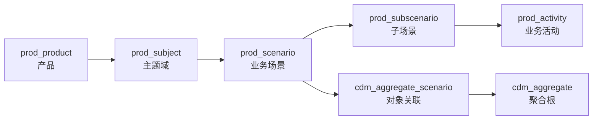

**业务数据模型层（建模第二阶段：再做业务数据模型）：**

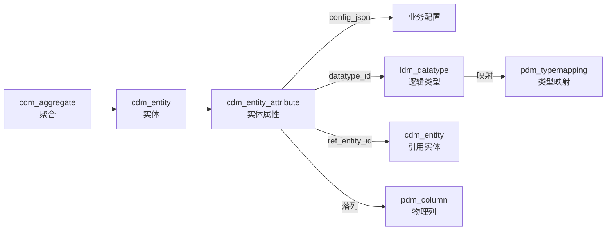

**值对象复用与落库展开（策略见 3.3/3.6 节）：**

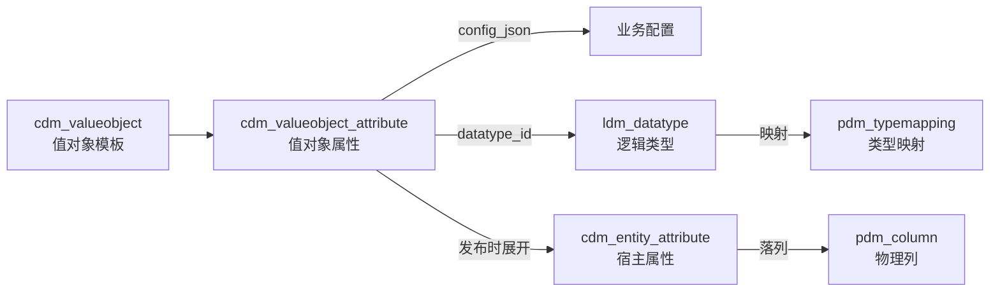

> 实体复用值对象：`cdm_entity` 与 `cdm_valueobject` 通过 `cdm_entity_valueobject` 多对多关联（记录方式），**同一实体对同一值对象模板只能有一行**（唯一约束 `uk_cdm_entity_vo`）；同一实体需要多份同构结构时（收货地址 + 发票地址）应新建从属实体各挂一份。展开规则：`SINGLE`/`OPTIONAL` 平铺展开为宿主属性列，`MULTIPLE` 内嵌为宿主表 `*_json` 列；且为**全量展开**——模板的全部属性须一一落在宿主 `cdm_entity_attribute` 上，不允许选取子集（代价与替代方案见 3.3）。

**聚合协作（经场景，不设聚合体间关联表）：**

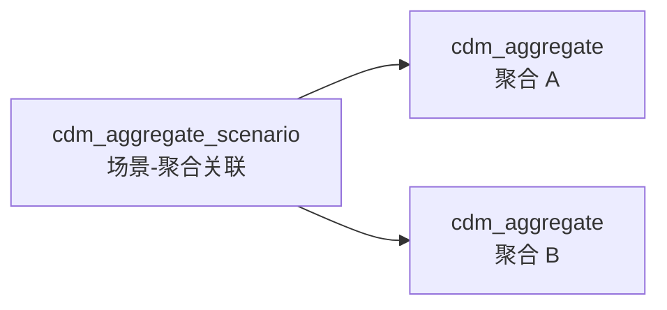

> 同一场景下多个聚合共同参与（`cdm_aggregate_scenario`，见 3.13）即构成聚合协作的**上下文**；跨聚合协作的**执行**由业务事件（`prod_event` → `prod_eventhandler` 订阅，见 2.6/2.7）与业务服务（`prod_service`，见 2.8）编排承载——**二者均锚业务场景、不与聚合直连**，参与的聚合由场景演绎（`cdm_aggregate_scenario`，见 3.13）。聚合体之间**不设专门关联表**（`cdm_aggregation` 已删除）——"聚合 A 关联聚合 B"可由场景参与关系推导，单独建表是与实现脱节的第二份关联；字段级引用仍由 `cdm_entity_attribute.ref_entity_id` 表达。

**业务事件与行级权限对象：**

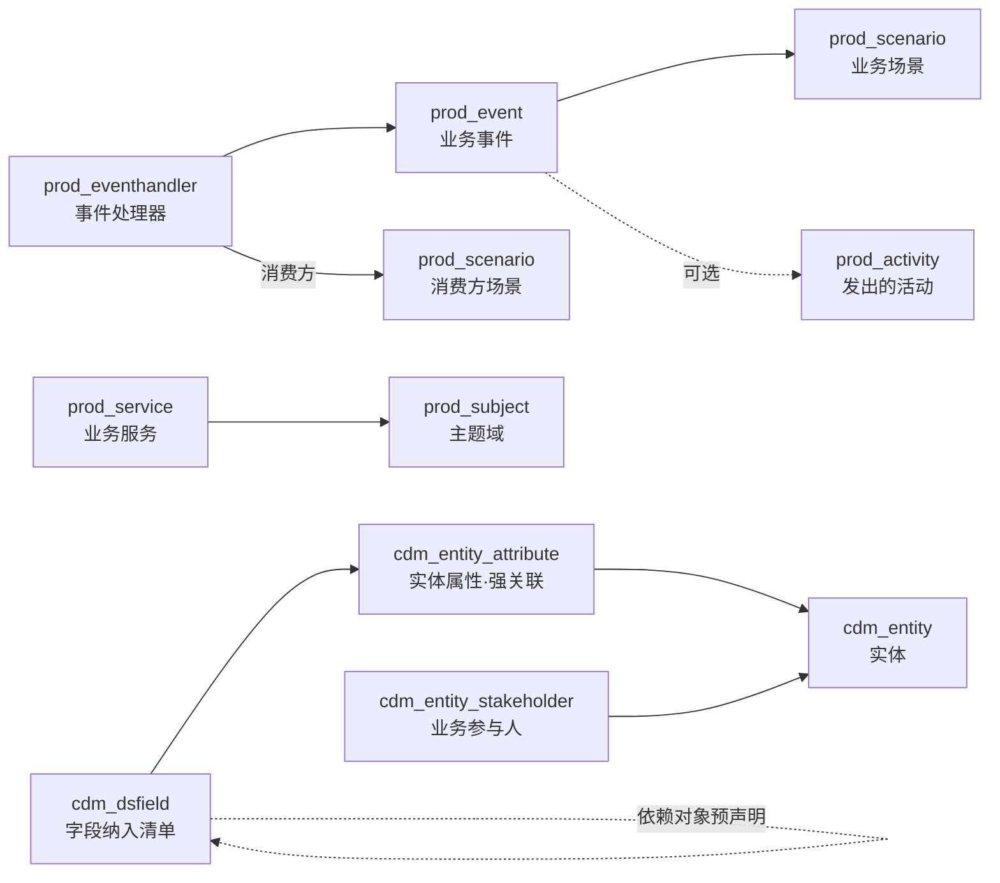

**物理存储模型（pdm_ 承接逻辑模型，落库实现）：**

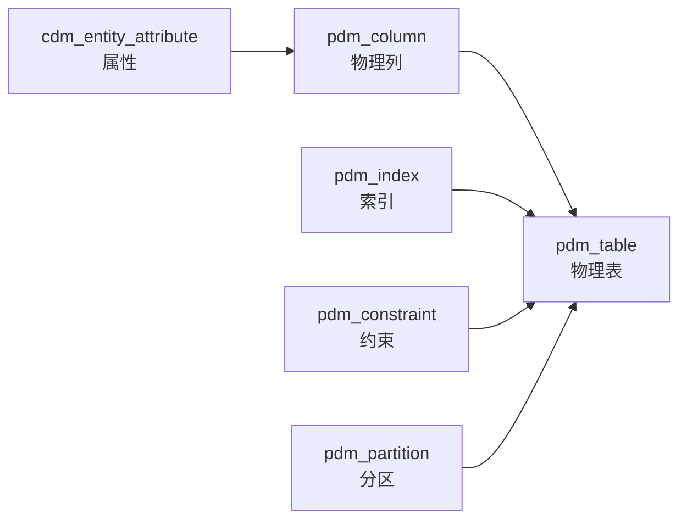

**治理与语义层（数据字典 + 术语/血缘 2 张治理预留表）：**

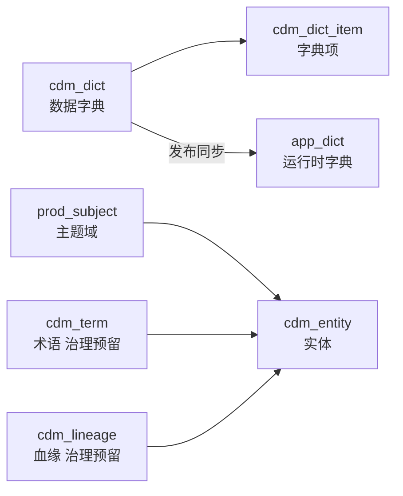

> 字典取值引用：各层 `_dict` 字段取值自 `cdm_dict_item`（字典宿主归概念模型层）；`app_dict` 为运行时载体，禁止运行侧直接增改。

> **非业务物理表的纳入**：token、日志、字典、报表、临时表等无对应业务实体语义的物理表，通过 `cdm_aggregate.cdm_aggregatetype_dict` 归类为 `PLATFORM`/`LOG`/`DICT`/`RPT`/`TMP` 等**非业务聚合**，其下的（广义）实体复用同一条 `aggregate → entity → attribute → pdm_column` 链路，无需放宽 `pdm_table`/`pdm_column` 的强绑定（见 3.1 聚合类型分类）。**非业务聚合由平台预置种子模板提供**（token/session、日志、字典、报表、临时表等标准载体按 `cdm_aggregate` 预置为种子聚合+实体+属性，锁定 `aggregate_code`），建模侧只能引用、不能新建非业务聚合（见 3.1 节）。

**应用服务层（第五层：后端驱动，读配置提供服务）：**

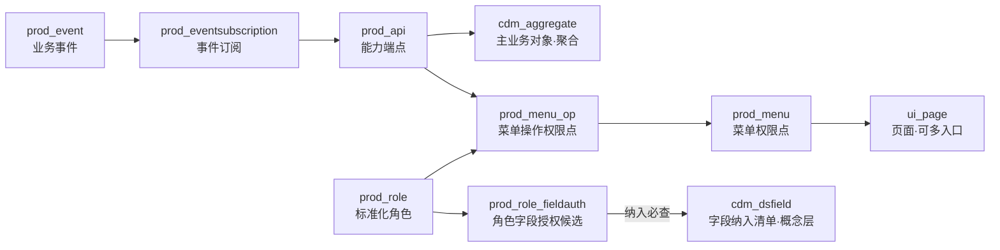

> **能力端点与场景的关联**：`prod_api` 经 `cdm_aggregate`（主业务对象）与主题域（`prod_subject`）间接对齐到业务场景；
> 与子场景活动（`prod_activity`）**无直接关联**（见 1.1 节链路断点说明）。

> **权限与授权链路**：运行时引擎**只从 `app_` 表取数**（产品侧标准资产经发布同步物化）：
> 「用户 → `app_role_user` → `app_role` → `app_role_menu`/`app_role_menu_op` → `app_menu`/`app_menu_op` → `app_api`」决定**功能权限**；
> 「用户 → `app_role` → `app_role_fieldauth`（角色字段授权候选）+ `app_dsfield`（字段纳入清单与依赖声明）」决定**行级数据权限**；
> 「`app_fieldperm`（属性保密类型个性化，升级/降级）+ `app_role_fieldperm`（角色 × 保密类型可见性）」决定**列级保密判定**；列最终呈现（可见/脱敏/隐藏）由查询结果装配层按**约定分档规则**执行（见 8.15.1）。
> 数据权限采用"**字段纳入 + 角色字段级直接授权 + 依赖对象**"模型（判定语义见 §8.0.2），
> 预计算行级谓词落 `app_role_scopesql`（角色×实体×`scope_context`，见 8.17）。
>
> **调用方边界**：上述功能权限链路只覆盖 `prod_api.prod_callertype_dict='USER'`（**用户经界面调用**）的端点；
> `SYSTEM`（**跨系统/第三方集成**）与 `INTERNAL`（**同一部署边界内**——同一 `app_system` 实例下的跨产品/跨模块服务间调用，含同系统跨产品微服务互调）型端点**不挂权限点、不进入 RBAC 权限树**，其授权由接口凭证范围/服务白名单表达（见 6.1/8.12）。注意 `INTERNAL` 豁免的仅是**功能权限**，**行级数据权限不豁免**——须透传用户上下文继续按 `prod_scope_context_dict` 解析行范围，防止其退化成绕过 `app_role_scopesql` 的通道。
> 领域内的跨聚合编排不产生端点记录——同步由业务服务（`prod_service`，见 2.8）、异步由事件订阅（`prod_eventsubscription`，见 6.8）承载。

**界面构造层（第六层：前端交互，解析 JSON 构造页面）：**

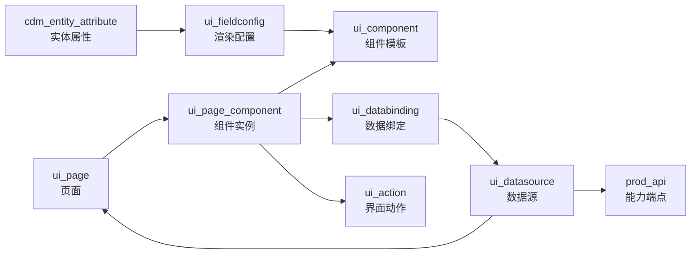

### 1.3 DDD 对象类型

**业务场景层对象**（建模第一阶段：先按场景分析业务逻辑）：

| 类型 | 表名 | 含义 | 示例 |
|------|------|------|------|
| **产品/子系统** | `prod_product` | 产品/子系统，业务划分的顶层组织单元 | 采购管理产品、供应链子系统 |
| **主题域** | `prod_subject` | 按业务域对聚合/实体/场景分组，支撑导航/权限分级 | "采购"、"库存"、"财务" |
| **业务场景** | `prod_scenario` | 业务场景/用例，描述触发条件、主流程、角色，归属某主题域；至少含一个子场景 | "采购下单"、"供应商对账" |
| **子场景** | `prod_subscenario` | 场景下的细化步骤/子用例，归属某场景 | "采购下单-创建订单"、"采购下单-审批" |
| **子场景活动** | `prod_activity` | 子场景下的结构化业务步骤（操作类型/输入输出/业务规则/状态流转），场景分析业务逻辑的核心载体 | "填写订单"（`CREATE`）、"提交审批"（`APPROVE`） |
| **业务事件** | `prod_event` | 已发生的业务事实（事件风暴产出），跨业务对象协作与最终一致性的信号载体，**归属某业务场景**（可精确到发出的活动），**不与聚合直连**（见 2.6） | 订单已创建、库存已扣减 |
| **事件处理器** | `prod_eventhandler` | 业务事件的订阅/消费方（同步/异步/SAGA），关联**消费方场景**或业务服务（见 2.7） | 订单事件 → 履约场景/库存扣减服务 |
| **业务服务** | `prod_service` | 跨业务对象、无自然归属的业务行为编排描述，无状态；**锚定业务场景**，不与聚合直连（见 2.8） | 下单并扣减库存、计算客户信用额度 |

**业务数据模型层对象**（建模第二阶段：再做业务数据模型）：

| 类型 | 表名 | 含义 | 示例 |
|------|------|------|------|
| **聚合主体** | `cdm_aggregate` | 有独立生命周期，全局唯一标识。通过 `cdm_aggregatetype_dict` 区分业务/平台/字典/日志/报表/临时聚合 | 业务：订单、客户、项目；平台：token、session |
| **场景-聚合关联** | `cdm_aggregate_scenario` | 场景分析识别的业务对象（聚合）及参与方式，承接场景层、衔接数据建模（见 3.13） | 下单场景 → 创建订单、引用客户 |
| **实体** | `cdm_entity` | 有唯一标识，依赖聚合主体；可通过 `cdm_entity_valueobject` 复用多个值对象模板 | 订单明细（在订单聚合内）；token 会话（在 token 聚合内） |
| **值对象** | `cdm_valueobject` | 无独立标识的可复用对象模板，可被多处复用；通过 `cdm_entity_valueobject` 被多个实体复用 | 地址模板 → 收货地址/客户地址/供应商地址 |

> 非业务聚合（`PLATFORM`/`DICT`/`LOG`/`RPT`/`TMP`）的实体同样用 `cdm_entity` 建模，使无业务语义的物理表也能纳入 `pdm_table`/`pdm_column` 完整链路。

**治理与语义层对象**（业务术语、责任、血缘；数据字典定义在治理层，运行时载体 `app_dict` 在应用层）：

| 类型 | 表名 | 含义 | 示例 |
|------|------|------|------|
| **术语表** | `cdm_term` | Business Glossary，统一业务语言，关联实体 | "订单"、"客户"术语权威口径 |
| **数据血缘** | `cdm_lineage` | 字段级来源→去向 | 报表字段 → 源表字段 |
| **数据字典** | `cdm_dict` | 统一数据字典定义，`_dict` 字段权威载体（发布同步生成运行时 `app_dict`） | AGGREGATE_TYPE、STATUS |
| **字典项** | `cdm_dict_item` | 字典下的具体枚举值（复合自然键 `(dict_code, item_code)`） | 业务聚合/启用/停用 |

> 治理与语义层 2 张表（`cdm_term`/`cdm_lineage`）为**治理预留表**：定义保留（建模资产完整），**不在 v1 DDL 清单**（v1 DDL 共 **65 张** = 67 − 2，见 11 章口径），待治理平台落地时纳入 DDL（见修订方案 D8）。
>
> **数据责任归属的落点（不设责任矩阵表）**：模型层**不建 `cdm_responsibility` 表**（已删除）。职责以**产品为单位在业务层面管理**——产品负责人由 `prod_product.owner_user_id`（见 2.1）承载，是责任归属的**业务管理单元**；实体级默认责任保留在 `cdm_entity.data_owner_user_id`/`steward_user_id`（见 3.2）两列，随 v1 落库；需要完整 RACI 矩阵时由治理平台在**产品粒度**上另建台账并关联实体编码。理由与规则表一致：**"谁负责"是随组织与客户而变的业务管理信息，不是数据结构**——放进模型层便必然与人力/组织系统脱节，成为又一份需要对齐的台账。

**产品服务层对象**（第五层：后端驱动，读配置提供服务；**研发固化、按产品交付**）：

| 类型 | 表名 | 含义 | 示例 |
|------|------|------|------|
| **能力端点** | `prod_api` | 产品能力与 REST 契约合一：能力类型/主业务对象/事务/幂等/入参出参 + 路径/方法/鉴权/限流/调用范围/调用方类型（`USER` 用户界面 / `SYSTEM` 跨系统集成 / `INTERNAL` 同一 `app_system` 实例内的跨产品、跨模块服务间调用；各类型的鉴权路径见 6.1）；前端数据绑定与事件订阅均挂本表 | POST /api/v1/orders/submit（兼"提交订单"操作语义） |
| **菜单权限点** | `prod_menu` | RBAC 权限树骨架节点，授权单元之一：决定"能看什么功能"（可挂页面、可带入口参数） | MENU_ORDER_LIST |
| **菜单操作权限点** | `prod_menu_op` | 挂在菜单下的最小授权单元（按钮/行内/批量/导出），决定"能做什么动作"；`prod_optype_dict` 标准操作代码归类（查看/新增/修改/删除/导入/导出/自定义） | PERM_ORDER_SUBMIT |
| **标准化角色** | `prod_role` | 随产品固化的**角色模板**（只读继承给客户侧，不得增量覆盖） | ROLE_BUYER（采购员） |
| **角色授权** | `prod_role_menu` / `prod_role_menu_op` | 角色 → 菜单 / 菜单操作的授权明细 | 采购员可见订单菜单、可提交订单 |
| **字段纳入清单** | `cdm_dsfield`（见 3.8） | 登记哪些实体的哪些字段**纳入行级权限管理**（未纳入即放行；含依赖对象预声明，强关联 `cdm_entity_attribute`） | 订单 `dept_id`/`applicant_id` 纳入 |
| **角色字段授权** | `prod_role_fieldauth` | 角色 → 实体 → 纳入字段的**授权候选**（`ALL`/`VALUE`/`RANGE`/`PARAM`，多条取 OR） | 采购员对订单 `dept_id` = `PARAM $orgs` |
| **字段保密类型** | `app_fieldperm`（见 8.15，**属性级个性化**：对建模基线逐条升级/降级）/ `prod_role_fieldperm`（见 6.9，角色 × 保密类型的列可见性） | 建模时属性已带保密类型（公开/内部/机密/绝密）；本环境认为该属性应按哪一档对待，由 `app_fieldperm` 逐属性登记（只登记**例外**，未个性化即沿用基线）；**列怎么显示**由约定分档规则执行（见 8.15.1）；加密存储由字段类型 `ENCRYPTED`/`HASH` 定死，不在本表内 | 客户编码由"内部"降级为"公开" |
| **事件订阅** | `prod_eventsubscription` | 业务事件 → 服务操作的订阅编排（同步/异步/重试） | 订单已创建 → 通知服务 |
| **发布版本** | `prod_release` / `prod_release_detail` | 发布版本定义与明细（含变更前后整行快照，支撑回滚，见 1.6/11.1/11.2） | REL-20260818-001 |
| **配置覆盖** | `prod_cfgoverride` | 研发侧三级覆盖登记（`PLATFORM`/`PRODUCT`/`SCENARIO`，见 1.7/12.3） | 产品级字段默认值覆盖 |
| **配置策略** | `prod_cfgpolicy` / `prod_cfgpolicyitem`（见 6.10/6.11） | 产品出厂的**可选菜单参数预设包**，应用系统按产品选用（`app_system_product.cfgpolicy_code`），影响菜单参数物化（见 8.10） | 采购产品"标准版"/"简洁版" |

**界面构造层对象**（第六层：前端交互，解析 JSON 构造页面）：

| 类型 | 表名 | 含义 | 示例 |
|------|------|------|------|
| **页面** | `ui_page` | 前端路由与渲染的顶层单元（列表/表单/详情/仪表盘/向导/树） | 订单列表页 |
| **组件** | `ui_component` | elementUI 组件模板登记与业务派生（props 可配置） | 表格组件、订单表格 |
| **页面布局** | `ui_page_component` | 页面内组件实例的布局树（父子/插槽/实例属性/显隐） | 表单页 → 表单 → 输入框 |
| **数据源** | `ui_datasource` | 页面级数据源定义（加载/提交/级联/选项，含依赖/刷新/缓存/分页） | 订单列表数据源、客户级联数据源 |
| **数据绑定** | `ui_databinding` | 组件实例 ↔ 数据源的数据通道（加载/提交/校验） | 列表 LOAD 绑定查询数据源 |
| **界面动作** | `ui_action` | 按钮/事件交互动作（调服务/开页面/状态流转/导出） | 提交订单按钮 |
| **字段渲染配置** | `ui_fieldconfig` | 属性 → 控件/栅格/显隐的呈现配置（与业务配置分离） | 状态字段 → 下拉控件 |

### 1.4 设计原则

- 场景驱动建模（两阶段）：**先按场景分析业务逻辑**（产品 → 主题域 → 场景 → 子场景 → 子场景活动），由活动分析识别业务对象（`cdm_aggregate_scenario`）；**再做业务数据模型**（聚合/实体/值对象/属性），数据建模以场景分析产出为输入
- 业务与技术解耦：业务对象定义不依赖具体数据库
- 类型可复用：一个数据逻辑类型可被多个属性引用
- 多数据库适配：同一逻辑类型可映射到不同数据库的物理类型
- 属性分表管理：实体属性和值对象属性分别用 `cdm_entity_attribute` 和 `cdm_valueobject_attribute` 管理，聚合主体自身无属性
- 配置与语义分离：属性语义（类型、必填、唯一、主键、引用）用独立列表达；**业务配置**（字典、精度、可编辑性、校验、顺序）存于 `config_json`（jsonb）。查询与约束语义由独立列承载，字段级取值约束由 `config_json.validationRules` 定义并执行（见 9.3），跨字段/跨步骤的业务规则在场景层业务活动上以自然语言描述（`prod_activity.rule_txt`，见 2.5），随客户而变的阈值与开关作为**业务策略**由应用服务层承载，枚举由数据字典定义
- 聚合类型化：`cdm_aggregate.cdm_aggregatetype_dict` 区分业务与非业务聚合；仅 `BUSINESS` 强制聚合根与业务规则语义；**非业务聚合（PLATFORM/DICT/LOG/RPT/TMP）由平台预置种子模板提供**，建模侧只读引用，作为表载体分组纳入统一建模链路
- 描述归场景、执行归实现：**模型层不设规则表**。业务规则（含聚合内不变式与跨聚合协作约束）的**自然语言描述**统一写在场景层业务活动上（`prod_activity.rule_txt`，见 2.5），经「活动 → 子场景 → 场景 → `cdm_aggregate_scenario`（见 3.13）→ 聚合」追溯；实际执行各有落点：字段级取值约束 → `config_json.validationRules`（见 9.3），结构约束 → `pdm_constraint`（见 5.6），复杂判定 → 业务服务（见 2.8）/工作流，随客户而变的阈值与开关 → **业务策略**，由应用服务层参数承载。理由见 2.5：规则一旦脱离场景单独建表，就会变成既不被运行时读取、又与实现脱节的第二份真相。**数据质量要求同理**：模型层不建质量规则表（原治理预留表 `cdm_qualityrule` 已删除），非空/唯一等要求由 `pdm_constraint` 承接、取值范围由 `config_json.validationRules` 承接，落点分派见 3 章章首
- 配置驱动全栈：场景 → 数据 → 服务 → 界面全链路配置化；前端经 `ui_databinding` 只走 `prod_api` 存取数据，**不直连数据模型**
- 数据源页面化：页面级数据共享（加载/提交/级联/选项）统一经 `ui_datasource` 建模，数据绑定引用数据源（见 7.4/7.7 节）
- 可复用性导向：配置按"可复用性"划分归属——可复用的配置统一在逸领域平台登记管理（挂业务场景关联，支持跨业务复用），纯用户私有、无复用价值的配置留在业务平台侧**登记覆盖**（业务侧覆盖写入 `app_cfgoverride`，见 1.7 节）
- 发布版本化：配置变更经"版本发布"机制同步到运行侧，可回滚、可追溯——发布明细携带变更前后**整行快照**（`prod_release_detail.before_json`/`after_json`），回滚按快照反向执行（见 1.6/12.2 节）

---

### 1.5 域归属（研发固化域 ddd / 运行配置域 app）

> **域划分说明**：域划分唯一主轴是**研发侧（`ddd`，模板/固化） vs 客户侧（`app`，实例化）**——建模资产与产品交付物同属研发侧，归并为同一个 `ddd` schema。
>
> | 项 | 说明 |
> |----|------|
> | **设计动因** | 建模资产与产品交付物同属**研发侧产出**，若分域则二者互为跨域引用（建模层引 `prod_product`、产品层引 `cdm_entity`），造成双向跨域依赖；同域后全部转为**域内引用** |
> | **跨域引用方向** | 仅 **`app` → `ddd` 单向**（客户侧引用研发侧模板），语义自然，无需额外跨域规则 |
> | **"固化"语义的承载** | 不由 schema 隔离表达，而由**发布流程**保证：`prod_*`/`ui_*` 为产品交付物，**发布后只读**，变更须经重新发布（见 1.6 节） |

> 全部 **69 张表**（研发固化域 50 张 + 运行配置域 19 张），按**研发侧 / 客户侧**划分，物理部署可**同库分 schema** 或**独立元数据库**（通过部署连接串解耦，表结构不变）。

| 域 | Schema | 表归属（数量） | 读写方 | 职责 |
|----|--------|--------|--------|------|
| **研发固化域** | `ddd` | 建模资产：**业务场景层 `prod_*` 4**+ `cdm_` **18**、`ldm_` 1、`pdm_` 7 = 30； 产品交付物：`prod_*` **13**（含 `prod_product`）、`ui_*` **7** = 20； **合计 50 张** ⚠️ `prod_` 前缀共 **17 张** = 建模资产 4 + 交付物 13 | 配置系统写入、研发/建模人员维护；平台自身读取 | 承载**建模资产 + 产品交付物**（能力/界面/版本/标准角色/字段纳入清单/字段策略模板），是配置的**唯一编辑源** |
| **运行配置域** | `app` | `app_*` **19 张**；另 `app_dict`（平台运行时字典载体，不计入 69 张口径）与**运行快照** | 业务平台引擎**运行时读写**（实例化配置与用户分配）；**权限引擎只从本域 `app_` 表取数**；只读研发侧快照 | 承载**按客户（应用系统）实例化**的配置、运行期数据与**运行时权限承载**（菜单/操作/API/角色授权/字段纳入/字段策略/预计算/审计） |

> **域归属判定原则**：一张表若属**研发侧产出、跨客户共享的模板/定义** → 归**研发固化域**（`ddd`）；
> 若属**按客户（应用系统）产生、随部署或运行变化** → 归**运行配置域**（`app`）。
>
> **跨域同步（ddd → app）**：`cdm_entity_attribute`/`cdm_valueobject_attribute`/`cdm_dict`/`cdm_dict_item`/`prod_menu`/`prod_menu_op`/`prod_api`/
> `prod_role`/`cdm_dsfield`/`prod_role_fieldauth` 等研发侧表的**运行子集**，在**发布时快照同步**到 `app`：
> - 同步内容：`config_json`、字段保密类型（建模基线）、字典引用、权限点与授权、字段纳入清单与依赖声明、列级可见性等
> - 快照**保留研发侧主键**（`prod_menu`/`prod_menu_op`/`prod_api` **同 id 同步**），或以**标准编码文本**（`std_role_code`/`std_field_code`）匹配重写——**不建跨域外键**
> - 业务平台只读快照，不直读研发侧库；**权限引擎只从 `app_` 表取数**（详见 1.6 节与 §8）
> - 跨域引用一律以**编码文本**表达（实体/属性编码、页面编码、产品编码），不建跨域外键

**各章表的域归属速查：**

| 章节 | 表 | 域 |
|------|----|----|
| 第 2 章 | 业务场景层 `prod_*` **7 张**（2.2~2.8） | 研发固化域（**建模资产**） |
| 第 3 章 | `cdm_*` **13 张** | 研发固化域（运行子集发布同步：属性/字典；治理 2 张为治理预留表，不在 v1 DDL） |
| 第 4 章 | `ldm_datatype` | 研发固化域（类型定义，供 DDL 生成） |
| 第 5 章 | `pdm_database`/`pdm_typemapping` | 研发固化域 |
| 第 5 章 | `pdm_table`/`pdm_column`/`pdm_index`/`pdm_constraint`/`pdm_partition` | 研发固化域（DDL 生成依据）；生成的**物理表结构**同步 `app` 域供引擎引用 |
| **产品层** | `prod_*` **13 张**（`prod_product` + `prod_api` + 原 `rls_*` 发布版本 + 角色/数据权限/字段策略/菜单系列；**不含第一层业务场景 7 张**） | **研发固化域**（产品交付物，发布后只读） |
| 第 7 章 | `ui_*` **7 张**（含 `ui_datasource`） | **研发固化域**（产品交付的界面模板） |
| **应用系统层** | `app_*` **19 张** | **运行配置域**（按客户实例化；含运行时权限承载与授权数据） |

> **配套 ER 图**：全局实体关系可视化见同目录 `领域模型ER图.html`（由本文六层模型渲染生成）。
> **注意**：该 ER 图基于早期 **48 表口径**生成，与当前 **67 表口径**存在差异，仅供关系趋势参考；权威口径以 §11 表清单为准，ER 图重绘待后续（届时治理 2 张预留表节点灰显标注）。

---

### 1.6 发布与版本管理

> **背景**：由于 `cdm_entity_attribute`（属性配置）、`cdm_dict`（字典）、`prod_*`（产品能力/权限点/角色/字段纳入/字段授权/字段策略）、`ui_*`（界面）等研发侧配置需要发布并同步供引擎读取，必须引入**发布/版本管理**机制，保证运行侧读取的是**一致的、可回滚的**配置版本。
>
> **发布口径**：发布是**研发固化域（`ddd`）内部 + `ddd` → `app`** 的版本化动作——产品交付物在 `ddd` 内定版并冻结（发布后只读），其运行子集快照同步到 `app` 供引擎消费。
> 应用系统层的**实例化**（`app_system` 初始化、生成 `app_role`/`app_dsfield`/`app_menu` 等运行承载）与**升级**属独立流程，其版本化与回滚语义**待定**（见 §1.9 追踪项 T4-3）。
>
> **权限资产的同步通道**：权限相关标准资产（`prod_menu`/`prod_menu_op`/`prod_api`/`prod_role` 及其明细、`cdm_dsfield`/`prod_role_fieldauth`）
> 经**发布同步**单向物化到 `app` 域对应运行承载表（同步关系见表 6 章首与 §8.0）。同步按**同主键**（菜单/操作/API）或
> **标准编码文本**（`std_role_code`/`std_field_code`）匹配：命中整行重写（保留主键，授权引用不断裂），未命中新增；
> 产品侧删除的资产置 `delete_flag=1`（逻辑删除，不物理删）。**同步是 `app` 域同步资产唯一的变更路径**，客户侧调整须先**物化**为 `CUSTOM`（见 8.0.1）。

**发布流程：**

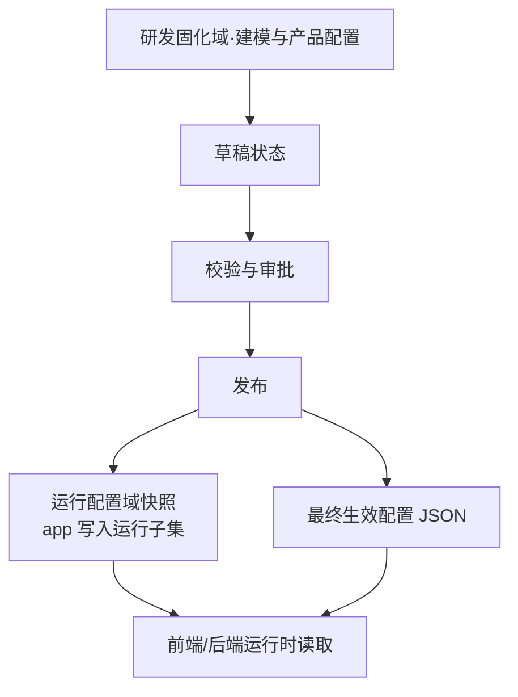

> 快照范围：`prod_*`/`ui_*`（含 `ui_datasource`）/属性/字典/**权限资产**（`prod_menu`/`prod_menu_op`/`prod_api` 同 id 同步；`prod_role`/`cdm_dsfield`/`prod_role_fieldauth` 按标准编码匹配重写）/物理表运行子集——即**研发固化域中需要被运行时消费的全部配置**，同步到运行配置域（`app`）。

**发布产物**：
- **配置快照**：将本次发布的 `prod_*`/`ui_*`（含 `ui_datasource`）/属性/字典/**权限资产**（菜单/操作/API 同 id 同步，角色/纳入清单/授权/策略按标准编码匹配重写）/物理表运行子集写入 `app`
- **生效 JSON**：将多层覆盖合并（基线 + `prod_cfgoverride`/`app_cfgoverride` 覆盖行）后的最终配置导出为 JSON 文件（主消费方式，见 1.7）
- **版本记录**：登记发布版本号、发布时间、变更内容、回滚点——发布明细（`prod_release_detail`）携带变更前后**整行快照**（`before_json`/`after_json`），支撑精确回滚（见 12.2）

**配套表（4 张，见第 12 章）：**
- `prod_release`：发布版本定义（版本号、状态、发布时间、发布内容、回滚目标、回滚类型）
- `prod_release_detail`：发布明细（本次发布纳入的配置对象清单：表/记录、变更类型 + 变更前后整行快照）
- `prod_cfgoverride`：配置覆盖登记（研发侧三级覆盖 `PLATFORM`/`PRODUCT`/`SCENARIO` 的载体，见 1.7/12.3）
- `app_cfgoverride`：配置覆盖登记（业务侧两级覆盖 `APPLICATION`/`USER` 的载体，见 1.7/8.20）

> **版本规则**：
> - 发布后当前版本在 `ddd` 域冻结、其快照在 `app` 域生效；历史版本可回滚——回滚按 `prod_release_detail` 快照**反向执行**（UPDATE 还原 before、DELETE 重建 after、CREATE 删除）
> - 回滚只作用于运行配置域快照，**不涉及业务数据域（`biz_*`）**（业务数据回滚属应用层补偿）
> - 运行配置域禁止直接增改**产品基线**（`prod_*`/`ui_*` 快照），一切变更须经 `ddd` 域 → 重新发布；
>   **研发侧**覆盖配置经 `prod_cfgoverride`（`ddd`）登记、**业务侧**覆盖配置经 `app_cfgoverride`（`app`）登记（见 1.7）
> - **字典项编码发布后不改码、废弃不回收**（迁移走新版本）

---

### 1.7 配置多层覆盖与合并

> **背景**：业务平台需要对平台生成的配置做**个性化调整**。按"可复用性导向"原则，配置分层管理：
> - **平台统一层**（可复用）：逸领域平台管理（平台公共 / 产品级 / 业务场景级），登记在 **`prod_cfgoverride`**（研发固化域 `ddd`）
> - **应用系统层**（按客户）：应用系统（`app_system`）实例级配置，登记在 **`app_cfgoverride`**（运行配置域 `app`）
> - **用户级层**（纯私有）：业务侧覆盖，同样登记在 **`app_cfgoverride`**
> - 运行时按优先级**多层合并**出最终生效配置；可审计、可版本化、可回滚

**配置层级与优先级（低 → 高）：**

| 层级 | 归属 | 说明 | 可复用性 | 覆盖登记 | 域 |
|------|------|------|:---:|------|------|
| **平台公共配置** | 逸领域平台 | 全局默认配置（通用组件、公共字段规则、默认布局） | ✅ 可复用 | `prod_cfgoverride`（层级 `PLATFORM`） | `ddd` |
| **产品级配置** | 逸领域平台 | 按产品（`prod_product`）维度的配置 | ✅ 可复用 | `prod_cfgoverride`（层级 `PRODUCT`） | `ddd` |
| **业务场景级配置** | 逸领域平台 | 按业务场景（`prod_scenario`）关联的配置，有潜在跨业务复用价值 | ✅ 可复用 | `prod_cfgoverride`（层级 `SCENARIO`） | `ddd` |
| **应用系统级配置** | 业务平台侧 | **按客户（应用系统）实例级**配置，随系统初始化产生 | ❌ 不可复用 | `app_cfgoverride`（层级 `APPLICATION`） | `app` |
| **用户级覆盖** | 业务平台侧 | 纯私有、无复用价值，**登记覆盖**（登记在 `app_cfgoverride`，层级 `USER`） | ❌ 不可复用 | `app_cfgoverride`（层级 `USER`） | `app` |

> **覆盖载体按域拆分**：覆盖层级按**域**拆为两张**结构完全一致**的表——研发侧固定层级随产品固化发布，须写入 `ddd`；按客户产生的层级（`APPLICATION`/`USER`）属客户实例数据，与"研发固化域只读冻结"语义冲突（业务侧不可写入 `ddd` 域），故登记在 `app` 域：
> - `prod_cfgoverride`（`ddd`）：仅 `PLATFORM`/`PRODUCT`/`SCENARIO` 三级，研发侧写入；
> - `app_cfgoverride`（`app`）：仅 `APPLICATION`/`USER` 两级，业务侧/客户写入。
>
> 两表 UNION ALL 后按层级优先级合并，故**字段结构必须保持一致**（详见 12.3）。

> **覆盖语义**：应用系统级与用户级个性化配置统一采用**"登记覆盖"**——写入 `app_cfgoverride`，运行侧只读该表合并，与"运行配置域不篡改研发侧基线"约束兼容（覆盖是登记而非篡改基线）。
>
> **菜单入口参数另有独立合并链**：`prod_menu.menu_param_json`（产品默认）→ 所选**配置策略**预设（`prod_cfgpolicyitem` 逐键覆写，见 6.11）→ 应用系统级 → 用户级。其中后两级与上表共享 `app_cfgoverride` 载体；策略是**可选预设**而非覆盖，不进上表层级（策略本体在 6.10/6.11）。

**合并机制：**
- 合并**粒度到字段属性级**，通过 **JSON path** 定位覆盖点（如 `pages[PG_ORDER_LIST].components[...].props_json[...]`）
- 合并输入：**基线配置（发布快照）+ `prod_cfgoverride` 与 `app_cfgoverride` 中 `ACTIVE` 覆盖行**，按层级排序 `平台公共 → 产品级 → 业务场景级 → 应用系统级 → 用户级`，**高层级覆盖低层级**
- 合并结果 = **最终生效配置 JSON**，发布时导出给业务平台部署运行

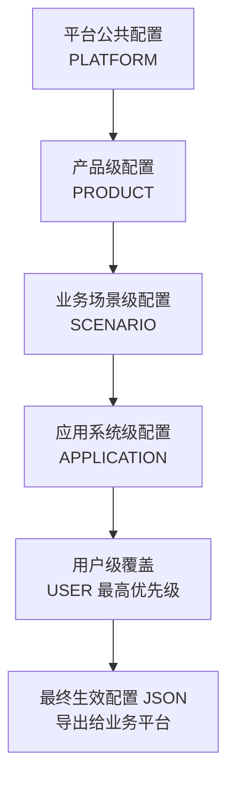

> **复用性判断原则**：一项配置若**可能被多个业务/产品复用**（通用组件行为、公共字段规则、跨产品页面布局）→ 上逸领域平台并挂业务场景关联，登记 `prod_cfgoverride`；
> 若**按某客户（应用系统）不同或纯属某个用户/业务私有** → 登记在业务侧 `app_cfgoverride`（分别为 `APPLICATION` / `USER` 层级）。

**配置消费方式（两种并存，不互斥）：**

| 方式 | 说明 | 定位 |
|------|------|------|
| **导出 JSON 文件** | 发布时按当前 `ACTIVE` 覆盖行合并分层配置，**固化**导出"某业务场景最终生效配置 JSON"，与前端/后端代码一同部署 | **主**（部署简单、版本与代码绑定、离线可运行；导出的是合并**产物**，覆盖源仍留库） |
| **在线读库** | 运行时读取基线快照（`app`）+ 两表 `ACTIVE` 覆盖行**实时合并**，支持配置热更新（覆盖行独立版本，新建/修改即时生效，不触发全量发布） | 辅（覆盖热更新、配置调试场景） |

> **导出 JSON 与覆盖配置的关系**：导出产物 = 「基线（发布快照）按层级合并 `prod_cfgoverride` + `app_cfgoverride` 覆盖行」的**最终生效配置**，随代码部署的是**产物**；覆盖源（两表覆盖行）留库，可审计、可随下版本发布重新固化导出——两者不存在互斥。
>
> **两表合并口径**：消费侧（导出与在线读库同一套逻辑）对 `prod_cfgoverride` 与 `app_cfgoverride` 做 `UNION ALL`，再按层级优先级（PLATFORM → PRODUCT → SCENARIO → APPLICATION → USER）逐层覆盖。**两表结构必须保持一致**，否则 UNION 不成立（详见 12.3）。
>
> **写入权限边界**：`prod_cfgoverride` 仅研发/平台侧可写，`app_cfgoverride` 仅业务侧/客户可写——运行时读两表、按层级合并，谁都不改对方数据。

---

### 1.8 业务数据隔离部署

> **背景**：通过平台搭建的业务平台，其**业务数据**（具体业务表 + 业务记录）由后端引擎按 `pdm_table`/`pdm_column` 配置**自动生成**，物理位置与元数据配置隔离。

| 部署形态 | 说明 | 适用 |
|----------|------|------|
| **独立业务库**（推荐） | 业务数据存独立数据库，与元数据配置完全隔离，安全隔离性最佳 | 资源充足、对隔离性有要求的生产环境 |
| **同库分 schema 强隔离** | 业务数据与元数据同库但分 schema（`ddd`/`app`/`biz_*`），禁止跨 schema 直接访问，通过应用层权限控制 | 资源有限、单机部署场景 |

> **隔离原则**：无论哪种形态，**业务数据域（`biz_*`）与建模/运行配置域物理或逻辑隔离**；前端/后端引擎只经 `prod_api` 存取业务数据，业务表结构由 `pdm_*` 配置生成，业务记录不进入元数据配置表。

**部署模型表态（v3.0 新增）：**

| 部署模型 | 说明 | v1 定位 |
|----------|------|:---:|
| **私有化单租户** | 每套部署拥有**独立元数据库 + 独立业务库**（物理隔离形态按上表二选一），元数据 69 张表**不引入 `tenant_id`**；每个客户实例在 `app` 域建一条 `app_system` 记录（见 8.1） | ✅ **v1 采用** |
| **SaaS 多租户** | 共享元数据 + 按租户隔离业务数据（`biz_*` 逻辑隔离，租户列统一规约） | 后续演进方向 |

> **多租户演进前置约定**（本期仅记录，不改表）：
> - ① 租户维度只加在**业务数据域**——由 DDL 引擎按 `tenant_id` 列规约 + 唯一约束前缀统一生成，平台元数据域共享；
> - ② 若个别场景需元数据逻辑隔离（按租户分 schema）——由部署层连接串隔离，表结构不变。
> - 本模型 v1 全表无租户维度。

---

### 1.9 前端契约对齐缺口（记录 + 已建模项）

> 本节记录《领域模型设计文档》`ui_` 层与前端技术设计契约（JSON Schema v3.0 / YiPageRegistry / 数据源组件）的对齐缺口，作为后续前端实现的追踪清单。
> - 数据源由 `ui_datasource`（界面构造层）承载、覆盖配置由 `prod_cfgoverride`（发布配套）承载
> - 产品层 `prod_*` 权限与角色系列、应用系统层 `app_*` 系列见 §11 表清单
> - **其余缺口**统一以「建模侧映射规则」方式对齐，由前端解析层按映射规则落地

**缺口清单（来自前端契约评审，阻断级 8 项）：**

| # | 缺口 | 状态与建模侧映射规则 |
|---|------|----------------|
| B1-1 | PageMeta 缺 parentId/icon/visible/configVersion | 页面层级由 `ui_page.parent_page_id`（自引用，见 7.1）表达；组件树由 `ui_page_component.parent_page_component_id` 表达；icon/visible/configVersion 由 `props_json`/`layout_json` 在 JSON 层承载 |
| B1-2 | 组件类型体系不对齐 | `ui_componenttype_dict`（见 7.2）已定义组件类型字典，前端按 `component_code` 映射 elementUI 组件族 |
| B1-3 | 联动无建模 | 联动经 `ui_datasource.depends_on_json` 级联 + `ui_action`（见 7.5）动作完成后按 `refresh_trigger_json` 刷新目标数据源表达（见 7.7） |
| B1-4 | 组件事件绑定无建模 | `ui_action.ui_actiontype_dict`（OPERATE/PAGE/STATE_TRANS）映射前端事件类型，事件处理后触发数据源刷新（见 7.7） |
| B1-5 | 数据源概念整体缺失 | **已建模**：`ui_datasource` 表承载（见 7.7）——sourceId/dependsOn/refreshTrigger/缓存/分页/selection 均有字段对应；`ui_databinding` 经 `datasource_id` 挂接数据源（见 7.4） |
| B1-6 | domain 类型体系缺失 | 业务对象域由 `cdm_aggregatetype_dict`/`cdm_entity` 表达，前端 domain 体系按 `aggregate_id` 关联 |
| B1-7 | 校验规则类型体系不对齐 | 校验经 `ui_databinding` 的 VALIDATE 绑定 + 字段级 `validationRules`（见 9.3）执行；跨字段/跨步骤规则的**自然语言描述**在场景层活动（`prod_activity.rule_txt`，见 2.5），实现在业务服务（见 2.8） |
| B1-8 | PageConfig 运行时字段缺失 | 运行时字段由发布同步的运行配置域（`app`）快照承载，不进入建模元数据表 |

> **映射规则总原则**：前端 JSON Schema 中的组件实例、布局树、数据源、数据绑定、动作均可在 `ui_page`/`ui_page_component`/`ui_datasource`/`ui_databinding`/`ui_action` 五表中找到对应建模载体；其余缺口由前端解析层按上表映射规则落地。
> - 页面层级：`ui_page.parent_page_id` 自引用承载
> - 数据源概念：`ui_datasource` 承载（已建模，见 7.7）
> - 表数量为 69 张**（`ddd` 域 50 张 + `app` 域 19 张，见 §11 表清单汇总）

**追踪项（待定议题，不阻塞当前建模）：**

| # | 议题 | 搁置时默认口径 |
|:-:|------|------|
| T4-1 | 菜单入口参数（`prod_menu.menu_param_json`）如何作用到 UI 配置 | 暂按"参数参与 `ui_datasource`（过滤/默认值）与 `ui_fieldconfig`（字段显隐）解析"理解（见 6.2） |
| T4-2 | `menu_param_json`（jsonb 单字段）是否够用，是否需立 `prod_menu_param` 子表 | 暂用 `menu_param_json` 单字段 |
| T4-3 | 应用系统层**实例化/升级**的版本化与回滚语义（`ddd` → `app` 的发布链路延伸） | 暂维持 §1.6 原发布语义，实例化环节待补 |
| T4-4 | 菜单入口参数与配置覆盖（`app_cfgoverride`）的**优先级** | **已定**（随配置策略 `prod_cfgpolicy` 建模闭环，见 6.10/6.11）：产品默认 → 策略预设 → 应用系统级覆盖 → 用户级覆盖 |

---
