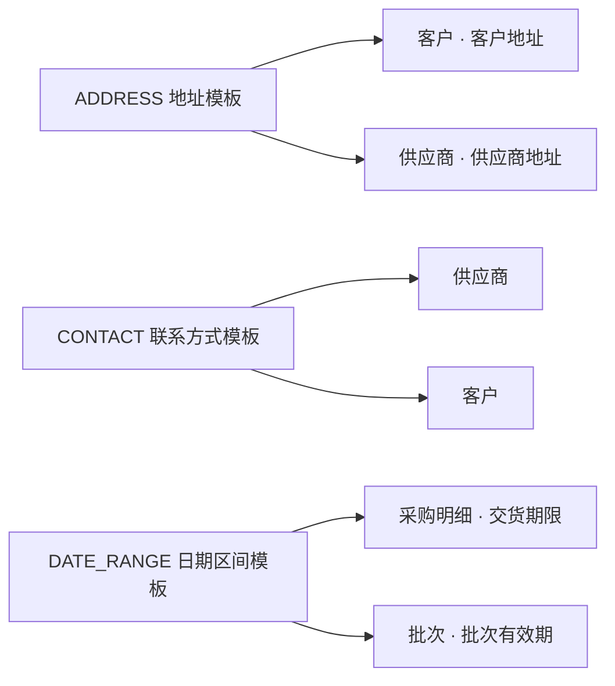

# 3. 第二层：概念数据模型（cdm_）

> 内容为原文**完整搬运、未作改写**；正文中的章节编号（如「见 6.11」「见 8.20」）沿用原文档全局编号，可对照下表定位到对应分章文件。

<b>分章索引（点击展开）</b>

| 文件 | 原文档章节 | 关键内容 |
|---|---|---|
| [01_设计概述.md](./01_设计概述.md) | §1 设计概述 | 两域划分、六层架构、核心数据流、发布同步、多层覆盖 |
| [02_第一层_业务场景模型.md](./02_第一层_业务场景模型.md) | §2 第一层：业务场景模型 | 产品/主题域、场景/子场景/活动、业务事件与业务服务 |
| [03_概念数据模型_cdm.md](./03_概念数据模型_cdm.md) | §3 第二层：概念数据模型（cdm_） | 聚合/实体/值对象/属性、字段纳入清单、字典、治理预留表 |
| [04_数据逻辑模型_ldm.md](./04_数据逻辑模型_ldm.md) | §4 第三层：数据逻辑模型（ldm_） | 逻辑数据类型 `ldm_datatype` |
| [05_物理存储模型_pdm.md](./05_物理存储模型_pdm.md) | §5 第四层：物理存储模型（pdm_） | 数据库/类型映射/表/列/索引/约束/分区 |
| [06_产品服务模型_prod.md](./06_产品服务模型_prod.md) | §6 第五层：产品服务模型（prod_） | 服务与 API、菜单与操作、标准角色、字段授权/策略、事件订阅 |
| [07_界面构造模型_ui.md](./07_界面构造模型_ui.md) | §7 第六层：界面构造模型（ui_） | 页面/组件/布局/数据源/数据绑定/动作/字段配置 |
| [08_应用系统层运行配置模型_app.md](./08_应用系统层运行配置模型_app.md) | §8 应用系统层：运行配置模型（app_） | 双轨模型、系统实例化、角色与授权、字段纳入与策略、组织、预计算 SQL |
| [09_属性配置模型.md](./09_属性配置模型.md) | §9 属性配置模型（业务配置） | 业务配置 JSON 结构与校验规则 |
| [10_业务示例.md](./10_业务示例.md) | §10 业务示例 | 采购/订单端到端建模示例 |
| [11_表清单汇总.md](./11_表清单汇总.md) | §11 表清单汇总（69 张） | 69 张表总清单与口径说明 |
| [12_发布版本配套表.md](./12_发布版本配套表.md) | §12 发布版本配套表（prod_） | 发布版本、发布明细、配置覆盖登记 |

**本文件包含的子节**：`3.1 cdm_aggregate — 聚合主体定义`、`3.2 cdm_entity — 实体定义`、`3.3 cdm_valueobject — 值对象定义`、`3.4 cdm_entity_attribute — 实体属性定义`、`3.5 cdm_valueobject_attribute — 值对象属性定义`、`3.6 cdm_entity_valueobject — 实体-值对象关联（多对多）`、`3.7 cdm_entity_stakeholder — 实体业务参与方定义`、`3.8 cdm_dsfield — 字段纳入权限管理清单`、`3.9 cdm_term — 术语表（Business Glossary）`、`3.10 cdm_dict — 数据字典定义`、`3.11 cdm_dict_item — 字典项定义`、`3.12 cdm_lineage — 数据血缘`、`3.13 cdm_aggregate_scenario — 场景-聚合关联（承接场景层）`

---

## 3. 第二层：概念数据模型（cdm_）

> **第二层：概念数据模型**（建模第二阶段）：承接第一层业务场景模型的分析产出，**再做业务数据模型**——**业务数据模型层**（3.1～3.8）：沿 `cdm_aggregate_scenario`（场景-聚合衔接表，见 3.13）关联将业务对象细化为聚合/实体/值对象/属性；跨聚合协作由**场景层业务行为**承载（业务事件/事件处理器/业务服务，见 2.6～2.8）；**治理与语义层**（3.9～3.12）：贯穿两阶段的术语、统一数据字典与数据治理支撑（字典运行时载体 `app_dict` 由 `cdm_dict` 发布同步，见 3.10；**治理 2 表 `cdm_term`/`cdm_lineage` 为治理预留表，定义保留、不在 v1 DDL 清单**，见各节标注）。**域归属**：本章 13 张表属**研发固化域**（`ddd`），其中 `cdm_entity_attribute`/`cdm_valueobject_attribute`/`cdm_dsfield`/`cdm_dict`/`cdm_dict_item` 的**运行子集**（渲染/服务/权限所需字段）在发布时快照同步到**运行配置域**（`app`）供引擎只读（见 1.5/1.6 节）。

> **数据质量要求的落点（不设质量规则表）**：模型层**不建 `cdm_qualityrule` 表**（沿革：该表曾以自然语言登记"非空 / 唯一 / 取值范围"等质量要求，但没有运行时消费方、也无法被程序求值，与真正的执行落点构成**第二份真相**，故与业务规则表一并删除）。数据质量要求**直接写在有明确执行方的载体上**，按下表分派；治理盘点由治理平台从这些载体**反向汇总**，不在模型层另建声明表：
>
> | 质量维度 | 可执行落点 | 执行方 |
> |---|---|---|
> | 非空 / 唯一 / 默认值 | `pdm_constraint`（见 5.6） | 数据库（DDL） |
> | 取值范围 / 格式 / 长度 / 精度 | `config_json.validationRules`（见 9.3） | 引擎 |
> | 跨行、跨表的参照一致与一致性 | 数据质量平台 | 平台（外部） |
> | 数据字典取值合法 | `app_dict` + 字典引用（见 3.10） | 引擎 |
>
> 判据与业务规则一致：**能被某个执行方真正卡住的才建模型，只用于"声明"的不建表**。

### 3.1 cdm_aggregate — 聚合主体定义

定义系统中的顶层业务对象（聚合根），拥有独立生命周期。业务聚合通常源自**场景分析识别出的业务对象**（`cdm_aggregate_scenario`，见 3.13）——场景分析先行、数据建模承接，聚合经主题域归类（`subject_id`）、经场景关联追溯需求来源。

| 字段 | 类型 | 约束 | 说明 |
|------|------|------|------|
| `aggregate_id` | integer | PK | 主键，序列 `seq_cdm_aggregate` |
| `row_uuid` | uuid | UN, NOT NULL | 全局行标识（UUID v4，应用写入） |
| `aggregate_code` | varchar(64) | UN, NOT NULL | 聚合主体编码——业务聚合遵循《数据库开发规范》§4.3：`agg_<模块缩写>_<业务段>` 全小写（如 `agg_pur_purchase_order`）；非业务聚合见 `cdm_aggregatetype_dict` |
| `cdm_aggregatetype_dict` | varchar(64) | NOT NULL, DEFAULT 'BUSINESS' | 聚合类型（字典）：`BUSINESS`（业务聚合）/ `PLATFORM`（平台/基础设施）/ `DICT`（字典）/ `LOG`（日志）/ `RPT`（报表）/ `TMP`（临时/导入）。仅 `BUSINESS` 强制聚合根与业务规则语义，见 3.1 节说明。`_dict` 字典引用，主体为 `dict_code` 全小写 |
| `aggregate_name` | varchar(128) | NOT NULL | 聚合主体名称（采购订单, 客户, 项目...） |
| `subject_id` | integer | NOT NULL | → `prod_subject.subject_id`（所属主题域，逻辑关联，见 2.2）。聚合根直接归属一个主题域 |
| `product_id` | integer | | → `prod_product.product_id`（所属产品/子系统，逻辑关联） |
| `description_txt` | text | | 业务描述 |
| `sort_order` | integer | | 排序 |
| `enable_flag` | smallint | NOT NULL, DEFAULT 0 | 启用标志（0=停用，1=启用） |
| `create_by` | integer | NOT NULL | 创建人（app.user_id） |
| `create_ts` | timestamp | NOT NULL, DEFAULT CURRENT_TIMESTAMP | 创建时间 |
| `update_by` | integer | NOT NULL | 最后修改人（app.user_id） |
| `update_ts` | timestamp | NOT NULL, DEFAULT CURRENT_TIMESTAMP | 最后修改时间 |
| `delete_flag` | smallint | NOT NULL, DEFAULT 0 | 逻辑删除标志 |
| `version_cnt` | integer | NOT NULL, DEFAULT 0 | 乐观锁版本号 |

**聚合主体在领域模型中的角色：**

- 聚合根，拥有独立生命周期和全局唯一标识
- 聚合内的实体和值对象在同一事务边界中保持一致
- 聚合主体间**不设专门关联表**（`cdm_aggregation` 已删除）：同场景下多聚合共同参与（`cdm_aggregate_scenario`，见 3.13）即构成协作上下文；跨聚合协作的**执行**由业务事件（`prod_event`，见 2.6）→ 事件处理器（`prod_eventhandler`，见 2.7）与业务服务（`prod_service`，见 2.8）承载——**三者均锚定业务场景，不在本层反向登记所属聚合**（"某聚合上有哪些事件/服务"由 `cdm_aggregate_scenario` 反查其场景得出）；字段级引用由 `cdm_entity_attribute.ref_entity_id` 表达

**聚合类型分类（`cdm_aggregatetype_dict`）：**

| 类型 | `cdm_aggregatetype_dict` | 语义 | 强制聚合根/业务规则 | 典型表 | 来源 |
|------|----------------------|------|:---:|--------|------|
| **业务聚合** | `BUSINESS` | 标准 DDD 聚合，有聚合根、业务规则、事务边界 | ✅ | 采购订单、客户 | 建模者自建 |
| **平台/基础设施聚合** | `PLATFORM` | 平台认证/技术表，无业务事务边界 | ❌ | **token、session、任务调度** | 平台预置种子 |
| **字典聚合** | `DICT` | 平台统一字典/枚举 | ❌ | `app_dict`、字典项 | 平台预置种子 |
| **日志聚合** | `LOG` | 操作/审计日志 | ❌ | 操作日志、审计日志 | 平台预置种子 |
| **报表聚合** | `RPT` | 统计/物化汇总 | ❌ | 报表汇总表 | 平台预置种子 |
| **临时/导入聚合** | `TMP` | 导入预处理、临时表 | ❌ | `tmp_*`、导入暂存 | 平台预置种子 |

> **设计要点**：引入聚合类型是为了把**无对应业务实体语义的物理表**（token、日志、字典、报表、临时表等）也纳入本模型统一管理。仅 `BUSINESS` 聚合强制满足聚合根判定（独立生命周期/全局唯一标识/外部唯一入口/维护业务规则），其业务规则在场景层活动中描述（见 2.5）；其余分类复用 `aggregate → entity → attribute → column` 完整建模链路，但"聚合"语义弱化为**表载体分组**，不强制聚合根与业务规则。从而保持 `pdm_table.entity_id`、`pdm_column.entity_attribute_id` 强绑定不变，所有物理表都有对应（广义）entity。
>
> **非业务聚合种子化（v3.0）**：`PLATFORM`/`DICT`/`LOG`/`RPT`/`TMP` 五类非业务聚合由**平台预置种子模板**提供——平台按标准载体（token/session、日志、字典、报表、临时表）预置 `cdm_aggregate`/`cdm_entity`/`cdm_entity_attribute` 种子数据并**锁定 `aggregate_code`**，建模侧只能**引用**种子聚合，不能新建非业务聚合（防误用、保引擎兼容）。**日志型聚合（LOG）的日志表**（操作日志、审计日志等）由平台种子模板按《数据库开发规范》§7.4 定义——含日志主键、事件/操作类型、事件时间、实际业务操作人、来源系统/模块、`trace_code` 链路标识、被操作对象类型及稳定标识、处理结果（失败含错误码与脱敏错误摘要）；追加写入模式，业务应用不得更新/删除，保留期限与清理方式建表时确定。

### 3.2 cdm_entity — 实体定义

定义聚合主体内的实体，有唯一标识，依赖聚合主体。实体可通过 `cdm_entity_valueobject`（见 3.6）复用一个或多个可复用值对象模板，**对同一个值对象模板只能复用一次**（唯一约束 `uk_cdm_entity_vo`，同一实体多次挂载同一模板不被允许）；同一实体确需多份同构结构时（如客户既有收货地址又有发票地址），应新建从属实体各挂一份（见 3.6）。

| 字段 | 类型 | 约束 | 说明 |
|------|------|------|------|
| `entity_id` | integer | PK | 主键，序列 `seq_cdm_entity` |
| `row_uuid` | uuid | UN, NOT NULL | 全局行标识（UUID v4） |
| `aggregate_id` | integer | NOT NULL | → `cdm_aggregate.aggregate_id`（所属聚合主体，逻辑关联，不建物理外键） |
| `entity_code` | varchar(64) | UN, NOT NULL | 实体编码（如 `order_detail`、`approval_record`，遵循《数据库开发规范》§5.1 小写 snake_case） |
| `entity_name` | varchar(128) | NOT NULL | 实体名称（订单明细, 审批记录...） |
| `subject_id` | integer | | → `prod_subject.subject_id`（所属主题域，逻辑关联，见 2.2） |
| `cdm_ismaster_dict` | varchar(64) | NOT NULL, DEFAULT 'NONMASTER' | 主数据标记（字典）：`MASTER`（主数据，如客户/物料/组织，需 MDM 治理）/`NONMASTER`（业务数据）。`_dict` 字典引用 |
| `cdm_sensitivelevel_dict` | varchar(64) | NOT NULL, DEFAULT 'L2' | 实体级**保密类型**（字典）：`L1`（公开）/`L2`（内部）/`L3`（机密）/`L4`（绝密）。`_dict` 字典引用；作为实体级默认值，供其属性标注继承（属性级标注见 3.4） |
| `data_owner_user_id` | integer | | 数据所有者（Data Owner，业务负责人，`app.user_id`，`_by` 后缀） |
| `steward_user_id` | integer | | 数据管家（Data Steward，日常治理，`app.user_id`，`_by` 后缀） |
| `retention_period_uom` | integer | | 数据保留周期（`_uom` 计量值，单位由主体表达，如 `365_days_uom`；空表示永久保留） |
| `cdm_retentionstrategy_dict` | varchar(64) | | 保留/归档策略（字典）：`ARCHIVE`（归档）/`PURGE`（销毁）/`KEEP`（永久）。`_dict` 字典引用 |
| `description_txt` | text | | 业务描述 |
| `sort_order` | integer | | 排序 |
| `create_by` | integer | NOT NULL | 创建人（app.user_id） |
| `create_ts` | timestamp | NOT NULL, DEFAULT CURRENT_TIMESTAMP | 创建时间 |
| `update_by` | integer | NOT NULL | 最后修改人（app.user_id） |
| `update_ts` | timestamp | NOT NULL, DEFAULT CURRENT_TIMESTAMP | 最后修改时间 |
| `delete_flag` | smallint | NOT NULL, DEFAULT 0 | 逻辑删除标志 |
| `version_cnt` | integer | NOT NULL, DEFAULT 0 | 乐观锁版本号 |

**实体判定边界：**

| 特征 | 实体 (ENTITY) | 值对象 (VALUE_OBJECT) |
|------|-------------|---------------------|
| 独立增删改查 | ✅ 需要 | ❌ 随宿主整体替换 |
| 多条记录 | ✅ 可有（1:N） | ❌ 嵌入宿主，不独立存在 |
| 排序/筛选 | ✅ 需要按时间等排序 | ❌ 不关心顺序 |
| 典型例子 | 订单明细、工作经历、教育背景 | 地址、金额、联系方式 |

**典型实体预设：**

| 聚合主体 | 实体 | entity_code | 说明 |
|----------|------|-------------|------|
| 员工(EMPLOYEE) | 工作经历 | work_experience | 多条，按时间排序，可独立增删 |
| 员工(EMPLOYEE) | 教育背景 | education | 多条，按学历/时间排序 |
| 员工(EMPLOYEE) | 家庭成员 | family_member | 多条，独立管理 |
| 订单(ORDER) | 订单明细 | order_detail | 多条，独立增删，聚合内实体 |
| 订单(ORDER) | 审批记录 | approval_record | 多条，按审批时间排序 |
| 客户(CUSTOMER) | 联系人 | customer_contact | 多条，可独立管理 |
| 采购单(PURCHASE) | 采购明细 | purchase_detail | 多条，独立增删 |
| 项目(PROJECT) | 项目阶段 | project_phase | 多条，按阶段顺序 |

> **关键区分**：工作经历是实体而非值对象，因为它需要"添加一段经历、删除某段、按时间排序"，这些是独立增删改查的典型特征。值对象没有这种需求——地址要改就是整个替换。

> **外部数据同步（规范 §7.1.1 衔接）**：实体对应的业务表若从外部系统（ERP/HR/CRM 等）同步数据，DDL 生成时**须追加** `source_system_code`（来源系统编码，NOT NULL）与 `source_update_ts`（来源数据最后更新时间，NOT NULL）两字段，并建立 `source_system_code + 来源主键/唯一标识` 本地唯一索引防重复写入；`update_ts` 每次接收更新为最新接收时间，**禁止**跨时钟比较 `update_ts` 与 `source_update_ts` 时间先后。此规则由 DDL 生成引擎按实体是否标记外部同步执行。

**双键分工：`entity_id`（主键）vs `entity_code`（候选键）**

| 键 | 类型 | 约束 | 角色 |
|----|------|------|------|
| `entity_id` | integer | PK | **系统代理主键**，用于所有关系引用（`cdm_entity_attribute.entity_id`、`pdm_table.entity_id` 等） |
| `entity_code` | varchar(64) | **UN**, NOT NULL | **业务候选键**，实体的权威业务身份（如 `order_detail`），用于业务查找、物理表名生成、权限维度配置 |

两者各司其职：**`entity_id` 是系统身份（代理标识），`entity_code` 是业务身份（自然标识）**。关系引用一律用 `entity_id`（integer，性能好、稳定、可随编码调整不变），业务定位用 `entity_code`（语义清晰、可读）。这与 `cdm_aggregate`（`aggregate_id` + `aggregate_code`）、`cdm_valueobject`（`valueobject_id` + `valueobject_code`）保持一致。

### 3.3 cdm_valueobject — 值对象定义

定义可复用的通用值对象模板，描述一组内聚的可复用业务对象结构（如地址、联系方式、金额、区间、证件、文件附件等），可被多个实体复用。值对象无独立标识，随宿主整体替换，不独立存在。复用关系由 `cdm_entity_valueobject`（见 3.6）显式记录（哪个实体复用了它、以何方式），也可由实体通过 `cdm_entity_attribute` 引用；实体一经关联，模板属性即被**全量展开**为宿主实体的 `cdm_entity_attribute`（见下文"落库策略"）。

| 字段 | 类型 | 约束 | 说明 |
|------|------|------|------|
| `valueobject_id` | integer | PK | 主键，序列 `seq_cdm_valueobject` |
| `row_uuid` | uuid | UN, NOT NULL | 全局行标识（UUID v4） |
| `valueobject_code` | varchar(64) | UN, NOT NULL | 值对象编码（ADDRESS, CONTACT, AMOUNT...） |
| `valueobject_name` | varchar(128) | NOT NULL | 值对象名称（地址, 联系方式, 金额...） |
| `description_txt` | text | | 业务描述 |
| `sort_order` | integer | | 排序 |
| `create_by` | integer | NOT NULL | 创建人（app.user_id） |
| `create_ts` | timestamp | NOT NULL, DEFAULT CURRENT_TIMESTAMP | 创建时间 |
| `update_by` | integer | NOT NULL | 最后修改人（app.user_id） |
| `update_ts` | timestamp | NOT NULL, DEFAULT CURRENT_TIMESTAMP | 最后修改时间 |
| `delete_flag` | smallint | NOT NULL, DEFAULT 0 | 逻辑删除标志 |
| `version_cnt` | integer | NOT NULL, DEFAULT 0 | 乐观锁版本号 |

**预设通用值对象模板（共15个）：**

| 序号 | valueobject_code | valueobject_name | 包含属性 |
|------|-------------------|-------------------|----------|
| 1 | ADDRESS | 地址 | province_name(省), city_name(市), district_name(区), detail_addr(详细地址), zip_code(邮编) |
| 2 | CONTACT | 联系方式 | contact_person(联系人), phone(电话), email(邮箱) |
| 3 | BANK_ACCOUNT | 银行账户 | bank_name(开户行), account_no(账号), account_type(账户类型) |
| 4 | AMOUNT | 金额 | amount(金额), currency(币种) |
| 5 | TAX_INFO | 税务信息 | tax_type(税种), tax_rate(税率%), include_tax_flag(含税标志) |
| 6 | UNIT_MEASURE | 计量换算 | base_unit(基本单位), convert_unit(换算单位), convert_rate(换算率) |
| 7 | SPECIFICATION | 规格 | model(型号), color(颜色), size(尺寸), material(材质) |
| 8 | USAGE_QUOTA | 用量定额 | usage_qty(用量), unit(单位), loss_rate(损耗率%) |
| 9 | DATE_RANGE | 日期区间 | start_date(起始日期), end_date(截止日期) |
| 10 | NUMERIC_RANGE | 数值区间 | min_value(最小值), max_value(最大值), unit(单位) |
| 11 | TOLERANCE | 公差标准 | nominal_value(标准值), upper_deviation(上偏差), lower_deviation(下偏差) |
| 12 | GEO_LOCATION | 坐标位置 | coord_type(坐标类型), longitude(经度), latitude(纬度), altitude(海拔), precision(精度), collect_time(采集时间) |
| 13 | FILE_ATTACHMENT | 文件附件 | file_name(文件名), file_size(文件大小), file_type(文件类型/MIME), storage_path(存储路径), upload_time(上传时间), upload_by(上传人) |
| 14 | ID_DOCUMENT | 身份证件 | id_type(证件类型), id_no(证件号), issue_authority(签发机关), expire_date(有效期) |
| 15 | INVOICE_INFO | 开票信息 | invoice_type(发票类型), tax_no(税号), bank_name(开户行), account_no(账号) |

**值对象复用示例（同一个模板，多个宿主）：**

> **设计要点**：值对象是可复用的对象模板，其属性由 `cdm_valueobject_attribute` 定义。实体通过 `cdm_entity_attribute` 引用值对象来嵌入对应对象结构。
>
> **上图读作"横向复用，不读作纵向重复"**：每条箭头连接**不同的宿主**（客户/供应商/采购明细/批次），这正是模板复用的价值所在；反过来，**同一宿主对同一模板只允许一条连线**——客户若还要一份"发票地址"，须另建从属实体（如"客户地址台账"）再挂一条 ADDRESS，不能在同一实体上画两条到 ADDRESS 的线（见 3.6）。
>
> **取消分类字典 `cdm_category_dict`**：**值对象自身即分类粒度**——`valueobject_code`（`ADDRESS`/`CONTACT`/`AMOUNT`/`GEO`…）已完整表达类别语义，原分类字典与其取值高度重合（`ADDRESS`→`ADDRESS`、`CONTACT`→`CONTACT`、`AMOUNT`→`AMOUNT`），属冗余字段：既多一处维护口径，又存在"两者不一致时以谁为准"的歧义。
> 需要归类展示时**按模板本身分组**即可（预设模板表的行序已按主题聚合：地址/联系 → 金额 → 度量 → 区间 → 地理 → 附件 → 证件开票），不再由字典承担。
>
> **落库策略（v3.0 定稿，DDL 引擎前提）**：值对象不直接落库，由**发布时展开**驱动物理列生成——`cdm_entity_valueobject.cdm_usage_dict` 决定展开方式：
> - `SINGLE`/`OPTIONAL`（单值/可选单值）→ **平铺展开**：值对象属性在发布时展开为宿主实体的 `cdm_entity_attribute`（列名 = `值对象角色_属性名`，如 `ship_to_province_name`），来源标记 `cdm_attributesource_dict` = `VO_EXPAND`（见 3.4），`pdm_column` 沿 `cdm_entity_attribute → pdm_column` 常规链路生成物理列，可做非空/唯一/索引语义列；
> - `MULTIPLE`（多值）→ **jsonb 内嵌**：落为宿主表 `*_json`（`ldm_datatype.JSON_DATA`）列，数组内嵌，结构校验由 `config_json.validationRules` 的 `custom` 校验器（`validatorId`）承载（见 9.3）；
> - 展开生成物是**发布产物**（运行配置域），`cdm_valueobject_attribute` 仍是模板的**唯一编辑源**；模板变更 → 重新发布 → 展开属性 diff（新增列 ALTER、删除列废弃），对已生成业务表的影响属 DDL 引擎演进策略。
> - **全量展开（硬性约束）**：实体一旦经 `cdm_entity_valueobject`（见 3.6）指定某值对象，发布时必须把该值对象的**全部** `cdm_valueobject_attribute` 属性展开为宿主实体的 `cdm_entity_attribute`（`VO_EXPAND`），**不允许只选取部分属性展开**。
>   - **收益**：展开结果完全确定（行数 = VO 属性数），无需属性级选择子表，模板变更的 diff 与 diff 作用范围都可枚举；
>   - **代价与应对**：可能产生宿主未使用的空列。若只需属性子集，**不要复用该值对象**——改为在宿主实体上直接定义普通属性，或另建规模更小的值对象模板；
>   - **对模板的约束**：值对象模板须保持**紧凑内聚**——向模板增删属性会波及**所有**宿主实体的展开结果（新增 → ALTER 加列、删除 → 列废弃），因此模板应满足"凡用必全用"的最小集合。
>
> 展开链路见 1.2 节核心数据流。
### 3.4 cdm_entity_attribute — 实体属性定义

定义实体的业务属性，描述数据类型和引用目标。实体属性属于特定实体。

| 字段 | 类型 | 约束 | 说明 |
|------|------|------|------|
| `entity_attribute_id` | integer | PK | 主键，序列 `seq_cdm_entity_attribute` |
| `row_uuid` | uuid | UN, NOT NULL | 全局行标识（UUID v4） |
| `entity_id` | integer | NOT NULL | → `cdm_entity.entity_id`（所属实体，逻辑关联） |
| `attribute_code` | varchar(64) | NOT NULL | 属性编码（实体内唯一：`entity_id + attribute_code` 组合唯一约束 `uk_cdm_entity_attribute_entity_code`） |
| `attribute_name` | varchar(128) | NOT NULL | 属性名称 |
| `datatype_id` | integer | NOT NULL | → `ldm_datatype.datatype_id`（逻辑关联） |
| `ref_entity_id` | integer | | → `cdm_entity.entity_id`（引用目标实体，逻辑关联） |
| `required_flag` | smallint | NOT NULL, DEFAULT 0 | 必填标志 |
| `unique_flag` | smallint | NOT NULL, DEFAULT 0 | 唯一标志 |
| `pk_flag` | smallint | NOT NULL, DEFAULT 0 | 主键标志 |
| `cdm_sensitivelevel_dict` | varchar(64) | NOT NULL, DEFAULT 'L2' | **字段保密类型**（字典）：`L1`（公开）/`L2`（内部）/`L3`（机密）/`L4`（绝密）。`_dict` 字典引用。**本列只做分类标注**：作为列级保密判定的建模基线（本环境可经应用侧治理配置 `app_fieldperm` 逐属性升级/降级，见 8.15）；**不驱动加密**——加密与否由字段类型（`ldm_datatype` 的 `ENCRYPTED`/`HASH`，见第 4 章）在建模选型时定死 |
| `cdm_attributesource_dict` | varchar(64) | NOT NULL, DEFAULT 'DIRECT' | 属性来源（字典，v3.0 新增）：`DIRECT`（直接定义）/`VO_EXPAND`（值对象展开生成，见 3.3 落库策略）/`STAKEHOLDER`（参与方列展开生成，见 3.7）。`_dict` 字典引用；值对象展开与参与方展开生成的属性记录据此标记，支撑发布器幂等展开与追溯 |
| `config_json` | jsonb | | **业务配置**（全部 JSON 驱动）：字典引用（`dictCode`）、精度（`precision`）、可编辑性（`editableOnCreate`/`editableOnUpdate`）、校验规则（`validationRules`）、顺序（`order`）等业务侧配置。见第 9 章 |
| `sort_order` | integer | | 排序 |
| `create_by` | integer | NOT NULL | 创建人（app.user_id） |
| `create_ts` | timestamp | NOT NULL, DEFAULT CURRENT_TIMESTAMP | 创建时间 |
| `update_by` | integer | NOT NULL | 最后修改人（app.user_id） |
| `update_ts` | timestamp | NOT NULL, DEFAULT CURRENT_TIMESTAMP | 最后修改时间 |
| `delete_flag` | smallint | NOT NULL, DEFAULT 0 | 逻辑删除标志 |
| `version_cnt` | integer | NOT NULL, DEFAULT 0 | 乐观锁版本号 |

> **语义列与配置 JSON 的分工**：`required_flag` / `unique_flag` / `pk_flag` 等**语义性、影响 DDL 生成**的字段仍以独立列表达（可查询、可约束）；`config_json` 仅承载**业务配置**（如何约束/编辑字段值），属于非查询型业务侧配置。
> - 查询与约束语义由独立列承载；**字段级取值/取值范围约束由 `cdm_entity_attribute.config_json.validationRules`（见 9.3）定义并执行**；枚举值由数据字典定义（见 3.10）
> - 独立列决定「字段是什么」，`config_json` 决定「字段的值如何约束」

> **`ref_entity_id` 用途**：当属性是一个外键引用时（如采购明细的 `project_id` 引用项目实体），通过此属性指向目标实体对象。

**示例 — 采购明细属性定义（业务配置）：**

| entity | attribute_code | attribute_name | datatype_id | ref_entity_id | 说明 | config_json（业务配置，简） |
|--------|----------------|----------------|-------------|---------------|------|-------------------|
| order_detail | order_detail_id | 明细ID | IDENTIFIER | NULL | 主键 | `{"editableOnCreate":false,"editableOnUpdate":false}` |
| order_detail | product_code | 产品编码 | CODE | NULL | 普通属性 | `{"validationRules":[{"type":"required","message":"必填"}]}` |
| order_detail | unit_price | 单价 | PRICE | NULL | 普通属性 | `{"precision":6}` |
| order_detail | order_qty | 数量 | QUANTITY | NULL | 普通属性 | `{"precision":3,"validationRules":[{"type":"range","min":0}]}` |
| order_detail | project_id | 项目号 | IDENTIFIER | project | 引用项目实体 | `{"editableOnUpdate":false}` |

### 3.5 cdm_valueobject_attribute — 值对象属性定义

定义值对象的组合属性。值对象属性属于特定值对象模板。

| 字段 | 类型 | 约束 | 说明 |
|------|------|------|------|
| `valueobject_attribute_id` | integer | PK | 主键，序列 `seq_cdm_valueobject_attribute` |
| `row_uuid` | uuid | UN, NOT NULL | 全局行标识（UUID v4） |
| `valueobject_id` | integer | NOT NULL | → `cdm_valueobject.valueobject_id`（所属值对象，逻辑关联） |
| `attribute_code` | varchar(64) | NOT NULL | 属性编码（值对象内唯一：`valueobject_id + attribute_code` 组合唯一约束 `uk_cdm_valueobject_attribute_vo_code`） |
| `attribute_name` | varchar(128) | NOT NULL | 属性名称 |
| `datatype_id` | integer | NOT NULL | → `ldm_datatype.datatype_id`（逻辑关联） |
| `required_flag` | smallint | NOT NULL, DEFAULT 0 | 必填标志 |
| `unique_flag` | smallint | NOT NULL, DEFAULT 0 | 唯一标志 |
| `config_json` | jsonb | | **业务配置**（全部 JSON 驱动），结构与 `cdm_entity_attribute.config_json` 一致（字典/精度/可编辑性/校验/顺序），见第 9 章 |
| `sort_order` | integer | | 排序 |
| `create_by` | integer | NOT NULL | 创建人（app.user_id） |
| `create_ts` | timestamp | NOT NULL, DEFAULT CURRENT_TIMESTAMP | 创建时间 |
| `update_by` | integer | NOT NULL | 最后修改人（app.user_id） |
| `update_ts` | timestamp | NOT NULL, DEFAULT CURRENT_TIMESTAMP | 最后修改时间 |
| `delete_flag` | smallint | NOT NULL, DEFAULT 0 | 逻辑删除标志 |
| `version_cnt` | integer | NOT NULL, DEFAULT 0 | 乐观锁版本号 |

> **值对象配置复用**：值对象是可复用模板（地址、区间等），其配置定义模板内各输入项。实体通过 `cdm_entity_attribute` 引用值对象时，配置合并优先级为：**实体属性 `config_json`（覆盖）> 值对象属性 `config_json`（模板）> 平台默认配置**。
>
> **模板角色（v3.0）**：本表定义值对象模板属性，**不直接生成物理列**——物理列由发布时按宿主实体的 `cdm_usage_dict` 展开生成：
> - `SINGLE` → 平铺展开为宿主 `cdm_entity_attribute`；`MULTIPLE` → 内嵌 jsonb（见 3.3/3.6 节）
> - 模板配置的唯一编辑源 = 本表属性定义 + 配置合并优先级（实体属性覆盖 > 值对象模板 > 平台默认）

> **注意**：值对象属性无 `ref_entity_id` 和 `pk_flag`——值对象不引用实体，也不定义主键。

**示例 — 地址值对象属性定义：**

| valueobject | attribute_code | attribute_name | datatype_id | 说明 |
|-------------|----------------|----------------|-------------|------|
| ADDRESS | province_name | 省 | NAME | |
| ADDRESS | city_name | 市 | NAME | |
| ADDRESS | district_name | 区 | NAME | |
| ADDRESS | detail_addr | 详细地址 | ADDRESS | |
| ADDRESS | zip_code | 邮编 | CODE | |

### 3.6 cdm_entity_valueobject — 实体-值对象关联（多对多，受唯一约束限制）

> 显式表达**实体与可复用值对象之间的多对多关系**，并在"(实体, 值对象) 唯一"的前提下使用：一个实体可复用多个值对象模板，一个值对象模板可被多个实体复用（如 ADDRESS 值对象被客户/供应商/订单实体复用为各自地址），但**同一实体对同一模板只能有一行**。该关联表在聚合内实体层面记录"哪个实体复用了哪个值对象"，与 `cdm_entity_attribute` 的属性级引用互补——前者表达**实体↔值对象的复用关系**，后者表达**实体属性的字段级承载**。

| 字段 | 类型 | 约束 | 说明 |
|------|------|------|------|
| `entity_valueobject_id` | integer | PK | 主键，序列 `seq_cdm_entity_valueobject` |
| `row_uuid` | uuid | UN, NOT NULL | 全局行标识（UUID v4） |
| `entity_id` | integer | NOT NULL | → `cdm_entity.entity_id`（复用值对象的实体） |
| `valueobject_id` | integer | NOT NULL | → `cdm_valueobject.valueobject_id`（被复用的值对象模板） |
| `cdm_usage_dict` | varchar(64) | NOT NULL, DEFAULT 'SINGLE' | 使用方式（字典）：`SINGLE`（单值，默认）/`MULTIPLE`（多值，如多地址）/`OPTIONAL`（可选）。`_dict` 字典引用——落库展开方式的驱动开关，必填 |
| `relation_txt` | text | | 实体中该值对象承担的角色/用途（如"客户默认收货地""订单送达地"）——仅供设计说明与画布展示，**不作为区分多次复用的依据**：同一实体对同一值对象仅一行，多次复用须走从属实体（见设计要点） |
| `create_by` | integer | NOT NULL | 创建人（app.user_id） |
| `create_ts` | timestamp | NOT NULL, DEFAULT CURRENT_TIMESTAMP | 创建时间 |
| `update_by` | integer | NOT NULL | 最后修改人（app.user_id） |
| `update_ts` | timestamp | NOT NULL, DEFAULT CURRENT_TIMESTAMP | 最后修改时间 |
| `delete_flag` | smallint | NOT NULL, DEFAULT 0 | 逻辑删除标志 |
| `version_cnt` | integer | NOT NULL, DEFAULT 0 | 乐观锁版本号 |

> **与 `cdm_entity_attribute` 的分工**：本表记录**实体 → 值对象模板**的复用关系（哪些实体复用了哪个值对象、以何方式）；实体属性引用值对象（如"客户地址"属性类型为 ADDRESS）由 `cdm_entity_attribute` 承载，其具体属性由 `cdm_valueobject_attribute` 定义。
>
> **唯一约束（同一实体对同一值对象只占一行）**：约束名 `uk_cdm_entity_vo` = `(entity_id, valueobject_id)`——**一个实体只能关联同一个值对象一次**。本表在不同实体复用同一值对象时各占一行（客户/供应商/订单各自复用 ADDRESS），但**不允许同一实体登记多行同 VO**。
> **需要"同一值对象出现多次"时，不在此表加行，而应建模为从属实体**：
> - **同一实体多次、语义不同**（如客户既有收货地址又有发票地址）→ 新建从属实体（如"客户地址台账"，每条记录各含一份 ADDRESS），在**该从属实体上**增加一个**用途字典列**承载语义区分，由该从属实体与本表**一对一**关联；
> - **同一语义多值**（如多收货地址）→ 仍是本表一行，取 `cdm_usage_dict` = `MULTIPLE`（jsonb 内嵌数组，见 3.3 落库策略）。
> 取舍依据：**多值/多次使用是"实体关系"问题，应由从属实体或 `MULTIPLE` 承载，不应在关联表里靠"多行 + 角色文本"表达**——多行角色会让展开列名的来源失去唯一稳定依据，也会让模板变更时的展开 diff 无法确定作用范围。此取舍与 5.8 节"多值槽位 → 从属实体"一致。
>
> **用途字典（`{值对象}_MODE`）规范——语义区分不复用 `cdm_usage_dict`**：表达"这一份 VO 是干什么用的"须**另立业务字典**，与本表 `cdm_usage_dict` 分工严格区分：
>
> | 维度 | `cdm_usage_dict`（本表列） | 用途字典（落在从属实体上） |
> |---|---|---|
> | 回答什么 | **怎么用**——这份 VO 在宿主里占几个物理槽位、怎么落列 | **什么用**——这份 VO 在业务上扮演什么角色 |
> | 取值样例 | `SINGLE`/`MULTIPLE`/`OPTIONAL` | `SHIP_TO`/`BILL_TO`/`RETURN_TO`/`REGISTERED` |
> | 性质 | **平台语义**——发布引擎读取并据此展开，**平台预置字典 `VO_USAGE`（见 3.10），取值域业务不得改写** | **业务语义**——引擎不读，仅供业务查询/展示/校验，**由业务侧在 `cdm_dict`（见 3.10）自建** |
> | 落点 | 本表 `cdm_entity_valueobject.cdm_usage_dict` | 从属实体的一条普通属性（`cdm_entity_attribute`） |
> | 一份 VO 几个值 | 一行一个值（整份 VO 共用一个） | 一条记录一个值，靠多行区分多份 VO |
>
> **命名约定**：字典编码取 `{值对象}_MODE`（如 `ADDRESS_MODE`/`CONTACT_MODE`/`AMOUNT_MODE`），从属实体上的列名取 `{值对象小写}_mode_dict`（如 ADDRESS → `address_mode_dict`，遵循 `_dict` 后缀规范），取值引用自建字典。**平台不预置任何 `*_MODE` 字典**——"退货地""注册地"是业务知识，平台预置等于替业务做决策。
>
> **样例**：业务自建 `ADDRESS_MODE` = `SHIP_TO`（收货地）/`BILL_TO`（发票地）/`RETURN_TO`（退货地）/`REGISTERED`（注册地）；"客户地址台账"从属实体以 `address_mode_dict` 引用之。注意**模型层不为此加唯一约束**——"同一客户同一用途只能有一条"是业务规则，写在场景层业务活动上（`prod_activity.rule_txt`，见 2.5）；客户能否有多个收货地由业务决定，模型不替它拍板。
>
> **展开驱动（v3.0）**：本表 `cdm_usage_dict` 同时是值对象**落库展开方式**的驱动开关——`SINGLE`/`OPTIONAL` → 平铺展开为宿主属性列；`MULTIPLE` → 内嵌为宿主表 `*_json` 列（见 3.3 节落库策略）。
>
> **与全量展开的联动（硬性）**：本表登记一行即意味着宿主实体承诺承接该模板的**全部**属性——发布时须把 `cdm_valueobject_attribute` 的每一条都展开为 `cdm_entity_attribute`（`cdm_attributesource_dict` = `VO_EXPAND`），不得取子集。因此"先用大模板、少用几个属性"的用法应改为：（a）不用模板、直接定义普通属性；（b）另建更小的模板；（c）把可选部分拆到从属实体。详见 3.3 落库策略"全量展开（硬性约束）"。

### 3.7 cdm_entity_stakeholder — 实体业务参与方定义

定义实体与外部参与方的关联关系——"谁以什么身份参与了这件事"。参与方可以是员工、部门、公司等任意实体，由 `ref_entity_id` 指向。这类参与属性不再作为 `cdm_entity_attribute` 存储，统一通过本表独立管理。

典型场景：项目的建设单位、施工单位、监理单位；订单的申请人、审批人、接收人。不包括审计字段（`create_by`、`update_by`），审计字段由系统自动维护。参与方的业务角色语义（如"建设单位"、"申请人"）由独立的角色体系另行设计。

| 字段 | 类型 | 约束 | 说明 |
|------|------|------|------|
| `stakeholder_id` | integer | PK | 主键，序列 `seq_cdm_entity_stakeholder` |
| `row_uuid` | uuid | UN, NOT NULL | 全局行标识（UUID v4） |
| `entity_id` | integer | NOT NULL | → `cdm_entity.entity_id`（所属实体，逻辑关联） |
| `attribute_code` | varchar(64) | NOT NULL | 属性编码（snake_case，如 `builder_company_id`、`applicant_id`；发布阶段映射为 `cdm_entity_attribute.attribute_code`） |
| `attribute_name` | varchar(128) | NOT NULL | 属性名称（如"建设单位ID"、"申请人ID"） |
| `datatype_id` | integer | NOT NULL | → `ldm_datatype.datatype_id`（数据类型，通常为 `OPERATOR`，逻辑关联） |
| `ref_entity_id` | integer | NOT NULL | → `cdm_entity.entity_id`（引用的目标实体，可以是员工、部门、公司等任意实体，逻辑关联） |
| `description_txt` | text | | 说明 |
| `sort_order` | integer | | 排序 |
| `create_by` | integer | NOT NULL | 创建人（app.user_id） |
| `create_ts` | timestamp | NOT NULL, DEFAULT CURRENT_TIMESTAMP | 创建时间 |
| `update_by` | integer | NOT NULL | 最后修改人（app.user_id） |
| `update_ts` | timestamp | NOT NULL, DEFAULT CURRENT_TIMESTAMP | 最后修改时间 |
| `delete_flag` | smallint | NOT NULL, DEFAULT 0 | 逻辑删除标志 |
| `version_cnt` | integer | NOT NULL, DEFAULT 0 | 乐观锁版本号 |

> **与 `cdm_entity_attribute.ref_entity_id` 的区别**：属性表中的 `ref_entity_id` 表达数据建模关系（如采购明细.项目ID → 项目），是数据的组成部分；本表表达业务参与关系（谁参与了这件事），是参与者视角。二者最终都经 `cdm_entity_attribute` 承载并落库为物理列：
> - 参与方列（`attribute_code`/`ref_entity_id`）在**发布/生成阶段**映射为一条 `cdm_entity_attribute` 记录，再由 `pdm_column.entity_attribute_id` 引用该属性记录生成物理列
> - `pdm_column` 不另设 stakeholder 直接引用字段（与 5.4 节结构一致）——参与方列的"定义来源"在建模语义上归属本表，物理列的生成链路统一走 `cdm_entity_attribute → pdm_column`

**示例 — 项目的参与方：**

| 实体 | attribute_code | attribute_name | datatype_id | ref_entity_id | 说明 |
|------|-------------|-------------|-------------|---------------|------|
| 项目 | builder_company_id | 建设单位ID | OPERATOR | company | 出资建设单位 |
| 项目 | contractor_company_id | 施工单位ID | OPERATOR | company | 施工执行单位 |
| 项目 | general_contractor_id | 总包单位ID | OPERATOR | company | 总承包单位 |
| 项目 | supervisor_company_id | 监理单位ID | OPERATOR | company | 工程监理单位 |
| 项目 | project_manager_id | 项目经理ID | OPERATOR | user | 项目负责人 |

**示例 — 采购订单的参与方：**

| 实体 | attribute_code | attribute_name | datatype_id | ref_entity_id | 说明 |
|------|-------------|-------------|-------------|---------------|------|
| 采购订单 | applicant_id | 申请人ID | OPERATOR | user | 发起采购申请的人 |
| 采购订单 | approver_id | 审批人ID | OPERATOR | user | 审批采购订单的人 |
| 采购订单 | receiver_id | 接收人ID | OPERATOR | user | 收货确认的人 |

> **设计意图**：员工关联从属性表中剥离，作为独立的关联关系管理。权限引擎通过本表识别"谁跟这条数据有关系"，驱动数据范围控制（如"只看我申请的订单"）和待办推送（如"推给审批人"）。物理层 DDL 生成时，本表的 `attribute_code` + `datatype_id` 直接产出列定义。
>
> **落库形态（`biz_*` 侧）**：本表只定义**槽位**，"槽位填了谁"的真实数据在业务数据域有三种落库形态，取舍见 **§5.8 业务实例参与方数据的落库口径**：
> - **单值槽位 → 列**：发布阶段映射为 `cdm_entity_attribute`（`cdm_attributesource_dict`=`STAKEHOLDER`）后经 `pdm_column`（见 5.4）落成宿主表一列（如 `applicant_id`）；当槽位取值允许多种类别时，升级为 `{xxx}_party_type` + `{xxx}_party_id` 双列；
> - **多值槽位 → 独立表**：不再作为本表的一条 stakeholder 建模，而是**建模为从属 `cdm_entity`**（归属同一聚合），由 `pdm_table`（见 5.3）生成明细业务表（典型场景：抄送人、会签人、围观人）；
> - **参与方主体不由本表定义**：用户 → 外部用户体系 `app.user_id`（本模型不建用户表）；组织/部门/公司 → `app_org`（见 8.13）；供应商/客户等有业务语义的参与方 → 建模为 `cdm_entity` 产出 `biz_*` 业务表。
>
> **两种不推荐的形态**：①**一张全局参与方大表（EAV）**——会破坏行级权限的依赖对象判定（`depend_entity_code`，见 3.8/8.9）与 `app_role_scopesql`（见 8.17）预计算，且无法表达单值唯一；②**按参与方类别分别建表**（用户参与表/企业参与表）——唯一收益是物理外键，而本模型规定通用关联字段不建物理外键（见 5.6），收益归零、成本全在查询侧。二者的适用门槛与例外条件统一见 5.8 节。

### 3.8 cdm_dsfield — 字段纳入权限管理清单

>
> **纳入清单**：显式声明受行级权限管辖的实体字段。**实体至少登记一个纳入字段才受行级管辖**；
> 完全未纳入的实体/字段**不做行级过滤**（放行）——"纳入"是数据权限的总开关。
> 与 `prod_role_fieldauth`（见 6.7，角色对该字段的授权候选）构成"**先纳入、后授权**"两步式。
>
> **依赖对象预声明**：当某字段的值**指向另一实体**（外键/参与方，如 `purchase_order.dept_id`→组织、
> `purchase_order.project_id`→项目）时，其可见性取决于当前用户对**被依赖实体**的可访问实例集合。
> 依赖是字段的**固有语义**（"它指向谁"），故在**纳入阶段预声明**（`depend_entity_code` 等四列），
> 不由角色授权临时决定——使依赖图稳定、可发现、可治理、可审计、可环检测。
>
> **为何置于概念层**："字段是否受行级管辖、它指向谁"是字段的**治理属性**，与 `cdm_entity_attribute` 的
> 字段保密类型（见 3.4）、`cdm_entity_stakeholder` 的参与方语义（见 3.7）同源——描述的是**领域自身的约束**，
> 而非产品交付的能力。故本表与 `cdm_entity_attribute` 同层建模、以 `entity_attribute_id` **强关联**（同域同层可加外键）；
> 同步到 `app` 域所需的编码（`entity_code`/`attribute_code`）作为**冗余列**保留，跨版本稳定、便于按编码匹配重写。

| 字段 | 类型 | 约束 | 说明 |
|------|------|------|------|
| `dsfield_id` | integer | PK | 主键，序列 `seq_cdm_dsfield` |
| `row_uuid` | uuid | UN, NOT NULL | 全局行标识（UUID v4） |
| **`entity_attribute_id`** | integer | NOT NULL | → `cdm_entity_attribute.entity_attribute_id`（纳入的字段，同层强关联，可加外键，见 3.4）。唯一约束 `uk_cdm_dsfield_attr`——**同一属性只纳入一次** |
| `entity_id` | integer | NOT NULL | → `cdm_entity.entity_id`（所属实体，逻辑关联，见 3.2；与 `entity_attribute_id` 冗余，便于按实体批量拉取） |
| `entity_code` | varchar(64) | NOT NULL | 纳入实体编码（冗余自 `cdm_entity.entity_code`，如 `purchase_order`）。同步到 `app` 域后按编码匹配，跨版本稳定 |
| `attribute_code` | varchar(64) | NOT NULL | 纳入字段编码（冗余自 `cdm_entity_attribute.attribute_code`，如 `dept_id`、`applicant_id`、`status`）。字段须为**可作 where 条件的标量/FK/参与方字段** |
| `datatype_code` | varchar(64) | | 字段数据类型编码（文本引用 `ldm_datatype`，见 4.1；冗余，便于授权值域校验） |
| **`depend_entity_code`** | varchar(64) | | **依赖对象实体编码**：本字段指向的被依赖实体编码（文本引用实体运行注册，可为 `app_org`、`project`、`company` 等；跨域故用编码文本）。空 = 不预声明依赖，授权侧可独立使用 `ALL`/`VALUE`/`RANGE`/`PARAM`。**禁止指向本实体自身** |
| **`via_attribute_code`** | varchar(64) | | **关联键**（`depend_entity_code` 非空时相关）：本字段在**被依赖实体**上的关联键编码（缺省 = 被依赖实体主键） |
| **`include_child_flag`** | smallint | NOT NULL, DEFAULT 0 | 含下级标志（`depend_entity_code = 'app_org'` 时生效，沿 `app_org.org_path_txt` 展开含下级；其余恒 `0`） |
| **`depend_description_txt`** | text | | 依赖关系说明（治理审计） |
| `description_txt` | text | | 纳入说明（为何纳入治理） |
| `enable_flag` | smallint | NOT NULL, DEFAULT 1 | 启用标志：停用该纳入登记 = 该字段退出行级管辖（`F_E` 剔除） |
| `sort_order` | integer | | 排序 |
| `create_by` | integer | NOT NULL | 创建人（app.user_id） |
| `create_ts` | timestamp | NOT NULL, DEFAULT CURRENT_TIMESTAMP | 创建时间 |
| `update_by` | integer | NOT NULL | 最后修改人（app.user_id） |
| `update_ts` | timestamp | NOT NULL, DEFAULT CURRENT_TIMESTAMP | 最后修改时间 |
| `delete_flag` | smallint | NOT NULL, DEFAULT 0 | 逻辑删除标志 |
| `version_cnt` | integer | NOT NULL, DEFAULT 0 | 乐观锁版本号 |

> **设计要点**：
> - **强关联优先**：`entity_attribute_id` 是纳入关系的**唯一事实来源**（可加外键、可级联约束），
>   `entity_code`/`attribute_code` 仅为同步与检索冗余，由应用层保证与源属性一致；
>   唯一约束 `uk_cdm_dsfield` = `(entity_code, attribute_code)`（部分唯一索引 `WHERE delete_flag = 0`）同步时用；
> - **禁止自依赖 CHECK**（约束名 `ck_cdm_dsfield_no_self_dep`）：`depend_entity_code IS NULL OR depend_entity_code <> entity_code`；
>   依赖**环检测**（A→B→…→A）与**深度上限**（建议 ≤ 4 层）在配置期完成（拓扑排序 / 递归标记），命中即拒绝保存，防递归爆炸；
> - **未纳入即不受控**：字段不在本清单 → 该字段不产生行级约束；实体无任何纳入字段 → 整实体不参与行级过滤（放行）；
> - **纳入字段的合法性**：`entity_attribute_id` 指向的属性须**可查询**（非纯展示、非已发布变更废弃），校验结果供审计；
>   参与方字段（见 3.7）须先发布映射为属性后方可纳入；
> - **依赖深度超限**时改用子查询扁平表达（依赖扁平化，v2 演进方向）；
> - **授权落点不在本层**：本表只声明"纳入与依赖"，"谁能看什么范围"由 `prod_role_fieldauth`（见 6.7）在角色侧表达——
>   纳入是领域治理、授权是产品交付，二者分层；
> - **运行承载**：本表运行子集随发布同步物化到 `app_dsfield`（见 8.9）；运行时行级权限引擎**只读 `app_dsfield`**，
>   其 `enable_flag=1` 的行集构成实体的纳入字段集 `F_E`（判定语义见 §8.0.2）。

---

### 3.9 cdm_term — 术语表（Business Glossary）

> **术语表**：集中维护业务术语的定义（Business Glossary），消除"同名异义、一词多义"。术语可关联到实体/属性，形成"业务术语 → 概念模型 → 物理列"的语义溯源。是数据治理的基础资产。
>
> **治理预留**：本表属治理资产，无运行时消费方，**定义保留、不在 v1 DDL 清单**——待治理平台落地时纳入 DDL（见修订方案 D8）。

| 字段 | 类型 | 约束 | 说明 |
|------|------|------|------|
| `term_id` | integer | PK | 主键，序列 `seq_cdm_term` |
| `row_uuid` | uuid | UN, NOT NULL | 全局行标识（UUID v4） |
| `term_code` | varchar(64) | UN, NOT NULL | 术语编码（如 `ORDER_NO`、`SUPPLIER`） |
| `term_name` | varchar(128) | NOT NULL | 术语名称（订单号、供应商…） |
| `definition_txt` | text | | 权威定义（统一解释，消除歧义） |
| `alias_name` | varchar(128) | | 别名（常见同义词） |
| `related_entity_id` | integer | | → `cdm_entity.entity_id`（术语对应的实体，逻辑关联，可选） |
| `cdm_status_dict` | varchar(64) | NOT NULL, DEFAULT 'ACTIVE' | 术语状态（字典）：`ACTIVE`/`DRAFT`/`DEPRECATED`。`_dict` 字典引用 |
| `create_by` | integer | NOT NULL | 创建人（app.user_id） |
| `create_ts` | timestamp | NOT NULL, DEFAULT CURRENT_TIMESTAMP | 创建时间 |
| `update_by` | integer | NOT NULL | 最后修改人（app.user_id） |
| `update_ts` | timestamp | NOT NULL, DEFAULT CURRENT_TIMESTAMP | 最后修改时间 |
| `delete_flag` | smallint | NOT NULL, DEFAULT 0 | 逻辑删除标志 |
| `version_cnt` | integer | NOT NULL, DEFAULT 0 | 乐观锁版本号 |

> **设计要点**：术语表是"业务语言"的权威层，与模型表分离维护。`cdm_entity_attribute.attribute_name`/`attribute_code` 若与术语冲突，以术语表定义为准；新建实体/属性前**必须**查术语表，优先复用已有术语。

### 3.10 cdm_dict — 数据字典定义

> **数据字典（Dict）**：统一维护业务枚举/字典，是 `_dict` 字段（如 `cdm_aggregatetype_dict`、`cdm_status_dict`）的**权威载体**。当前枚举散落在各 `_dict` 字段并引用 `app_dict`，本表在模型内显式建模字典分类，消除"同名异义、一词多义"。

| 字段 | 类型 | 约束 | 说明 |
|------|------|------|------|
| `row_uuid` | uuid | UN, NOT NULL | 全局行标识（UUID v4） |
| `dict_code` | varchar(64) | PK | 主键（自然键，发布后不改码、不回收，变更走迁移）。字典编码（如 `AGGREGATE_TYPE`、`STATUS`） |
| `dict_name` | varchar(128) | NOT NULL | 字典名称 |
| `description_txt` | text | | 字典说明 |
| `cdm_status_dict` | varchar(64) | NOT NULL, DEFAULT 'ACTIVE' | 字典状态（字典）：`ACTIVE`/`INACTIVE`/`DEPRECATED`。`_dict` 字典引用 |
| `sort_order` | integer | | 排序 |
| `create_by` | integer | NOT NULL | 创建人（app.user_id） |
| `create_ts` | timestamp | NOT NULL, DEFAULT CURRENT_TIMESTAMP | 创建时间 |
| `update_by` | integer | NOT NULL | 最后修改人（app.user_id） |
| `update_ts` | timestamp | NOT NULL, DEFAULT CURRENT_TIMESTAMP | 最后修改时间 |
| `delete_flag` | smallint | NOT NULL, DEFAULT 0 | 逻辑删除标志 |
| `version_cnt` | integer | NOT NULL, DEFAULT 0 | 乐观锁版本号 |

> **设计要点**：
> - 按规范字典类表用业务编码自然键 `dict_code` 作主键（无整数代理键、无序列）；`_dict` 字段的取值（`dict_code` + `item_code`）统一引用本表及 `cdm_dict_item`；字典项编码**发布后不改码、废弃不回收**（见开发规范枚举规范）
> - **同步机制**：本表与 `cdm_dict_item` 为字典**唯一编辑源**；运行时公共表 `app_dict` 由本表**发布产物同步生成**——发布时按 `dict_code` 增量同步字典与字典项，`DEPRECATED` 项下架不删除；**禁止在运行时侧直接增改** `app_dict`
> - **字典级联（v3.0 声明）**：字典父子级联（省市区、物料分类等）由**运行层级联表** `app_dictcasc`（级联策略）/`app_dictcasc_detail`（父子值映射）承载（外部运行表，见《数据库开发规范》§11.2），建模层仅定义字典与字典项，**不在 cdm_ 层新增级联字段**——级联策略与映射随 `app_dict` 同步由发布流程生成（禁止硬编码/隐式关联，级联链路须无环校验）
> - **标准操作字典 `OP_TYPE`（平台预置）**：平台预置 `OP_TYPE` 字典与字典项（`VIEW`/`ADD`/`EDIT`/`DELETE`/`IMPORT`/`EXPORT`/`CUSTOM`），作为 `prod_menu_op.prod_optype_dict`（见 6.3）的权威取值——`VIEW` 查看、`ADD` 新增、`EDIT` 修改、`DELETE` 删除、`IMPORT` 导入、`EXPORT` 导出、`CUSTOM` 自定义按钮操作（标准操作之外、按场景定制，由 `op_code` 自定义命名区分）。字典项编码发布后不改码、废弃不回收，新增标准操作走新版本迁移
> - **API 调用范围字典 `API_SCOPE`（平台预置）**：平台预置 `API_SCOPE` 字典与字典项（`MENU`/`SUBJECT`/`PRODUCT`），作为 `prod_api.prod_apiscope_dict`（见 6.1）的权威取值——`MENU` 某菜单、`SUBJECT` 某主题域、`PRODUCT` 某产品，表示 API 端点的调用范围粒度（三选一互斥，配套 `scope_menu_id`/`scope_subject_id`/`scope_product_id` 目标字段）
> - **值对象展开方式字典 `VO_USAGE`（平台预置）**：平台预置 `VO_USAGE` 字典与字典项（`SINGLE`/`MULTIPLE`/`OPTIONAL`），作为 `cdm_entity_valueobject.cdm_usage_dict`（见 3.6）的权威取值——**发布引擎直接读取本字典驱动落库展开**（`SINGLE`/`OPTIONAL` 平铺为宿主属性列、`MULTIPLE` 内嵌为 `*_json` 列）。取值域属**平台语义**，业务**不得自行增删取值**，否则展开行为不可预期
>
> **平台预置字典 vs 业务自建字典**：上表各类字典与上述平台预置字典（`OP_TYPE`/`API_SCOPE`/`VO_USAGE` + 权限模型系列）均为**平台资产**——引擎、权限链路或对账工具读取其取值，**业务只能引用、不能改写取值域**，新增取值走平台版本迁移。与之相对，**表达业务分类的自有字典由业务侧在本表自建**，`*_MODE` 系列即典型：同一值对象多次复用时的用途区分（如 `ADDRESS_MODE` = `SHIP_TO`/`BILL_TO`）由业务按自己的业务术语（`cdm_term`，见 3.13）定义；平台不预置、不占用（见 3.6）。判据只有一条：**取值被谁读——被引擎或权限链路读的是平台字典，只被业务规则和界面读的是业务字典**。
>
> **权限模型预置字典**：平台预置下列字典，作为各权限表 `_dict` 字段的**权威取值**；
> 字典项编码**发布后不改码、废弃不回收**，新增取值走新版本迁移。
>
> | 字典编码 | 字典项 | 作为何字段的权威取值 |
> |---|---|---|
> | **`SCOPE_CONTEXT`**（操作上下文） | `ROW_QUERY`（日常查询，默认）/`ROW_EXPORT`（导出下载）/`ROW_AUDIT`（审计追溯）/`ROW_ADMIN`（管理运维）/`ROW_REPORT`（报表聚合） | `prod_menu`/`prod_menu_op`/`prod_api` 的 `prod_scope_context_dict`（6.1/6.2/6.3）；`app_menu`/`app_menu_op`/`app_api` 的 `app_scope_context_dict`（8.10/8.11/8.12）；`app_role_scopesql.scope_context_dict`（8.17） |
> | **`API_CALLER`**（API 调用方类型） | `USER`（用户经界面调用）/`SYSTEM`（跨系统、第三方系统集成调用）/`INTERNAL`（**同一部署边界内**——同一 `app_system` 实例下的跨产品/跨模块服务间调用，见 8.1） | `prod_api.prod_callertype_dict`（6.1）/`app_api.app_callertype_dict`（8.12）。`USER` 型端点可挂 `prod_menu_op` 权限点；`SYSTEM`/`INTERNAL` 型不进入 RBAC 权限树，但 `INTERNAL` **不豁免行级数据权限**（须透传用户上下文，见 6.1/8.12） |
| **`VO_USAGE`**（值对象落库展开方式） | `SINGLE`（单值，平铺展开为宿主属性列）/`MULTIPLE`（多值，内嵌为宿主表 `*_json` 列）/`OPTIONAL`（可选单值，同 `SINGLE` 落法） | `cdm_entity_valueobject.cdm_usage_dict`（3.6）。**发布引擎读取并据此展开**，取值域业务不得自行增删 |
> | **`FA_TYPE`**（字段授权类型） | `ALL`（全部数据）/`VALUE`（指定值）/`RANGE`（指定范围）/`PARAM`（系统预定义参数） | `prod_role_fieldauth.prod_fa_type_dict`（6.7）/`app_role_fieldauth.app_fa_type_dict`（8.7） |
> | **`DSF_SOURCE`**（纳入清单来源） | `STANDARD`/`CUSTOM` | `app_dsfield.app_dsf_source_dict`（8.9） |
> | **`FA_SOURCE`**（字段授权来源） | `STANDARD`/`CUSTOM` | `app_role_fieldauth.app_fa_source_dict`（8.7） |
> | **`ROLE_SOURCE`**（角色来源） | `STANDARD`/`CUSTOM` | `app_role.app_rolesource_dict`（8.4） |
> | **`SENSITIVE_LEVEL`**（字段保密类型） | `L1`（公开）/`L2`（内部）/`L3`（机密）/`L4`（绝密） | 字段侧标注：`cdm_entity.cdm_sensitivelevel_dict`（3.2，实体级默认）/`cdm_entity_attribute.cdm_sensitivelevel_dict`（3.4，字段级）；运行侧个性化：`app_fieldperm.app_sensitivelevel_dict`（8.15，逐属性升级/降级）。**分类标注，不驱动加密**（加密由字段类型 `ENCRYPTED`/`HASH` 决定） |
> | **`MENU_OP_TYPE`**（操作形态） | `BUTTON`/`ROW`/`BATCH`/`OTHER` | `prod_menu_op.prod_menu_optype_dict`（6.3）/`app_menu_op.app_menuoptype_dict`（8.11） |
> | **`ORG_TYPE`**（组织类型） | `COMPANY`/`DEPT`/`GROUP`/`VIRTUAL` | `app_org.app_orgtype_dict`（8.13） |
> | **`ORG_SOURCE`**（组织维护方式） | `LOCAL`/`EXTERNAL` | `app_org.app_orgsource_dict`（8.13） |
> | **`SCOPE_SQL_SOURCE`**（预计算来源） | `STANDARD`/`CUSTOM` | `app_role_scopesql.app_scope_source_dict`（8.17） |
> | **`SCOPE_SQL_TRIGGER`**（预计算触发原因） | `FIELD_AUTH_CHANGE`/`ROLE_AUTH_CHANGE`/`DS_FIELD_CHANGE`/`SYNC`/`MATERIALIZE`/`INIT`/`SCOPE_CONTEXT_CHANGE` | `app_role_scopesql.app_scope_trigger_dict`（8.17） |
> | **`GRANT_ACTION`**（授权动作） | `GRANT`/`REVOKE`/`MATERIALIZE`/`SYNC`/`RESET`/`ENROLL`/`UNENROLL`/`SCOPE_RECOMPUTE`/`SCOPE_CONTEXT_CHANGE` | `app_grant_log.app_grantaction_dict`（8.18） |
> | **`GRANT_TARGET`**（授权目标类别） | `ROLE_USER`/`ROLE_MENU`/`ROLE_MENU_OP`/`FIELDAUTH`/`DS_FIELD`/`ROLE_FIELDPERM`/`ORG`/`ORG_USER`/`ROLE_META`/`FIELDPERM_META`/`SCOPE_SQL` | `app_grant_log.app_granttarget_dict`（8.18） |

### 3.11 cdm_dict_item — 字典项定义

> **字典项（Dict Item）**：数据字典（`cdm_dict`，见 3.10）下的具体枚举值。是 `_dict` 字段取值 `item_code` 的权威定义。

| 字段 | 类型 | 约束 | 说明 |
|------|------|------|------|
| `row_uuid` | uuid | UN, NOT NULL | 全局行标识（UUID v4） |
| `dict_code` | varchar(64) | PK, NOT NULL | → `cdm_dict.dict_code`（所属字典，见 3.10）。复合主键成员 |
| `item_code` | varchar(64) | PK, NOT NULL | 字典项编码（如 `BUSINESS`、`ACTIVE`）。复合主键成员（`dict_code + item_code`） |
| `item_name` | varchar(128) | NOT NULL | 字典项显示名（如"业务聚合"、"启用"） |
| `sort_order` | integer | | 排序 |
| `cdm_status_dict` | varchar(64) | NOT NULL, DEFAULT 'ACTIVE' | 状态（字典）：`ACTIVE`/`INACTIVE`/`DEPRECATED`。`_dict` 字典引用 |
| `create_by` | integer | NOT NULL | 创建人（app.user_id） |
| `create_ts` | timestamp | NOT NULL, DEFAULT CURRENT_TIMESTAMP | 创建时间 |
| `update_by` | integer | NOT NULL | 最后修改人（app.user_id） |
| `update_ts` | timestamp | NOT NULL, DEFAULT CURRENT_TIMESTAMP | 最后修改时间 |
| `delete_flag` | smallint | NOT NULL, DEFAULT 0 | 逻辑删除标志 |
| `version_cnt` | integer | NOT NULL, DEFAULT 0 | 乐观锁版本号 |

> **设计要点**：复合自然键 `(dict_code, item_code)` 作主键（无整数代理键、无序列），一个字典项编码仅存在于所属字典内。字段 `_dict` 通过字典编码 + 字典项编码引用，禁止跨字典复用同一 `item_code`。

### 3.12 cdm_lineage — 数据血缘

> **数据血缘（Lineage）**：记录字段级"来源 → 去向"关系，支撑**影响分析**（改了上游影响哪些下游）与**溯源**（下游数据从哪来）。涵盖模型内部（实体属性 → 物理列）与外部（来源系统字段 → 本模型字段）。
>
> **治理预留**：本表属治理资产，无运行时消费方，**定义保留、不在 v1 DDL 清单**——待治理平台落地时纳入 DDL（见修订方案 D8）。

| 字段 | 类型 | 约束 | 说明 |
|------|------|------|------|
| `lineage_id` | integer | PK | 主键，序列 `seq_cdm_lineage` |
| `row_uuid` | uuid | UN, NOT NULL | 全局行标识（UUID v4） |
| `cdm_sourcetype_dict` | varchar(64) | NOT NULL | 来源类型（字典）：`SYSTEM`（外部系统）/`MODEL`（模型内部）/`TRANSFORM`（加工）。`_dict` 字典引用 |
| `source_system_code` | varchar(64) | | 来源系统编码（`SYSTEM` 类型必填，如 `ERP`、`HR`） |
| `source_table_code` | varchar(64) | | 来源表编码（外部表名或本模型 `cdm_entity.entity_code`） |
| `source_attribute_code` | varchar(64) | | 来源属性编码 |
| `target_table_code` | varchar(64) | NOT NULL | 目标表编码（本模型 `cdm_entity.entity_code`） |
| `target_attribute_code` | varchar(64) | NOT NULL | 目标属性编码 |
| `transform_txt` | text | | 转换逻辑说明（无则空，表示直接透传） |
| `create_by` | integer | NOT NULL | 创建人（app.user_id） |
| `create_ts` | timestamp | NOT NULL, DEFAULT CURRENT_TIMESTAMP | 创建时间 |
| `update_by` | integer | NOT NULL | 最后修改人（app.user_id） |
| `update_ts` | timestamp | NOT NULL, DEFAULT CURRENT_TIMESTAMP | 最后修改时间 |
| `delete_flag` | smallint | NOT NULL, DEFAULT 0 | 逻辑删除标志 |
| `version_cnt` | integer | NOT NULL, DEFAULT 0 | 乐观锁版本号 |

> **设计要点**：血缘采用"表编码 + 属性编码"文本定位（`entity_code`/`attribute_code` 体系），避免与物理表强耦合。`source_system_code` 与 `target_*` 的组合（`source_system_code` + `source_table_code` + `source_attribute_code` + `target_table_code` + `target_attribute_code`）**应**建唯一索引防止重复血缘记录。血缘与外部同步字段（开发规范 6.1.1 节 `source_system_code`）衔接。

### 3.13 cdm_aggregate_scenario — 场景-聚合关联（承接场景层）

> 记录业务场景分析识别出的**业务对象（聚合）**及其参与方式，是**业务场景层到业务数据模型层的衔接表**——场景分析（`prod_activity`，见 2.5）识别"本场景涉及哪些业务对象、以何种方式参与"，数据建模沿本关联搭建/完善聚合与实体。一个场景通常涉及多个业务对象（主对象 + 协作对象），一个业务对象可服务多个场景（多对多）。本表承载**场景视角**的对象参与，聚合仍归属主题域（`cdm_aggregate.subject_id`）作业务分类，二者互补。

| 字段 | 类型 | 约束 | 说明 |
|------|------|------|------|
| `aggregate_scenario_id` | integer | PK | 主键，序列 `seq_cdm_aggregate_scenario` |
| `row_uuid` | uuid | UN, NOT NULL | 全局行标识（UUID v4） |
| `scenario_id` | integer | NOT NULL | → `prod_scenario.scenario_id`（业务场景，逻辑关联，见 2.3） |
| `aggregate_id` | integer | NOT NULL | → `cdm_aggregate.aggregate_id`（业务对象/聚合，逻辑关联，见 3.1） |
| `prod_participationtype_dict` | varchar(64) | NOT NULL | 参与方式（字典）：`CREATE`（创建）/`MODIFY`（修改）/`QUERY`（查询）/`DELETE`（删除）/`REFERENCE`（引用，只读/上下文）。`_dict` 字典引用 |
| `description_txt` | text | | 参与说明（本场景对该业务对象的使用方式，如"下单场景创建订单并引用客户"） |
| `sort_order` | integer | | 排序（主业务对象在前） |
| `create_by` | integer | NOT NULL | 创建人（app.user_id） |
| `create_ts` | timestamp | NOT NULL, DEFAULT CURRENT_TIMESTAMP | 创建时间 |
| `update_by` | integer | NOT NULL | 最后修改人（app.user_id） |
| `update_ts` | timestamp | NOT NULL, DEFAULT CURRENT_TIMESTAMP | 最后修改时间 |
| `delete_flag` | smallint | NOT NULL, DEFAULT 0 | 逻辑删除标志 |
| `version_cnt` | integer | NOT NULL, DEFAULT 0 | 乐观锁版本号 |

> **设计要点**：`scenario_id + aggregate_id + prod_participationtype_dict` 联合唯一（同一场景对同一业务对象的同一参与方式仅记一条）。本表是场景驱动建模的落点——"场景 → 业务对象 → 聚合 → 实体 → 属性 → 物理表"的追溯链经此衔接。

---
