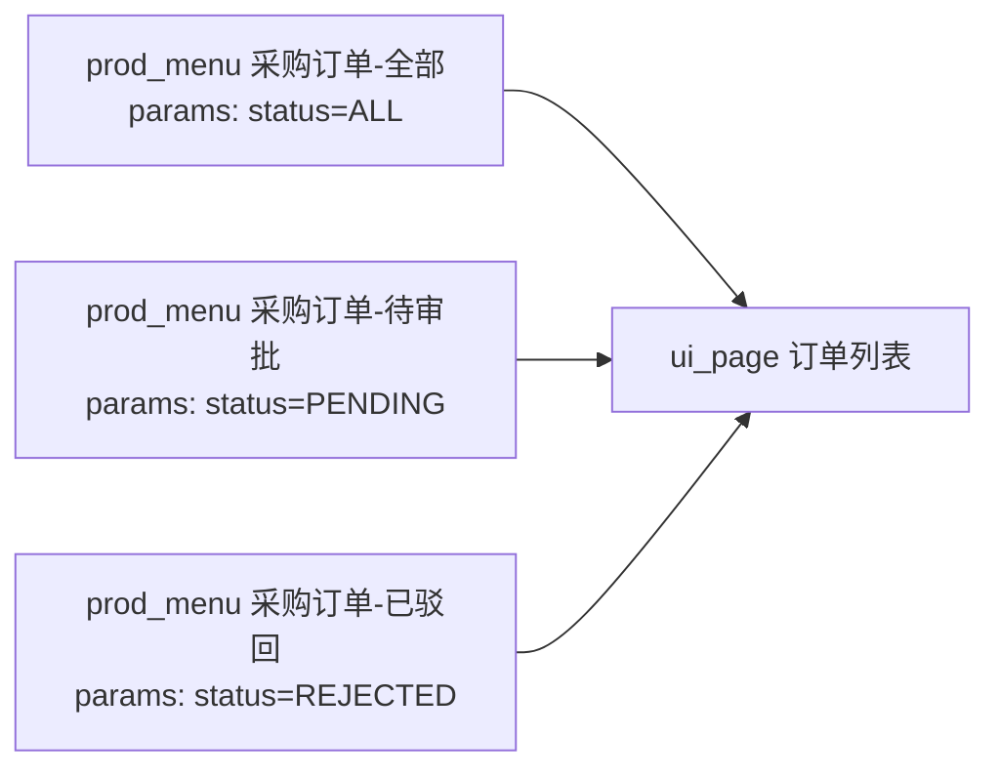

# 6. 第五层：产品服务模型（prod_）

> 内容为原文**完整搬运、未作改写**；正文中的章节编号（如「见 6.9」「见 8.20」）沿用原文档全局编号，可对照下表定位到对应分章文件。

<b>分章索引（点击展开）</b>

| 文件 | 原文档章节 | 关键内容 |
|---|---|---|
| [01_设计概述.md](./01_设计概述.md) | §1 设计概述 | 两域划分、六层架构、核心数据流、发布同步、多层覆盖 |
| [02_第一层_业务场景模型.md](./02_第一层_业务场景模型.md) | §2 第一层：业务场景模型 | 产品/主题域、场景/子场景/活动、业务事件与业务服务 |
| [03_概念数据模型_cdm.md](./03_概念数据模型_cdm.md) | §3 第二层：概念数据模型（cdm_） | 聚合/实体/值对象/属性、字段纳入清单、字典、治理预留表 |
| [04_数据逻辑模型_ldm.md](./04_数据逻辑模型_ldm.md) | §4 第三层：数据逻辑模型（ldm_） | 逻辑数据类型 `ldm_datatype` |
| [05_物理存储模型_pdm.md](./05_物理存储模型_pdm.md) | §5 第四层：物理存储模型（pdm_） | 数据库/类型映射/表/列/索引/约束/分区 |
| [06_产品服务模型_prod.md](./06_产品服务模型_prod.md) | §6 第五层：产品服务模型（prod_） | 服务与 API、菜单与操作、标准角色、字段授权/策略、事件订阅 |
| [07_界面构造模型_ui.md](./07_界面构造模型_ui.md) | §7 第六层：界面构造模型（ui_） | 页面/组件/布局/数据源/数据绑定/动作/字段配置 |
| [08_应用系统层运行配置模型_app.md](./08_应用系统层运行配置模型_app.md) | §8 应用系统层：运行配置模型（app_） | 双轨模型、系统实例化、角色与授权、字段纳入与策略、组织、预计算 SQL |
| [09_属性配置模型.md](./09_属性配置模型.md) | §9 属性配置模型（业务配置） | 业务配置 JSON 结构与校验规则 |
| [10_业务示例.md](./10_业务示例.md) | §10 业务示例 | 采购/订单端到端建模示例 |
| [11_表清单汇总.md](./11_表清单汇总.md) | §11 表清单汇总（69 张） | 69 张表总清单与口径说明 |
| [12_发布版本配套表.md](./12_发布版本配套表.md) | §12 发布版本配套表（prod_） | 发布版本、发布明细、配置覆盖登记 |

**本文件包含的子节**：`6.1 prod_api — API 端点定义（能力载体）`、`6.2 prod_menu — 菜单权限点定义`、`6.3 prod_menu_op — 菜单操作权限点定义`、`6.4 prod_role — 标准化角色定义（产品级）`、`6.5 prod_role_menu — 标准角色-菜单授权`、`6.6 prod_role_menu_op — 标准角色-菜单操作授权`、`6.7 prod_role_fieldauth — 标准角色字段授权候选`、`6.8 prod_eventsubscription — 应用事件订阅`、`6.9 prod_role_fieldperm — 标准角色-字段保密类型覆盖`、`6.10 prod_cfgpolicy — 配置策略定义`、`6.11 prod_cfgpolicyitem — 策略参数项`

---

## 6. 第五层：产品服务模型（prod_）

> **第五层：产品服务模型**（对位平台「后端驱动平台」）：承接第一层场景活动分析与第二层数据模型，定义**产品交付的能力与权限**——
> **能力**：API 端点（兼承能力契约与操作语义）、事件订阅；**权限点**：菜单权限点 `prod_menu`、菜单操作权限点 `prod_menu_op`；
> **角色**：标准化角色 `prod_role` 及其菜单/操作/字段授权；**数据权限**：字段纳入清单 `cdm_dsfield`（见 3.8）+ 角色字段授权 `prod_role_fieldauth`；
> **字段保密类型可见性授权**：`prod_role_fieldperm`（按保密类型挂接，属性档位个性化在应用侧 `app_fieldperm`，见 8.15）；**发布**：`prod_release`/`prod_release_detail`/`prod_cfgoverride`（见第 12 章）。
>
> **前缀约定**：本章各表用 **`prod_`**（Product，产品层）。**域归属**：本章 **15 张表**属**研发固化域**（`ddd`）——
> 产品层数据在**研发阶段产生并固化**，发布后只读，是跨客户复用的**产品交付物**（含 API 端点、发布版本、权限/角色系列）。
> 客户侧的实例化配置见**第 8 章应用系统层（`app_` 域）**。
>
> **权限资产同步关系（产品侧真源 → 运行承载）**：本章定义的**标准权限资产**经**发布同步**单向物化到 `app` 域的运行承载表，
> 运行时权限引擎**只从 `app_` 表取数**，不跨域直读本章（`prod_`）：
>
> | 产品侧真源（本章） | 运行承载（`app` 域） | 同步方式 |
> |---|---|---|
> | `prod_api`（6.1）/ `prod_menu`（6.2）/ `prod_menu_op`（6.3） | `app_api`（8.12）/ `app_menu`（8.10）/ `app_menu_op`（8.11） | **同 id 同步**，整表客户禁改 |
> | `prod_role`（6.4） | `app_role`（8.4）`STANDARD` 行 | 按 `std_role_code` 匹配重写 |
> | `prod_role_menu`（6.5）/ `prod_role_menu_op`（6.6） | `app_role_menu`（8.5）/ `app_role_menu_op`（8.6） | 随角色同步 |
> | `cdm_dsfield`（3.8） | `app_dsfield`（8.9）`STANDARD` 行 | 按 `std_field_code` 匹配重写 |
> | `prod_role_fieldauth`（6.7） | `app_role_fieldauth`（8.7）`STANDARD` 行 | 随角色同步 |
> | `prod_role_fieldperm`（6.9） | `app_role_fieldperm`（8.16） | 按"角色 + 保密类型编码"匹配重写（属性档位个性化不随同步下发，由本环境在 `app_fieldperm` 维护） |
>

### 6.1 prod_api — API 端点定义（能力载体）

> **能力端点**：本表**兼承「业务操作」与「HTTP 端点」两层语义**——既是产品对外交付的**一次完整业务操作的契约**
> （用例编排、事务边界、幂等、入参出参），也是后端驱动平台据以**自动生成路由与鉴权**的 REST 契约，是前后端交互的挂接单元。
> 前端经 `ui_datasource`/`ui_action`（见 7.7/7.5）、事件订阅经 `prod_eventsubscription`（见 6.8）均直接挂本表。
>
> **设计取舍（不设独立「服务/操作」表）**：原产品层 `prod_service`（服务分组）与 `prod_service_op`（操作）已取消（**勿与场景层 `prod_service` 业务服务混淆**，见 2.8——后者是场景行为登记，不承载端点）——
> 服务层只是分组标签，操作与端点在绝大多数场景一一对应，两层中间表带来的间接引用成本高于收益；
> 原操作的**能力语义字段**（能力类型/`transaction_flag`/`idempotent_flag`/`input_json`/`output_json`/`timeout_s_uom`/`retry_cnt`，能力类型现列 `prod_apptype_dict`）
> 直接下沉到本表。**代价**：同一操作若需暴露多个端点（分页版/导出版），须各配一条记录、各自声明契约。

| 字段 | 类型 | 约束 | 说明 |
|------|------|------|------|
| `api_id` | integer | PK | 主键，序列 `seq_prod_api` |
| `row_uuid` | uuid | UN, NOT NULL | 全局行标识（UUID v4） |
| `api_code` | varchar(64) | UN, NOT NULL | 端点编码（如 `API_ORDER_SUBMIT`），兼作能力编码 |
| **`prod_apptype_dict`** | varchar(64) | NOT NULL | **能力类型**（字典）：`CRUD`（增删改查）/`QUERY`（查询）/`REPORT`（报表）/`IMPORT`（导入）/`EXPORT`（导出）/`WORKFLOW`（流程，**对接平台内置 `wf_*` 工作流体系的流程服务**）/`COMPOSITE`（复合编排，可跨聚合）。`_dict` 字典引用。**列名用 `apptype` 而非 `servicetype`**——`prod_servicetype_dict` 是场景层业务服务（`prod_service`，见 2.8）的类型列，两者取值域不同，须避免同名撞列 |
| **`aggregate_id`** | integer | | → `cdm_aggregate.aggregate_id`（主业务对象，逻辑关联，见 3.1；复合能力可空） |
| **`transaction_flag`** | smallint | NOT NULL, DEFAULT 1 | 事务边界标志：`1` 独立事务 / `0` 无事务（查询类） |
| **`idempotent_flag`** | smallint | NOT NULL, DEFAULT 0 | 幂等标志：重复调用是否安全 |
| **`input_json`** | jsonb | | 入参定义（参数名/类型/必填/默认值） |
| **`output_json`** | jsonb | | 出参定义（字段/类型/来源属性） |
| `prod_httpmethod_dict` | varchar(64) | NOT NULL | HTTP 方法（字典）：`GET`/`POST`/`PUT`/`DELETE`。`_dict` 字典引用 |
| `api_path` | text | NOT NULL | 路由路径（如 `/api/v1/orders/submit`，不定长，对齐 `_path` → `text` 后缀规范） |
| `prod_authtype_dict` | varchar(64) | NOT NULL, DEFAULT 'TOKEN' | 鉴权方式（字典）：`TOKEN`（令牌）/`SESSION`（会话）/`OPEN`（开放接口）。`_dict` 字典引用 |
| **`prod_callertype_dict`** | varchar(64) | NOT NULL, DEFAULT 'USER' | **调用方类型**（字典 `API_CALLER`）：`USER`（用户经界面调用）/`SYSTEM`（跨系统、第三方系统集成调用）/`INTERNAL`（**同一部署边界内**——同一 `app_system` 实例下的跨产品/跨模块服务间调用，见 8.1）。声明本端点面向的**调用方类别**，决定鉴权路径与可否挂权限点，见下方"调用方类型"。`_dict` 字典引用 |
| `prod_apiscope_dict` | varchar(64) | NOT NULL, DEFAULT 'PRODUCT' | **调用范围**（字典 `API_SCOPE`）：`MENU`（某菜单）/`SUBJECT`（某主题域）/`PRODUCT`（某产品）。`_dict` 字典引用。三选一互斥，配套目标字段按类型二选一非空 |
| `scope_menu_id` | integer | | → `prod_menu.menu_id`（`MENU` 型调用范围：限定该端点仅在某菜单内可调用，逻辑关联，见 6.2） |
| `scope_subject_id` | integer | | → `prod_subject.subject_id`（`SUBJECT` 型调用范围：限定该端点仅在某主题域内可调用，逻辑关联，见 2.2） |
| `scope_product_id` | integer | | → `prod_product.product_id`（`PRODUCT` 型调用范围：限定该端点仅在某产品内可调用，逻辑关联，见 2.1） |
| `rate_limit_per_min_uom` | integer | | 限流阈值（次/分钟，空为不限） |
| `timeout_s_uom` | integer | | 超时秒数 |
| `retry_cnt` | integer | DEFAULT 0 | 失败重试次数 |
| **`prod_scope_context_dict`** | varchar(64) | NOT NULL, DEFAULT 'ROW_QUERY' | **操作上下文**（字典 `SCOPE_CONTEXT`）：`ROW_QUERY`（日常查询）/`ROW_EXPORT`（导出下载）/`ROW_AUDIT`（审计追溯）/`ROW_ADMIN`（管理运维）/`ROW_REPORT`（报表聚合）。`_dict` 字典引用。声明经本端点访问数据时按哪个上下文取行级范围（优先级高于菜单/操作级声明，见 6.3） |
| `description_txt` | text | | 端点说明 |
| `create_by` | integer | NOT NULL | 创建人（app.user_id） |
| `create_ts` | timestamp | NOT NULL, DEFAULT CURRENT_TIMESTAMP | 创建时间 |
| `update_by` | integer | NOT NULL | 最后修改人（app.user_id） |
| `update_ts` | timestamp | NOT NULL, DEFAULT CURRENT_TIMESTAMP | 最后修改时间 |
| `delete_flag` | smallint | NOT NULL, DEFAULT 0 | 逻辑删除标志 |
| `version_cnt` | integer | NOT NULL, DEFAULT 0 | 乐观锁版本号 |

> **设计要点**：`api_path + prod_httpmethod_dict` 联合唯一（约束名 `uk_prod_api_path_method`）；接口权限校验经 `prod_menu_op`（挂 `api_id` 的菜单操作权限点，见 6.3）判定——**仅适用 `USER` 型端点**，见下方"调用方类型"。
>
> **能力语义**：`prod_apptype_dict` 声明能力类型（`WORKFLOW` 型对接平台内置 `wf_*` 工作流体系）；
> `aggregate_id` 指向主业务对象；`transaction_flag`/`idempotent_flag` 声明事务与幂等语义（查询类通常 `0`/`1`）；
> `input_json`/`output_json` 为能力契约（`_json` 后缀规范），`ui_datasource.schema_json` 应与其对齐。
> 能力**不含业务规则**——业务规则的**描述**在场景层活动（`prod_activity.rule_txt`，见 2.5），**实现**在业务服务（`prod_service`，见 2.8）；
> 本表只做用例的编排、事务边界、幂等与契约声明。
>
> **调用方类型（`prod_callertype_dict`）**：声明本端点面向的**调用方类别**，三类互斥，各自对应完全不同的鉴权与授权路径——
> - **`USER`（默认）用户经界面调用**：由前端经 `ui_action`/`ui_datasource`（见 7.5/7.7）发起。鉴权走 `SESSION`/`TOKEN`；授权走 RBAC 权限树（`prod_menu_op` → `prod_role_menu_op`，见 6.3/6.6）；数据范围按 `prod_scope_context_dict` 解析。**这是唯一可挂 `prod_menu_op` 权限点的类型**。
> - **`SYSTEM` 跨系统 / 第三方系统集成调用**：调用方不经界面、不属本系统用户（如客户 ERP、供应商门户、外部平台）。鉴权走 `OPEN`；**不挂权限点**（无菜单可挂，RBAC 链路不成立），由接口凭证的应用授权范围控权——凭证体系 `app_api_credential`（client_code/api_key/scope_json/IP 白名单/限流/有效期）为 **v2 演进项**（见 8.20），v1 以 `OPEN` + 限流兜底。
> - **`INTERNAL` 同一部署边界内的服务间调用**：**定义边界**——同一部署边界即**同一个应用系统实例 `app_system`（见 8.1）**之内的调用，含**跨产品**（经 `app_system_product`（见 8.2）挂在同一实例下的多个产品）与**跨模块**两种情形；反之，一旦调用方与被调方不在同一 `app_system` 实例，即便同属一个客户的私有云，也判为 `SYSTEM`。**同一系统跨产品微服务调用正落在这一档**：
>   - **被调端点必须登记**——端点不被登记就意味着后端驱动平台不为其生成路由与鉴权，等于裸奔上线；因此**凡要有 HTTP 端点的被调用能力，一律在 `prod_api` 占一行**，与调用方是同产品还是跨产品无关。登记的是**端点**，**不是调用关系**——"哪个产品调了哪个端点"不在本模型建模（无调用拓扑表），同进程内的方法级调用也不登记；
>   - **鉴权要过，但不过 RBAC**——仍须做**服务身份鉴权**（调用方产品出示服务凭证，被调侧校验产品身份与授权范围），只是**不入 RBAC 权限树**（无用户会话、无菜单可挂）。粗粒度控权由调用范围 `prod_apiscope_dict` = `PRODUCT`/`SUBJECT` 承担；
>   - **三项硬口径**（防把这档做成"绕过一切管控的后门"）：
>     1. **事件解耦优先**——能表达为事件的协作一律走 `prod_event` + `prod_eventsubscription`（见 2.6/6.8），只有确需同步拿到结果时才用 REST；REST 内部调用是退而求其次的选择，不是默认选择；
>     2. **不跨库事务**——`transaction_flag` 只在**单个数据源内**成立。跨产品常意味着跨库（`pdm_database`，见 5.1），此时必须用最终一致性（`COMPOSITE` 能力 + 事件补偿 / SAGA），**禁止声明为分布式强事务**；
>     3. **用户上下文透传**——调用须显式携带原用户标识（on-behalf-of 模式），被调侧据此继续走 `prod_scope_context_dict` 解析行级范围。**禁止以"服务身份"调用来规避数据权限**——否则 `INTERNAL` 会退化成一个绕过 `app_role_scopesql`（见 8.17）的万能通道。
>
> **"要不要登记 / 要不要鉴权"速判表**（按调用方类型）：

| 调用形态 | 登记 `prod_api`？ | 鉴权方式 | 过 RBAC？ | 承载/替代方案 |
|---|---|---|---|---|
| 用户经界面调操作 | 是（`USER`） | `SESSION`/`TOKEN` | **是**（挂 `prod_menu_op`，见 6.3） | — |
| 外部系统 / 第三方集成调 | 是（`SYSTEM`） | `OPEN` + 接口凭证 | 否（凭证的应用授权范围控权） | 凭证表 `app_api_credential` 为 v2 演进项（见 8.20） |
| **同系统跨产品微服务互调** | **是（`INTERNAL`）** | 服务身份凭证 | 否（`PRODUCT`/`SUBJECT` 粗粒度控权） | 首选事件解耦（2.6/6.8） |
| 同产品内跨聚合同步编排 | 否 | 免鉴权（同进程） | 否 | `prod_service`（见 2.8） |
| 异步事件协作 | 否 | 免鉴权（消息通道内） | 否 | `prod_eventsubscription`（见 6.8） |

> **表中后两条是唯一"不登记"的合法情形**：领域层编排与事件协作不产生 HTTP 端点，自然不需要 `prod_api` 记录与鉴权；把它们误建成 `INTERNAL` 端点，等于把进程内调用平白升级为网络调用，是常见过度设计。
>
> **与权限点控权的边界**：`prod_menu_op.menu_id` 非空（权限点必须挂在菜单下），因此**只有 `USER` 型端点能进入 RBAC 权限树**；`SYSTEM`/`INTERNAL` 型端点的授权改由凭证/服务白名单表达。这是"接口权限即挂了 `api_id` 的菜单操作权限点"（见 6.3）的**唯一例外**。
>
> **但"不过 RBAC"≠"不受数据权限约束"**：`INTERNAL` 豁免的只是**功能权限**（谁能点这个按钮），**行级数据权限无从豁免**——
> 调用方须以 on-behalf-of 透传原用户标识，被调侧仍按 `prod_scope_context_dict` → `app_role_scopesql`（见 8.17）解析行集合。
> 仅当调用确无用户上下文（定时批处理、数据同步等真·机器场景）才允许以纯服务身份执行，此时须**显式声明**而非默认如此，并接受审计留痕（`app_grant_log`（见 8.18）记录授权类变更，调用侧由链路追踪覆盖）。
>
> **调用范围**：`prod_apiscope_dict` 声明该端点的**调用粒度**，由细到粗为 `MENU`（某菜单）→ `SUBJECT`（某主题域）→ `PRODUCT`（某产品），配套目标字段**三选一互斥非空**：
> - `MENU` → `scope_menu_id` 非空、`scope_subject_id`/`scope_product_id` 空；
> - `SUBJECT` → `scope_subject_id` 非空、`scope_menu_id`/`scope_product_id` 空；
> - `PRODUCT` → `scope_product_id` 非空、`scope_menu_id`/`scope_subject_id` 空。
>
> **互斥 CHECK 约束**（约束名 `ck_prod_api_scope_mutex`，规范 §9.1）：
> `(prod_apiscope_dict='MENU' AND scope_menu_id IS NOT NULL AND scope_subject_id IS NULL AND scope_product_id IS NULL) OR (prod_apiscope_dict='SUBJECT' AND scope_subject_id IS NOT NULL AND scope_menu_id IS NULL AND scope_product_id IS NULL) OR (prod_apiscope_dict='PRODUCT' AND scope_product_id IS NOT NULL AND scope_menu_id IS NULL AND scope_subject_id IS NULL)`
>
> **语义**：四个维度**正交、各管一件事**——**调用方类型**（`prod_callertype_dict`）管"**谁在调**"、**鉴权方式**（`prod_authtype_dict`）管"**怎么验证身份**"、**权限点控权**（`prod_menu_op`）管"**谁有权执行**"、**调用范围**（`prod_apiscope_dict`）管"**在哪个业务边界内暴露**"。其中调用方类型与权限点控权**不完全独立**：`SYSTEM`/`INTERNAL` 型端点不存在权限点（见上）。
>
> **运行承载**：本表运行子集**同 id 同步**到 `app_api`（见 8.12），引擎鉴权**只读 `app_api`**；`prod_callertype_dict` 同步为 `app_api.app_callertype_dict`，`prod_scope_context_dict` 同步为 `app_api.app_scope_context_dict`。
>
> **操作上下文（`prod_scope_context_dict`）**：数据权限的可见范围是**操作维度**而非"用户维度全集"——同一用户做"列表查询 / 审批 / 导出 / 审计追溯"应见不同行集合
> （审批需更宽、导出需更严）。引擎按当前请求解析出的 `scope_context` 取对应预计算范围 SQL（`app_role_scopesql`，见 8.17），
> **跨角色 OR 合流仅在同一个 `scope_context` 内**进行。解析优先级：`app_api` > `app_menu_op` > `app_menu` > 默认 `ROW_QUERY`。

---

### 6.2 prod_menu — 菜单权限点定义

> **菜单权限点**：RBAC 权限树的**骨架节点**——定义产品交付的功能菜单（一级/二级菜单），是"能看到什么功能"的授权单元；
> 菜单下的**操作**（按钮/行内操作/导出等）由 `prod_menu_op`（见 6.3）承载。
>
> - **两级拆分**：菜单权限点与菜单操作权限点**拆为两张表**（`prod_menu` / `prod_menu_op`）——
>   若以单表加类型字段混装，会**混装两种生命周期不同的对象**、且**跨类型的权限树**无法表达父子约束。
>   `app_permissiontype_dict` 字典随之取消。

| 字段 | 类型 | 约束 | 说明 |
|------|------|------|------|
| `menu_id` | integer | PK | 主键，序列 `seq_prod_menu` |
| `row_uuid` | uuid | UN, NOT NULL | 全局行标识（UUID v4） |
| `menu_code` | varchar(64) | UN, NOT NULL | 菜单编码（如 `MENU_ORDER_LIST`） |
| `menu_name` | varchar(128) | NOT NULL | 菜单名称（如"采购订单"） |
| `parent_menu_id` | integer | | → `prod_menu.menu_id`（父菜单，构成菜单树；根为空） |
| `product_id` | integer | | → `prod_product.product_id`（所属产品，逻辑关联，见 2.1；多产品组合时按产品隔离菜单树） |
| **`page_id`** | integer | | → `ui_page.page_id`（菜单打开的页面，见 7.1；**多个菜单可指向同一页面**，见下方"一页面多入口"） |
| **`menu_param_json`** | jsonb | | **入口参数**：区分同一页面的不同菜单入口，**参数影响 UI 配置**（列表默认过滤、字段显隐、默认视图等） |
| **`menu_param_schema_json`** | jsonb | | **入口参数 Schema**：对 `menu_param_json` 键值内容的结构化说明——逐键声明名称/类型/含义/默认值/可选值/必填性；前端据此渲染参数表单并做合法性校验；为空表示无参数约定 |
| `menu_icon_txt` | text | | 菜单图标标识（不定长，对齐 `_txt` → `text` 后缀规范） |
| `route_path` | text | | 前端路由（如 `/order/list`，与 `ui_page.route_path` 可不同，以菜单入口为准） |
| **`prod_scope_context_dict`** | varchar(64) | NOT NULL, DEFAULT 'ROW_QUERY' | **操作上下文**（字典 `SCOPE_CONTEXT`）：菜单级默认上下文（`ROW_QUERY`/`ROW_EXPORT`/`ROW_AUDIT`/`ROW_ADMIN`/`ROW_REPORT`），无操作级覆盖时生效。见 6.1 说明 |
| `sort_order` | integer | | 排序 |
| `enable_flag` | smallint | NOT NULL, DEFAULT 1 | 启用标志 |
| `description_txt` | text | | 菜单说明 |
| `create_by` | integer | NOT NULL | 创建人（app.user_id） |
| `create_ts` | timestamp | NOT NULL, DEFAULT CURRENT_TIMESTAMP | 创建时间 |
| `update_by` | integer | NOT NULL | 最后修改人（app.user_id） |
| `update_ts` | timestamp | NOT NULL, DEFAULT CURRENT_TIMESTAMP | 最后修改时间 |
| `delete_flag` | smallint | NOT NULL, DEFAULT 0 | 逻辑删除标志 |
| `version_cnt` | integer | NOT NULL, DEFAULT 0 | 乐观锁版本号 |

**一页面多入口：**

> **语义**：**页面是模板，菜单入口 = 页面 + 参数**。同一页面可被多个菜单复用，靠 `menu_param_json` 呈现不同形态。
> 参数作用到 UI 的默认口径：参与 `ui_datasource`（见 7.7，数据源过滤条件/默认值）与 `ui_fieldconfig`（见 7.6，字段显隐）的解析。
> 参数的**生效合并链**（低 → 高）：产品标准默认（本表 `menu_param_json` 同步基线）→ **策略预设**（系统所选 `prod_cfgpolicyitem` 逐键覆写，见 6.10/6.11）→ 应用系统级覆盖 → 用户级覆盖（`app_cfgoverride`，见 1.7）；追踪项 T4-4 随配置策略建模（6.10）闭环。

> **设计要点**：
> - `menu_code` **全局唯一**（跨产品不重复），保证授权配置与导出 JSON 的稳定引用；
> - 菜单树只在同一产品（`product_id`）内成型，**不同产品的菜单树互不嵌套**；
> - 界面动作（`ui_action`，见 7.5）经 `menu_op_id` 外键关联操作权限点（见 6.3），以 `menu_op_id` 外键强关联（不按 `permission_code` 字符串软关联）。
>
> **运行承载**：本表**同 id 同步**到 `app_menu`（见 8.10）——菜单权限点的运行时唯一数据源，授权（`app_role_menu`，见 8.5）挂 `app_menu.menu_id`；
> 同步落 `app` 域时 `product_code`（产品编码文本）替代 `product_id`，用于按 `app_system_product` 启用产品集裁剪菜单树（见 8.2）。

---

### 6.3 prod_menu_op — 菜单操作权限点定义

> **菜单操作权限点**：挂在菜单下的**最小授权单元**（按钮/行内操作/批量操作/导出等），是"能做什么动作"的授权单元。
> 与菜单构成**两级权限树**：菜单管"可见"、操作管"可做"。
>
> **标准操作代码**：`prod_optype_dict` 引用字典 `OP_TYPE`，对**常用操作做标准化归类**，便于跨菜单、跨产品复用一致的语义与鉴权规则：
>
> | 代码 | 语义 | 典型用途 |
> |------|------|----------|
> | `VIEW` | 查看 | 详情查看、只读展示 |
> | `ADD` | 新增 | 新建记录、打开新增表单 |
> | `EDIT` | 修改 | 编辑记录、打开编辑表单 |
> | `DELETE` | 删除 | 删除记录（含批量删除的确认语义） |
> | `IMPORT` | 导入 | 批量导入 |
> | `EXPORT` | 导出 | 导出列表/报表 |
> | `CUSTOM` | 自定义按钮操作 | 标准操作之外、需按场景定制的按钮操作，由 `op_code` 自定义命名区分 |

| 字段 | 类型 | 约束 | 说明 |
|------|------|------|------|
| `menu_op_id` | integer | PK | 主键，序列 `seq_prod_menu_op` |
| `row_uuid` | uuid | UN, NOT NULL | 全局行标识（UUID v4） |
| `op_code` | varchar(64) | UN, NOT NULL | 操作权限点编码（如 `PERM_ORDER_SUBMIT`） |
| `op_name` | varchar(128) | NOT NULL | 操作权限点名称（如"提交订单"） |
| `menu_id` | integer | NOT NULL | → `prod_menu.menu_id`（所属菜单，逻辑关联，见 6.2） |
| `prod_optype_dict` | varchar(64) | NOT NULL | **标准操作代码**（字典 `OP_TYPE`）：`VIEW`（查看）/`ADD`（新增）/`EDIT`（修改）/`DELETE`（删除）/`IMPORT`（导入）/`EXPORT`（导出）/`CUSTOM`（自定义按钮操作）。`_dict` 字典引用。**`CUSTOM` 用于标准操作之外的特定场景自定义按钮操作**，由 `op_code` 自定义命名区分 |
| `prod_menu_optype_dict` | varchar(64) | NOT NULL | 操作形态（字典）：`BUTTON`（按钮）/`ROW`（行内操作）/`BATCH`（批量操作）/`OTHER`（其他）。`_dict` 字典引用 |
| `api_id` | integer | | → `prod_api.api_id`（操作触发的后端端点，见 6.1；**纯前端操作为空**） |
| **`prod_scope_context_dict`** | varchar(64) | NOT NULL, DEFAULT 'ROW_QUERY' | **操作上下文**（字典 `SCOPE_CONTEXT`）：`ROW_QUERY`/`ROW_EXPORT`/`ROW_AUDIT`/`ROW_ADMIN`/`ROW_REPORT`。**操作点层声明最准确**，覆盖其所属菜单的 `prod_menu.prod_scope_context_dict` |
| `sort_order` | integer | | 排序 |
| `enable_flag` | smallint | NOT NULL, DEFAULT 1 | 启用标志 |
| `description_txt` | text | | 操作说明 |
| `create_by` | integer | NOT NULL | 创建人（app.user_id） |
| `create_ts` | timestamp | NOT NULL, DEFAULT CURRENT_TIMESTAMP | 创建时间 |
| `update_by` | integer | NOT NULL | 最后修改人（app.user_id） |
| `update_ts` | timestamp | NOT NULL, DEFAULT CURRENT_TIMESTAMP | 最后修改时间 |
| `delete_flag` | smallint | NOT NULL, DEFAULT 0 | 逻辑删除标志 |
| `version_cnt` | integer | NOT NULL, DEFAULT 0 | 乐观锁版本号 |

> **权限点不承载的两件事**：
> - **能力调用**：动作实际调用哪个能力由 `ui_action.target_api_id`（见 7.5）**直接声明**——能力调用链不经权限点。
> - **数据范围**：数据范围**上移到角色**声明——由 `prod_role_fieldauth`（见 6.7）声明"某角色对某实体某纳入字段的授权候选"。
>   这是**更优解**：避免"同一权限点在不同角色下需不同数据范围"的建模冲突
>   （若挂在权限点上，同一按钮无法表达 A 角色看本部门、B 角色看全公司）。
>
> **API 型权限点的表达**：不单设 `prod_permission_api` 表——接口权限即"挂了 `api_id` 的菜单操作权限点"；
> 其中 `api_id` 须指向 `prod_callertype_dict='USER'` 的端点（见 6.1）——`SYSTEM`/`INTERNAL` 型端点**不进入 RBAC 权限树**，其授权由接口凭证范围/服务白名单表达；
> 数据权限不单设 `prod_permission_data` 表——行级权限统一由 `cdm_dsfield`（纳入清单，见 3.8）+ `prod_role_fieldauth`（角色字段授权，见 6.7）表达，
> 列级可见性由 `prod_role_fieldperm`（见 6.9）表达——角色覆盖哪些保密类型；属性档位个性化在 `app_fieldperm`（见 8.15），呈现动作由约定分档规则执行（见 8.15.1）。
>
> **运行承载**：本表**同 id 同步**到 `app_menu_op`（见 8.11），接口级鉴权沿「用户 → `app_role_user` → `app_role` → `app_role_menu_op` → `menu_op_id` → `api_id`」解析（见 8.6）。
>
> **`prod_optype_dict`（标准操作代码）与 `prod_menu_optype_dict`（操作形态）的区分**：前者回答"这是什么操作"（语义归类，`VIEW`/`ADD`/`EDIT`/`DELETE`/`IMPORT`/`EXPORT`/`CUSTOM`），
> 后者回答"操作以什么形态呈现/触发"（`BUTTON`/`ROW`/`BATCH`/`OTHER`）。二者正交：一个 `EXPORT`（导出）操作可以 `BUTTON` 形态承载，一个 `DELETE`（删除）操作可以是 `ROW` 行内操作或 `BATCH` 批量操作。

---

### 6.4 prod_role — 标准化角色定义（产品级）

> **标准化角色**：产品交付时随产品**一并固化**的角色定义（如"采购员""部门主管""供应商"），是研发侧给出的**角色模板**。
> 客户（应用系统）侧的实际角色见 `app_role`（见 7.x 应用系统层）——可选择**继承**标准化角色，或**自定义**。
>
> **只读继承语义**：标准化角色在 `ddd` 域内定义，客户侧**不得增量覆盖**；需调整必须转为 `CUSTOM` 并**物化**（见应用系统层说明）。

| 字段 | 类型 | 约束 | 说明 |
|------|------|------|------|
| `role_id` | integer | PK | 主键，序列 `seq_prod_role` |
| `row_uuid` | uuid | UN, NOT NULL | 全局行标识（UUID v4） |
| `role_code` | varchar(64) | UN, NOT NULL | 角色编码（如 `ROLE_BUYER`） |
| `role_name` | varchar(128) | NOT NULL | 角色名称（如"采购员"） |
| `product_id` | integer | | → `prod_product.product_id`（所属产品，逻辑关联，见 2.1；空表示跨产品通用角色） |
| `builtin_flag` | smallint | NOT NULL, DEFAULT 0 | 平台内置标志：`1` 预置角色（不可删除）/`0` 产品自定义 |
| `sort_order` | integer | | 排序 |
| `enable_flag` | smallint | NOT NULL, DEFAULT 1 | 启用标志 |
| `description_txt` | text | | 角色说明 |
| `create_by` | integer | NOT NULL | 创建人（app.user_id） |
| `create_ts` | timestamp | NOT NULL, DEFAULT CURRENT_TIMESTAMP | 创建时间 |
| `update_by` | integer | NOT NULL | 最后修改人（app.user_id） |
| `update_ts` | timestamp | NOT NULL, DEFAULT CURRENT_TIMESTAMP | 最后修改时间 |
| `delete_flag` | smallint | NOT NULL, DEFAULT 0 | 逻辑删除标志 |
| `version_cnt` | integer | NOT NULL, DEFAULT 0 | 乐观锁版本号 |

> **设计要点**：`role_code` **全局唯一**；一个标准化角色的授权由四张明细表表达——
> `prod_role_menu`（可见菜单，见 6.5）、`prod_role_menu_op`（可做操作，见 6.6）、`prod_role_fieldauth`（可见数据范围，见 6.7）、
> `prod_role_fieldperm`（字段保密类型可见性，见 6.9）。
>
> **运行承载**：标准角色经**发布同步**物化为 `app_role`（见 8.4）的 `STANDARD` 行（按 `std_role_code` 文本匹配，不建跨域外键），
> 其上述四张明细表同步落 `app_role_menu`/`app_role_menu_op`/`app_role_fieldauth`/`app_role_fieldperm`。

---

### 6.5 prod_role_menu — 标准角色-菜单授权

> 标准化角色**可访问的菜单**集合。多对多，与 `prod_role_menu_op`（见 6.6）共同构成角色的功能权限。

| 字段 | 类型 | 约束 | 说明 |
|------|------|------|------|
| `role_menu_id` | integer | PK | 主键，序列 `seq_prod_role_menu` |
| `row_uuid` | uuid | UN, NOT NULL | 全局行标识（UUID v4） |
| `role_id` | integer | NOT NULL | → `prod_role.role_id`（角色，逻辑关联，见 6.4） |
| `menu_id` | integer | NOT NULL | → `prod_menu.menu_id`（授权的菜单，逻辑关联，见 6.2） |
| `create_by` | integer | NOT NULL | 创建人（app.user_id） |
| `create_ts` | timestamp | NOT NULL, DEFAULT CURRENT_TIMESTAMP | 创建时间 |
| `update_by` | integer | NOT NULL | 最后修改人（app.user_id） |
| `update_ts` | timestamp | NOT NULL, DEFAULT CURRENT_TIMESTAMP | 最后修改时间 |
| `delete_flag` | smallint | NOT NULL, DEFAULT 0 | 逻辑删除标志 |
| `version_cnt` | integer | NOT NULL, DEFAULT 0 | 乐观锁版本号 |

> **设计要点**：联合唯一约束 `uk_prod_role_menu` = `(role_id, menu_id)`——同一角色对同一菜单只授权一次（规范 §6.2 业务唯一性须唯一约束表达）。
>
> **运行承载**：随角色发布同步物化到 `app_role_menu`（见 8.5）——`STANDARD` 角色的授权明细**同步落 `app` 域**，
> 运行时权限引擎只从 `app_role_menu` 读取，不跨域直读本表。

---

### 6.6 prod_role_menu_op — 标准角色-菜单操作授权

> 标准化角色**可执行的菜单操作**集合（按钮级权限）。

| 字段 | 类型 | 约束 | 说明 |
|------|------|------|------|
| `role_menu_op_id` | integer | PK | 主键，序列 `seq_prod_role_menu_op` |
| `row_uuid` | uuid | UN, NOT NULL | 全局行标识（UUID v4） |
| `role_id` | integer | NOT NULL | → `prod_role.role_id`（角色，逻辑关联，见 6.4） |
| `menu_op_id` | integer | NOT NULL | → `prod_menu_op.menu_op_id`（授权的操作权限点，逻辑关联，见 6.3） |
| `create_by` | integer | NOT NULL | 创建人（app.user_id） |
| `create_ts` | timestamp | NOT NULL, DEFAULT CURRENT_TIMESTAMP | 创建时间 |
| `update_by` | integer | NOT NULL | 最后修改人（app.user_id） |
| `update_ts` | timestamp | NOT NULL, DEFAULT CURRENT_TIMESTAMP | 最后修改时间 |
| `delete_flag` | smallint | NOT NULL, DEFAULT 0 | 逻辑删除标志 |
| `version_cnt` | integer | NOT NULL, DEFAULT 0 | 乐观锁版本号 |

> **设计要点**：联合唯一约束 `uk_prod_role_menu_op` = `(role_id, menu_op_id)`。
>
> **运行承载**：随角色发布同步物化到 `app_role_menu_op`（见 8.6）。
> **接口级鉴权**运行时沿 `app` 域解析：请求 `app_api` 端点时，引擎按
> 「用户 → `app_role_user` → `app_role` → `app_role_menu_op` → `menu_op_id` → `api_id`」判定是否放行（本表为该链路的产品侧真源）。

---

### 6.7 prod_role_fieldauth — 标准角色字段授权候选

>
> **标准角色字段授权候选**：是**行级数据权限落到角色**的落点——声明标准角色对某实体某纳入字段的授权**范围**
> （`ALL`/`VALUE`/`RANGE`/`PARAM`）。**依赖对象不在此登记**——依赖是字段的固有语义，由 `cdm_dsfield.depend_entity_code`（见 3.8）预声明。

| 字段 | 类型 | 约束 | 说明 |
|------|------|------|------|
| `role_fieldauth_id` | integer | PK | 主键，序列 `seq_prod_role_fieldauth` |
| `row_uuid` | uuid | UN, NOT NULL | 全局行标识（UUID v4） |
| `role_id` | integer | NOT NULL | → `prod_role.role_id`（所属标准角色，逻辑关联，见 6.4） |
| **`entity_code`** | varchar(64) | NOT NULL | 作用实体编码（文本引用 `cdm_entity.entity_code`，见 3.2；与 `cdm_dsfield.entity_code` 一致（见 3.8））。**编码文本而非外键**——同步到 `app` 域后按编码匹配，跨版本稳定 |
| **`attribute_code`** | varchar(64) | NOT NULL | 作用字段编码（文本引用 `cdm_entity_attribute.attribute_code`，见 3.4）。**须已在 `cdm_dsfield` 纳入**（见 3.8，先纳入后授权） |
| **`prod_fa_type_dict`** | varchar(64) | NOT NULL | **授权类型**（字典 `FA_TYPE`）：`ALL`（全部数据）/`VALUE`（指定值）/`RANGE`（指定范围）/`PARAM`（系统预定义参数）。`_dict` 字典引用 |
| **`value_json`** | jsonb | | **取值描述**：`VALUE` 存值/值数组；`RANGE` 存 `{op, from, to}`（`op` ∈ `GT`/`GTE`/`LT`/`LTE`/`BETWEEN`，边界可为数值/日期或 `$now±T`）；`PARAM` 存参数编码（`$user`/`$orgs`/`$company`）；`ALL` 为 `null` |
| `sort_order` | integer | | 排序 |
| `enable_flag` | smallint | NOT NULL, DEFAULT 1 | 启用标志：停用该候选 = 该候选不参与该字段的 OR 判定 |
| `description_txt` | text | | 授权说明（治理审计） |
| `create_by` | integer | NOT NULL | 创建人（app.user_id） |
| `create_ts` | timestamp | NOT NULL, DEFAULT CURRENT_TIMESTAMP | 创建时间 |
| `update_by` | integer | NOT NULL | 最后修改人（app.user_id） |
| `update_ts` | timestamp | NOT NULL, DEFAULT CURRENT_TIMESTAMP | 最后修改时间 |
| `delete_flag` | smallint | NOT NULL, DEFAULT 0 | 逻辑删除标志 |
| `version_cnt` | integer | NOT NULL, DEFAULT 0 | 乐观锁版本号 |

> **设计要点**：
> - 联合唯一约束 `uk_prod_role_fieldauth` = `(role_id, entity_code, attribute_code, prod_fa_type_dict, value_json)`（部分唯一索引 `WHERE delete_flag = 0`）——防重复候选项；
>   **`(role_id, entity_code, attribute_code)` 允许多行**——多条候选即"授权范围 OR 依赖对象"的并集（同字段多候选取 OR，见 §8.0.2 判定语义）；
> - **纳入必查**：保存时校验 `(entity_code, attribute_code)` 已在 `cdm_dsfield`（见 3.8）启用登记，**未纳入不得授权**（"纳入 + 授权"两步式）；
> - **依赖对象不作为授权类型**：若字段在 `cdm_dsfield` 预声明了 `depend_entity_code`，本表只配授权范围候选，
>   行级引擎把"依赖对象分支"与"授权范围分支"按 **OR** 合成；
> - **运行承载**：随角色发布同步物化到 `app_role_fieldauth`（见 8.7）；运行时行级权限链路为
>   「用户 → `app_role_user` → `app_role` → `app_role_fieldauth`（授权候选）+ `app_dsfield`（纳入清单与依赖声明）」，由行级权限引擎解析生成 SQL 过滤条件。

---

### 6.8 prod_eventsubscription — 应用事件订阅

> **应用层事件订阅**：将业务事件（`prod_event`，见 2.6）的发布与订阅在应用层落地编排——事件触发后调用哪个服务操作、同步/异步、重试策略。

| 字段 | 类型 | 约束 | 说明 |
|------|------|------|------|
| `subscription_id` | integer | PK | 主键，序列 `seq_prod_eventsubscription` |
| `row_uuid` | uuid | UN, NOT NULL | 全局行标识（UUID v4） |
| `event_id` | integer | NOT NULL | → `prod_event.event_id`（订阅的业务事件，逻辑关联，见 2.6；事件锚场景，本表锚**端点**，两侧层级不同） |
| `api_id` | integer | NOT NULL | → `prod_api.api_id`（事件触发的处理能力端点，逻辑关联，见 6.1） |
| `prod_subscriptiontype_dict` | varchar(64) | NOT NULL | 订阅方式（字典）：`SYNC`（同步调用）/`ASYNC`（异步，消息队列）。`_dict` 字典引用 |
| `retry_cnt` | integer | DEFAULT 0 | 消费失败重试次数 |
| `description_txt` | text | | 订阅说明 |
| `create_by` | integer | NOT NULL | 创建人（app.user_id） |
| `create_ts` | timestamp | NOT NULL, DEFAULT CURRENT_TIMESTAMP | 创建时间 |
| `update_by` | integer | NOT NULL | 最后修改人（app.user_id） |
| `update_ts` | timestamp | NOT NULL, DEFAULT CURRENT_TIMESTAMP | 最后修改时间 |
| `delete_flag` | smallint | NOT NULL, DEFAULT 0 | 逻辑删除标志 |
| `version_cnt` | integer | NOT NULL, DEFAULT 0 | 乐观锁版本号 |

> **设计要点**：与 `prod_eventhandler`（见 2.7）的边界——场景层事件处理器声明"谁关心该事件"（处理器语义定义），应用层声明"事件如何驱动能力"（订阅编排：触发端点/同步异步/重试）；二者经 `event_id` 与 `api_id` 关联，前者管语义、后者管执行。

---

### 6.9 prod_role_fieldperm — 标准角色-字段保密类型可见性

> 标准角色**能否查看某档保密类型的字段**。**属性算哪一档机密**可由本环境个性化调整（`app_fieldperm`，见 8.15：对建模基线逐属性升级/降级），**列怎么显示**由界面组件的呈现能力决定（见 8.15.1）——
> 这两件事随客户合规要求与界面形态而变，不是可固化的标准资产，故**概念层不设字段策略表**（原 `cdm_fieldperm` 已删除）；
> 本表只做"角色 → 保密类型"的可见性覆盖。
> 与 `prod_role_fieldauth`（见 6.7，管**行**是否可见）分工：本表管角色对**列**的可见性。

| 字段 | 类型 | 约束 | 说明 |
|------|------|------|------|
| `role_fieldperm_id` | integer | PK | 主键，序列 `seq_prod_role_fieldperm` |
| `row_uuid` | uuid | UN, NOT NULL | 全局行标识（UUID v4） |
| `role_id` | integer | NOT NULL | → `prod_role.role_id`（角色，逻辑关联，见 6.4） |
| **`cdm_sensitivelevel_dict`** | varchar(64) | NOT NULL | 适用的**字段保密类型**（字典 `SENSITIVE_LEVEL`）：`L1`（公开）/`L2`（内部）/`L3`（机密）/`L4`（绝密）。`_dict` 字典引用。标准角色在此声明"可查看哪类保密类型的字段"，**匹配的是属性个性化后的生效类型**（见 8.15） |
| `create_by` | integer | NOT NULL | 创建人（app.user_id） |
| `create_ts` | timestamp | NOT NULL, DEFAULT CURRENT_TIMESTAMP | 创建时间 |
| `update_by` | integer | NOT NULL | 最后修改人（app.user_id） |
| `update_ts` | timestamp | NOT NULL, DEFAULT CURRENT_TIMESTAMP | 最后修改时间 |
| `delete_flag` | smallint | NOT NULL, DEFAULT 0 | 逻辑删除标志 |
| `version_cnt` | integer | NOT NULL, DEFAULT 0 | 乐观锁版本号 |

> **设计要点**：联合唯一约束 `uk_prod_role_fieldperm` = `(role_id, cdm_sensitivelevel_dict)`——同一角色对同一保密类型只挂一次；
> 一个角色可覆盖多个保密类型，运行时按命中字段**个性化后的生效类型**取对应那条；该角色**未覆盖的保密类型不做额外列级限制**（见 8.15.1）。
>
> **运行承载**：随角色发布同步物化到 `app_role_fieldperm`（见 8.16）。

---

### 6.10 prod_cfgpolicy — 配置策略定义

> **配置策略（Configuration Policy）**：产品出厂预置的**可选配置预设包**——同一产品面向不同客户/业态时常见的几组菜单参数取值组合（如"标准版"/"简洁版"）。产品交付物之一，**研发阶段固化**；应用系统在初始化时**按产品选用**其中一套（选择登记在 `app_system_product.cfgpolicy_code`，见 8.2），选择结果**影响菜单参数设置**（`app_menu.menu_param_json` 的物化取值，见 8.10）。
>
> **定位辨析（与配置覆盖的关系）**：`prod_cfgoverride`（见 12.3）是**键值级**的覆盖登记（平台/产品/场景三级，强制生效的基线修正）；本表是**可选项**——产品把"常见的成组取值"打包命名，由客户**选用**而非被强制。策略预设只影响**菜单入口参数**（`menu_param_json` 键值），其余配置仍走覆盖链（见 1.7）。

| 字段 | 类型 | 约束 | 说明 |
|------|------|------|------|
| `policy_id` | integer | PK | 主键，序列 `seq_prod_cfgpolicy` |
| `row_uuid` | uuid | UN, NOT NULL | 全局行标识（UUID v4） |
| `product_id` | integer | NOT NULL | → `prod_product.product_id`（所属产品，逻辑关联，见 2.1；策略按产品组织，只预设本产品菜单的参数） |
| `policy_code` | varchar(64) | UN, NOT NULL | 策略编码（全局唯一，如 `CFG_PO_STD`/`CFG_PO_SIMPLE`；**应用系统选择的引用锚点**——跨域以编码文本引用，见 8.2） |
| `policy_name` | varchar(128) | NOT NULL | 策略名称（如"标准版"/"简洁版"；系统初始化向导中的展示选项） |
| `description_txt` | text | | 策略说明（适用什么业态、与默认参数的差异点） |
| `sort_order` | integer | | 排序（初始化向导中的选项顺序） |
| `enable_flag` | smallint | NOT NULL, DEFAULT 1 | 启用标志（停用的策略不再出现在可选项中，已选用系统不受影响） |
| `create_by` | integer | NOT NULL | 创建人（app.user_id） |
| `create_ts` | timestamp | NOT NULL, DEFAULT CURRENT_TIMESTAMP | 创建时间 |
| `update_by` | integer | NOT NULL | 最后修改人（app.user_id） |
| `update_ts` | timestamp | NOT NULL, DEFAULT CURRENT_TIMESTAMP | 最后修改时间 |
| `delete_flag` | smallint | NOT NULL, DEFAULT 0 | 逻辑删除标志 |
| `version_cnt` | integer | NOT NULL, DEFAULT 0 | 乐观锁版本号 |

> **设计要点**：
> - `policy_code` **全局唯一**——它是 `app` 域（`app_system_product.cfgpolicy_code`）跨域引用的锚点，参照 `menu_code`/`product_code` 的全局唯一惯例；
> - 策略**只挂产品**（`product_id`），不挂系统——"哪个系统选了它"是运行侧事实（`app_system_product`），研发侧只提供选项，避免把客户选择固化进产品资产；
> - 预设值本身不在此表：本表只定义"有几套可选"，**具体参数键值在 `prod_cfgpolicyitem`（见 6.11）**；
> - 策略定义随**发布**纳入版本管理（变更进 `prod_release_detail` 明细，见 12.2）。

### 6.11 prod_cfgpolicyitem — 策略参数项

> 策略的**参数明细**：一行 = 该策略对**某菜单入口的某参数键**的预设值。**逐键预设**——只覆盖策略关注的键，未覆盖的键回落产品标准默认（`prod_menu.menu_param_json`，见 6.2），使策略间差异一目了然、且不随 Schema 演进整体脱节。

| 字段 | 类型 | 约束 | 说明 |
|------|------|------|------|
| `item_id` | integer | PK | 主键，序列 `seq_prod_cfgpolicyitem` |
| `row_uuid` | uuid | UN, NOT NULL | 全局行标识（UUID v4） |
| `policy_id` | integer | NOT NULL | → `prod_cfgpolicy.policy_id`（所属策略，逻辑关联，见 6.10） |
| `menu_id` | integer | NOT NULL | → `prod_menu.menu_id`（作用的菜单入口，逻辑关联，见 6.2） |
| `menu_code` | varchar(64) | NOT NULL | 冗余菜单编码（= `prod_menu.menu_code`，同步与核对用；跨域物化时按编码定位目标菜单） |
| `param_key` | varchar(64) | NOT NULL | 参数键（**须在该菜单 `menu_param_schema_json` 中声明**，见 6.2；未声明的键发布校验报错） |
| `param_value_json` | jsonb | NOT NULL | 该键的预设值（类型/可选值以 Schema 声明为准） |
| `sort_order` | integer | | 排序 |
| `create_by` | integer | NOT NULL | 创建人（app.user_id） |
| `create_ts` | timestamp | NOT NULL, DEFAULT CURRENT_TIMESTAMP | 创建时间 |
| `update_by` | integer | NOT NULL | 最后修改人（app.user_id） |
| `update_ts` | timestamp | NOT NULL, DEFAULT CURRENT_TIMESTAMP | 最后修改时间 |
| `delete_flag` | smallint | NOT NULL, DEFAULT 0 | 逻辑删除标志 |
| `version_cnt` | integer | NOT NULL, DEFAULT 0 | 乐观锁版本号 |

> **设计要点**：
> - 联合唯一约束 `uk_prod_cfgpolicyitem` = `(policy_id, menu_id, param_key)`——同一策略对同一菜单的同一键只预设一次；
> - `param_key` **以菜单参数 Schema 为准绳**：Schema 是键值契约（名称/类型/可选值/默认值，见 6.2），策略预设值不得超出 Schema 声明的可选值——**Schema 定"能配什么"，策略定"这套路选什么"**；
> - **物化时机与合并链**：系统初始化/策略变更重跑同步时，按 `app_system_product.cfgpolicy_code`（见 8.2）取本表预设，**逐键覆写** `app_menu.menu_param_json`（见 8.10）对应键，未命中的键保留产品默认。完整优先级（低 → 高）：**产品标准默认（`prod_menu.menu_param_json`）→ 策略预设（本表，经选用）→ 应用系统级覆盖（`app_cfgoverride.APPLICATION`）→ 用户级覆盖（`app_cfgoverride.USER`）**；客户对物化结果再做个性化，走 `app_cfgoverride` 登记覆盖，**不改 `app_menu` 本身**（同步资产客户禁改，见 8.10）。
