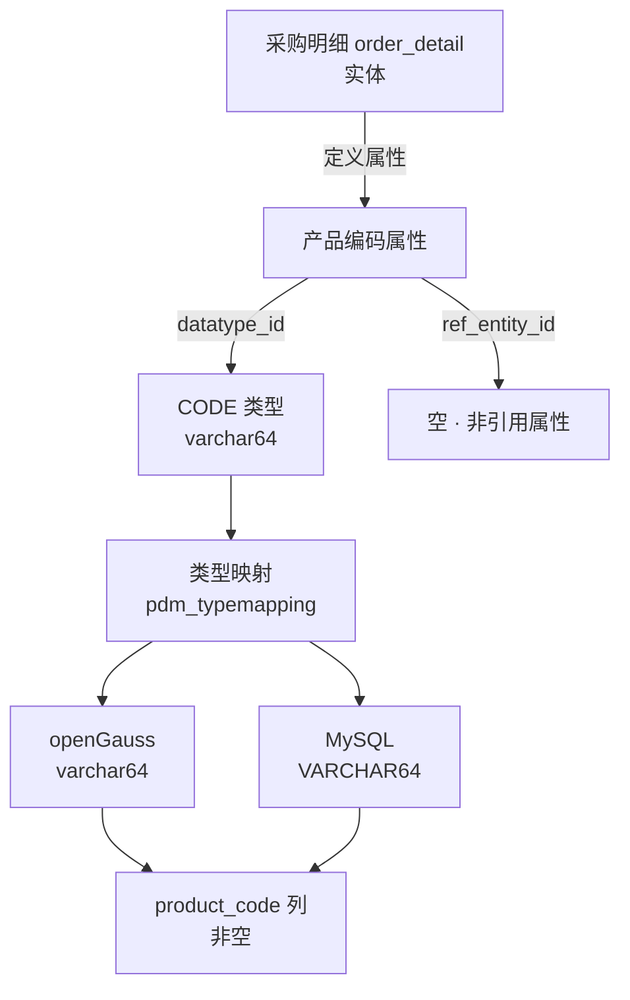
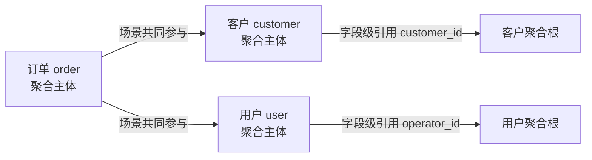
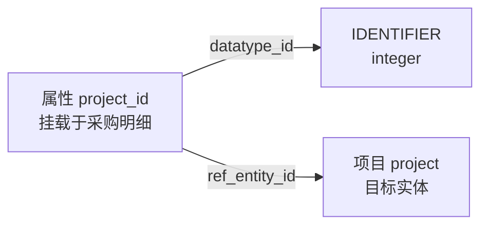
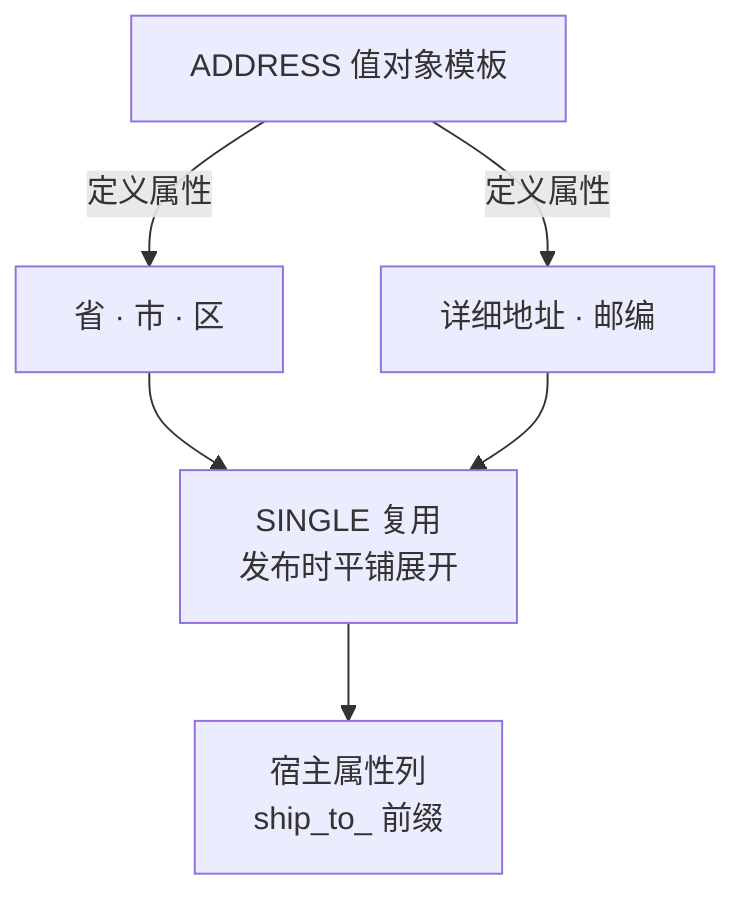

# 10. 业务示例

> 内容为原文**完整搬运、未作改写**；正文中的章节编号（如「见 6.11」「见 8.20」）沿用原文档全局编号，可对照下表定位到对应分章文件。

<b>分章索引（点击展开）</b>

| 文件 | 原文档章节 | 关键内容 |
|---|---|---|
| [01_设计概述.md](./01_设计概述.md) | §1 设计概述 | 两域划分、六层架构、核心数据流、发布同步、多层覆盖 |
| [02_第一层_业务场景模型.md](./02_第一层_业务场景模型.md) | §2 第一层：业务场景模型 | 产品/主题域、场景/子场景/活动、业务事件与业务服务 |
| [03_概念数据模型_cdm.md](./03_概念数据模型_cdm.md) | §3 第二层：概念数据模型（cdm_） | 聚合/实体/值对象/属性、字段纳入清单、字典、治理预留表 |
| [04_数据逻辑模型_ldm.md](./04_数据逻辑模型_ldm.md) | §4 第三层：数据逻辑模型（ldm_） | 逻辑数据类型 `ldm_datatype` |
| [05_物理存储模型_pdm.md](./05_物理存储模型_pdm.md) | §5 第四层：物理存储模型（pdm_） | 数据库/类型映射/表/列/索引/约束/分区 |
| [06_产品服务模型_prod.md](./06_产品服务模型_prod.md) | §6 第五层：产品服务模型（prod_） | 服务与 API、菜单与操作、标准角色、字段授权/策略、事件订阅 |
| [07_界面构造模型_ui.md](./07_界面构造模型_ui.md) | §7 第六层：界面构造模型（ui_） | 页面/组件/布局/数据源/数据绑定/动作/字段配置 |
| [08_应用系统层运行配置模型_app.md](./08_应用系统层运行配置模型_app.md) | §8 应用系统层：运行配置模型（app_） | 双轨模型、系统实例化、角色与授权、字段纳入与策略、组织、预计算 SQL |
| [09_属性配置模型.md](./09_属性配置模型.md) | §9 属性配置模型（业务配置） | 业务配置 JSON 结构与校验规则 |
| [10_业务示例.md](./10_业务示例.md) | §10 业务示例 | 采购/订单端到端建模示例 |
| [11_表清单汇总.md](./11_表清单汇总.md) | §11 表清单汇总（69 张） | 69 张表总清单与口径说明 |
| [12_发布版本配套表.md](./12_发布版本配套表.md) | §12 发布版本配套表（prod_） | 发布版本、发布明细、配置覆盖登记 |

**本文件包含的子节**：`10.1 采购明细中"产品编码"属性的映射链路`、`10.2 订购流程中"客户"与"操作人"的引用关系`、`10.3 采购明细属性引用项目对象`、`10.4 订单包含收货地址（值对象）`

---

## 10. 业务示例

### 10.1 采购明细中"产品编码"属性的映射链路

### 10.2 订购流程中"客户"与"操作人"的引用关系

> 订单聚合与客户、用户聚合共同参与下单场景（经 `cdm_aggregate_scenario` 关联，**聚合体之间不设专门关联表**）；
> 具体字段级引用（如订单表.customer_id → 客户聚合根）由 `cdm_entity_attribute.ref_entity_id` 承担。
> 客户是业务参与者，操作人是流程执行者——语义不同但模型层统一。

### 10.3 采购明细属性引用项目对象

> `cdm_entity_attribute` 通过 `ref_entity_id` 指向目标实体（project），
> 同时通过 `datatype_id` 定义数据类型（IDENTIFIER → integer），
> 属性自身即可描述"是什么类型 + 指向什么对象"。

### 10.4 订单包含收货地址（值对象）

> 采购明细实体经 `cdm_entity_valueobject`（见 3.6）登记一行 `PO_ITEM ← ADDRESS`，全量继承模板的全部属性。
> 值对象依附于实体，无独立标识，与实体同生命周期。
>
> 落库（v3.0 策略）：SINGLE 复用 → 发布时平铺展开为宿主实体属性列
> （如采购单收货地址 role=ship_to → ship_to_province_name/ship_to_city_name/...）；
> MULTIPLE 复用 → 内嵌为宿主表 *_json 列（数组）。详见 3.3 节落库策略。
>
> **两条硬约束（见 3.6 / 3.3）**：
> - **全量展开**——ADDRESS 模板定义的 5 个属性必须**全部**展开为 `cdm_entity_attribute`（`VO_EXPAND`），本例得到完整 5 列；不允许"只用省市、不要邮编"式的选择性展开。若确实只用省市，则不应复用 ADDRESS，改为直接定义 `ship_to_province_name`/`ship_to_city_name` 两个普通属性；
> - **不可重复挂载**——同一实体对 ADDRESS 只能有一行。若采购单还要记"发票地址"，不能在同一实体上再挂一份 ADDRESS，应新建从属实体（如"采购单地址台账"）各挂一份，并在该从属实体上加**用途字典列** `address_mode_dict`，取值为业务自建字典 `ADDRESS_MODE`（`SHIP_TO`/`BILL_TO`/`RETURN_TO`/`REGISTERED`）区分语义；注意这与 `cdm_usage_dict`（`SINGLE`/`MULTIPLE`，平台预置 `VO_USAGE`，驱动落库展开）**不是一回事**（见 3.6）。

---
